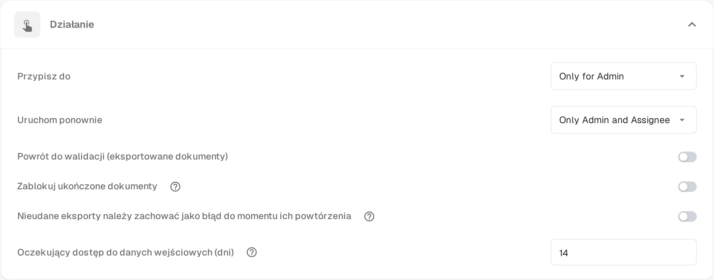

# Pending Input

**Pending Input** wstrzymuje dokument, gdy czekasz na odpowiedź współpracownika. Pytanie zadajesz w strumieniu aktywności dokumentu i oznaczasz osoby, które mają odpowiedzieć. Dokument opuszcza aktywną kolejkę do czasu odpowiedzi, a oznaczone osoby mogą otworzyć go w trybie tylko do odczytu przez link z wiadomości e-mail.

Status pojawia się w [panelu](dashboard/README.md) jako **Pending Input**, a listę roboczą można filtrować według tego statusu.

## Proszenie o informację

1. Otwórz dokument na ekranie, który udostępnia strumień aktywności — robią to ekrany zatwierdzania i przeglądu — i wybierz ikonę dymku w pasku narzędzi.
2. Napisz pytanie i wpisz **@**, a następnie imię i nazwisko osoby, którą chcesz zapytać. Wybierz ją z wyświetlanej listy. Oznaczenie przyznaje dostęp: tylko oznaczone osoby otrzymują link do dokumentu.
3. Gdy osoba jest oznaczona, pod polem wpisywania pojawia się pole z dwiema możliwościami:

* **Comment only** (tylko komentarz) – pytanie zostaje opublikowane w strumieniu aktywności, a status się nie zmienia. Użyj tej możliwości, gdy potrzebujesz tylko odpowiedzi i nie chcesz wstrzymywać dokumentu.
* **Send & set to Pending Input** (wyślij i ustaw Pending Input) – pytanie zostaje opublikowane, a dokument przechodzi w stan oczekiwania. Opuszcza aktywną kolejkę i pozostaje wstrzymany, dopóki oznaczona osoba nie odpowie.

Oznaczone osoby otrzymują wiadomość e-mail z linkiem do dokumentu. **Enter** lub ikona wysyłania nadal publikują zwykły komentarz bez przyznawania dostępu; **Shift+Enter** rozpoczyna nowy wiersz. W dokumencie już wstrzymanym lub w takim, którego nie można jeszcze wstrzymać, pole oferuje pytanie bez opcji wstrzymania.

## Odpowiadanie na prośbę

O informację prosi się Ciebie, gdy współpracownik oznaczy Cię w strumieniu aktywności.

* Otwórz link z wiadomości e-mail. Strona **Pending Input** pokazuje po lewej strony dokumentu, a po prawej strumień aktywności, ze znacznikiem **Pending Input**.
* Twój dostęp jest tylko do odczytu: możesz czytać dokument i odpowiadać w strumieniu aktywności, ale nie możesz zmieniać pól ani eksportować.
* Napisz odpowiedź w strumieniu aktywności i wyślij ją. Osoba pytająca otrzymuje powiadomienie, a rozmowa pozostaje w historii dokumentu.
* Nagłówek strony pokazuje, jak długo trwa Twój dostęp, na przykład **Read-only access until 09.11.2026**. Dostęp kończy się również wtedy, gdy dokument przejdzie dalej.

Jeśli otworzysz link po udzieleniu odpowiedzi lub po zakończeniu dostępu, strona poinformuje, że prośba została obsłużona lub wygasła i że nie trzeba nic robić.

## Zamykanie prośby

Dokument pozostaje wstrzymany, dopóki osoba przypisana nie podejmie odpowiedzi.

1. Otwórz dokument z panelu. Wstrzymany dokument otwiera się od razu na swojej stronie **Pending Input**.
2. Przeczytaj odpowiedź w strumieniu aktywności.
3. Wybierz **Resolve & Proceed** (zamknij i kontynuuj). Dokument wznawia pracę w kolejnym statusie swojego przepływu, więc trafiasz od razu na ekran, na którym kontynuujesz pracę.

Tylko osoba przypisana do dokumentu lub członek grupy, do której dokument jest przypisany, może zamknąć prośbę. Administratorzy i zatwierdzający mogą otworzyć wstrzymany dokument w trybie tylko do odczytu, aby zobaczyć, na co czeka.

## Ustawianie okresu dostępu

Funkcja jest dostępna w każdej organizacji. Skonfigurować można czas, przez jaki osoba poproszona o informację zachowuje dostęp do dokumentu:

1. Otwórz **Ustawienia → Pulpit**.
2. Rozwiń **Akcja**.
3. W polu **Oczekujący dostęp do danych wejściowych (dni)** wpisz całkowitą liczbę dni. Wartość domyślna to **14**, wymagany jest co najmniej jeden dzień.
4. Zapisz zmiany.

Okres zaczyna się w momencie wysłania prośby. Kończy się wcześniej, gdy dokument zostanie zamknięty lub przejdzie w inny status.

<figure><figcaption>
Oczekujący dostęp do danych wejściowych (dni) w sekcji Akcja ustawień panelu. Wartości uprawnień powyżej są nadal wyświetlane przez produkt po angielsku.
</figcaption></figure>
