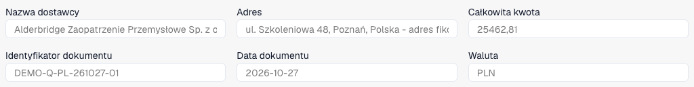
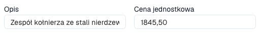

# Sprawdzanie pozycji i cen oferty

Widok ofert dotyczy odpowiednio skonfigurowanych dokumentów. Typ, układ, uprawnienia i przepływ określają pola i działania. Jest odrębny od dopasowywania zamówień.

<figure><figcaption>
Nagłówek fikcyjnej polskiej oferty na trzech stronach w DocBits: dostawca, numer, data, waluta i suma. Zrzut pokazuje pierwszych sześć pól.
</figcaption></figure>

Pobierz fikcyjną ofertę na trzech stronach (PDF)



## Kontrola i korekta

<figure><figcaption>
Opis i cena jednostkowa wybranej pierwszej pozycji. Nie zmieniono ani nie zapisano żadnych wartości.
</figcaption></figure>

1. Otwórz właściwą ofertę. Porównaj dostawcę, referencję, datę i walutę z oryginałem.
2. Sprawdź artykuły, opisy, ilości, jednostki, ceny i kwoty. Zgodny artykuł nie potwierdza zgodnej ceny lub jednostki.
3. Wybierz pozycję, aby wyświetlić szczegóły pod tabelą.
4. Użyj skonfigurowanego wyszukiwania danych podstawowych, jeśli jest dostępne. Sprawdź wybór i przeniesione wartości; wyjaśnij ostrzeżenia.
5. Popraw pozycję i wybierz **Zapisz** lub **Zapisz i dalej**. **Anuluj** zamyka edytor bez przesłania tych zmian pozycji.
6. Kopiuj wartości domyślne do następnej pozycji tylko wtedy, gdy pasują. Sprawdź skopiowane wartości.
7. Ponownie otwórz dokument i pozycję, aby sprawdzić zapis. Przy odrzuconej pozycji przeczytaj dostępną notatkę i wyjaśnij przyczynę biznesową.

## Szczególne przypadki

Dodanie wiersza tworzy ręczną pozycję, gdy edycja jest dozwolona. Porównaj ją z oryginałem i uzupełnij pola wymagane. Usunięcie jest odrębną czynnością; nie usuwaj prawdziwej pozycji, aby uzgodnić sumy.

Przy dokumencie tylko do odczytu sprawdź uprawnienia, blokadę i etap. Przy brakujących pozycjach sprawdź oryginał, ekstrakcję i układ.

Automatyczne kontrole względem cen zarządzanych, ostatnich lub umownych wykorzystują [Karty porównania ofert](../../administration-and-setup/workflow/cards-overview/quote-comparison-guide.md). Zapis nie potwierdza ich wykonania, akceptacji oferty ani zakończenia eksportu ERP.
