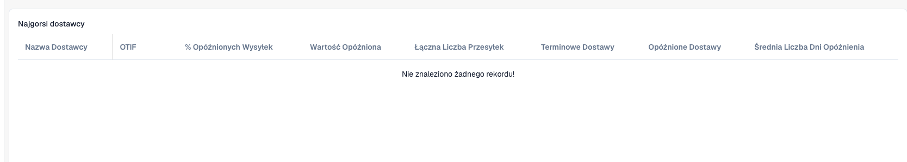

# Interpretacja statystyk dostawców

Statystyki pomagają wskazać dostawy wymagające analizy. Administrator musi włączyć moduł, a odpowiednie dane wysyłek muszą być dostępne. Wskaźniki zależą od rekordów organizacji.

<figure><figcaption>
Kolumny statystyk dostawców w organizacji bez danych o wysyłkach. Pusta tabela nie potwierdza dobrej terminowości dostaw.
</figcaption></figure>

## Ocena dostawcy

1. Otwórz **Statystyki dostawców**. Jeśli brak tej opcji, poproś o kontrolę modułu i dostępu.
2. Znajdź dostawcę w tabeli najsłabszych wyników.
3. Porównaj wszystkie, terminowe i opóźnione wysyłki przed oceną procentów. Dwie i dwa tysiące wysyłek to różne próby.
4. Analizuj razem **OTIF**, odsetek opóźnień, opóźnioną wartość i średnie dni opóźnienia. OTIF oznacza *On Time In Full*: terminowość sama nie dowodzi kompletnej dostawy.
5. Porównaj wykresy OTIF i opóźnionych wysyłek. Użyj liczby dostawców na stronę i nawigacji stron.
6. Prześledź konkretne wysyłki: daty obiecane/rzeczywiste, ilości, identyfikatory i walutę przed kontaktem z dostawcą.

## Interpretacja i wyjaśnianie

Liczby określają wielkość próby, średnie dni czas opóźnienia, a wartość skalę finansową. Nie wyliczaj OTIF wyłącznie z terminowych dostaw ani nie sumuj różnych walut bez uzgodnionego przeliczenia.

Pusta tabela lub zerowy wykres nie dowodzą idealnych wyników. Sprawdź dostępność danych i synchronizację. Podsumowanie nie wyjaśnia pojedynczej wysyłki.

Przy rozbieżnościach zachowaj identyfikator dostawcy, wysyłki, daty i oczekiwane obliczenie. Poproś o kontrolę źródła i danych wskaźnika.

Zobacz [Moduły](../../administration-and-setup/settings/document-processing/module/README.md) oraz [Synchronizacja](../../administration-and-setup/settings/log-settings/data-synchronization.md).
