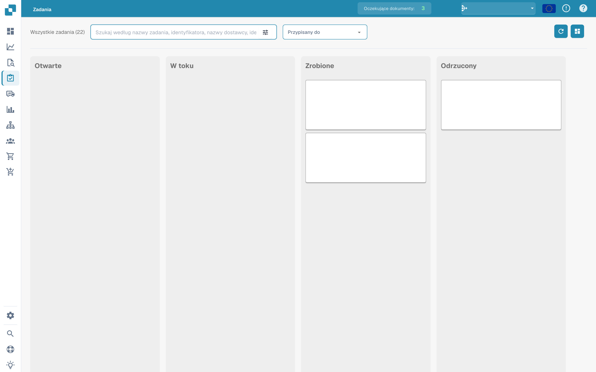
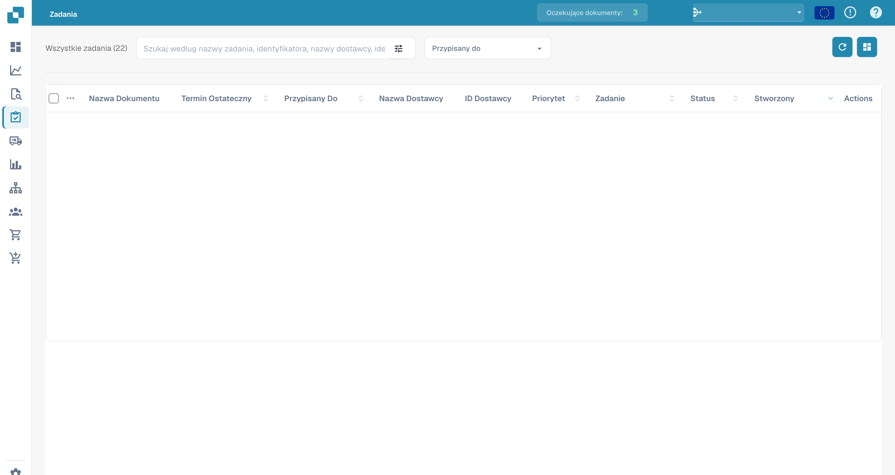

# Zadania


DocBits Samouczek dotyczący zadań i powiadomień: przydzielaj pracę, śledź status i obsługuj zadania przepływu pracy


To jest miejsce, w którym możesz śledzić swoje zadania. Możesz wybierać między dwoma różnymi układami – jeden jest nieco bardziej szczegółowy od drugiego. Możesz także filtrować zadania według różnych kryteriów, takich jak to, czy są przypisane do Ciebie, lub status zadania.

<figure><figcaption>
Tablica zadań według statusów; treść zadań jest ukryta.
</figcaption></figure>

<figure><figcaption>
Lista zadań z ukrytymi danymi dokumentów.
</figcaption></figure>
