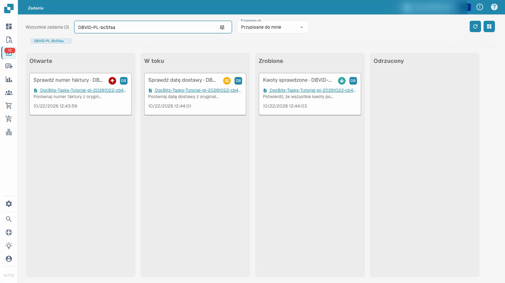
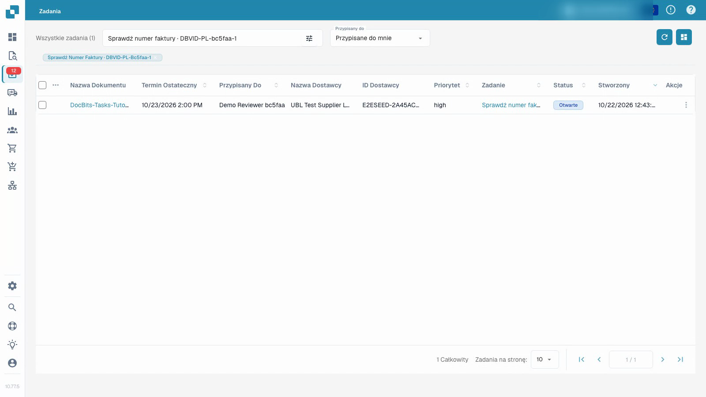

# Zadania

Film przedstawia zwykłego użytkownika testowego pracującego nad zadaniem z syntetycznymi dokumentami.


Zadania


[Oglądaj z napisami](https://docbits-videos.fra1.cdn.digitaloceanspaces.com/settings-assistant/document-tasks-customer/v1/pl.html)

Uwaga: Niektóre natywne etykiety produktów mogą pozostać nieprzetłumaczone. Nagranie zachowuje rzeczywisty interfejs użytkownika.

Użyj przeglądu zadań, aby znaleźć przypisaną pracę i śledzić jej postępy. Tablica grupuje zadania według statusu; lista zawiera więcej szczegółów. Filtruj według przypisania i użyj wyszukiwania, aby zlokalizować konkretne zadanie. Priorytet i termin pomagają zaplanować kolejność pracy.

## Praca nad przypisanym zadaniem dokumentu

1. Otwórz zadanie i przeczytaj jego opis oraz przypisanie.
2. Sprawdź powiązany oryginalny dokument. Sam tytuł zadania nie dowodzi, że dokument jest poprawny.
3. Ustaw zadanie jako w toku i zapisz podczas wykonywania pracy.
4. Zapisz wynik w opisie zadania.
5. Zakończ zadanie, zapisz je i przeładuj, aby potwierdzić zapisany status i zapisany wynik. Sprawdź jego pozycję w przeglądzie zadań.

Film przedstawia zwykłego użytkownika testowego i syntetyczne dokumenty. Zakończenie zadania jest niezależne od zatwierdzenia lub eksportu jego faktury. Dostępne akcje zależą od uprawnień konta.

<figure><figcaption>
Przegląd zadań przy użyciu danych syntetycznych.
</figcaption></figure>

<figure><figcaption>
Lista zadań z syntetycznymi danymi demonstracyjnymi.
</figcaption></figure>

## Dodatkowe nagranie


Zadania

