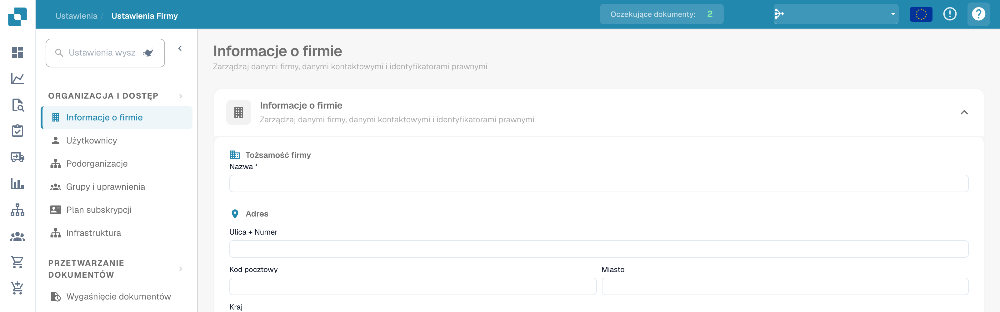

# Ikony Pomocy

Ikony pomocy zostały umieszczone w całym DocBits, aby pomóc Ci w nauce i zrozumieniu, co naprawdę robi dana funkcja i jak może Ci pomóc w przetwarzaniu dokumentów.

Te ikony pomocy wyglądają następująco

<figure><figcaption>
Ikona pomocy w prawym górnym rogu ustawień.
</figcaption></figure>
