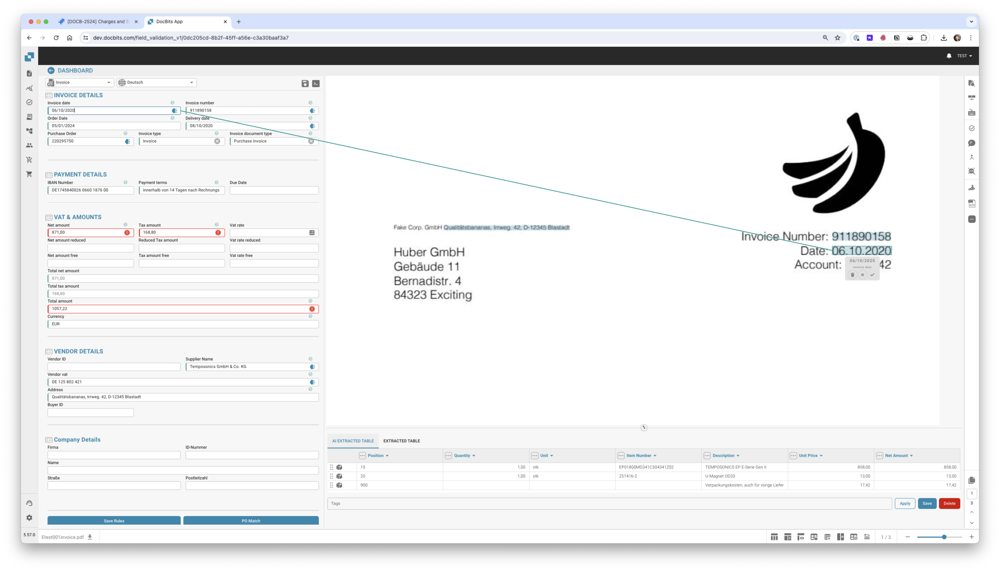
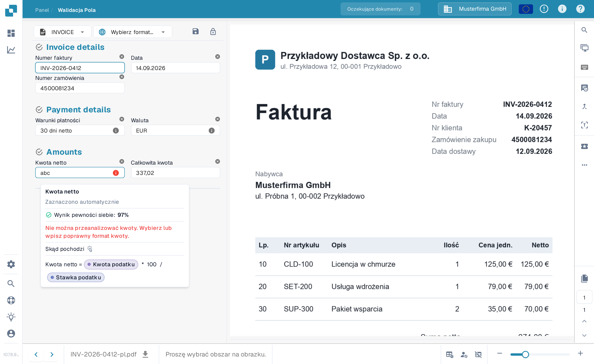
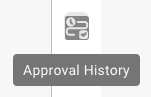
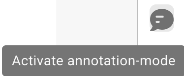
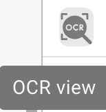
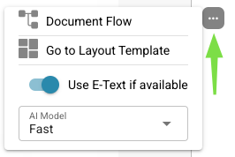

# Ekran walidacji

## Sprawdź fakturę i zakończ weryfikację

Przejdź od panelu do przekazania faktury dalej: porównaj dostawcę, daty, numer, kwoty i walutę z oryginałem oraz odczytaj komunikat o wymaganym polu. Wybierz numer bezpośrednio na dokumencie, potwierdź powiązanie i zachowaj regułę odczytu przyciskiem Zapisz reguły. W tym przykładzie sprawdzona faktura zostaje następnie przekazana do zatwierdzenia. Dostępne działania zależą od uprawnień i procesu w Twojej firmie.



## Przegląd

<figure><figcaption></figcaption></figure>

### Pochodzenie dokumentu

Pochodzenie dokumentu określa, jak DocBits interpretuje daty i formaty liczb. Wybierz kraj odpowiadający dokumentowi i porównaj odczytane wartości z oryginałem.

## **Przycisk Save:**

<figure><figcaption></figcaption></figure>

* **Przycisk Save:**
  * **Cel:** Zapisuje bieżący stan dokumentu lub skryptu, nad którym pracujesz.
  * **Przypadek użycia:** Po wprowadzeniu zmian lub adnotacji w dokumencie użyj tego przycisku, aby upewnić się, że wszystkie modyfikacje zostały zapisane.

### **Dodaj specjalne reguły:**

<figure><figcaption></figcaption></figure>

<figure><figcaption></figcaption></figure>

* **Add Special Rules / Add Script w DocBits:**
  * **Cel:** Umożliwia użytkownikom wdrażanie określonych reguł lub skryptów, które dostosowują sposób przetwarzania dokumentów.
  * **Przypadek użycia:** Użyj tej funkcji do automatyzacji zadań, takich jak ekstrakcja danych lub walidacja formatu, zwiększając efektywność przepływu pracy.


Zobacz tutaj dodawanie[ skryptu w DocBits](../../../administration-and-setup/settings/global-settings/document-types/script/scripting-in-docbits/)


### **Fuzzy Fields:**

<figure><figcaption></figcaption></figure>

* **Fuzzy Fields:**
  * **Cel:** Pomaga w identyfikowaniu i poprawianiu pól, w których dane mogą nie być idealnie dopasowane, ale są wystarczająco bliskie.
  * **Przypadek użycia:** Przydatne w procesach walidacji danych, gdzie dokładne dopasowanie nie zawsze jest możliwe, na przykład przy lekko błędnie zapisanych nazwach lub adresach.

### **Pola wymagane:**

<figure><figcaption></figcaption></figure>

Pola wymagające uwagi mają kolorową obwódkę lub ikonę informacji. W poniższym przykładzie pole **Numer faktury** ma czerwoną obwódkę i ikonę ostrzeżenia. Wartość jest widoczna na fakturze po prawej stronie, ale DocBits nie wyodrębnił jej z dokumentu. Zaznacz numer na dokumencie albo popraw pole, a następnie zapisz dokument.

Najedź kursorem na ikonę informacji obok pola lub wybierz ją, aby przeczytać konkretny powód. W zależności od pola komunikat może wskazywać brakującą ekstrakcję, wymaganą wartość, niską pewność lub niezgodność walidacji. Jeśli ostrzeżenie dotyczy kwot, porównaj pola kwot z fakturą i użyj strony [Automatyczne kontrole na ekranie walidacji](automatic-checks-on-the-validation-screen.md), aby sprawdzić odpowiednią kontrolę.

<figure><figcaption>
Pole wymagające uwagi obok faktury używanej do sprawdzenia jego wartości.
</figcaption></figure>

## Wyodrębniona tabela (pozycje)

<figure><figcaption>
Wyodrębniona tabela pod polami nagłówka
</figcaption></figure>

Pod polami nagłówka DocBits wyświetla tabelę pozycji dokumentu: jeden wiersz na pozycję faktury, jedna kolumna na każdą [kolumnę tabeli](../../../administration-and-setup/settings/global-settings/document-types/table-columns/README.md) skonfigurowaną dla typu dokumentu. Jeśli typ dokumentu ma kilka tabel (na przykład pozycje i opłaty), każda tabela ma własną zakładkę nad siatką.

### Skąd pochodzi tabela

Nad siatką znajduje się jedna zakładka dla każdej ścieżki ekstrakcji włączonej w organizacji:

| Zakładka | Znaczenie |
|---|---|
| **Extracted table** | Ekstrakcja oparta na regułach (ustawienie *Table Extraction*). U dostawcy z wytrenowaną tabelą wiersze pochodzą z zapisanych reguł i są wyodrębniane w ten sam sposób na każdym dokumencie tego dostawcy; u dostawcy bez treningu zakładka może być pusta. |
| **AI Extracted table** | Ekstrakcja tabeli przez AI (ustawienie *AI Table Extraction*). Wypełniana, gdy dostawca nie ma zapisanych reguł, oraz dla kolumn oznaczonych *Use AI* nawet wtedy, gdy reguły istnieją. Podpowiedź *AI table not found* na zakładce oznacza, że AI nie zwróciło niczego dla tego dokumentu. |
| **PO Tables** | Tylko w kreatorze układu: pozycje zamówienia zakupu używane do dopasowania. |

Jeśli nie widać żadnej z zakładek, oba ustawienia tabeli są wyłączone dla organizacji (Settings → Document Processing → Classification and Extraction). Który poziom AI odczytuje tabelę, ustawia się dla organizacji i można to nadpisać dla poszczególnego dostawcy, zobacz [Model AI specyficzny dla dostawcy](supplier-specific-ai-model-for-field-and-table-extraction.md).

### Praca w tabeli

* **Edit a cell**: kliknij komórkę i wpisz wartość. Kolumny kwot, liczb i dat są sprawdzane w trakcie wpisywania.
* **Add new table row**: dodaje pusty wiersz na końcu. Użyj, gdy pozycja nie została rozpoznana.
* **Delete a row**: ikona kosza na końcu wiersza.
* **Add empty mapped columns**: pokazuje skonfigurowane kolumny, które AI pozostawiło puste, abyś mógł je wypełnić ręcznie.
* **Restore Table Column**: przywraca kolumnę usuniętą z widoku dla tego dokumentu.
* **Delete table**: czyści wszystkie wiersze tej tabeli w tym dokumencie. Konfiguracja pozostaje nietknięta.
* **Add new table column** (administratorzy): to samo okno dialogowe co w ustawieniach kolumn tabeli, bez opuszczania dokumentu.
* **Tags** (tylko tabela AI): krótkie wskazówki tekstowe dla AI, na przykład *„ostatnia kolumna to kwota netto"*. Zobacz [Tagi tabeli AI](../ai-table/ai-table-tags.md).
* **Apply** / **Save** / **Delete** obok tagów: *Apply* ponownie uruchamia tabelę AI dla tego dokumentu z wprowadzonymi tagami i zmianami kolumn, bez zapisywania czegokolwiek (jeśli dokument ma pozycje dopasowane do PO, DocBits ostrzega, że dopasowania zostaną usunięte); *Save Rules* zapisuje bieżące mapowanie kolumn i tagi dla tego dostawcy; *Delete Rules* usuwa je i ponownie uruchamia ekstrakcję AI dla tego dokumentu.
* **Export**: pobiera tabelę jako plik CSV.
* **Go to table extraction view**: otwiera trening tabeli dla tego dokumentu. Użyj, gdy ten sam dostawca wciąż wychodzi źle: zaznacz tabelę raz, zmapuj kolumny i kliknij *Save Rules*; od tej pory wiersze pojawiają się w zakładce *Extracted table*. Zobacz [Trening pól pozycji / Trening tabeli](../../../administration-and-setup/setup/document-training/training-line-fields-table-training/README.md).


Jeśli tabela została wyodrębniona przez AI i otworzysz trening tabeli, DocBits zapyta *Table is already extracted by AI. Do you want to train manually?* Po zapisaniu reguł tabela AI nie jest już używana dla tego dostawcy.


### Ponowna ekstrakcja tabeli

* **Ten sam dokument, tabela AI:** dodaj lub zmień tagi i kliknij **Apply**; tabela AI jest odbudowywana tylko dla tego dokumentu. Aby dodatkowo usunąć zapisane tagi i formatowanie dostawcy, kliknij **Delete** (*Delete Rules*): DocBits potwierdza komunikatem *Rules has been deleted successfully* i ponownie uruchamia ekstrakcję AI.
* **Ten sam dokument, wytrenowane reguły:** otwórz *Go to table extraction view*, popraw tabelę i kliknij *Save & re-extract*.
* **Cały dokument ponownie (nagłówek i tabela):** Dashboard → menu dokumentu → *Restart*. Potrzebne po tym, jak administrator zmienił kolumny tabeli lub ustawienia ekstrakcji.

### Co blokuje zatwierdzenie

Tabela jest sprawdzana przy zapisie lub zatwierdzeniu. Czerwona komórka lub komunikat pod tabelą oznacza jedną z poniższych sytuacji:

| Komunikat | Przyczyna | Co zrobić |
|---|---|---|
| Required column empty | Kolumna oznaczona *Is Required* nie ma wartości w tym wierszu. | Wypełnij komórkę lub zapytaj administratora, czy kolumna musi być wymagana. |
| *Line total does not match quantity x unit price (expected …, got …)* | `ilość × cena jednostkowa + opłaty − rabat` różni się od sumy pozycji o więcej niż 0,02. Często jedna z czterech wartości została odczytana do niewłaściwej kolumny. | Popraw wartość, która jest błędna w dokumencie; jeśli kolumna taka jak *Charges* jest konsekwentnie wypełniana niewłaściwą wartością, powiedz o tym administratorowi (zobacz [Rozwiązywanie problemów](../../../administration-and-setup/settings/global-settings/document-types/table-columns/troubleshooting-1.md)). |
| *Line items add up to … but the net total is …* | Suma wartości pozycji różni się od kwoty netto w nagłówku. | Sprawdź, czy nie brakuje wiersza, czy wiersz nie jest zdublowany lub czy kwota w nagłówku nie została źle odczytana. |
| *Line Item Table is missing Mandatory column for PO* | Dopasowanie PO wymaga numeru pozycji, ceny jednostkowej, ilości i kwoty całkowitej; jedna z nich jest ukryta. | Administrator: odkryj kolumnę w Table Columns. |

Administrator może wyłączyć wszystkie kontrole tabeli dla typu dokumentu opcją *Skip table validation* (Document Types → More Settings); niezgodności pozycji i puste kolumny wymagane nie są wtedy zgłaszane.

Więcej o kontrolach: [Automatyczne kontrole na ekranie walidacji](automatic-checks-on-the-validation-screen.md) oraz [Rozwiązywanie problemów z ekstrakcją tabel](../../../overview-and-basics/faq/document-processing/table-extraction-troubleshoot.md).

### **Lupa:**

<figure><figcaption></figcaption></figure>

* **Lupa:**
  * **Cel:** Zapewnia powiększony widok wybranego obszaru dokumentu.
  * **Przypadek użycia:** Pomaga przyjrzeć się drobnym szczegółom lub małemu tekstowi w dokumentach, zapewniając dokładność wprowadzania danych lub przeglądu.

<figure><figcaption></figcaption></figure>

### **Otwórz w nowym oknie:**

<figure><figcaption></figcaption></figure>

* **Otwórz w nowym oknie:**
  * **Cel:** Otwiera nowe okno do porównywania dokumentów obok siebie lub do pracy wielozadaniowej.
  * **Przypadek użycia:** Przydatne przy porównywaniu dwóch dokumentów lub gdy chcesz sięgnąć do dodatkowych informacji bez opuszczania bieżącego dokumentu.

### **Skróty klawiszowe:**

<figure><figcaption></figcaption></figure>

1. **Skróty klawiszowe:**
   * **Cel:** Umożliwia użytkownikom szybkie wykonywanie działań za pomocą kombinacji klawiszy.
   * **Przypadek użycia:** Zwiększa szybkość i efektywność nawigacji oraz przetwarzania dokumentów, ograniczając zależność od myszy.

### **Zadania:**

<figure><figcaption></figcaption></figure>

Aby udostępnić informacje wewnętrzne, możesz tworzyć zadania i przypisywać je konkretnemu pracownikowi lub grupie w firmie.

* **Zadania:**
  * **Cel:** Umożliwia użytkownikom tworzenie zadań powiązanych z dokumentami i przypisywanie ich członkom zespołu.
  * **Przypadek użycia:** Ułatwia współpracę i zarządzanie zadaniami w zespołach, dzięki czemu każdy zna swoje obowiązki.

<figure><figcaption></figcaption></figure>

### Historia zatwierdzeń

<figure><figcaption></figcaption></figure>

**Uwaga:** Historia zatwierdzeń musi zostać aktywowana, zanim będzie mogła być tu wyświetlana.

**Historia zatwierdzeń:**

* **Cel**: Wyświetla historię zatwierdzeń dokumentu w walidacji pól; kolor czerwony oznacza odrzucenie, a kolor aplikacji — zatwierdzenie.
* **Przypadek użycia**: Przydatne dla organizacji, które wymagają przejrzystego zapisu działań zatwierdzających podczas walidacji pól.

<figure><figcaption></figcaption></figure>

### **Tryb adnotacji:**

<figure><figcaption></figcaption></figure>

<figure><figcaption></figcaption></figure>

Możesz zostawiać adnotacje w dokumencie. Może to być pomocne, aby przekazać informacje innym użytkownikom, którzy będą dalej edytować ten dokument.

* **Tryb adnotacji:**
  * **Cel:** Pozwala użytkownikom zostawiać notatki lub adnotacje bezpośrednio w dokumencie.
  * **Przypadek użycia:** Przydatne do przekazywania uwag, instrukcji lub ważnych notatek innym członkom zespołu, którzy będą później pracować nad dokumentem.

### **Scal:**

<figure><figcaption></figcaption></figure>

Dokumenty można tutaj scalać, na przykład jeśli brakowało strony faktury — takie strony można później scalić w ten sposób, bez konieczności usuwania lub ponownego przesyłania całego dokumentu.

* **Scal dokumenty:**
  * **Cel:** Łączy wiele dokumentów w jeden plik.
  * **Przypadek użycia:** Przydatne, gdy części dokumentu są skanowane osobno i trzeba je połączyć.

### **Widok OCR:**

<figure><figcaption></figcaption></figure>

W widoku OCR tekst jest automatycznie odfiltrowywany z dokumentu. Służy to do rozpoznawania istotnych cech, takich jak kod pocztowy, numer umowy, numer faktury oraz sortowanie dokumentu.

* **Widok OCR:**
  * **Cel:** Automatycznie rozpoznaje tekst w dokumentach za pomocą technologii optycznego rozpoznawania znaków (OCR).
  * **Przypadek użycia:** Usprawnia digitalizację tekstów drukowanych lub pisanych odręcznie, czyniąc je przeszukiwalnymi i edytowalnymi.

<figure><figcaption>
OCR
</figcaption></figure>

### **Utwórz zgłoszenie:**

<figure><figcaption></figcaption></figure>

W odróżnieniu od zadań przekazywanych wewnętrznie w firmie, to zgłoszenie do wsparcia służy do powiadomienia nas i natychmiastowego utworzenia zgłoszenia w razie błędów i/lub rozbieżności. To znacznie ułatwia proces, ponieważ możesz od razu wysłać błąd wraz z odpowiednim dokumentem. Możesz także ustawić priorytet, zrobić zrzut ekranu dokumentu lub przesłać własny.

* **Utwórz zgłoszenie:**
  * **Cel:** Umożliwia użytkownikom zgłaszanie problemów lub rozbieżności przez utworzenie zgłoszenia do wsparcia.
  * **Przypadek użycia:** Niezbędne do szybkiego rozwiązywania problemów i błędów, pomagając utrzymać integralność i sprawne działanie systemu.

<figure><figcaption></figcaption></figure>

### **Logi skryptów dokumentu:**

<figure><figcaption></figcaption></figure>

Skrypty można tworzyć w ustawieniach w sekcji Document Types; informacje te są następnie wyświetlane tutaj.

* **Logi skryptów dokumentu:**
  * **Cel:** Wyświetla logi związane ze skryptami wdrożonymi dla różnych typów dokumentów.
  * **Przypadek użycia:** Przydatne do śledzenia i debugowania działań skryptów na dokumentach, pomagając użytkownikom zrozumieć zautomatyzowane procesy i poprawić ewentualne problemy.

<figure><figcaption></figcaption></figure>

### **Więcej ustawień:**

<figure><figcaption></figcaption></figure>

### **Przepływ dokumentu:**

Tam znajdziesz przepływ dokumentu

* **Cel:** Pokazuje sekwencję i postęp przetwarzania dokumentu w systemie.
* **Przypadek użycia:** Pomaga śledzić status dokumentu na kolejnych etapach, dbając o to, by wszystkie niezbędne kroki przetwarzania zostały zachowane.

### **Przejdź do szablonu układu:**

* Ta opcja przekieruje Cię do edytora, w którym możesz edytować swój układ lub użyć szablonu domyślnego
* **Przejdź do szablonu układu:**
  * **Cel:** Przekierowuje użytkowników do edytora układu, w którym mogą modyfikować istniejące szablony lub zastosować domyślny.
  * **Przypadek użycia:** Umożliwia dostosowanie układów dokumentów do konkretnych potrzeb lub preferencji biznesowych, poprawiając wizualne i funkcjonalne dopasowanie dokumentu do standardów firmy.

### Użyj E-Text, jeśli dostępny

* **Cel:** Umożliwia DocBits korzystanie z e-text dla wszystkich dokumentów od konkretnego dostawcy, jeśli jest dostępny, co poprawia dokładność ekstrakcji.
* **Przypadek użycia:** Usprawnia ekstrakcję tekstu dzięki wykorzystaniu tekstu osadzonego zamiast OCR, co może dawać dokładniejsze wyniki dla tego dostawcy.

### [Model AI oparty na dostawcy](supplier-specific-ai-model-for-field-and-table-extraction.md)

* **Cel:** Umożliwia wybór spośród trzech różnych modeli AI w celu optymalizacji wyników ekstrakcji dla konkretnego dostawcy.
* **Przypadek użycia:** Zapewnia lepszą dokładność ekstrakcji dzięki wyborowi modelu AI najlepiej dopasowanego do struktury i treści dokumentów danego dostawcy.
