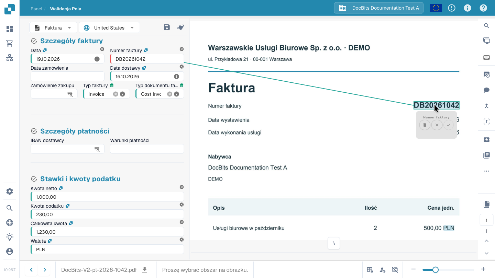

# Ekran walidacji

## Sprawdź fakturę i zakończ weryfikację

Przejdź od panelu do przekazania faktury dalej: porównaj dostawcę, daty, numer, kwoty i walutę z oryginałem oraz odczytaj komunikat o wymaganym polu. Wybierz numer bezpośrednio na dokumencie, potwierdź powiązanie i zachowaj regułę odczytu przyciskiem Zapisz reguły. W tym przykładzie sprawdzona faktura zostaje następnie przekazana do zatwierdzenia. Dostępne działania zależą od uprawnień i procesu w Twojej firmie.



## Otwieranie i obsługa ekranu walidacji

Otwórz dokument z panelu. W **walidacji pól** porównaj edytowalne pola z oryginałem widocznym obok. Typ dokumentu i skonfigurowany układ określają dostępne pola, tabele i przyciski. Przesuń separator, aby powiększyć obszar pól lub dokumentu.

W dokumentach wielostronicowych używaj nawigacji po stronach, a do małego tekstu — powiększenia. Strzałki na dole przełączają dokumenty i są odrębne od nawigacji po stronach.

### Pochodzenie dokumentu

Przed sprawdzaniem dat i kwot skontroluj **pochodzenie dokumentu**. Określa ono interpretację formatów dat i liczb; nie tłumaczy dokumentu ani nie zmienia języka interfejsu. Wybierz pochodzenie zgodne z dokumentem i porównaj wartości z oryginałem.

## Poprawianie pola i uczenie DocBits miejsca odczytu

Jeśli numer faktury został odczytany nieprawidłowo:

1. Wybierz pole **Numer faktury**.
2. Kliknij dwukrotnie pełny numer na oryginale lub zaznacz obszar, który go zawiera.
3. Sprawdź proponowane przypisanie pola i zatwierdź je znacznikiem wyboru, gdy pojawi się monit.
4. Sprawdź wartość i podświetlony obszar źródłowy. Powtórz zaznaczenie, jeśli numer jest niepełny lub przypisany do niewłaściwego pola.
5. Zapisz dokument. Aby zachować uczenie ekstrakcji, użyj także **Zapisz reguły / Save Rules** i potwierdź okno dialogowe.

<figure><figcaption>
Numer zaznaczony na oryginale i jego przypisanie do pola. Potwierdź przypisanie przed zapisaniem reguły.
</figcaption></figure>


Wpisanie nowej wartości poprawia ten dokument, ale nie tworzy powiązania z obszarem źródłowym wymaganego do tego uczenia. Zaznacz wartość na oryginale, potwierdź przypisanie i zapisz regułę, aby móc wykorzystać ją w pasujących dokumentach tego dostawcy. Uczenie na podstawie obrazu nie jest dostępne dla dokumentów odczytanych bezpośrednio jako dane e-faktury.


## Zapis dokumentu, reguł i przekazanie dalej

| Działanie | Skutek |
| --- | --- |
| **Zapisz** — dyskietka nad polami | Zapisuje zmiany w bieżącym dokumencie. Samo zapisanie nie zatwierdza go ani nie eksportuje. |
| **Zapisz reguły / Save Rules** | Zachowuje reguły ekstrakcji na podstawie dokumentu i przypisań do obszarów źródłowych. Jest to odrębne od zapisu wartości. |
| **Export**, zatwierdzenie lub inne skonfigurowane działanie | Po odpowiednich kontrolach przekazuje dokument do następnego skonfigurowanego etapu. Działanie i nowy status zależą od procesu oraz uprawnień. |

W filmie sprawdzona faktura jest przekazywana do zatwierdzenia. Przycisk **Export** nie gwarantuje, że faktura dotarła już do docelowego systemu ERP. Sprawdź nowy status w panelu i ewentualne błędy przetwarzania.

## Pola wymagane i komunikaty walidacji

Czerwona ramka lub ikona ostrzeżenia wskazuje pole wymagające uwagi. Odczytaj komunikat: może brakować wymaganej wartości, ekstrakcja może wymagać kontroli albo skonfigurowany test zakończył się błędem. Sama obecność wartości nie potwierdza poprawności pola.

Porównaj dostawcę, numer, daty, kwoty i walutę z oryginałem. Przy sumach sprawdź odpowiednie pola nagłówka i pozycje. Usuń przyczynę wskazaną w komunikacie przed przekazaniem dalej. Kontrole zależą od typu dokumentu i konfiguracji organizacji; zobacz [Kontrole automatyczne](automatic-checks-on-the-validation-screen.md).

## Korzystanie z asystenta

Przycisk **Asystent** nad polami pokazuje otwarte problemy walidacji. Otwórz go i wybierz **Przejdź do pola**, aby sprawdzić wskazane pole. Pytania i sugestie AI zależą od włączenia asystenta w organizacji oraz Twoich uprawnień. Jeśli są niedostępne, przeczytaj komunikat w panelu. Sugestie zmieniają formularz: sprawdź je i zapisz dokument, aby zachować zmiany.

## Wybór danych podstawowych

Pola ze skonfigurowanym wyszukiwaniem mogą korzystać z danych dostawców, zamówień lub innych danych podstawowych. Otwórz wyszukiwanie przy polu, zawęź wyniki i wybierz właściwy rekord. Wybór może uzupełnić kilka powiązanych pól: sprawdź je również. Wartości pochodzą z danych podstawowych i mogą różnić się od wydrukowanego tekstu. Zobacz [Dane fuzzy](fuzzy-data.md).

## Sprawdzanie pozycji faktury

Jeśli układ zawiera tabele, porównaj wiersze, opisy, ilości, ceny i kwoty z dokumentem. **Wyodrębniona tabela** i **Tabela wyodrębniona przez AI** to różne widoki ekstrakcji. Ich dostępność zależy od włączonych metod i układu. Pusta lub nieobecna karta sama w sobie nie wyjaśnia przyczyny problemu ekstrakcji.

Popraw komórki oraz brakujące lub powielone wiersze za pomocą dostępnych narzędzi. Zmiany dotyczą bieżącego dokumentu. Wielokrotne wykorzystanie treningu tabel, tagi AI i trening pól nagłówka to odrębne operacje. Zobacz [Tagi tabel AI](../ai-table/ai-table-tags.md) i [Trening tabel](../../../administration-and-setup/setup/document-training/training-line-fields-table-training/README.md).

Przeczytaj ostrzeżenia o wymaganych kolumnach, obliczeniach pozycji i sumach. Przed nową ekstrakcją AI lub ponownym wyodrębnieniem tabeli przeczytaj potwierdzenie: istniejące powiązania z zamówieniami mogą wymagać usunięcia i odtworzenia.

## Podgląd dokumentu i współpraca

Najedź na ikonę, aby odczytać jej nazwę. Niektóre narzędzia zależą od modułów, typu dokumentu lub uprawnień.

| Narzędzie | Zastosowanie |
| --- | --- |
| **Lupa** i powiększenie | Oglądanie drobnych szczegółów oryginału. |
| **Otwórz obraz w nowym oknie** | Wyświetlenie tego samego obrazu w osobnym oknie, np. na drugim monitorze. Interfejs oznacza tę funkcję jako przeznaczoną dla Chrome. |
| **Skróty klawiaturowe** | Otwarcie pomocy; zobacz [Skróty klawiaturowe](keyboard-shortcuts.md). |
| **Zadania** | Tworzenie i śledzenie pracy wewnętrznej przypisanej osobie lub grupie. |
| **Strumień aktywności** | Przegląd zarejestrowanych działań na dokumencie. |
| **Historia zatwierdzeń** | Przegląd zatwierdzeń i odrzuceń, gdy funkcja jest włączona. |
| **Tryb adnotacji** | Dodawanie notatek na dokumencie, jeśli adnotacje są włączone. |
| **Scal / dodaj strony** | Łączenie dokumentów lub dodawanie brakujących stron w dostępnym oknie. Przed potwierdzeniem sprawdź wybrane strony. |
| **Widok OCR** | Przegląd tekstu już rozpoznanego. Otwarcie widoku nie uruchamia nowej ekstrakcji OCR. Funkcja jest niedostępna dla niektórych dokumentów elektronicznych. |
| **Utwórz zgłoszenie** | Przygotowanie prośby o pomoc z kontekstem dokumentu i opisem problemu. Zadania wewnętrzne obsługiwane są osobno. |
| **Dzienniki skryptów** | Przegląd komunikatów skryptów dokumentu, gdy moduł jest aktywny. Jest to podgląd dzienników, a nie edytor skryptów. |

## Więcej opcji i ustawienia administratora

Dla faktur **Więcej opcji → Przepływ dokumentu** otwiera przebieg przetwarzania. Zależnie od dostępu i konfiguracji menu może zawierać także dzielenie dokumentów, skrót do szablonu układu oraz preferencje ekstrakcji dostawcy.

**Użyj E-Text, jeśli dostępny**, **Użyj ekstrakcji strukturalnej (AI)** i **Model AI** są ustawieniami ekstrakcji dostawcy, a nie zwykłymi poprawkami pól. Zmieniać je mogą tylko uprawnieni administratorzy. Jeśli zmiana wymaga ponownego przetworzenia, postępuj zgodnie z potwierdzeniem restartu. Szablon układu konfiguruje formularz walidacji; nie zmienia wyglądu wydrukowanej faktury. Zobacz [Model AI dla dostawcy](supplier-specific-ai-model-for-field-and-table-extraction.md).

## Gdy nie można edytować lub kontynuować

Przeczytaj wyświetloną przyczynę: dokument może być zablokowany, tylko do odczytu, w innym stanie lub ograniczony Twoją rolą. Usuń przyczyny komunikatów walidacji i skonsultuj dostęp lub konfigurację z odpowiednią osobą albo administratorem. Jeśli błąd pozostaje, skorzystaj z [Rozwiązywania problemów](troubleshooting/README.md) lub przygotuj zgłoszenie z dokumentem i dokładnym komunikatem.
