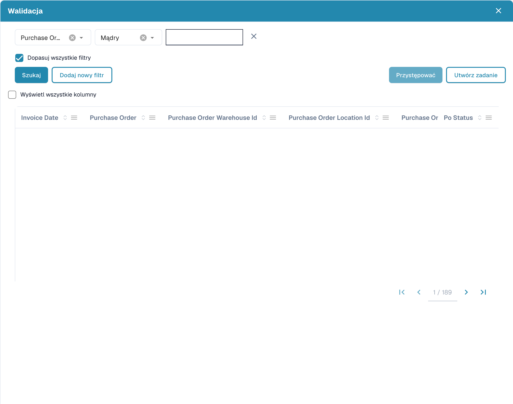

# Rozmyte Dane

### **Przegląd**

Pola Rozmytych Danych (Fuzzy Data) pozwalają użytkownikom uzupełniać powiązane pola na podstawie przybliżonych dopasowań z danych głównych. Pola te są oznaczone **niebieską ikoną** obok nich.

<figure><figcaption></figcaption></figure>

### **Funkcjonalność**

#### **Do czego służą pola Rozmytych Danych?**

* Uzupełniają powiązane pola na podstawie swojej wartości lub wprowadzonych danych.
* Trzy standardowe pola korzystające z Rozmytych Danych to:
  * **Zamówienie zakupu**
  * **Dostawca**
  * **Vendor ID**

#### **Korzystanie z pól Rozmytych Danych**

1. **Wybór zamówienia zakupu (Purchase Order)**
   *   Kliknięcie **niebieskiej ikony** obok pola Purchase Order otwiera **okno wyboru**.

       <figure><figcaption>
Okno wyszukiwania danych podstawowych; rekordy są ukryte.
</figcaption></figure>
   * To okno zawiera tabelę ze wszystkimi zamówieniami zakupu z **tabeli wyszukiwania danych głównych**.
   * Włączenie opcji **"Display all columns"** pokazuje dodatkowe szczegóły.
   * Wybierz **Zamówienie zakupu** i kliknij **Przystępować**:
     * Jeśli system znajdzie w dokumencie zamówienie zakupu, automatycznie je filtruje.
     * Jeśli nie znaleziono dopasowania, możesz **utworzyć własne filtry**, aby znaleźć właściwe zamówienie zakupu.
     * Można dodać wiele filtrów; włączenie opcji **"Match all filters"** zapewnia, że wszystkie warunki muszą być spełnione.
     * Dostępne opcje filtrów:
       * **Mądry**
       * **Zawiera**
       * **Dokładny**
       * **Zaczyna się od**
       * **Kończy się na**
   * Przycisk obok **Przystępować** pozwala użytkownikom **utworzyć nowe zadanie/powiadomienie**.
2. **Wybór dostawcy (Supplier) lub Vendor ID**
   * Proces jest taki sam jak w przypadku zamówień zakupu.
   * Różnica polega na tym, że pola **Supplier i Vendor ID korzystają z tabeli danych głównych dostawców (Supplier Master Data Table)** zamiast z tabeli danych głównych nagłówków zamówień zakupu (Purchase Order Header Master Data Table).

#### **Wskazówka o uzupełnieniu pola**

* Jeśli pole zostało uzupełnione za pomocą Rozmytych Danych, a nie wyodrębnione z dokumentu, pojawia się **mała wskazówka lub ikona informacji** wskazująca, że dane **nie zostały wyodrębnione z dokumentu**, lecz wypełnione na podstawie danych głównych.

### **Konfiguracja administratora**


[fuzzy-data-configuration-with-master-data.md](../../../administration-and-setup/setup/document-types/fuzzy-data-configuration-with-master-data.md)



[fuzzy-data-configuration-with-list-of-values.md](../../../administration-and-setup/setup/document-types/fuzzy-data-configuration-with-list-of-values.md)



