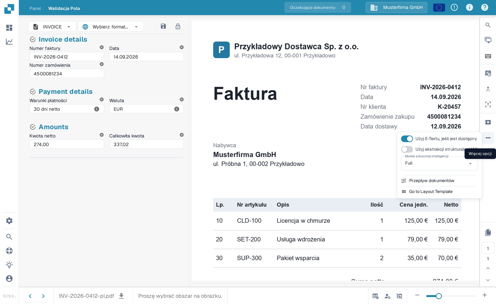
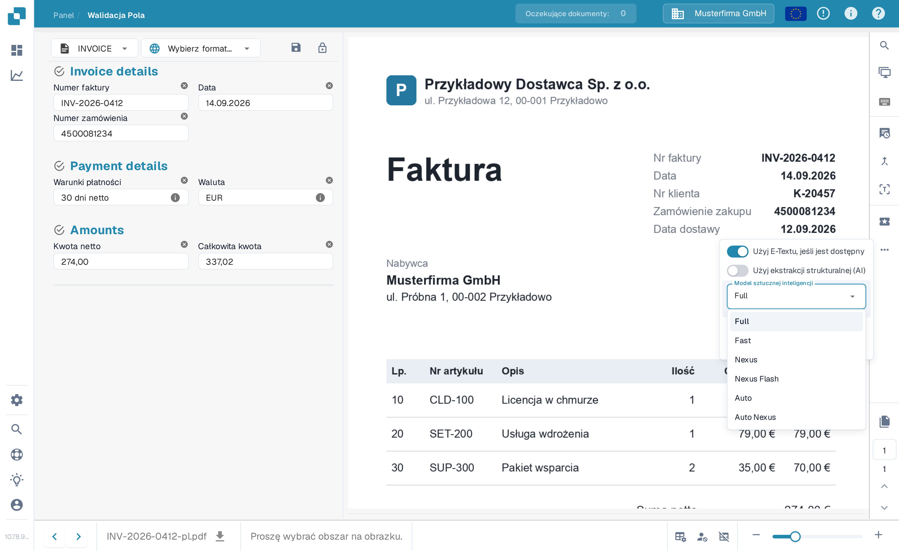

# Wybór modelu AI specyficznego dla dostawcy do ekstrakcji pól i tabel

W sekcji narzędzi **Ekranu Walidacji** możesz wybrać model AI używany do **Ekstrakcji Pól** i **Ekstrakcji Tabel**.\
Wybrany **model AI** jest stosowany wyłącznie do wszystkich dokumentów bieżącego dostawcy.

Aby zmienić model, otwórz menu opcji, klikając przycisk **Więcej opcji** (trzy kropki) po prawej stronie ekranu, a następnie wybierz jeden z dostępnych modeli: 

* **Full** – Najwyższa dokładność; koszt 2 tokeny za dokument
* **Fast** – Poziom domyślny; koszt 1 token za dokument
* **Nexus** – Koszt 1 token za dokument
* **Nexus Flash** – Szybszy poziom z rodziny Nexus; koszt 1 token za dokument
* **Auto** – DocBits decyduje dla każdego dokumentu, czy wystarczy Fast, czy potrzebny jest Full; koszt 1 token za dokument
* **Auto Nexus** – Jak Auto, ale ograniczone do rodziny modeli Nexus; koszt 1 token za dokument

<figure><figcaption>
Otwórz menu opcji i wybierz model AI dla tego dostawcy.
</figcaption></figure>

<figure><figcaption>
Lista <strong>Model sztucznej inteligencji</strong> z sześcioma dostępnymi opcjami.
</figcaption></figure>

Jeśli wyniki **ekstrakcji pól** lub **ekstrakcji tabel** nie są satysfakcjonujące, spróbuj przełączyć się na inny model, aby poprawić dokładność.

Aby skonfigurować model AI **globalnie dla dostawców bez niestandardowego modelu** lub aby **zarządzać, który model jest aktywny dla każdego dostawcy**, zapoznaj się z odpowiednią dokumentacją [**tutaj**](../../../administration-and-setup/settings/document-processing/classification-and-extraction/ai-model.md).
