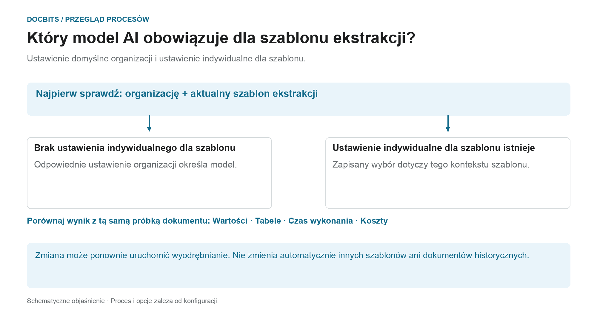

# Wybór modelu AI specyficznego dla dostawcy do ekstrakcji pól i tabel

## Od standardu organizacyjnego do efektywnego modelu

<figure><figcaption>
Ustawienie domyślne organizacji i ustawienie indywidualne dla szablonu. Schemat ma charakter schematyczny; aktywne ustawienia Twojej organizacji określają rzeczywiste zachowanie.
</figcaption></figure>

Wpis na ekranie walidacji nazywany jest modelem AI specyficznym dla dostawcy. Jednak **bieżący kontekst szablonu wyodrębniania** jest kluczowy: zastąpienie jest zapisywane dla każdej organizacji i szablonu. Dostawca może mieć wiele szablonów z różnymi ustawieniami.

1. **Określ kontekst:** Przed zmodyfikowaniem modelu przejrzyj organizację, dokument i bieżący szablon wyodrębniania.
2. **Sprawdź zastąpienie:** Jeśli model jest zapisany dla tego szablonu, ten wybór obowiązuje w jego zakresie. Jeśli brakuje zastąpienia, zastosowanie ma odpowiednie ustawienie organizacji.
3. **Potwierdź zmianę celowo:** Wybierz tylko opcję dostępną w Twoim środowisku. Zmiana może wymagać potwierdzenia i ponownego uruchomienia ekstrakcji. Samo otwarcie menu nie powoduje zmiany wyboru.
4. **Porównaj wyniki:** Sprawdź wartości pól, tabele, czas wykonania i koszty na podstawie stałej próbki. Inny poziom modelu nie gwarantuje lepszej ekstrakcji, pomyślnej walidacji lub dopasowania PO.

**Przykład:** Dostawca A korzysta z szablonów „Faktura krajowa” i „Faktura zagraniczna”. Zastąpienie opcji „Faktura krajowa” nie powoduje zmiany wszystkich faktur od tego dostawcy. W przypadku innego dokumentu sprawdź ponownie jego szablon i efektywne ustawienie.

Grafika przedstawia hierarchię wyboru, a nie zalecenie dla konkretnego poziomu modelu. Informacje o diagnostyce [Standard organizacyjny i nadpisania](../../../administration-and-setup/settings/document-processing/classification-and-extraction/ai-model.md) i [Która ścieżka ekstrakcji została wykorzystana?](../../../overview-and-basics/faq/document-processing/which-extraction-path-was-used.md) pomagają sklasyfikować rzeczywisty wynik.

W sekcji narzędzi **Ekranu Walidacji** możesz wybrać model AI używany do **Ekstrakcji Pól** i **Ekstrakcji Tabel**.\
Wybrany **model AI** jest stosowany wyłącznie do wszystkich dokumentów bieżącego dostawcy.

Aby zmienić model, otwórz menu opcji, klikając przycisk **Więcej opcji** (trzy kropki) po prawej stronie ekranu, a następnie wybierz jeden z dostępnych modeli: 

* **Full** – Najwyższa dokładność; koszt 2 tokeny za dokument
* **Fast** – Poziom domyślny; koszt 1 token za dokument
* **Nexus** – Koszt 1 token za dokument
* **Nexus Flash** – Szybszy poziom z rodziny Nexus; koszt 1 token za dokument
* **Auto** – DocBits decyduje dla każdego dokumentu, czy wystarczy Fast, czy potrzebny jest Full; koszt 1 token za dokument
* **Auto Nexus** – Jak Auto, ale ograniczone do rodziny modeli Nexus; koszt 1 token za dokument

<figure><figcaption>
Otwórz menu opcji i wybierz model AI dla tego dostawcy.
</figcaption></figure>

<figure><figcaption>
Lista <strong>Model sztucznej inteligencji</strong> z sześcioma dostępnymi opcjami.
</figcaption></figure>

Jeśli wyniki **ekstrakcji pól** lub **ekstrakcji tabel** nie są satysfakcjonujące, spróbuj przełączyć się na inny model, aby poprawić dokładność.

Aby skonfigurować model AI **globalnie dla dostawców bez niestandardowego modelu** lub aby **zarządzać, który model jest aktywny dla każdego dostawcy**, zapoznaj się z odpowiednią dokumentacją [**tutaj**](../../../administration-and-setup/settings/document-processing/classification-and-extraction/ai-model.md).
