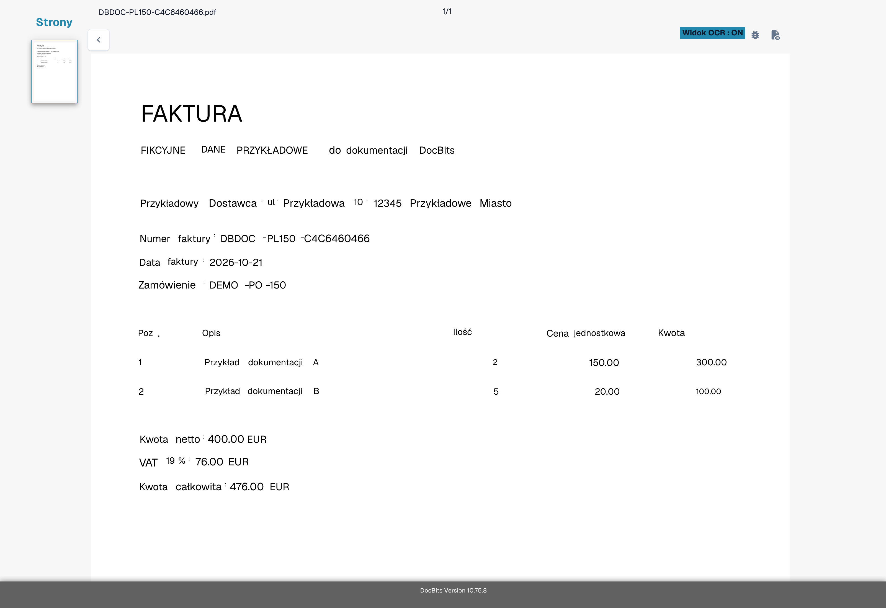
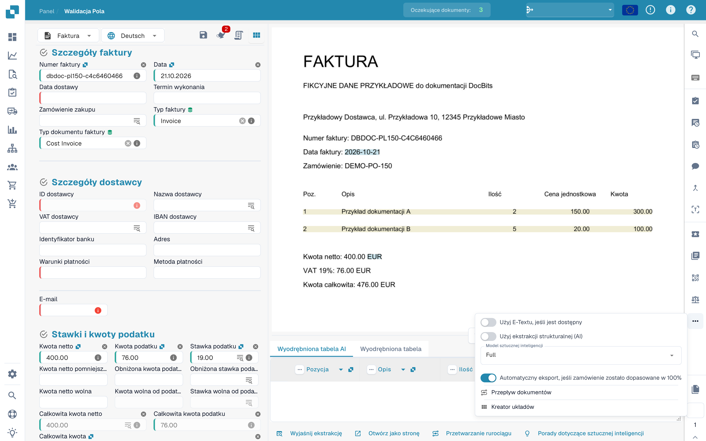
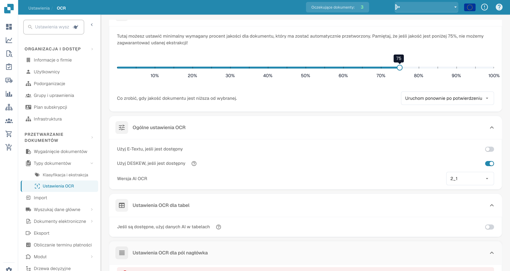
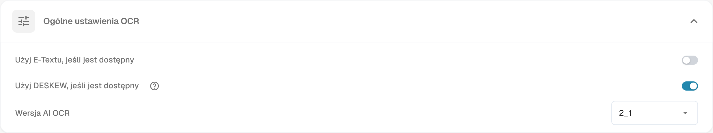

# Brakujący tekst w ekstrakcji OCR

## **Problem**

W niektórych przypadkach tekst może wydawać się brakujący w **Widoku OCR**, co uniemożliwia jego ekstrakcję za pomocą funkcji ekstrakcji.

<figure><figcaption>
Kontrola pól fikcyjnej faktury.
</figcaption></figure>

Aby to zweryfikować, kliknij przycisk **Widok OCR** na pasku narzędzi po prawej stronie. Jeśli tekst się tam nie pojawia, oznacza to, że nie jest dostępny do ekstrakcji.

<figure><figcaption>
Widok OCR tekstu rozpoznanego na fikcyjnej fakturze.
</figcaption></figure>

## **Przyczyna**

Najprawdopodobniej przyczyną jest to, że tekst, który próbujesz wyodrębnić, jest częścią obrazu (np. logo lub zeskanowany fragment) w dokumencie.\
Gdy funkcja E-Text jest włączona, tekst, który pojawia się na obrazach lub logo, nie jest uwzględniany w warstwie tekstu wyodrębnionego. W rezultacie ten tekst nie może być dostępny ani wyodrębniony za pomocą standardowej logiki ekstrakcji.

## **Rozwiązanie**

Aby rozwiązać ten problem, wyłącz funkcję E-Text—dla [konkretnego dostawcy](missing-text-in-ocr-extraction.md#wylacz-e-text-dla-konkretnego-dostawcy) lub dla [całej organizacji](missing-text-in-ocr-extraction.md#wylacz-e-text-dla-calej-organizacji). Po dezaktywowaniu E-Text, DocBits będzie polegać wyłącznie na OCR, który jest w stanie wyodrębnić tekst z obrazów i logo w dokumencie.

### **Wyłącz E-Text dla konkretnego dostawcy**

1. Otwórz dokument od konkretnego dostawcy w **Walidacji pól**.
2.  Kliknij menu z trzema kropkami na pasku narzędzi po prawej stronie.

<figure><figcaption>
Menu dodatkowych opcji walidacji pól.
</figcaption></figure>

3.  Odznacz **Użyj E-Textu, jeśli jest dostępny**.

<figure><figcaption>
Opcja tekstu elektronicznego w menu dokumentu.
</figcaption></figure>

4.  Kliknij **Potwierdzać**, aby ponownie uruchomić przetwarzanie dokumentu.

<figure><figcaption>
Potwierdzenie przed zmianą użycia tekstu elektronicznego.
</figcaption></figure>

### Wyłącz E-Text dla całej organizacji

1.  Przejdź do **Ustawienia → Przetwarzanie dokumentów → Ustawienia OCR**.

<figure><figcaption>
Ustawienia OCR w polskim interfejsie.
</figcaption></figure>

2.  W sekcji **Ogólne ustawienia OCR** odznacz opcję **Użyj E-Textu, jeśli jest dostępny**.

<figure><figcaption>
Ogólne ustawienia OCR z opcją tekstu elektronicznego.
</figcaption></figure>

Obrazy wykorzystują fikcyjną fakturę z dostępnym tekstem OCR. Pokazują elementy interfejsu, a nie odtworzony incydent brakującego tekstu.
