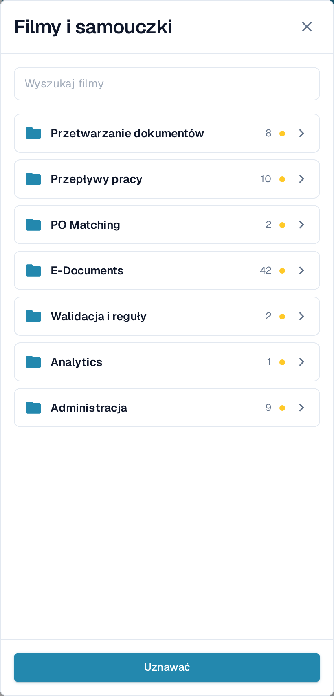
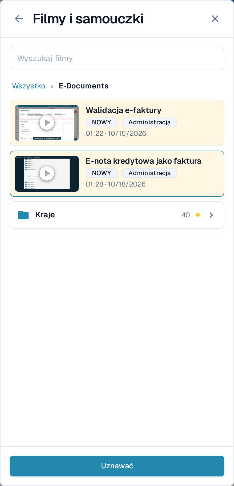
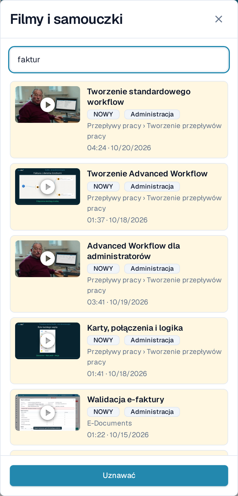
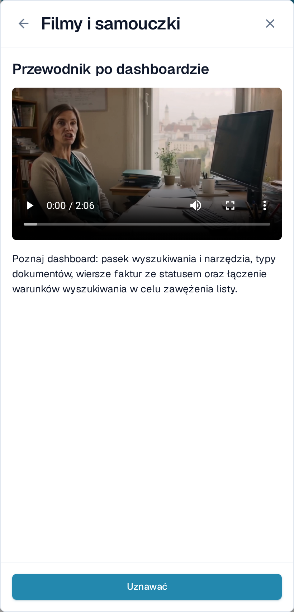

# Filmy i samouczki

**Filmy i samouczki** odtwarzają krótkie filmy DocBits bez opuszczania strony, na której pracujesz. Filmy są pogrupowane według tematów, więc szybko znajdziesz ten, który pasuje do bieżącego zadania.

## Otwieranie panelu

Ikona filmu znajduje się po prawej stronie górnego paska, za ikoną pomocy.

<figure><figcaption>
Ikona filmu jest ostatnią ikoną na górnym pasku.
</figcaption></figure>

* Ikona jest **żółta z małą kropką**, dopóki co najmniej jeden film nie został uznany.
* Przyjmuje kolor pozostałych ikon paska, gdy uznasz każdy film.

Wybierz ikonę, aby otworzyć **Filmy i samouczki** jako panel po prawej stronie.

<figure><figcaption>
Panel otwiera się na liście tematów. Każdy temat to folder z liczbą zawartych filmów.
</figcaption></figure>

## Przeglądanie tematu

Panel otwiera się na **folderach tematów**, na przykład **Przetwarzanie dokumentów**, **Przepływy pracy**, **E-Documents** lub **Administracja**. Folder pokazuje, ile zawiera filmów, oraz oznaczenie **NOWY**, dopóki zawiera film, którego jeszcze nie uznałeś.

Wybierz folder, aby go otworzyć. Znajdziesz w nim filmy z tego tematu, a przy obszernych tematach także kolejne foldery, które je grupują — na przykład **Kraje** w **E-Documents**. Ścieżka u góry oraz strzałka wstecz przenoszą o jeden poziom wyżej. Film otwarty z folderu wraca do tego folderu po zamknięciu.

<figure><figcaption>
Otwórz temat, aby zobaczyć jego filmy i podfoldery.
</figcaption></figure>

## Wyszukiwanie filmu

Wpisz tekst w polu **Wyszukaj filmy**, aby przeszukać wszystkie tematy naraz. Każdy wynik podaje folder, do którego należy, na przykład **Przepływy pracy › Tworzenie przepływów pracy**, dzięki czemu wiesz, gdzie film się znajduje. Wyszukiwanie obejmuje również nazwy tematów i folderów oraz pomija wielkość liter i znaki diakrytyczne.

<figure><figcaption>
Wyszukiwanie obejmuje wszystkie tematy i pokazuje folder każdego wyniku.
</figcaption></figure>

Wyczyść pole wyszukiwania, aby wrócić do folderów tematów.

## Obejrzenie filmu i jego uznanie

Wybierz film, aby odtworzyć go w panelu. Tytuł i krótki opis mówią, czego film dotyczy.

<figure><figcaption>
Odtwórz film w panelu, a następnie uznaj go.
</figcaption></figure>

Wybierz **Uznawać**, gdy obejrzysz film. Zostanie on oznaczony jako obejrzany wyłącznie dla Twojego użytkownika: oznaczenie **NOWY** znika dla Ciebie przy filmie i przy jego folderze, a ikona na górnym pasku szarzeje, gdy nic nie pozostaje do uznania. Inni użytkownicy nadal widzą własne nieuznane filmy.

## Filmy dla administratorów i dla użytkowników

* Filmy z oznaczeniem **Administracja** są przeznaczone dla administratorów. Administratorzy widzą w panelu zarówno filmy administracyjne, jak i filmy dla użytkowników końcowych; użytkownicy końcowi widzą wyłącznie te drugie.
* Jeśli film nie jest dostępny w języku Twojego interfejsu, wyświetlana jest wersja angielska z kodem języka, na przykład **EN**.


Zrzuty ekranu przedstawiają testową organizację DocBits z aplikacją ustawioną na język polski.

