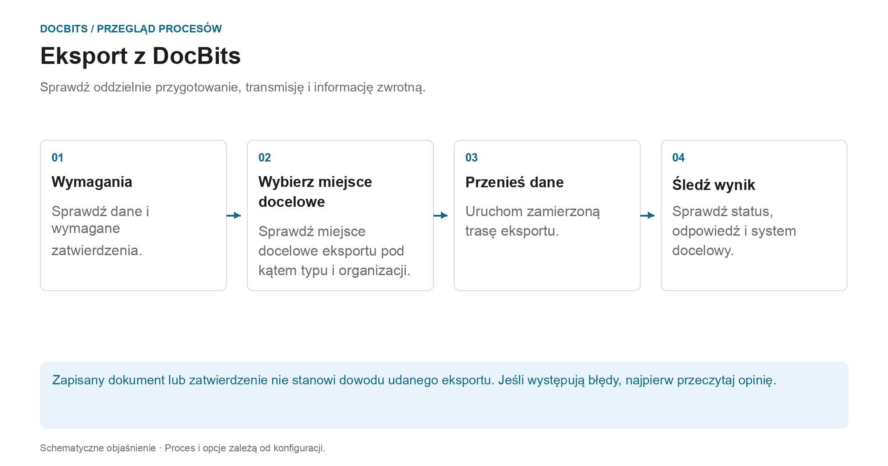

# Eksportowanie w DocBits

## Ze sprawdzonego dokumentu do systemu docelowego

<figure><figcaption>
Sprawdź oddzielnie przygotowanie, transmisję i informację zwrotną. Schemat ma charakter schematyczny; aktywne ustawienia Twojej organizacji określają rzeczywiste zachowanie.
</figcaption></figure>

Podczas eksportu DocBits przesyła dokumenty i dane do nawiązanego połączenia. To, czy eksport jest oferowany, czy uruchamiany automatycznie, zależy od typu dokumentu, statusu, przepływu pracy i konfiguracji eksportu.

1. **Sprawdź wymagania wstępne:** Przejrzyj dane dokumentu, otwarte zadania i zatwierdzenia wymagane przez Twój proces. Pomyślne dopasowanie PO nie zastępuje tych kroków.
2. **Wyjaśnij miejsce docelowe eksportu:** Sprawdź, która konfiguracja dotyczy typu dokumentu i organizacji lub podorganizacji. Zarządzanie eksportem obsługuje między innymi Infor, Infor & IDM, Webhook i SFTP. Rzeczywisty zakres dostawy zależy od wykonania połączenia.
3. **Wyzwalanie transferu:** Użyj zamierzonej akcji dokumentu lub skonfigurowanego przepływu pracy. Alternatywny eksport jest konfigurowany osobno; jego status dostępności nie jest stanem, który należy ustawić po eksporcie.
4. **Sprawdź opinię:** Sprawdź status dokumentu i dostępne odpowiedzi odbiorców. W przypadku kompleksowej kontroli sprawdza się również powiązany proces w systemie docelowym. W przypadku Infor dalsze etapy przetwarzania mogą nastąpić w ION i ERP.

### Jeśli eksport się nie powiedzie

Otwórz szczegóły błędu przed ponownym eksportowaniem. Powtarzające się wysyłanie nie rozwiąże problemu nieprawidłowego mapowania ani odrzucenia przez odbiorcę. Skorzystaj z odpowiedzi, aby sprawdzić wartości dokumentów, mapowanie i konfigurację docelową oraz sprawdzić, czy w systemie docelowym została już utworzona transakcja.

### Dalsze instrukcje

- [Moduł eksportu](export-module.md): Pierwsze kroki z administracją.
- [Eksportuj konfigurację](../../administration-and-setup/settings/document-processing/export.md): Połączenia i zakresy.
- [Alternatywny eksport](alternate-export.md): osobna ścieżka eksportu dla każdego typu i statusu dokumentu.
- [Eksportuj do Infor](../exporting-to-infor/README.md): dalsze przetwarzanie Infor.

Przewodnik po eksportowaniu dokumentów w DocBits.
