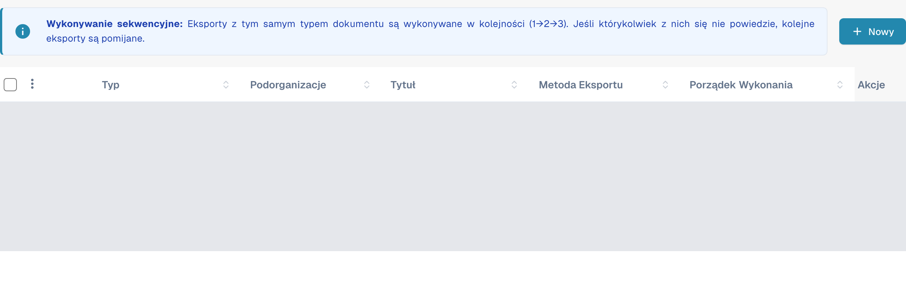
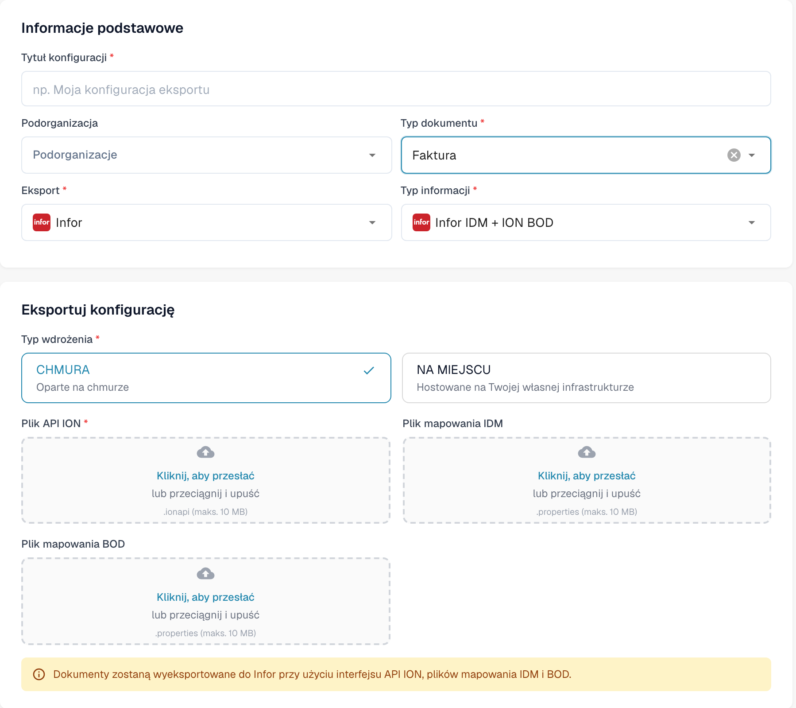

# Tworzenie punktu końcowego Infor ION API dla eksportów DocBits

Administrator Infor konfiguruje punkt końcowy API Gateway dla **konkretnego środowiska i organizacji DocBits**. Stare obrazy na tej stronie pokazywały jednego historycznego tenanta Infor, stały przykład `api.docbits.com` oraz starszy formularz eksportu DocBits. Używaj zatwierdzonego docelowego adresu URL, klucza API i dokumentu OpenAPI dla swojego rzeczywistego środowiska. Żaden tenant Infor nie został podłączony ani żaden punkt końcowy nie został zapisany podczas tej aktualizacji.

## Zanim zaczniesz

Zbierz od administratora integracji docelowy adres URL API DocBits, zatwierdzony klucz API i nazwę jego nagłówka, adres URL OpenAPI oraz planowane środowiska Infor i DocBits. Trzymaj klucze i pliki `.ionapi` z dala od zgłoszeń, zrzutów ekranu i repozytorium Git. Upewnij się, że testowy punkt końcowy nie może kierować ruchu do produkcyjnego środowiska.

## Konfigurowanie Infor API Gateway

1. W **Available APIs** utwórz pakiet API typu **Custom or Non-Infor** dla docelowego środowiska. Zobacz [instrukcje Infor dotyczące pakietów API](https://docs.infor.com/inforos/2025.x/en-us/useradminlib_cloud/apigatewayag_cloud/gyy1489512842881.html).
2. Dodaj do pakietu punkt końcowy z zatwierdzonym **Target Endpoint URL**. Wybierz typ uwierzytelniania wymagany przez ten punkt końcowy. Dla **API Key** Infor pyta o **Key Name** i **Key Value**; użyj nazwy określonej w kontrakcie API DocBits oraz klucza wydanego dla tej organizacji. Zobacz [pola punktu końcowego](https://docs.infor.com/inforos/2024.x/en-us/useradminlib_cloud/apigatewayag_cloud/bmg1489588707659.html) Infor. Nie kopiuj klucza z innego środowiska.
3. Dodaj adres URL OpenAPI/Swagger środowiska w ustawieniach **Documentation** punktu końcowego, postępując zgodnie z [instrukcjami Infor dotyczącymi dokumentacji](https://docs.infor.com/inforos/2025.x/en-us/useradminlib_cloud/apigatewayag_cloud/tzr1489597424134.html). Sprawdź, czy punkt końcowy pojawia się w [metadanych API](https://docs.infor.com/inforos/2025.x/en-us/useradminlib_cloud/apigatewayag_cloud/tdr1489674063627.html).
4. Razem z administratorem Infor zweryfikuj docelowy adres URL, uwierzytelnianie, ścieżkę proxy i bezpieczne wywołanie poza środowiskiem produkcyjnym, zanim użyjesz punktu końcowego w przepływie dokumentów ION. Samo zapisanie pakietu API nie dowodzi, że dokument został dostarczony.

## Konfigurowanie eksportu w DocBits

W odpowiedniej organizacji DocBits otwórz **Ustawienia → Eksport** i wybierz **Nowy**. Dane istniejących konfiguracji są zasłonięte na obrazie.

<figure><figcaption>
Nowy otwiera niezapisaną konfigurację. Dane istniejących konfiguracji są zasłonięte na tym aktualnym zrzucie z aplikacji.
</figcaption></figure>

Uzupełnij **Tytuł konfiguracji**, wybierz **Typ dokumentu** oraz w razie potrzeby pole **Podorganizacja**. W polu **Eksport** wybierz wyświetlaną wartość **Infor** odpowiadającą Infor, a w polu **Typ informacji** opcję **Infor IDM + ION BOD**. W przykładzie wybrano opcję **Faktura**.

W polu **Typ wdrożenia** wybierz wdrożenie chmurowe lub lokalne odpowiednie dla środowiska. Formularz pokazuje **Plik API ION** (`.ionapi`, wymagany), **Plik mapowania IDM** (`.properties`) i **Plik mapowania BOD** (`.properties`). Poproś administratora o pliki właściwe dla tenanta. Tytuł, podorganizacja i wszystkie trzy pola przesyłania są puste na obrazie.

<figure><figcaption>
Aktualny formularz z aplikacji Infor IDM + ION BOD: wybrano opcję Faktura i wariant chmurowy; tytuł, podorganizacja i trzy pola przesyłania są puste. Formularz zamknięto przyciskiem Anulować bez zapisywania.
</figcaption></figure>

Po zweryfikowaniu ścieżki ION przez administratora zapisz konfigurację i przetestuj jeden dokument poza środowiskiem produkcyjnym. Sprawdź jego status w DocBits i w Infor ION. Zapisany formularz lub wpis w metadanych API nie dowodzi pomyślnego eksportu.

Podczas kontroli dokumentacji tylko odczytano listę i nowy formularz. Nie przesłano plików, nie zapisano ani nie aktywowano konfiguracji, nie testowano połączenia, nie logowano się do tenanta Infor i nie wykonano rzeczywistego eksportu dokumentu.
