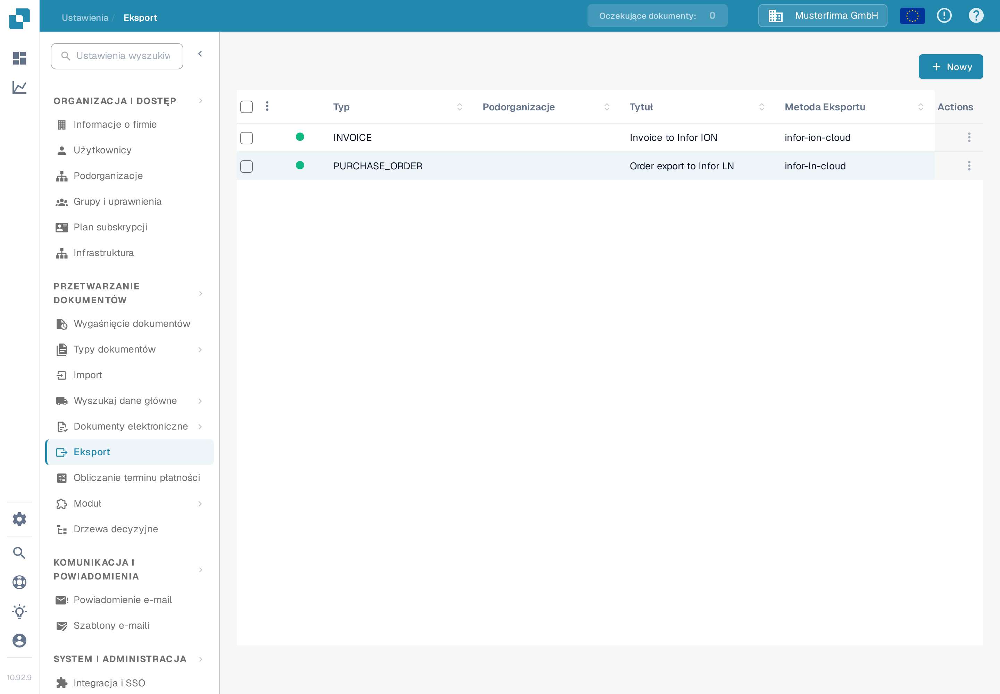
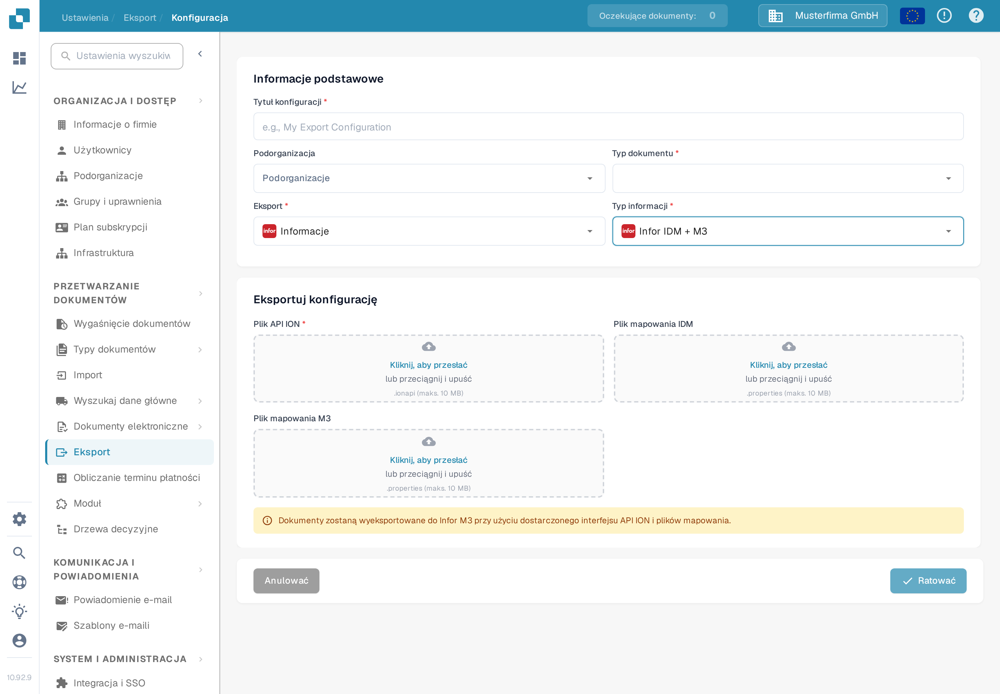

# Konfigurowanie eksportu do Infor M3

Na tej stronie opisano czynności sprawdzające, które łączą konfigurację eksportu DocBits z przepływem dokumentów Infor ION dla M3. Poprzednia wersja strony zawierała 38 zrzutów ekranu ze starszej instancji (tenant) Infor, w tym ustawienia API i mapowań właściwe dla tego środowiska. Nie pozwalają one skonfigurować systemu w Twojej instancji, dlatego obecny przewodnik odsyła do instrukcji Infor i pokazuje zweryfikowany polski formularz DocBits. W ramach tej aktualizacji nie testowano połączenia z Infor ani eksportu faktury.

## Przygotowanie tenant Infor

Poproś administratora Infor o zatwierdzony **punkt końcowy ION API**, plik `.ionapi` właściwy dla instancji, pliki `.properties` **mapowania IDM** i **mapowania M3** oraz nazwy mapowań BOD używanych w przepływie faktur tej firmy. Plik `.ionapi` zawiera dane uwierzytelniające; nie umieszczaj go na zrzutach ekranu, w załącznikach Jira ani w repozytorium Git. Jego wartość `ci` to identyfikator klienta, co opisano w [dokumentacji pól uwierzytelniających Infor](https://docs.infor.com/crm/9.4.x/en-us/webclient/upi1639111995644.html).

W ION Desk administrator powinien:

1. Zaimportować i zatwierdzić wersje mapowań wymagane przez bieżącą instancję. Sprawdź nazwy BOD wejściowych i wyjściowych mapowań, zamiast ponownie używać nazw ze starego zrzutu ekranu.
2. Sprawdzić punkty połączeń DocBits i M3, ich logiczne identyfikatory właściwe dla środowiska, subskrypcje dokumentów oraz uprawnienia.
3. Zbudować przepływ dokumentów z zatwierdzonymi mapowaniami i ewentualnymi wymaganymi filtrami. Infor opisuje [punkty połączeń, mapowania i przepływy dokumentów](https://docs.infor.com/inforos/2024.x/en-us/useradminlib_cloud/iondeskceug_cloud_osm/lnj1556623308383.html).
4. Zapisać, przejrzeć i [aktywować przepływ dokumentów](https://docs.infor.com/depm/2024.x/en-us/depmolh/configuring_ion/jex1510174562552.html) dopiero po sprawdzeniu tras. Aktywacja to coś innego niż udany eksport dokumentu.

Przykład historycznego przepływu ION znajdziesz na stronie [Eksport do Infor M3](README.md). Porównaj każdy ekran Infor na tej stronie ze swoją instancją, zanim zastosujesz się do instrukcji.

## Konfiguracja eksportu w DocBits

W docelowej organizacji DocBits otwórz **Ustawienia → Eksport** i wybierz **Nowy**. Pokazana tu polska testowa organizacja Sandbox nie ma żadnej zapisanej konfiguracji eksportu.

<figure><figcaption>
Lista eksportu w polskich ustawieniach DocBits: brak zapisanej konfiguracji, w prawym górnym rogu przycisk „Nowy”.
</figcaption></figure>

Wpisz **Tytuł konfiguracji**, wybierz **Typ dokumentu** (w tym przepływie faktura) i wybierz **Podorganizację** tylko wtedy, gdy jest to wymagane. Ustaw **Eksport** na **Infor** i **Typ informacji** na **Infor IDM + M3**. Obecny formularz wymaga **Pliku API ION** (`.ionapi`, obowiązkowy), **Pliku mapowania IDM** (`.properties`) i **Pliku mapowania M3** (`.properties`). Zdobądź wyłącznie pliki przeznaczone dla tej instancji i sprawdź je przed zapisaniem. Zrzut ekranu celowo pozostawia wszystkie pola przesyłania puste.

<figure><figcaption>
Formularz eksportu „Infor IDM + M3” w polskiej aplikacji Sandbox; pola przesyłania plików ION API, IDM i M3 pozostawiono puste.
</figcaption></figure>

Po aktywowaniu przepływu Infor przetestuj go na jednej fakturze spoza środowiska produkcyjnego. Sprawdź jej wynik w DocBits, ION i M3. Sama zapisana konfiguracja albo aktywny przepływ nie dowodzą, że faktura dotarła.
