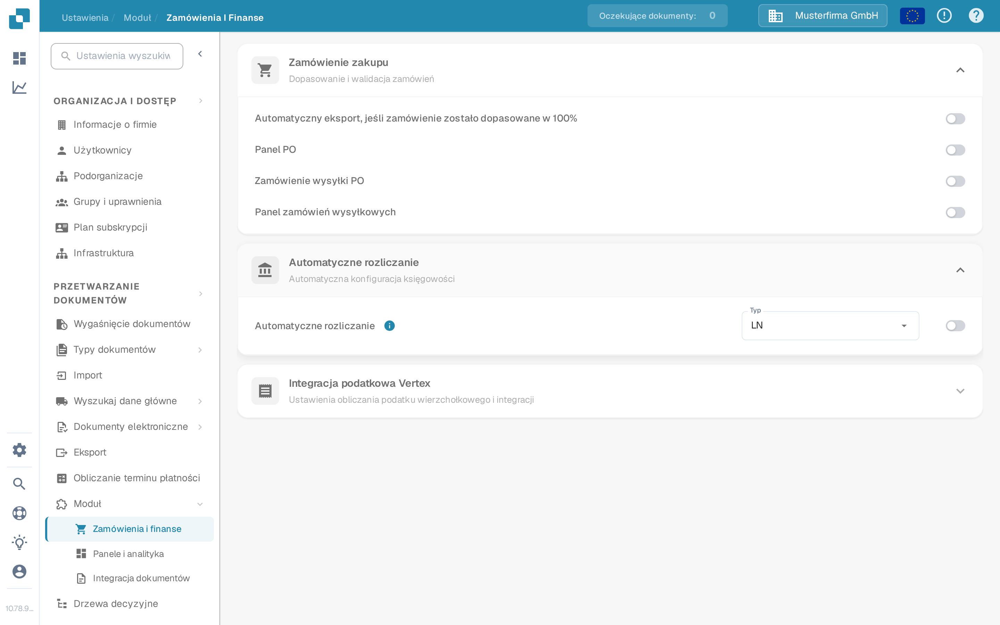
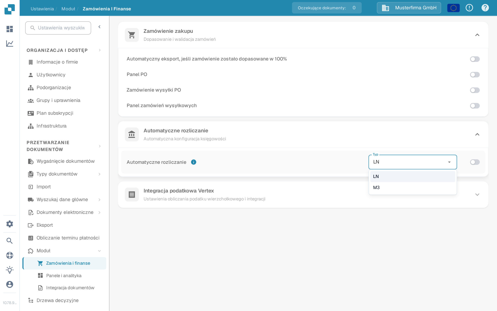

# Automatyczne Księgowanie

Skorzystaj z tego przewodnika, gdy administrator Infor LN chce, aby DocBits używał zaimportowanych danych finansowych do automatycznej księgowości. Poprzednia strona pokazywała 48 ekranów z konkretnej dzierżawy Infor. Nazwy punktów połączeń, mapowania, dane logowania i adresy punktów końcowych z tej dzierżawy nie stanowią konfiguracji wielokrotnego użytku.

## Znajdowanie ustawienia w DocBits

Otwórz **Ustawienia → Moduł → Zamówienia i finanse → Automatyczne rozliczanie** przy użyciu konta administratora. Menu **Typ** oferuje opcje **LN** i **M3**. W przypadku integracji z LN sprawdź, czy wybranym typem jest **LN**. Włącz przełącznik dopiero po sprawdzeniu docelowej spółki LN, przepływu BOD i zaimportowanych danych głównych. Zmiana typu lub przełącznika może wpłynąć na zachowanie księgowania, dlatego postępuj zgodnie z procesem zmian obowiązującym w Twojej organizacji.

Poniższe zrzuty ekranu pochodzą z syntetycznej piaskownicy **DocBits Documentation Test A**. W tej organizacji wybrano **LN**, a automatyczne rozliczanie było **wyłączone**. Menu zostało otwarte bez wyboru innej wartości; żadne ustawienie nie zostało zapisane.

<figure><figcaption>
Znajdź Automatyczne rozliczanie i sprawdź wybrany typ przed jego włączeniem.
</figcaption></figure>

<figure><figcaption>
LN i M3 to dostępne typy w tej piaskownicy; nie zmieniono żadnego wyboru.
</figcaption></figure>

## Przygotowanie LN i ION

1. Potwierdź spółkę LN, jednostkę księgową, organizację DocBits i środowisko docelowe. Uzgodnij z administratorem DocBits, która bieżąca operacja API i mapowanie pól będą odbierać konta i wymiary. Dane logowania do API przechowuj w zatwierdzonym magazynie sekretów, nigdy na zrzucie ekranu ani w załączniku Jira.
2. Skonfiguruj publikowanie BOD w LN i sprawdź konfigurację danych publikowania. Infor dokumentuje **BOD Parameters (tcbod0100m000)** i **Validate Publishing Data Setup (tcbod0300m000)** w swoim [przewodniku publikowania BOD w LN](https://docs.infor.com/ln/10.7.in/en-us/lnolh/help/tc/onlinemanual/000520.html).
3. Sprawdź, jakich notatek (nouns) wymaga Twoja wersja LN i operacja odbierająca w DocBits. Dawniej przykład używał `Sync.ChartOfAccounts` i `Sync.CodeDefinition` dla danych planu kont i wymiarów. Infor wymienia opcje Chart of Accounts i CodeDefinition w [Publish Financial Master Data (tfbia0200m000)](https://docs.infor.com/ln/2025.x/en-us/lnolh/tfolh/help/tf/bia/tfbia0200m000.html). Niektóre karty CodeDefinition pojawiają się dopiero po określeniu i zatwierdzeniu mapowania wymiarów. Potwierdź dokładne wersje dokumentów i pola w swojej dzierżawie przed ich routingiem.
4. W **ION Desk → Connect → Connection Points** połącz źródło LN z zatwierdzonym miejscem docelowym API DocBits. W **Data Flows** skieruj wybrane dokumenty, sprawdź filtry i mapowanie, a następnie zapisz i aktywuj. Infor rozróżnia [zapisanie i aktywowanie przepływu](https://docs.infor.com/inforos/latest/en-us/useradminlib_cloud/iondeskceug/lsm1436532178755.html).
5. W LN użyj niewrażliwego identyfikatora testowego. W **Publish Financial Master Data** najpierw użyj **Count** lub **Simulate**, aby przejrzeć wybór, a **Publish** tylko w ramach zmiany zatwierdzonej przez administratora. Akcja publikowania nie jest zależna od celu: Infor dostarcza dane do wszystkich subskrybentów. Śledź ten identyfikator i ewentualne błędy w [ION OneView](https://docs.infor.com/inforos/latest/en-us/useradminlib_cloud/iondeskceug/lsm1436532196155.html).

## Potwierdzenie wyniku w DocBits

Poproś administratora DocBits o sprawdzenie odebranego rekordu, organizacji i pól księgowych w bieżących dziennikach importu lub API. Jeśli odpowiednia tabela wyszukiwania jest dostępna, wyszukaj ten sam identyfikator w **Ustawienia → Przetwarzanie dokumentów → Wyszukaj dane główne**. Sam pomyślnie aktywowany przepływ ION nie dowodzi, że DocBits przyjął rekord. Jeśli wartości brakuje, porównaj źródłowy BOD, mapowanie ION, odpowiedź API i organizację docelową, zanim włączysz automatyczne rozliczanie.

Do testu end-to-end nie była dostępna żadna dzierżawa LN ani rzeczywisty transfer finansowych BOD. Nowe zrzuty z piaskownicy potwierdzają wyłącznie bieżące elementy sterujące DocBits. Administrator dzierżawy musi zweryfikować końcowe mapowanie i wynik księgowania.
