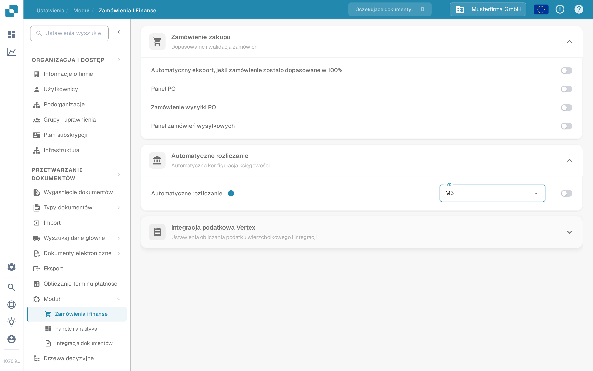

# Automatyczne Księgowanie z Infor M3

Skorzystaj z tego przewodnika, aby zaplanować dane główne wymagane do automatycznego księgowania M3 (Auto accounting) w DocBits. Sama włączona opcja nie importuje kont ani elementów kosztowych. Administrator Infor musi potwierdzić mapowanie BOD, operację API DocBits oraz wynik we własnej organizacji.

## Sprawdzenie ustawienia DocBits

Administrator może otworzyć **Ustawienia → Moduł → Zamówienia i finanse → Automatyczne rozliczanie**. Menu **Typ** oferuje **LN** i **M3**. Wybierz **M3** tylko w przypadku integracji z M3 i włącz przełącznik po zweryfikowaniu przepływu danych oraz wymaganych danych głównych. Sąsiednia opcja **Integracja podatkowa Vertex** w tym samym akordeonie nie jest częścią tego przewodnika. Poniższe zrzuty ekranu przedstawiają tę stronę w polskojęzycznym środowisku testowym DocBits. Przełącznik był **wyłączony**, bieżący Typ to **LN**, a otwarcie menu nie zapisało ani nie zmieniło żadnego ustawienia.

<figure><figcaption>
Znajdź Automatyczne rozliczanie w Zamówienia i finanse; w tym przykładzie środowiska testowego jest wyłączone.
</figcaption></figure>

<figure><figcaption>
Menu Typ oferuje LN i M3. W tym przykładzie nie wybrano żadnej opcji.
</figcaption></figure>

## Przygotowanie przepływu danych M3

1. Ustal, która firma M3 i która organizacja DocBits będą wymieniać dane. Zapytaj administratora DocBits, która bieżąca operacja API przyjmuje dane główne księgowości. Unikaj kopiowania endpointu lub poświadczeń ze zrzutu ekranu starszego środowiska.
2. W M3 potwierdź, że wymagane BOD-y są włączone dla odpowiedniej jednostki księgowej. Przykład ze starszego środowiska używał `Sync.ChartOfAccounts` i `Sync.CodeDefinition` dla wymiarów księgowych. Potwierdź dokładną nazwę (noun), wersję i pola względem konfiguracji M3 oraz kontraktu API odbiorcy. Infor opisuje [włączanie publikowania BOD](https://docs.infor.com/m3core/2025.x/en-us/useradminlib_cloud/m3cecoreag_cloud/wbr1509377469290.html).
3. W **ION Desk → Connect → Connection Points** skonfiguruj źródło M3 i miejsce docelowe API z zatwierdzoną operacją DocBits oraz kontem serwisowym. W **Data Flows** kieruj tylko zatwierdzone dokumenty, sprawdź filtry i mapowanie pól, a następnie zapisz i aktywuj przepływ. Zobacz [listę punktów połączeń Infor](https://docs.infor.com/inforos/latest/en-us/useradminlib_cloud/iondeskceug/documentflowdesk_connectionpointmasterlist.html) oraz [instrukcje aktywacji przepływów danych](https://docs.infor.com/inforos/latest/en-us/useradminlib_cloud/iondeskceug/lsm1436532178755.html).
4. Opublikuj jeden niewrażliwy identyfikator testowy z M3. Wstępne ładowanie może używać **EVS006** w M3; nazwy akcji i tabel zależą od zainstalowanej wersji M3. Postępuj zgodnie z [instrukcjami wstępnego ładowania Infor](https://docs.infor.com/m3core/2025.x/en-us/useradminlib_cloud/m3cecoreag_cloud/pbi1544012609638.html). W **ION OneView** śledź identyfikator przez przepływ i sprawdź wynik API za pomocą [Infor OneView](https://docs.infor.com/inforos/latest/en-us/useradminlib_cloud/iondeskceug/lsm1436532196155.html).
5. Sprawdź ten sam identyfikator w DocBits w **Ustawienia → Przetwarzanie dokumentów → Wyszukaj dane główne**. [Przewodnik po API z M3 do DocBits](import-from-infor-m3-to-docbits-via-api.md) opisuje kontrole importu. Włącz automatyczne księgowanie M3 tylko wtedy, gdy wymagane rekordy są obecne, a administrator zwalidował mapowanie.

## Elementy kosztowe

Starszy przykład ze środowiska eksportował elementy kosztowe z M3 **PPS280** do Excela, redukował kolumny i przesyłał plik CSV przez stary ekran API HTTP. Ta sekwencja zrzutów ekranu nie jest bezpieczną ogólną procedurą importu: nazwy kolumn, separator, endpoint i uwierzytelnianie wymagają potwierdzenia dla bieżącego środowiska. Skorzystaj z aktualnego [przewodnika po tabeli elementów kosztowych](table-extraction-for-costing-element.md), aby przygotować plik i przejrzeć dostępne opcje CSV w DocBits. Nie przesyłaj pliku, dopóki administrator nie sprawdzi jego kolumn względem tabeli docelowej.

Jeśli BOD dotrze do ION, ale w DocBits nie pojawi się żaden wiersz, przed włączeniem funkcji sprawdź trasę ION, odpowiedź API, organizację, identyfikator i mapowanie. Nie wnioskuj o powodzeniu na podstawie aktywowanego przepływu ani istniejących danych demonstracyjnych.

Ta strona zastępuje 43 zrzuty ekranu ze starszego środowiska Infor bieżącymi elementami sterującymi DocBits i krokami z odnośnikami do źródeł. Nie było dostępnego środowiska Infor ani żywego transferu BOD do testu end-to-end; administrator Twojego środowiska musi zwalidować końcowe mapowanie, import i wynik księgowania.
