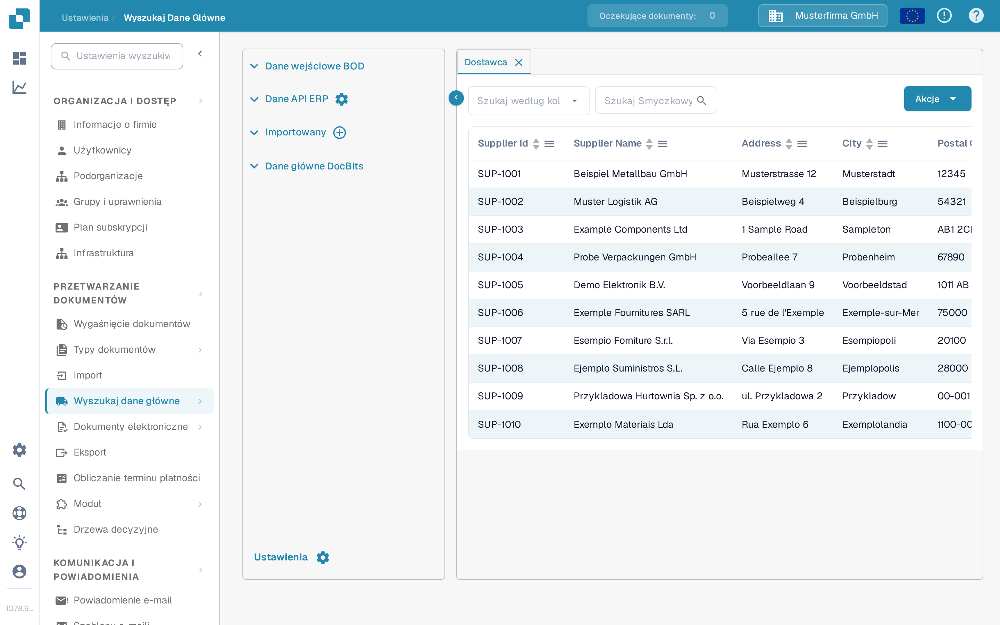
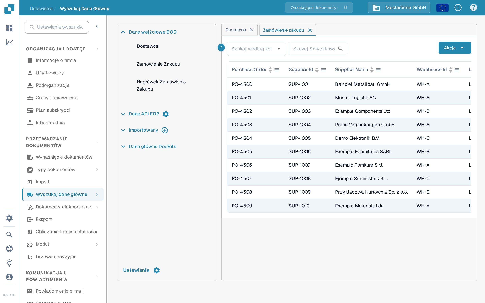

# Import z Infor M3 do DocBits przez API

Korzystaj z tego przewodnika, gdy administrator Infor M3 musi przekazać wybrane BOD do DocBits przez Infor ION i API Gateway. Poprzednia wersja tej strony zawierała 42 zrzuty ekranu ze starego dzierżawcy Infor oraz stałe adresy API środowiska Sandbox. Te zrzuty i adresy nie są bezpiecznym wzorcem konfiguracji dla innego dzierżawcy.

Ścieżka do sprawdzenia to **M3 publikuje BOD → ION go trasuje → API Gateway wywołuje API DocBits → DocBits pokazuje zaimportowany rekord**. Każdy etap ma własny status. Rekord widoczny w DocBits to końcowe potwierdzenie; sam aktywny przepływ danych w ION nie dowodzi importu.

## Zanim skonfigurujesz przepływ

1. Potwierdź firmę M3, dzierżawcę ION, organizację DocBits i środowisko, które zamierzasz połączyć. Poproś administratora DocBits o aktualny bazowy adres URL API oraz wymaganą operację API z opisu OpenAPI tego środowiska. Hosty regionalne mogą się różnić; nie kopiuj hosta ani ścieżki proxy API Gateway ze starego zrzutu ekranu.
2. Ustal, jakich typów dokumentów potrzebuje organizacja. Dane podstawowe dostawców i zamówień zakupu można sprawdzić w DocBits. Dokumenty dostawy i księgowe dodawaj tylko wtedy, gdy ich zastosowanie i operacja odbioru są potwierdzone.
3. Przygotuj konto usługi Infor z uprawnieniem do wybranej operacji API oraz dane uwierzytelniające API DocBits o minimalnym wymaganym dostępie. Wpisuj dane uwierzytelniające wyłącznie na autoryzowanym ekranie konfiguracji. Nie wklejaj pełnego pliku `.ionapi` ani klucza API do strony dokumentacji, zgłoszenia Jira ani zrzutu ekranu.
4. Zachowaj jeden niewrażliwy identyfikator testowy dla każdego wybranego BOD, aby móc prześledzić ten sam rekord w M3, ION OneView i DocBits.

## Wybierz dokument i operację odbioru

Przykład starego dzierżawcy używał tych BOD. Potwierdź każde przypisanie na podstawie aktualnych metadanych API i własnego projektu integracji, zanim utworzysz punkt połączenia:

| BOD w starym przykładzie                                                                    | Docelowe dane w DocBits                                | Gdzie sprawdzić format odbioru                                                                                         |
| ------------------------------------------------------------------------------------------- | ------------------------------------------------------ | ---------------------------------------------------------------------------------------------------------------------- |
| `Sync.SupplierPartyMaster`, `Sync.RemitToPartyMaster`                                       | Dane podstawowe dostawców                              | [Importowanie Dostawców (Supplier BOD)](../importing-via-the-api/supplier-bod.md)                                      |
| `Sync.PurchaseOrder`                                                                        | Zamówienia zakupu                                      | [Importowanie Zamówień Zakupu (Purchase Order BOD)](../importing-via-the-api/purchase-order-bod.md)                    |
| `Sync.ReceiveDelivery`                                                                      | Dane dostawy                                           | [Importowanie Przyjęć Towarów (Receive Delivery BOD)](../importing-via-the-api/receive-delivery-bod.md)                |
| `Sync.AdvanceShipNotice`, `Sync.ChartOfAccounts`, `Sync.CodeDefinition-AccountingDimension` | Dodatkowe dane podstawowe dla skonfigurowanych funkcji | [Importowanie Danych Głównych z XML](../importing-via-the-api/master-data-xml.md) oraz metadane API Twojego dzierżawcy |

`Acknowledge.SupplierInvoice` należy do przepływu potwierdzania faktur i należy go skonfigurować osobno, niezależnie od importu danych podstawowych z M3 do DocBits. Stara strona mieszała te kierunki i zawierała treść żądania właściwą dla jednego dzierżawcy; nie kopiuj tej treści do nowego przepływu bez sprawdzenia kontraktu punktu końcowego i kontroli dostępu.

## Skonfiguruj Infor OS i ION

1. W Infor OS przygotuj cel API Gateway dla **potwierdzonej** operacji API DocBits. Sprawdź z administratorem DocBits adres docelowy, metodę żądania, format żądania i uwierzytelnianie. Do kontroli Gateway użyj aktualnego [przewodnika Infor API Gateway](https://docs.infor.com/inforos/2025.x/en-us/useradminlib_cloud/apigatewayag_cloud/ionapi_2025.x_apigatewayag_cloud_en-us.pdf).
2. W **ION → Connect → Connection Points** utwórz lub wybierz punkt połączenia dla API DocBits. W **Documents** dodaj tylko wybrane BOD, wybierz pasującą operację Gateway i skonfiguruj treść żądania oczekiwaną przez tę operację. [Instrukcje dotyczące elementu API](https://docs.infor.com/inforos/latest/en-us/useradminlib_cloud/iondeskceug/hqg1491985489422.html) firmy Infor wyjaśniają konto usługi i ustawienia żądania.
3. W **ION → Connect → Data Flows** połącz źródło M3 z celem API. Sprawdź listę dokumentów, filtry i przypisania; następnie zapisz i aktywuj przepływ. Infor rozróżnia [zapisanie od aktywowania przepływu danych](https://docs.infor.com/inforos/latest/en-us/useradminlib_cloud/iondeskceug/lsm1436532178755.html).
4. Opublikuj z M3 jeden zatwierdzony testowy BOD. W **ION OneView** znajdź ten identyfikator i potwierdź, który punkt połączenia, przypisanie i wywołanie API go obsłużyło. Zobacz [Infor OneView](https://docs.infor.com/inforos/latest/en-us/useradminlib_cloud/iondeskceug/lsm1436532196155.html). Jeśli nie ma trasy albo pojawia się błąd, najpierw napraw przepływ ION, a potem sprawdź DocBits.

## Sprawdź wynik w DocBits

Otwórz **Ustawienia → Przetwarzanie dokumentów → Wyszukaj dane główne**. Rozwiń **Dane wejściowe BOD**, wybierz odpowiedni typ i wyszukaj identyfikator testowy. Zakładki **Dostawca** i **Zamówienie zakupu** pokazane poniżej to aktualne polskie widoki z syntetycznymi danymi demonstracyjnymi. Ich istniejące wiersze **nie są dowodem importu z M3**.

<figure><figcaption>
Wybierz Dostawca, wybierz kolumnę wyszukiwania i wpisz testowy identyfikator dostawcy.
</figcaption></figure>

<figure><figcaption>
Wybierz Zamówienie zakupu i wyszukaj testowe zamówienie; widoczne wiersze to syntetyczne dane demonstracyjne.
</figcaption></figure>

W obu zakładkach **Szukaj według kolumny** wybiera pole, **Szukaj Smyczkowy** przyjmuje identyfikator, a lupa uruchamia wyszukiwanie. Nagłówki tabeli sortują widoczne wiersze; strzałki na dole przechodzą między stronami. **Akcje** otwiera operacje tabeli i nie jest potrzebne do tego sprawdzenia tylko do odczytu. **×** na zakładce zamyka ją. Przycisk plus przy **Importowany** służy do wysyłania plików CSV, a nie do odbierania BOD z ION.

Jeśli BOD pojawia się w OneView, ale rekordu brakuje w DocBits, sprawdź operację API i odpowiedź, organizację/środowisko, typ dokumentu, format treści żądania oraz identyfikator użyty w wyszukiwaniu. Poproś administratora DocBits o odpowiedni dziennik importu. Nie wnioskuj o powodzeniu na podstawie wywołania HTTP ani zrzutu ekranu z niepowiązanym wierszem demonstracyjnym.

Ta strona została zaktualizowana na podstawie aktualnych elementów sterujących DocBits Sandbox i dokumentacji Infor. Dzierżawca Infor ani rzeczywiste przesłanie BOD z M3 do DocBits nie były dostępne do testu od początku do końca; administrator dzierżawcy musi zweryfikować końcowe przypisanie i wynik.
