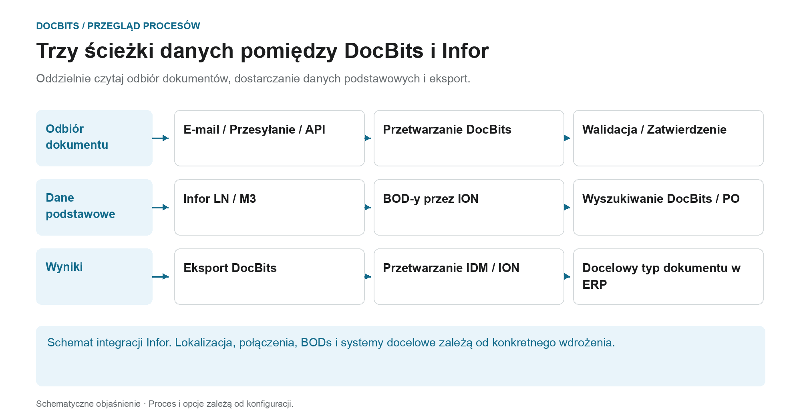

# Architektura

## Architektura jako trzy oddzielne ścieżki danych

<figure><figcaption>
Oddzielnie czytaj odbiór dokumentów, dostarczanie danych podstawowych i eksport. Schemat ma charakter schematyczny; aktywne ustawienia Twojej organizacji określają rzeczywiste zachowanie.
</figcaption></figure>

Architektura zawiera kilka przepływów danych o różnych celach. Dokumenty są importowane w celu przetworzenia; dane podstawowe pochodzą z integracji ERP; rozpoznane i sprawdzone wyniki są zwracane poprzez skonfigurowaną ścieżkę eksportu. Ścieżki te stanowią oddzielne połączenia i należy je oddzielnie prześledzić podczas diagnostyki.

| Ścieżka danych | Kierunek i cel | Punkt kontrolny |
| --- | --- | --- |
| **Odbiór dokumentu** | E-mail, przesyłanie lub interfejs → DocBits. Dokumenty kierowane są do zamierzonego procesu przetwarzania. | Czy właściwy dokument trafił do właściwej organizacji? |
| **Dostawa danych podstawowych** | LN/M3 → BODs i ION przepływ danych → DocBits. Dostawcy i zamówienia są udostępniane w celu identyfikacji i uzgodnienia. | Czy wymagany zestaw danych został przesłany i zaakceptowany przez DocBits? |
| **Eksport wyników** | DocBits → skonfigurowane połączenie Infor → IDM lub ION i ERP. Dokumenty i dane biznesowe mogą podążać różnymi ścieżkami. | Czy udowodniono transfer i odpowiednią obróbkę w miejscu przeznaczenia? |

W opisanym tutaj eksporcie Infor, PDF i jego atrybuty są wysyłane do IDM, a `Sync.CaptureDocument` są wysyłane do ION Desk. ION przekształca go w wymagany cel BODs zgodnie z typem dokumentu. Akceptacja przez LN lub M3 musi zostać zweryfikowana w odpowiednim systemie docelowym; sam krok DocBits nie potwierdza każdego dalszego etapu przetwarzania.

**Skorzystaj z przeglądu, aby sprawdzić błędy:** Jeśli brakuje dokumentu, rozpocznij import. Jeśli brakuje dostawców lub wierszy zamówienia zakupu, postępuj zgodnie ze ścieżką danych głównych. Jeśli transfer zwrotny nie powiedzie się, sprawdź konfigurację eksportu, odpowiedź odbiorcy i przetwarzanie ION/ERP. Poniższe diagramy architektury dodają szczegóły wdrożenia i komponentów do tego przeglądu procesu.

Dalej: [Importuj dokumenty](../../end-user-and-partner-section/end-user-section/how-to-import-documents/README.md), [Importuj dane podstawowe klienta](../../infor-integration-and-configuration/importing-customer-master-data/README.md) i [Eksport z DocBits](../../infor-integration-and-configuration/exporting-in-docbits/README.md).

## **Klient DocBits Cloud**

<figure><figcaption></figcaption></figure>

## DocBits lokalnie

<figure><figcaption></figcaption></figure>

Doc**Bits** bezproblemowo integruje się z Infor LN/M3 za pośrednictwem ION API, ION Desk i standardowych BOD Infor. Nasza integracja API pozwala nam na eksport danych do Infor oraz przeprowadzanie walidacji danych głównych w Doc**Bits**.

## **Architektura DocBits Operator**

Wszystkie połączenia między komponentami są zabezpieczone przy użyciu standardowych w branży protokołów szyfrowania. SSH, HTTPS i inne bezpieczne kanały zapewniają integralność i poufność danych w całym systemie.

**W siedzibie:**

<figure><figcaption></figcaption></figure>


[prefect-local-setup-requirements.md](prefect-local-setup-requirements.md)


**Cloud**:

<figure><figcaption></figcaption></figure>

## Eksportowanie danych do Infor

Używamy ION API do wysyłania PDF z atrybutami do IDM oraz BOD Sync.CaptureDocument do ION Desk. W ION Desk przekształcamy [Sync.CaptureDocument](../../infor-integration-and-configuration/exporting-in-docbits/) do docelowych BOD w zależności od przetwarzanego typu dokumentu. Te przekształcone BOD Infor są następnie automatycznie importowane do LN lub M3.


Eksport do [Infor](../../infor-integration-and-configuration/exporting-to-infor/)


## Walidacja danych głównych w DocBits

Aby zidentyfikować dostawcę lub porównać/dopasować linie zamówienia, aktywujemy wyzwalacz w LN/M3, który wysyła BOD Sync.RemitToPartyMaster, Sync.SupplierPartyMaster i Sync.PurchaseOrder do Doc**Bits**. Konfigurujemy ten proces w ION Desk, definiując przepływ danych do konkretnego punktu połączenia z Doc**Bits**.

<figure><figcaption></figcaption></figure>


[Walidacja danych głównych](../../infor-integration-and-configuration/importing-customer-master-data/)


## Import e-mail OAuth Office365

<figure><figcaption></figcaption></figure>
