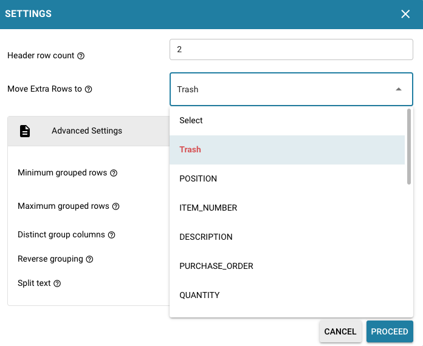
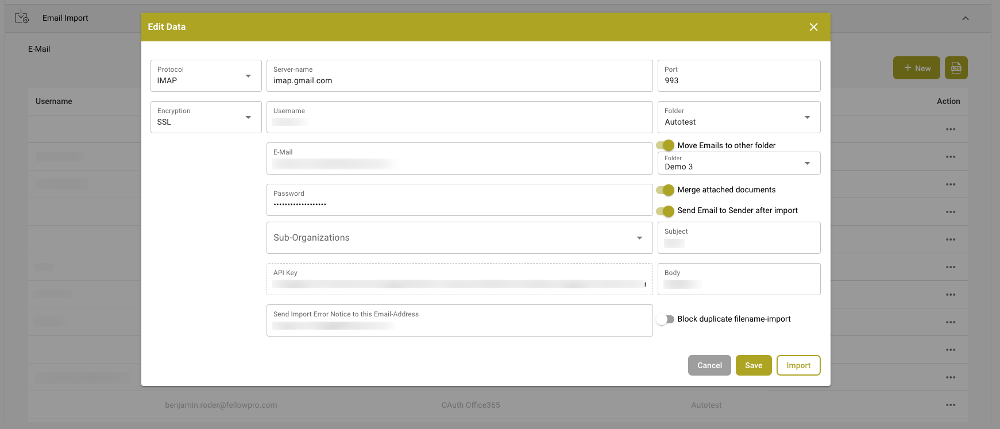

# Notatki do wydania

Wybierz kanał wydania, aby zobaczyć zmiany dotyczące Twojego zespołu. **NOVA to główne wydanie z dodatkowymi funkcjami dla klientów. Hotfixy VESTA ulepszają bieżącą wersję produkcyjną.** Zobacz [cykl życia wydania](../docbits-release-lifecycle-strategy.md), aby poznać dostępność i możliwość przełączania między kanałami.

**Funkcje, które wcześniej były w wersji beta VESTA, są teraz dostępne w NOVA.** Wszystkie funkcje wcześniej dostępne jako beta w VESTA są teraz częścią standardowego zestawu funkcji NOVA. Staną się one również standardowymi funkcjami VESTA w ramach [następnego hotfixa VESTA, planowanego na **11 listopada 2026 r.**](vesta-hotfix-11-november-2026.md).

| Kanał wydania | Notatki do wydania | Zakres |
| --- | --- | --- |
| **NOVA — Główne wydanie** | [Nowości dla klientów](nova-major-release-16-october-2026.md) · migawka wersji z **16 października 2026 r.** | Wszystkie funkcje, które wcześniej były w wersji beta VESTA, plus nowe możliwości i rozszerzenia w porównaniu z VESTA R1.0.15. |
| **VESTA — Następny hotfix (planowany)** | [11 listopada 2026 r.](vesta-hotfix-11-november-2026.md) | Wprowadza wszystkie funkcje, które wcześniej były w wersji beta VESTA, do standardowego zestawu funkcji VESTA. |
| **VESTA — Wydanie hotfix** | [14 października 2026 r. — R1.0.15](incremental-updates-14-october-2026.md) | Ulepszenia i poprawki dla bieżącej wersji produkcyjnej VESTA. |

## NOVA — Główne wydanie

### Co zyskuje Twój zespół dzięki NOVA

* **Korzystaj z funkcji, które wcześniej były w wersji beta VESTA, jako ze standardowych funkcji NOVA.** Wszystkie funkcje wcześniej oferowane w wersji beta VESTA są teraz dostępne w NOVA, w tym elementy sterujące zarządzaniem regułami i układami. Ustawienia organizacji, przełączniki typów dokumentów i uprawnienia nadal obowiązują.
* **Rozwiązuj problemy blokujące dokumenty dzięki Asystentowi walidacji.** Dowiedz się, co blokuje dokument, przejdź do odpowiedniego pola i przejrzyj sugerowane poprawki, pozostając w widoku dokumentu.
* **Przekształć powtarzalne poprawki w zweryfikowane ulepszenia automatyzacji.** Recenzenci mogą przesyłać wnioski o ulepszenia; administratorzy mogą oceniać wyuczone propozycje reguł, przeglądać objęte dokumenty i mierzyć wyniki po aktywacji.
* **Rozumiej błędy e-faktur i podejmuj działania.** Korzystaj z raportów pogrupowanych według poziomu walidacji, przeglądaj polityki dotyczące typów dokumentów i ich historię oraz odrzucaj kwalifikującą się fakturę z odnotowaną przyczyną.
* **Konfiguruj i kontroluj importy FTP/SFTP.** Korzystaj z kreatora połączeń, postępuj zgodnie z krokami importu dla poszczególnych plików, konfiguruj ponowne próby i powiadomienia o błędach oraz opcjonalnie usuwaj pliki źródłowe po pomyślnym imporcie.
* **Dopasowuj pozycje dostaw przy mniejszej liczbie powtarzalnych czynności.** Najpierw wybierz pozycje dokumentu lub zamówienia zakupu i łącz je w dowolnym kierunku. Skonfigurowane eksporty mogą zachowywać szczegóły podpozycji i grupować rekordy według wartości pozycji.
* **Oddzielaj eksportowaną pracę od pracy zakończonej.** Używaj statusu Exported do dalszego przetwarzania i opcjonalnie blokuj dokumenty Finished przed zwykłym ponownym otwarciem.
* **Miej bezpośredni dostęp do elementów sterujących regułami i układami.** Otwieraj panele zarządzania bez linku beta, szukaj i podglądaj układy oraz otwieraj edytor układu z poziomu dokumentu.
* **Kontroluj ekstrakcję i rutynową administrację.** Ponownie uruchamiaj dokument z wybraną liczbą stron, decyduj, czy wyodrębniać ukryte pola, korzystaj z dodatkowych akcji Asystenta ustawień i ograniczaj reguły powiadomień do suborganizacji.

### Przewodniki dotyczące konfigurowania reguł

* [**Zasady transformacji**](../../administration-and-setup/settings/global-settings/document-types/transformation-rules.md): porządkuj i przepisuj wyodrębnione wartości, twórz sekwencje kroków i podglądaj wyniki. **Obejrzyj:** [Obejrzyj film](https://docbits-videos.fra1.cdn.digitaloceanspaces.com/settings-assistant/transformation-rules/v1/pl.mp4).
* [**Niestandardowe reguły walidacji**](../../administration-and-setup/settings/global-settings/document-types/custom-validation-rules.md): definiuj sprawdzenia dla pól i wierszy tabel, wybieraj warunki i poziom ważności oraz testuj swoje reguły. **Obejrzyj:** [Film po angielsku](https://docbits-videos.fra1.cdn.digitaloceanspaces.com/settings-assistant/custom-validation-rules/v1/en.mp4).
* [**Reguły dopasowywania zamówień**](../../administration-and-setup/settings/global-settings/document-types/more-settings/purchase-order/purchase-order-matching-rules.md): konfiguruj typy dopasowań, tolerancje i kolejność wykonania oraz zarządzaj wersjami reguł. **Powiązany film — Wybierz właściwą automatyzację:** [Obejrzyj film](https://docbits-videos.fra1.cdn.digitaloceanspaces.com/settings-assistant/choose-automation/v1/pl.mp4).

[Przeglądaj wszystkie filmy dotyczące funkcji](nova-major-release-16-october-2026.md#watch-the-feature-videos), w tym dotyczące układów, Touchless Intelligence, walidacji e-faktur oraz sześcioodcinkowej serii AI Table.

[Przeczytaj pełne porównanie funkcji NOVA](nova-major-release-16-october-2026.md), w tym wymagania dotyczące aktywacji, dodatkowe ulepszenia i wszystkie **16 wersji usługi**.

**Bazowa wersja VESTA obejmuje istniejące funkcje i funkcje beta:** oryginalny Asystent ustawień, podstawowe ostrzeżenia dotyczące stanu importu, poziomy AI, Kontrola pól nagłówka, pulpit Touchless Intelligence, silniki reguł, transformacje po wyszukiwaniu danych podstawowych oraz podstawowe logi wykonania reguł. Notatki dotyczące NOVA odróżniają przejście z wersji beta do regularnej dostępności od dalszych rozszerzeń tych możliwości.

## VESTA — Wydania poprawek <a href="#vesta-hotfix-releases" id="vesta-hotfix-releases"></a>

**Następne planowane wydanie poprawki: [11 listopada 2026](vesta-hotfix-11-november-2026.md).** Wszystkie funkcje wcześniej dostępne w VESTA jako beta, a obecnie włączone do NOVA, staną się standardowymi funkcjami VESTA w tym wydaniu poprawki.

**Najnowsze wydane wydanie poprawki: [14 października 2026 — R1.0.15](incremental-updates-14-october-2026.md).** To wydanie poprawki VESTA wprowadziło Asystenta ustawień, zaktualizowane poziomy AI, Kontrolę pól nagłówka, ulepszenia logowania oraz ulepszenia dopasowywania kosztów zamówień zakupu.

Wcześniejsze notatki dotyczące wydań poprawek VESTA:

* [15 września 2026 — R1.0.13](incremental-updates-15-september-2026.md)
* [8 września 2026](incremental-updates-8-september-2026.md)
* [12–25 sierpnia 2026](incremental-updates-12-25-august-2026.md)
* [29 lipca – 12 sierpnia 2026](incremental-updates-29-july-12-august-2026.md)
* [14–29 lipca 2026](incremental-updates-14-29-july-2026.md)
* [4–14 lipca 2026](incremental-updates-4-14-july-2026.md)
* [3–4 lipca 2026](incremental-updates-3-4-july-2026.md)
* [30 czerwca – 3 lipca 2026](incremental-updates-30-june-3-july-2026.md)
* [26–30 czerwca 2026](incremental-updates-26-30-june-2026.md)
* [21–25 czerwca 2026](incremental-updates-21-25-june-2026.md)

Oryginalne ogłoszenia dotyczące wydań pozostają poniżej w celach referencyjnych.

## **Release R1.0 13/14 czerwca 2026**

> **Dostępność w Sandbox:** 28 kwietnia 2026

### Nowe funkcje:

* **Activity Logging / Access Audit:**\
  Szczegółowe rejestrowanie aktywności i ślad audytu dostępu w całej aplikacji na potrzeby zgodności i monitorowania. Różne typy logowania dla wszystkich mikroserwisów, oparte na zakresie czasowym.
* **Globalne szybkie wyszukiwanie:**\
  Naciśnij Cmd+K / Ctrl+K z dowolnego miejsca aplikacji, aby przeszukać ponad 200 tras i ponad 40 funkcji w obrębie strony. Pokazuje 8 najlepszych wyników z dopasowaniem rozmytym (fuzzy), nawigacją strzałkami i linkami do pełnej App Index Page.
* **Sitemap (App Index Page):**\
  Przeszukiwalna strona indeksu katalogująca każdą nawigowalną stronę i każdą funkcję w obrębie strony (dialogi, paski boczne, panele) w DocBits. Zorganizowana w 18 kategorii z filtrami typu, pigułkami kategorii, wyszukiwaniem zsynchronizowanym z URL oraz wpisami z kontrolą uprawnień wyświetlanymi jako zablokowane dla użytkowników niebędących administratorami.
* **Analytics Dashboard:**\
  Kompleksowe analizy przetwarzania dokumentów z Executive Overview, API Metrics, Quality Metrics, Processing Performance, Document Flow Analytics, Activity Log, Event Log i Audit Trail.
* **Funkcjonalność eksportu dashboardu:**\
  Nowa funkcja eksportu dashboardu umożliwiająca eksport listy w formacie CSV lub XLSX.
* **Full-Text Search / DocSearch:**\
  Wyszukiwanie wektorowe oparte na AI we wszystkich indeksowanych dokumentach z filtrowaniem dostawców w czasie rzeczywistym, funkcją "Find Similar" oraz konfigurowalnymi ustawieniami indeksowania.
* **Supplier Delivery Statistics:**\
  Nowe widoki zapewniające wgląd w metryki przetwarzania dokumentów związanych z dostawcami.
* **Debug Collector:**\
  Naciśnij Ctrl+Shift+P, aby przechwycić pełny zrzut debugowania zawierający wywołania API, stan WebSocket, błędy, logi konsoli, metryki wydajności i informacje o środowisku. Zrzuty można skopiować do schowka lub wysłać bezpośrednio jako zgłoszenie wsparcia z raportem w formacie HTML i załączonym plikiem JSON.
* **AI Agents (DocNet):**\
  Autonomiczni agenci działający w tle, którzy automatycznie przetwarzają przychodzące e-maile — klasyfikują, wyodrębniają i kierują dokumenty bez ręcznej interwencji. Agenci samodzielnie pracują nad przypisanymi zadaniami i eskalują do użytkowników za pomocą żądań zatwierdzenia, gdy wymagany jest osąd człowieka. Zawiera dedykowany dashboard agentów do monitorowania aktywności i wydajności.
* **Nowe E-Documents:**\
  Ponad 80 nowych globalnych typów e-invoice i ponad 40 nowych formatów, w tym XRechnung 3.0.2, ZUGFeRD 2.2/2.3.2, warianty Factur-X i Asia-Pacific PINT Credit Notes. 100 % pokrycia klasyfikacji i ekstrakcji.
* **AI Script Chat:**\
  Asystent czatu oparty na AI do podstawowego tworzenia skryptów, z odpowiedziami w strumieniu w czasie rzeczywistym.
* **Script Versioning:**\
  Pełna historia wersji dla skryptów z śledzeniem zmian, porównywaniem i możliwością przywracania. Zapewnia zarządzanie wersjami skryptów podobne do tego, jak utrzymywane są wersje E-Docs.
* **Historia eksportu w Dashboard Actions:**\
  Dostęp do historii eksportu dokumentu bezpośrednio z menu akcji dashboardu.
* **Generic API Exporter (APS450, GLS840):**\
  Konfigurowalny ogólny cel eksportu API poprzez konfigurację Mapping-File, umożliwiający elastyczną integrację z systemami zewnętrznymi. Zaimplementowano obsługę APS450 i GLS840.
* **Wiele konfiguracji eksportu:**\
  Obsługa wielu aktywnych konfiguracji eksportu na typ dokumentu z kolejnością wykonywania oraz przyciskiem ponownego eksportu pozwalającym na powtórzenie od nieudanego kroku.
* **Nowa wersja Watchdog:**\
  Kompletna przebudowa strony WatchDog Settings. Dodano nowe funkcje poprawiające komfort pracy, w tym aktualny WatchDog Status, przewodnik i polecenia instalacji, konfigurację szablonów XSLT oraz ustawienie automatycznej aktualizacji. Zaimplementowano również funkcjonalność umożliwiającą WatchDog obsługę wielu konfiguracji jednocześnie.
* **Integracja Vertex:**\
  Integracja Consumer Use Tax za pomocą Vertex dla automatycznego obliczania podatków i zgodności podczas przetwarzania dokumentów.
* **Przeprojektowanie UI i przebudowa ustawień:**\
  Kompleksowe odświeżenie UI w całej aplikacji. Przeprojektowane strony logowania i uwierzytelniania. Przeprojektowany obszar ustawień z zwijanym paskiem bocznym, zorganizowanymi podkategoriami, nawigacją opartą na kotwicach, kontekstowym panelem pomocy i odznakami śledzenia statusu. Zmiany UI w Document scripts. Nowe UI dla Document flow. Ulepszone UI List of Values.
* **Idea Board:**\
  Tablica zgłoszeń funkcji dla użytkowników, na której mogą zgłaszać, dyskutować i głosować na nowe funkcje, ulepszenia, potrzebne poprawki błędów itp., z edytorem tekstu sformatowanego i obsługą obrazów.
* **API Key Management:**\
  Dedykowana strona ustawień do tworzenia, przeglądania i zarządzania wieloma kluczami API.
* **Funkcjonalność wyszukiwania Master Data Lookup:**\
  Ulepszone możliwości wyszukiwania Master Data dzięki odpowiednim opcjom wyszukiwania w oparciu o wybrane pola.
* **User Activity Chart:**\
  Wizualny wykres pokazujący wzorce aktywności użytkowników i metryki zaangażowania. Dashboard aktywności logowania z wykresami porównań trendów, agregacją dzienną/tygodniową oraz geolokalizacją opartą na GeoLite2.
* **User Login History:**\
  Users Detail View z historią logowania.
* **Konfigurowalny pasek boczny:**\
  Zmiana kolejności metodą drag-and-drop, przełącznik pokaż/ukryj oraz przypięcie na górze dla elementów menu paska bocznego. Preferencje są zapisywane na poziomie użytkownika z opcją "Reset to default". Respektuje feature flagi.
* **Video Carousel:**\
  Automatycznie odtwarzany carousel wideo na stronie prepare-dashboard pokazujący krótkie animowane wideo ze wskazówkami dotyczącymi produktu (Global Search, Keyboard Shortcuts, Document Upload, Table Customization). Układ dwukolumnowy z wideo po lewej i przygotowaniem dashboardu po prawej. Automatyczne przekierowanie jest wstrzymywane, gdy użytkownicy przeglądają wideo.
* **Advanced Workflow Designer:**\
  Wizualny, oparty na węzłach konstruktor automatyzacji z płótnem drag-and-drop dla wielostopniowych potoków przetwarzania. Obsługuje wait steps, ścieżki równoległe, szablony wielokrotnego użytku, karty Or condition, ręczny przycisk test/run, częściowe wykonanie "Test from Here" oraz logi wykonania per węzeł z wizualnym wyróżnieniem przepływu pokazującym dokładnie, które węzły zostały wykonane.
* **Workflow KPI Dashboard:**\
  Dashboard kluczowych metryk do monitorowania wykonywania workflow.
* **Workflow Partner Card SDK:**\
  SDK dla zewnętrznych deweloperów umożliwiające tworzenie niestandardowych kart workflow, z przeglądem opartym na AI, walidacją sandbox i dokumentacją startową.
* **Workflow Test Manager:**\
  Automatyczny menedżer testów dla workflow, umożliwiający administratorom tworzenie i uruchamianie testów indywidualnie lub zbiorczo.

### Ulepszenia:

* **Baza danych (wszystkie moduły) — Migracja kolumn ID:**\
  Wszystkie kolumny "ID" w bazie danych DocBits zostały wewnętrznie zmigrowane z ciągów znaków do dedykowanego typu ID (UUID7). Bazowa baza danych Postgres została zmigrowana do V18, aby wspierać to ulepszenie.
* **Przetwarzanie dokumentów — Dalsze ulepszenia:**\
  Zmiana logiki eksportu związanej z maksymalną liczbą stron do uwzględnienia — teraz eksportowany jest cały dokument. Podczas walidacji dokumentu użytkownik będzie miał możliwość nadpisania domyślnego limitu maksymalnej liczby stron dla konkretnego dokumentu. Usprawniono obliczanie Pending Document Counter.
* **Wersje, status i data wdrożenia usług:**\
  Status dostępności usług udostępniony w popupie "Service Versions".
* **Rozszerzenie językowe:**\
  Obsługa rozszerzona do 22 języków ze zaktualizowanym selektorem języka.
* **Design Access Control na poziomie pola:**\
  Przeprojektowana/ulepszona kontrola dostępu z wyraźniejszym stanem aktywacji, dostępem na poziomie pola, spójnym obsługiwaniem reguł oraz uproszczonymi uprawnieniami opartymi na grupach. Rozwiązuje konflikty reguł między Access Control a View Permissions, pokazuje właściciela importu w UI oraz konsekwentnie stosuje kontrolę dostępu w walidacji pól, tabelach wyodrębnionych przez AI i wszystkich widokach.
* **Activity Stream dla wszystkich ekranów:**\
  Activity Stream jest teraz dostępny na wszystkich ekranach przetwarzania dokumentów (Ready for Validation, PO Matching, Accounting, Quote Details, Reject) — nie tylko w Pending Approval. Przeniesiono do spójnej pozycji w prawym panelu na wszystkich ekranach.
* **Strona Document Flow:**\
  Dedykowana strona do wizualizacji i śledzenia przepływu przetwarzania dokumentów, pokazująca przejścia stanów i postęp przez potok.
* **Dual Monitor Mode (globalne ustawienie użytkownika):**\
  Dual Monitor Mode przeniesiono do globalnego ustawienia użytkownika, trwałego między sesjami.
* **Ulepszenia Layout Builder:**\
  Obsługa pól ukrytych i tylko do odczytu z wizualnymi wskaźnikami, zmieniany rozmiar rozdzielacz panelu oraz ustawienia długości pól. Zastosuj Default Layout do wielu Origins bez konieczności odwiedzania każdego z osobna.

## **Release HotFix 3 16 kwietnia 2026**

### Ulepszenia DocBits:

* **Ekstrakcja kodu QR dla polskich faktur:**\
  DocBits obsługuje teraz ekstrakcję kodów QR specjalnie dla polskich faktur, poprawiając automatyczne przechwytywanie danych dla dokumentów pochodzących z Polski.

### Poprawki błędów:

* Naprawiono problem, w którym automatyczny eksport kończył się niepowodzeniem, gdy PO Matching już wystąpiło, ale zamówienie zakupu nie było powiązane z dokumentem.
* Naprawiono problem, w którym ceny jednostkowe były nieprawidłowo zaokrąglane dla faktur z jednostkami opakowaniowymi (Verpackungseinheiten / VPE).
* Naprawiono problem, w którym komunikaty o błędach eksportu z ION/MEC (np. niepowodzenia Acknowledge.PurchaseOrder) nie były wyświetlane w DocBits, pokazując status "Exported" pomimo niepowodzenia eksportu.
* Naprawiono problem, w którym cena jednostkowa na ekranie zatwierdzania była nieprawidłowa, gdy użyto ekstrakcji tabel przez AI.
* Naprawiono problem, w którym skrypt Total Matching generował błąd na ekranie walidacji.
* Naprawiono problem, w którym przetwarzanie dokumentu kończyło się błędem ("UserAuthentication object has no setter for 'org_id'").
* Naprawiono problem, w którym trenowanie tabel nie działało dla określonych dostawców — kolumny trafiały do kolumn ukrytych zamiast do zmapowanych pól.
* Naprawiono problem, w którym PO Matching kończył się niepowodzeniem dla dużych faktur (ponad 10 stron) z powodu przekroczenia limitu rozmiaru żądania multipart.
* Naprawiono problem, w którym wartości kolumn wypełnione skryptem nie były zachowywane po restarcie dokumentu.
* Naprawiono problem, w którym przełącznik "Ignore Table Validation" pokazywał się jako aktywny (zielony) w UI, ale w tle był faktycznie dezaktywowany.
* Naprawiono problem, w którym jakość dokumentu była znacząco pogorszona po imporcie.
* Naprawiono problem, w którym wersje mikroserwisów i daty wdrożenia wyświetlane w aplikacji były niespójne między środowiskami po pełnym wdrożeniu.
* Naprawiono problem, w którym ekstrakcja kodu kreskowego kończyła się niepowodzeniem z powodu błędu podczas budowania obiektu uwierzytelniania użytkownika z danych zadania.
* Naprawiono problem, w którym dane kontaktowe dostawcy były wyczyszczone podczas zapisywania w Supplier Portal.
* Naprawiono problem, w którym dokumenty napotykały błąd NoneType podczas eksportu.
* Naprawiono problem, w którym treść e-maila nie była dołączana, gdy pierwszy załączony plik był obrazem PNG lub JPEG.
* Naprawiono problem, w którym brakowało treści e-maila dla kilku dokumentów.
* Naprawiono problem, w którym DocBits Operator "ai-exporting" nie produkował wyników eksportu w systemach docelowych (LN/D3).

## **Release HotFix 2 31 marca 2026**

### Ulepszenia DocBits:

* **Hybrydowe przetwarzanie PDF — Ekstrakcja XML kontrolowana przez użytkownika:**\
  Gdy PDF zawiera osadzone dane XML, użytkownicy mogą teraz wybrać, czy DocBits powinien użyć osadzonego XML do ekstrakcji, czy przetworzyć dokument jako standardowy PDF. Daje to organizacjom pełną kontrolę nad sposobem obsługi dokumentów hybrydowych, zapewniając zastosowanie metody ekstrakcji najlepiej dopasowanej do ich przepływu pracy.
* **AP Assignment Code na ekranie Approval:**\
  Strona AP Manager Approval zawiera teraz pole AP Assignment Code, zintegrowane z Infor M3 CRS620. Umożliwia to osobom zatwierdzającym przeglądanie i potwierdzanie kodów przypisania bezpośrednio podczas procesu zatwierdzania bez przełączania się do systemów zewnętrznych.
* **Dopasowanie sumy PO z sumą dokumentu:**\
  DocBits obsługuje teraz porównywanie sumy zamówienia zakupu z sumą na dokumencie, zapewniając dodatkową warstwę walidacji podczas PO Matching w celu wcześniejszego wykrywania rozbieżności w procesie.
* **Aktualizacja numeru artykułu dostawcy i VPE:**\
  DocBits obsługuje teraz aktualizację pól numer artykułu dostawcy i VPE (Verpackungseinheit / jednostka opakowaniowa) podczas przetwarzania dokumentów, z synchronizacją wartości z powrotem do M3 podczas eksportu.
* **Ulepszona klasyfikacja layoutu dokumentu:**\
  Identyfikator layoutu dokumentu (tfidf_id) jest teraz generowany wyłącznie na podstawie tekstu nagłówka, z wykluczeniem tekstu stopki. Poprawia to dokładność klasyfikacji, zapobiegając wpływowi treści stopki na wykrywanie typu dokumentu.
* **Przycisk Export & Next:**\
  Dodano nowy przycisk "Export & Next", umożliwiający użytkownikom eksport bieżącego dokumentu i natychmiastowe przejście do następnego w kolejce, usprawniając przepływ pracy przeglądania i eksportu.
* **Proces zatwierdzania faktur kosztowych:**\
  Proces zatwierdzania faktur kosztowych został ulepszony dzięki zoptymalizowanej logice routingu i walidacji.

### Poprawki błędów:

* Naprawiono problem, w którym eksport Infor SFTP kończył się błędem z powodu nieprawidłowego polecenia biblioteki.
* Naprawiono problem, w którym pola wyboru typu boolean nie mogły być wyświetlane na ekranie zatwierdzania.
* Naprawiono problem, w którym wiadomości UNMU były wysyłane nawet gdy nie było rozbieżności w jednostce zakupu.
* Naprawiono problem, w którym podatek od sprzedaży był nieprawidłowo klasyfikowany jako opłata na ekranie PO Matching, co skutkowało ujemną kwotą nierozliczoną.
* Naprawiono problem, w którym eksport kończył się niepowodzeniem, gdy jednostka zakupu nie była ustawiona w potwierdzeniu zamówienia, ale była obecna w zamówieniu zakupu.
* Naprawiono problem, w którym treść e-maila brakowała dla kilku dokumentów.
* Naprawiono problem, w którym numer artykułu dostawcy nie był widoczny na ekranie zatwierdzania, a aktualizacje nie były wysyłane do M3.
* Naprawiono problem, w którym eksport dostawców do Infor zwracał błąd.
* Naprawiono problem, w którym PO Matching generował błędy podczas przetwarzania.
* Naprawiono problem, w którym funkcja `findAll` nie działała poprawnie w skryptach dokumentów.
* Naprawiono problem, w którym kolumna "Updated By" w Watchdog nieprawidłowo pokazywała użytkownika Fellow Admin zamiast rzeczywistego użytkownika.
* Naprawiono problem, w którym BOD-Mapping nie mógł być konfigurowany w interfejsie Watchdog.
* Naprawiono problem, w którym opłaty były nieprawidłowo wyświetlane jako kwoty nierozliczone zamiast jako opłaty.
* Naprawiono problem, w którym automatyczne dopasowywanie nie działało dla faktur wieloliniowych pomimo posiadania konfiguracji dopasowania.
* Naprawiono problem, w którym myślnik ("-") w numerze artykułu był uwzględniany podczas PO Matching dla zamówienia zakupu, ale ignorowany na fakturze, powodując fałszywą rozbieżność.
* Naprawiono problem, w którym zarówno pliki PDF, jak i XML były przesyłane do folderu eksportu nawet gdy przełącznik "Export PDF" był wyłączony.
* Naprawiono problem, w którym brakujący status na karcie workflow uniemożliwiał dokumentom przechodzenie przez przepływ pracy.
* Naprawiono problem, w którym jakość dokumentu była znacząco pogorszona po imporcie.
* Naprawiono problem, w którym ekran PO Match generował błąd ("Cannot read properties of null").
* Naprawiono problem, w którym domyślna lista wartości nie mogła być edytowana.
* Naprawiono problem, w którym workflow nie mógł prawidłowo odczytać statusu pola, powodując nieprawidłowy routing.
* Naprawiono problem, w którym import przychodzących e-maili kończył się błędem.
* Naprawiono problem, w którym brakujące linie nie docierały prawidłowo do M3 podczas eksportu.
* Naprawiono problem, w którym zakodowane i zatwierdzone faktury sporadycznie nie były aktualizowane do statusu "zatwierdzone" w M3 przez API APS110.
* Naprawiono problem z konfiguracją Multi Banking, która nie działała prawidłowo.
* Naprawiono wiele problemów z wyświetlaniem i zachowaniem zapisu udostępnionych dashboardów.
* Naprawiono problem, w którym pole numer artykułu dostawcy było ograniczone do 30 znaków, uniemożliwiając przechowywanie dłuższych wartości.
* Naprawiono problem, w którym wartości ceny jednostkowej i ceny jednostkowej za jednostkę powodowały błąd podczas eksportu.
* Naprawiono problem, w którym linie PO z wykluczonym statusem (np. "Closed") nadal mogły być przeciągane i dopasowywane na ekranie PO Matching pomimo wykluczenia przez reguły dopasowania.

### Zmiany konfiguracji:

* Zaktualizowano szablony e-mail, usuwając przycisk "Go to Task".
* Dostosowano skrypty i ustawienia pól obowiązkowych dla elementów kosztowych.

## **Release HotFix 1 16 marca 2026**

### Ulepszenia DocBits:

* **Historia dokumentów w eksporcie SFTP:**\
  DocBits obsługuje teraz dołączanie pełnej historii dokumentu jako części eksportowanego ładunku XML podczas eksportu do SFTP. Funkcja ta jest konfigurowalna w Export Settings i zapewnia systemom downstream pełny ślad audytu każdej zmiany statusu i akcji wykonanej na dokumencie w DocBits — w tym kto dokonał zmiany, kiedy nastąpiła oraz jakie były poprzedni i bieżący status. Jest to szczególnie wartościowe dla zgodności, identyfikowalności i analizy operacyjnej.
* **Aktualizacja opłat w potwierdzeniu zamówienia dla Infor On Premise:**\
  Klienci Infor On Premise mogą teraz przetwarzać potwierdzenia zamówień zawierające opłaty bezpośrednio w DocBits. Opłaty są w pełni aktualizowane poprzez eksport, dzięki czemu kompleksowy proces potwierdzania zamówień jest płynny i eliminuje potrzebę ręcznych korekt w systemach downstream.
*   **Zastosuj domyślny Layout do wszystkich Origins:**\
    Nowy przycisk **Apply Default Layout to Origins** został wprowadzony na ekranie konfiguracji layoutu. Administratorzy mogą teraz przekazać domyślny layout do wszystkich origins w organizacji jedną akcją, eliminując czasochłonny ręczny proces kopiowania i wklejania JSON layoutu dla każdego origin osobno. Jest to szczególnie przydatne podczas wdrażania nowych klientów, gdzie wiele origins musi być skonfigurowanych spójnie.

    <figure><figcaption></figcaption></figure>
*   **Wybór typu dokumentu dla importu FTP:**\
    Konfiguracje importu FTP obsługują teraz przypisywanie typu dokumentu na poziomie folderu. Podczas konfigurowania importu FTP użytkownicy mogą określić, jaki typ dokumentu — taki jak Faktura lub Potwierdzenie Zamówienia — powinien być stosowany do wszystkich dokumentów importowanych z danego folderu. Dokumenty są automatycznie klasyfikowane przy imporcie, eliminując potrzebę ręcznego przypisywania typu dokumentu po pozyskaniu. Wspiera to organizacje zarządzające wieloma typami dokumentów w różnych podorganizacjach i folderach.

    <figure><figcaption></figcaption></figure>
* **Eksport do GLS840 dla Infor On Premise:**\
  DocBits obsługuje teraz eksport dokumentów do programu GLS840 dla klientów Infor On Premise, rozszerzając zakres obsługiwanych celów eksportu dla środowisk on-premise.
*   **Ulepszenia interfejsu dla Watchdog i konfiguracji eksportu:**\
    Ekrany konfiguracji Watchdog i konfiguracji eksportu zostały odświeżone z ulepszonym interfejsem użytkownika, oferując czystszy układ i bardziej intuicyjne doświadczenie dla administratorów zarządzających tymi ustawieniami.

    <figure><figcaption></figcaption></figure>

    <figure><figcaption></figcaption></figure>

### Poprawki błędów:

* Naprawiono problem, w którym użytkownicy z ważnymi uprawnieniami do przeglądania nie mogli wyświetlać dokumentów — logika uprawnień została przebudowana z kontrolą poziomu dostępu zastępującą poprzednie podejście filtrowania opartego na grupach.
* Poprawiono obsługę wyjątków w wielu obszarach aplikacji dla większej stabilności.
* Rozwiązano problem, w którym kolumny typu boolean nie były prawidłowo obsługiwane podczas ekstrakcji pól.
* Naprawiono problem z asynchroniczną autentykacją w endpoincie przesyłania plików.
* Rozwiązano problemy z wyświetlaniem interfejsu dla tabeli PO na ekranie walidacji.
* Zaktualizowano szablon skryptu o komentarze śledzenia zmian dla lepszej możliwości audytu.
* Naprawiono problem z polami rozwijanymi, które nie zachowywały się prawidłowo na ekranie walidacji.
* Naprawiono problem, w którym pole podorganizacji nie było wstępnie wypełniane podczas aktualizowania przypisań dokumentów z dashboardu.

## **Wydanie Winter Summit 10 grudnia 2025**

### Ulepszenia DocBits:

*   **Ulepszona personalizacja reguł dopasowania zamówień:**\
    DocBits zapewnia teraz bardziej szczegółową i konfigurowalną kontrolę nad regułami dopasowania zamówień zakupu. Administratorzy mogą precyzyjnie skonfigurować, które kolumny powinny być oceniane podczas procesu dopasowania dla każdego typu dokumentu, zapewniając, że brane są pod uwagę tylko najbardziej istotne pola. Ponadto tolerancje mogą być definiowane na poziomie kolumny, co pozwala na większą elastyczność w obsłudze drobnych rozbieżności. Każda reguła może być również skonfigurowana tak, aby dotyczyła dopasowania ręcznego, dopasowania automatycznego lub obu, dając zespołom możliwość dostosowania przepływu pracy dopasowania do ich dokładnych wymagań operacyjnych. Te ulepszenia znacząco poprawiają adaptowalność i precyzję procesu dopasowania zamówień zakupu.

    <figure><figcaption></figcaption></figure>
*   **Wsparcie dla wielu kont finansowych dostawców:**\
    DocBits obsługuje teraz zarządzanie wieloma kontami finansowymi dla dostawców za pośrednictwem RemitToPartyMaster BOD dostarczonego przez Infor. To ulepszenie umożliwia organizacjom utrzymywanie kilku rekordów kont płatności dla jednego dostawcy, poprawiając elastyczność i dokładność przetwarzania płatności. Wprowadzono nowe ustawienie konfiguracyjne umożliwiające włączenie lub wyłączenie tej funkcji, pozwalając administratorom aktywować funkcjonalność w oparciu o ich potrzeby operacyjne.

    <figure><figcaption></figcaption></figure>
*   **Dodano dostęp użytkowników do wyników ekstrakcji OCR:**\
    Przycisk **Widok OCR** na ekranie walidacji pól jest teraz dostępny dla wszystkich użytkowników, którzy mają dostęp do walidacji, zamiast być ograniczonym tylko do administratorów. Dzięki tej aktualizacji każdy autoryzowany użytkownik może bezpośrednio przeglądać wyniki ekstrakcji OCR, ułatwiając walidację dokładności danych i monitorowanie ogólnej wydajności OCR. To ulepszenie promuje większą przejrzystość i poprawia efektywność przepływu pracy walidacji.

    <figure><figcaption></figcaption></figure>
* **Dynamiczne renderowanie kolumn na ekranach zatwierdzania:**\
  Ulepszone widoki zatwierdzania, aby dynamicznie wyświetlać tylko kolumny skonfigurowane do porównania w preferencjach bazy danych każdej organizacji. Wcześniej niektóre kolumny specyficzne dla organizacji pojawiały się puste, gdy nie były skonfigurowane do porównania, powodując zamieszanie. Teraz widoki zatwierdzania pokazują tylko pola, które są aktywnie porównywane. Zapewnia to jaśniejsze, specyficzne dla organizacji ekrany zatwierdzania bez pustych lub nieistotnych kolumn.
* **Pole typu zamówienia dodane do wyszukiwania danych głównych**:\
  Lista nagłówków zamówień zakupu zawiera teraz kolumnę "Order Type" w wyszukiwaniu danych głównych, zapewniając dodatkowe możliwości kategoryzacji.
* **Ulepszenia panelu filtrów niestandardowych:**\
  Funkcjonalność udostępniania pulpitu została ulepszona, aby zapewnić większą elastyczność użytkownikom, którym udostępniono pulpit. Osoby, którym udostępniono pulpity, mogą teraz dostosowywać i edytować filtry pulpitu, umożliwiając im dostosowanie wyświetlanych informacji do ich konkretnych potrzeb. To ulepszenie wspiera bardziej spersonalizowane i interaktywne doświadczenie przeglądania, zapewniając, że użytkownicy mogą łatwo udoskonalać informacje o danych najbardziej istotne dla ich zadań.
* **Konfigurowalne prefiksy dla kolumn ekranu zatwierdzania:**\
  Wprowadzono nową konfigurowalną opcję wyświetlania prefiksów przed kolumnami dokumentów na ekranach zatwierdzania. Ta funkcja może być zarządzana bezpośrednio w konstruktorze układu, dając administratorom pełną kontrolę nad tym, czy prefiksy są wyświetlane i do jakich typów dokumentów mają zastosowanie. Włączając tę opcję, użytkownicy uzyskują jaśniejszy kontekst i lepszą czytelność podczas przeglądania dokumentów w procesie zatwierdzania.

### Ogólne ulepszenia

* Ulepszone rejestrowanie błędów dla źle wyszkolonych tabel w ekstrakcji tabel.
* Dodano limit udostępniania dla paneli do 10 użytkowników lub 5 grup, wraz z wyraźnym komunikatem o błędzie po osiągnięciu limitu.
* Ulepszona obsługa błędów dla niestandardowych paneli, gdy użytkownik próbuje utworzyć panel z nazwą, która już istnieje.

### Poprawki Błędów:

* Naprawiono problem, w którym e-maile wydawały się być wysyłane pomyślnie z sekcji Szczegóły Dostawcy, ale nie były dostarczane do odbiorców.
* Naprawiono problem, w którym pola rozwijane dodane do ekranów zatwierdzania/odrzucania nie były wyświetlane.
* Naprawiono problem, w którym wszystkie eksportowane dokumenty były oznaczone jako ostatnio zaktualizowane przez niewłaściwego użytkownika.
* Naprawiono problem, w którym dokumenty pokazywały status "Workflow w toku", ale nie wykonywały się żadne workflow, a dziennik pozostawał pusty.
* Naprawiono problem, w którym niepowiązani użytkownicy byli przypisywani do dokumentów w momencie eksportu bez wykonywania jakiejkolwiek pracy nad nimi.
* Naprawiono problem, w którym użytkownicy z poprawnymi uprawnieniami nie mogli odrzucić przypisanych dokumentów i otrzymywali błędy.
* Naprawiono problem, w którym ikony przepływu dokumentów nie były wyświetlane dla niektórych organizacji.
* Naprawiono problem, w którym pojawiało się okienko pop-up podczas przesyłania dokumentów metodą przeciągnij i upuść na pulpit.
* Naprawiono problem, w którym flagi E-TEXT były wyświetlane jako włączone w interfejsie użytkownika, mimo że odpowiedź API pokazywała wszystkie wartości jako fałszywe.
* Naprawiono problem, w którym występował błąd podczas przesyłania dokumentów zawierających puste strony.
* Rozwiązano problem, w którym hiperłącza zadań w powiadomieniach e-mail nie przekierowywały użytkowników na właściwy ekran zatwierdzania.
* Rozwiązano problem, w którym wybranie podorganizacji cross powodowało, że Wyszukiwanie Danych Głównych nie pokazywało żadnych dostawców. Użytkownicy mogą teraz poprawnie przeglądać dane dostawców międzyorganizacyjnych.

## Release Autumn Summit 22 października 2025

### Usprawnienia DocBits:

*   **Usprawnienia projektu szablonów e-mail:**

    Edytor szablonów e-mail został przeprojektowany, aby zapewnić czytelniejszą strukturę i płynniejszą obsługę. Wybieranie pól dokumentu jest teraz bardziej intuicyjne, a załączniki można dołączać bezpośrednio do szablonów. Dzięki tym usprawnieniom tworzenie profesjonalnych, dopasowanych wiadomości e-mail jest szybsze i prostsze.

    <figure><figcaption></figcaption></figure>
*   **Usprawnienia dashboardu:**

    Dashboard został rozbudowany, aby ułatwić nawigację i personalizację. Dzięki nowym zakładkom użytkownicy mogą szybciej przełączać się między różnymi typami dokumentów, co skraca czas poświęcany na szukanie odpowiedniego widoku.

    <figure><figcaption></figcaption></figure>
*   **Niestandardowe filtry dashboardów:**\
    Ponadto dashboardy można teraz dostosowywać i filtrować zgodnie z indywidualnymi preferencjami. Takie niestandardowe dashboardy można również udostępniać współpracownikom, co ułatwia tworzenie spójnych widoków raportowych dla całego zespołu.

    <figure><figcaption></figcaption></figure>
*   **Dzienniki powiadomień e-mail:**

    Dla wszystkich powiadomień e-mail dostępna jest nowa funkcja rejestrowania. Użytkownicy mogą teraz przeglądać historię wysłanych powiadomień, co ułatwia weryfikację dostarczenia i diagnozowanie problemów, gdy wiadomości nie dotarły.
*   **Obsługa e-faktur: e-SLOG 1.6 i 2.0:**

    Wprowadzono obsługę kolejnych formatów e-faktur. System potrafi teraz przetwarzać i generować wersje e-SLOG 1.6 i 2.0, co zwiększa zgodność z partnerami i wymogami regulacyjnymi.
*   **Usprawnienia wykrywania duplikatów:**

    Wykrywanie duplikatów zostało rozbudowane o dwie wydajne opcje konfiguracji. **Duplicate Detection Interval** pozwala określić zakres czasu, w którym duplikaty są sprawdzane, co zwiększa precyzję, a ustawienie **Disallow Export of Duplicates** automatycznie blokuje eksport dokumentów wykrytych jako duplikaty. Razem usprawnienia te zapewniają większą kontrolę i wyższą dokładność danych.

    <figure><figcaption></figcaption></figure>
*   **Usprawnienia drzew decyzyjnych:**

    Drzewa decyzyjne są teraz bardziej wszechstronne dzięki możliwości zwracania wartości pól dokumentu. Umożliwia to bardziej zaawansowaną logikę automatyzacji, w której workflow podejmują decyzje na podstawie rzeczywistych danych z dokumentów.
*   **Nowe karty workflow:**

    Dwie nowe karty workflow rozszerzają możliwości automatyzacji. Pierwsza pozwala sprawdzić, czy dokument należy do określonej podorganizacji, co ułatwia obsługę konfiguracji wieloprzedsiębiorstwowych. Druga wprowadza kontrolę tolerancji terminu dostawy, która porównuje terminy dostaw z bieżącą datą w dniach roboczych, aby skuteczniej zarządzać wymaganiami dotyczącymi dostaw i je egzekwować.
*   **Usprawnienia eksportu CSV:**

    Eksport CSV został znacząco ulepszony. Zamiast eksportować tylko dokumenty wyświetlane na bieżącej stronie, system eksportuje teraz wszystkie dokumenty ze zbioru danych. Każdy eksport tworzy wpis w dzienniku, a powstały plik CSV jest automatycznie wysyłany e-mailem, co czyni proces eksportu pełniejszym i bardziej niezawodnym.
*   **Okres usuwania zamówień zakupu:**

    Nowa opcja konfiguracji pozwala administratorom zdefiniować okres, po którym zamówienia zakupu są usuwane. To usprawnienie zwiększa elastyczność i kontrolę nad zasadami przechowywania danych, dzięki czemu zamówienia zakupu są usuwane tylko wtedy, gdy jest to właściwe.

### Poprawki błędów

* Naprawiono problem, w którym podczas eksportu dokumentów uwzględniane były stare dane.
* Poprawiono filtr Export Errors, który wcześniej pokazywał również inne statusy.
* Rozwiązano niezgodność walidacji tabeli, w której „Unit Price" powodowało błędy, a „Unit Price Per" nie, mimo że wartości były poprawne.
* Naprawiono problem z niepowodzeniem dodawania nowej kolumny do dashboardu.
* Poprawiono problem, w którym zadania nie były widoczne w kolumnie zadań dashboardu.
* Naprawiono losowe zachowanie sortowania, dzięki czemu listy mają teraz spójną kolejność.
* Rozwiązano problem, w którym zmiany rozmiaru kolumny nie dało się zatrzymać.
* Naprawiono błąd uniemożliwiający ręczne dopasowanie linii na ekranie PO-Matching.
* Poprawiono problem, w którym opcja załącznika e-mail była resetowana po zapisaniu.
* Naprawiono problem, w którym Auto Accounting po pierwszym otwarciu początkowo wyświetlał identyfikatory z bazy danych.
* Poprawiono zachowanie pól rozmytych (fuzzy), dzięki czemu wartości nie są już błędnie nadpisywane.
* Naprawiono problem, w którym pola w Auto Accounting znikały po usunięciu zawartości.
* Poprawiono błąd, w którym użytkownik nie mógł zmienić nazwy pól „First Name" i „Last Name" w oknie ustawień.
* Rozwiązano problem, w którym dokumenty mogły utknąć w stanie „workflow w toku".
* Naprawiono problem z kolorem ikon menu, w którym wybrane kolory organizacji nie były stosowane poprawnie.
* Poprawiono problem, w którym kody QR bywały nierozpoznawane.
* Naprawiono problem, w którym kont nie można było usunąć klawiszem Backspace, aby wprowadzić inne.
* Rozwiązano pomieszanie języków po zalogowaniu po wdrożeniu na produkcję.

## Release **Summer Bloom** lipiec 2025

### Ulepszenia DocBits:

* **Opcja filtrowania dla dziennika importu e-maili:**\
  Użytkownicy mogą teraz filtrować dzienniki importu i sortować tabelę, co zapewnia czytelniejszy i bardziej efektywny przegląd. To ulepszenie usprawnia identyfikowanie wpisów e-mail i zarządzanie nimi, ułatwiając rozwiązywanie problemów i ogólne zarządzanie dziennikami.
*   **Obsługa wielu języków dla List of Values:**\
    Rozszerzyliśmy możliwości wielojęzyczne funkcji List of Values. Administratorzy mogą teraz definiować etykiety w wielu językach, dzięki czemu właściwa etykieta jest wyświetlana automatycznie na podstawie ustawień języka systemu użytkownika. To ulepszenie zwiększa dostępność i lokalizację, ułatwiając użytkownikom na całym świecie korzystanie z platformy w ich ojczystym języku.

    <figure><figcaption></figcaption></figure>
* **Ulepszenia szczegółów użytkownika w ustawieniach:**\
  Interfejs ustawień wyświetla teraz kompleksowe informacje o użytkownikach. Administratorzy mogą łatwo przeglądać przynależność do grup, szczegóły podorganizacji i inne kluczowe dane, co umożliwia lepsze zarządzanie rolami użytkowników i czytelniejsze zrozumienie struktur zespołów. Ponadto administratorzy mogą teraz utworzyć System Admina dla organizacji.
* **Informacje o Auto Accounting na ekranie zatwierdzania:**\
  Ekran zatwierdzania prezentuje teraz szczegóły Auto Accounting obok informacji o fakturze. To ulepszenie zapewnia głębszy wgląd w dane transakcji, ułatwiając płynniejsze procesy przeglądu i bardziej świadome podejmowanie decyzji dotyczących faktur.
* **Licznik zadań dla dokumentów w widoku dashboardu:**\
  Dokumenty na dashboardzie mogą teraz wskazywać powiązane z nimi otwarte zadania i wyświetlać łączną liczbę oczekujących zadań. Funkcja ta daje użytkownikom szybki przegląd zaległych działań, poprawiając zarządzanie zadaniami i efektywność przepływu pracy.
* **Wybór modelu AI na podstawie dostawcy:**\
  Użytkownicy mogą teraz wybierać model AI używany do ekstrakcji danych dla każdego dostawcy osobno. To ulepszenie pozwala na precyzyjną optymalizację, zapewniając lepszą dokładność ekstrakcji dla różnych dostawców i poprawiając ogólne wyniki przetwarzania danych. [Dowiedz się więcej](https://docs.docbits.com/end-user-and-partner-section/end-user-section/validation-screen#supplier-based-ai-model)
* **Ulepszone dzienniki workflow dla kart drzewa decyzyjnego:**\
  Dzienniki wyświetlają teraz wynik drzewa decyzyjnego, co ułatwia śledzenie i zrozumienie, jak podejmowane były decyzje w ramach workflow.
*   **Wprowadzenie nowej konfiguracji automatycznych testów w celu poprawy funkcjonalności i stabilności systemu:**

    Z radością ogłaszamy wdrożenie nowego systemu automatycznego testowania, którego celem jest poprawa ogólnej funkcjonalności i niezawodności naszej platformy. Ta nowa konfiguracja będzie regularnie przeprowadzać dokładne kontrole systemu, aby wykrywać problemy, zanim wpłyną one na Twoją pracę. Dzięki automatyzacji tych testów możemy szybciej reagować na potencjalne problemy i utrzymywać najwyższe standardy jakości systemu.
* **Wdrożenie architektury mikroserwisów:**\
  Przebudowaliśmy platformę, wydzielając kluczowe komponenty do dedykowanych mikroserwisów. Ta zmiana architektury zwiększa skalowalność, poprawia wydajność systemu i umożliwia szybsze, bardziej modułowe cykle rozwoju i wdrażania.
*   **Walkthrough:**\
    Dostępny jest teraz interaktywny przewodnik (walkthrough), który pomaga użytkownikom łatwiej poruszać się po różnych częściach aplikacji i je zrozumieć. Jest to szczególnie przydatne przy wdrażaniu nowych użytkowników lub poznawaniu nieznanych funkcji.

    <figure><figcaption></figcaption></figure>
* **Ulepszenia drzewa decyzyjnego:**\
  Wprowadzono ulepszenia interfejsu drzewa decyzyjnego, w tym bardziej intuicyjną funkcję dodawania wierszy — teraz znajdującą się na górze drzewa — aby uprościć konserwację i edycję.
* **DocOperator**\
  Nowe narzędzia oparte na AI, takie jak DocOperator, pomagają automatyzować powtarzalne zadania, zwiększając efektywność i ograniczając pracę ręczną w przepływach pracy z dokumentami.
*   **Opcja podglądu dokumentów elektronicznych:**\
    Dodano funkcję podglądu dla dokumentów elektronicznych (eDocs), która pozwala użytkownikom testować i przeglądać zmiany bezpośrednio w ustawieniach przed ich wdrożeniem.\\

    <figure><figcaption></figcaption></figure>
* **Nowy język — chiński:**\
  DocBits obsługuje teraz język chiński, rozszerzając dostępność i opcje lokalizacji dla użytkowników na rynkach globalnych.
* **Ulepszony dashboard zadań:**\
  Dashboard zadań został ulepszony, aby wyświetlać jednocześnie większą liczbę zadań, co zapewnia użytkownikom lepszy przegląd i ułatwia śledzenie zadań.
*   **Ulepszenia PO Matching:**

    Dodano wizualne wskaźniki dla różnych stanów dopasowania

    Nowe ustawienie pozwalające ignorować już dopasowane linie PO dla każdego typu dokumentu

    Ulepszone automatyczne sprawdzanie aktualizacji PO dla zapewnienia spójności
* **Ulepszenia Layout Builder:**\
  Można teraz wyszukiwać zarówno nazwy pól, jak i tytuły pól, co przyspiesza i ułatwia konfigurowanie oraz odnajdywanie komponentów layoutu.
* **Przycisk Export and Next na ekranie zatwierdzania:**\
  Na ekranie zatwierdzania dodano nowy przycisk, który pozwala użytkownikom wyeksportować dokument i automatycznie przejść do następnego w kolejce „Ready for Validation".
* **Nowe karty workflow:**\
  Wprowadzono nowe karty workflow, w tym karty do uruchamiania workflow dla nowych zamówień zakupu oraz zdarzeń związanych z ofertami. Zapewniają one więcej opcji automatyzacji.
*   **Ulepszenia Watchdog:**\
    Konfiguracja Watchdog została przeniesiona do głównego interfejsu aplikacji, co ułatwia zarządzanie nią. Wprowadzono także dodatkowe funkcje zapewniające lepszy monitoring i kontrolę.\\

    <figure><figcaption></figcaption></figure>
* **Ulepszenia odrzucania linii:**\
  Odrzucenie pozycji linii wymaga teraz podania powodu przez użytkownika, co zapewnia lepszą identyfikowalność i rozliczalność w przepływach przeglądu.
* **Lista modeli AI dostawców w ustawieniach:**\
  Nowy widok ustawień wyświetla modele AI przypisane do konkretnych dostawców wraz z opcją ich zresetowania. Zwiększa to przejrzystość i łatwość zarządzania konfiguracjami AI opartymi na dostawcach.
*   **Ulepszenia dziennika dokumentu:**\
    Dzienniki dokumentów zawierają teraz bardziej szczegółowe informacje, co wspiera lepszy audyt i rozwiązywanie problemów.

    <figure><figcaption></figcaption></figure>
* **Obsługa PNG i JPG:**\
  Można teraz przesyłać pliki PNG i JPG, które zostaną automatycznie przekonwertowane do formatu PDF w celu przetwarzania.
* **Konfiguracja formatu dokumentu eksportu IDM:**\
  Format eksportu plików PDF w IDM można teraz skonfigurować, co daje użytkownikom większą kontrolę nad sposobem generowania dokumentów.
* **Nowy typ eDoc — EDIFACT INVOIC02:**\
  Obsługujemy teraz typ dokumentu elektronicznego EDIFACT INVOIC02, co zwiększa zgodność ze standaryzowanymi formatami faktur.
*   **Powiadomienia e-mail i opcje szablonów**

    DocBits oferuje teraz większą kontrolę nad powiadomieniami e-mail, w tym:

    * **Timed Resend:** Automatyczne ponowne wysyłanie powiadomień e-mail po określonym czasie, jeśli nie podjęto żadnej akcji, co zapewnia, że zadania nie zostaną pominięte.
    * **Resend on Reassignment:** Powiadomienia mogą być również wyzwalane, gdy zadania są przypisywane ponownie, co informuje użytkowników na bieżąco o zmianach odpowiedzialności.
    * **Custom Email Templates:** Administratorzy mogą teraz tworzyć szablony e-mail i zarządzać nimi, aby dostosować tematy, treść wiadomości i formatowanie. Pozwala to na spersonalizowane, uwzględniające kontekst powiadomienia, zgodne ze stylem komunikacji Twojej organizacji.

    Te dodatki zwiększają efektywność komunikacji i ograniczają opóźnienia w przepływach obsługi dokumentów.
*   **Status PO na dashboardzie**

    Dashboard zawiera teraz opcję wyświetlania **statusu powiązanych zamówień zakupu (PO)** bezpośrednio w przeglądach dokumentów. To ulepszenie daje użytkownikom wgląd na pierwszy rzut oka w postęp PO — na przykład czy zostało odebrane lub zafakturowane — co umożliwia szybsze podejmowanie decyzji i lepsze dopasowanie dokumentów do procesów zakupowych.

### Poprawki błędów

* Rozwiązano problem, w którym zadania nie pojawiały się na ekranie walidacji/zatwierdzania.
* Naprawiono pozycjonowanie przycisku Next/Previous, aby pozostawał nieruchomy.
* Naprawiono problemy z przewijaniem w widokach skryptu i drzewa decyzyjnego, dzięki czemu przyciski akcji pozostają nieruchome podczas przewijania.
* Usunięto pole kraju pochodzenia z e-faktur.
* Naprawiono problem z licznikiem zadań wyświetlającym nieprawidłową liczbę zadań.
* Dodano brakujące tłumaczenia.
* Poprawiono pola niestandardowe, aby wyświetlały nazwy opisowe zamiast identyfikatorów.
* Rozwiązano problem, w którym dokumenty były pobierane z nieprawidłową nazwą pliku.
* Naprawiono niespójności sortowania w tabeli linii faktury w PO Matching.
* Naprawiono problem wpływający na funkcję tworzenia zadań.
* Naprawiono problem w PO Matching, w którym sortowanie tabeli faktury resetowało się po dopasowaniu linii.
* Rozwiązano problemy z Auto Accounting, zapewniając prawidłowy podział referencji księgowania po podzieleniu kwoty.
* Zaktualizowano informacje o hoście ClickHouse.
* Rozwiązano problem, w którym zduplikowane dokumenty nie były rozpoznawane jako duplikaty.
* Naprawiono problemy z eksportem spowodowane zbyt długimi referencjami księgowania.
* Poprawiono predykcje podawane przez Auto Accounting.
* Rozwiązano problem, w którym pola wyboru tylko do odczytu nie były tylko do odczytu.
* Naprawiono problem, w którym użytkowników można było dodać do podorganizacji dwukrotnie.
* Naprawiono problem, w którym zmiana podorganizacji dla dokumentu powodowała zresetowanie przypisanego użytkownika lub grupy.
* Rozwiązano kilka problemów z ekranem auto.accounting.
* Naprawiono problem, w którym użytkownicy nie mogli dodać konfiguracji FTP.
* Naprawiono problem z logowaniem SSO.
* Naprawiono kilka problemów związanych z wiadomościami przychodzącymi (Inbound Emails).
* Naprawiono problem, w którym dokumenty otrzymywały błędną nazwę podczas pobierania.
* Naprawiono problem, w którym drzewo decyzyjne zwracało nieprawidłowy wynik.

## Release Hot Fix Winter Frost 10 kwietnia 2025

### Ulepszenia DocBits:

* **Ulepszona funkcja skryptu `set_column_date_value`:**\
  Funkcja `set_column_date_value` obsługuje teraz opcję `skip_weekend`, która pozwala automatycznie pomijać weekendy podczas stosowania wartości daty.
* **Ulepszona obsługa przesyłania plików:**\
  Pliki PNG i JPEG można teraz przesyłać bezpośrednio, a następnie są automatycznie konwertowane do formatu PDF, co upraszcza obsługę dokumentów.
* **Ulepszenia funkcjonalności Watchdog:**
  * Obsługuje teraz eksport do **Enaio** dla lepszej integracji systemów.
  * Ulepszone możliwości parsowania do wydobywania informacji ze struktur XML `Sync.ContentDocument`, co umożliwia bardziej efektywne przetwarzanie danych.

### Poprawki błędów

* Naprawiono problem z funkcją skryptu.
* Rozwiązano problem, w którym zamówienia zakupu miały błędny status po aktualizacji.

## Release Hot Fix Winter Frost 17 marca 2025

### Poprawki błędów

* Ulepszono skróty.

## Release Hot Fix Winter Frost 11 marca 2025

### Ulepszenia DocBits:

* **Ulepszona ekstrakcja danych:** Dodano opcję ekstrakcji **Purchase Order** lub **Item Number** z linii powyżej lub poniżej.
* **Rozszerzony dostęp do Cross Sub-Organizations:** Użytkownicy niebędący administratorami mogą teraz również korzystać z funkcji **Cross Sub-Organizations**. [Dowiedz się więcej](https://docs.docbits.com/administration-and-setup/settings/global-settings/groups-users-and-permissions/sub-organizations#cross-sub-organisations-access)

### **Poprawki błędów:**

* Naprawiono problem, w którym nie można było dodać użytkowników do grupy.
* Naprawiono problem z niepowodzeniami importu e-maili.
* Rozwiązano problem z treningiem pól na dokumentach z więcej niż jedną stroną.
* Naprawiono problem, w którym skrypty nie działały poprawnie.
* Rozwiązano problem, w którym dane dokumentu nie były wyświetlane poprawnie.
* Naprawiono problem z ustawieniem automatycznej aktualizacji zamówienia zakupu.
* Naprawiono problem, w którym tokeny subskrypcji były wyświetlane nieprawidłowo.
* Rozwiązano problem, w którym ekran zadań wyświetlał nieaktualną wersję dokumentu.
* Naprawiono problem, który powodował, że dokumenty nie zmieniały statusu.

## Release Hot Fix Winter Frost 3 lutego 2025

### **Ulepszenia DocBits:**

* **Obsługa ISO-8859-1 dla ZUGFeRD:** Ulepszona zgodność z fakturami używającymi kodowania znaków ISO-8859-1.
* **Zoptymalizowany system rejestrowania:** Ulepszone śledzenie i diagnostyka dla szybszego wykrywania i rozwiązywania problemów.

## Release Winter Frost 22 stycznia 2025

#### Nowe funkcje

### Obsługa ZUGFeRD 2.1 i nowszych

DocBits zapewnia teraz pełną obsługę ZUGFeRD w wersji 2.1 i nowszych, umożliwiając bezproblemową obsługę i przetwarzanie e-faktur zgodnych z ZUGFeRD. Integracja zapewnia:

* **Zgodność**: DocBits potrafi obsługiwać faktury ZUGFeRD zarówno w formacie ustrukturyzowanym (XML), jak i nieustrukturyzowanym (PDF), zachowując zgodność ze standardami UE, takimi jak EN 16931 dla e-fakturowania.
* **Efektywność**: Użytkownicy mogą bez wysiłku importować e-faktury ZUGFeRD, walidować je i wyodrębniać z nich dane, ograniczając ręczne wprowadzanie danych i skracając czas przetwarzania.
* **Elastyczność**: Niezależnie od tego, czy pracujesz z profilami basic, comfort czy extended w standardzie ZUGFeRD, DocBits udostępnia narzędzia do obsługi każdego poziomu złożoności faktur.
* **Odporność na zmiany**: Dzięki obsłudze nowszych wersji DocBits zapewnia firmom zgodność z rozwijającymi się przepisami dotyczącymi e-fakturowania w państwach członkowskich UE i poza nimi.

Dzięki wdrożeniu ZUGFeRD 2.1 i nowszych standardów DocBits upraszcza transakcje transgraniczne i odpowiada współczesnym potrzebom biznesowym, stając się niezbędnym narzędziem dla organizacji, które stawiają na transformację cyfrową i zgodność z przepisami. [Poznaj wersje ZUGFeRD i ich mapowania w DocBits](https://docs.docbits.com/administration-and-setup/settings/global-settings/document-types/edi/zugferd)

### Integracja zewnętrznych API dla ulepszonego przetwarzania dokumentów

DocBits wprowadza zaawansowaną możliwość wykorzystania zewnętrznych API podczas przetwarzania dokumentów, co zwiększa kompletność i dokładność wyodrębnianych danych. Funkcja ta znacząco ogranicza ręczne wprowadzanie danych, uzupełniając brakujące pola dokładnymi, aktualnymi informacjami pobieranymi w czasie rzeczywistym z zaufanych źródeł. Dzięki temu dokumenty są przetwarzane szybciej i bardziej spójnie.

### Dostęp Cross Sub-Organizations

Dla organizacji z włączonymi wieloma podorganizacjami DocBits wprowadza funkcję Cross Sub-Organizations. To ulepszenie umożliwia użytkownikom administracyjnym usprawnienie zarządzania dokumentami we wszystkich podorganizacjach pod jednym parasolem. Administratorzy mogą teraz uzyskiwać dostęp do wszystkich dokumentów z każdej podorganizacji i je przeglądać bez konieczności przełączania podorganizacji. Ta scentralizowana widoczność pozwala administratorom zobaczyć wszystkie dokumenty wszystkich podorganizacji, co ułatwia znajdowanie konkretnych plików przy jednoczesnym zachowaniu widoku z lotu ptaka. [Dowiedz się więcej](https://docs.docbits.com/administration-and-setup/settings/global-settings/groups-users-and-permissions/sub-organizations#cross-sub-organisations-access)

<figure><figcaption></figcaption></figure>

### Widoczność dokumentów na podstawie uprawnień grup

DocBits wprowadza rozszerzone mechanizmy kontroli widoczności dokumentów, umożliwiające precyzyjniejsze zarządzanie dostępem dla użytkowników niebędących administratorami za pomocą uprawnień opartych na grupach. Funkcja ta pozwala administratorom określać, które dokumenty są widoczne dla określonych użytkowników lub grup, co zapewnia uporządkowane przepływy pracy i lepsze bezpieczeństwo danych. Administratorzy mogą przypisywać dokumenty do konkretnych grup, nadając widoczność wyłącznie użytkownikom z tych grup. Dzięki temu użytkownicy widzą tylko dokumenty istotne dla ich roli lub zespołu, co ogranicza bałagan i poprawia koncentrację. [Dowiedz się więcej](https://docs.docbits.com/administration-and-setup/settings/global-settings/groups-users-and-permissions/groups-and-permissions)

<figure><figcaption></figcaption></figure>

### Sekwencyjny workflow i historia zatwierdzeń

DocBits wprowadza zaawansowaną funkcję Sequential Workflow i Approval History, której celem jest zwiększenie efektywności przetwarzania dokumentów i rozliczalności. Umożliwiając dokumentom podążanie za zdefiniowanym drzewem decyzyjnym, funkcja ta zapewnia uporządkowany przegląd i zatwierdzanie przy jednoczesnym zachowaniu pełnego zapisu podjętych działań. Zarządzanie sekwencyjnym workflow:

* Dokumenty mogą być przypisywane do wielu użytkowników w zdefiniowanej kolejności, co zapewnia, że każdy etap przeglądu lub walidacji odbywa się we właściwej kolejności.
* Każdy użytkownik w workflow jest powiadamiany, gdy nadchodzi jego kolej na działanie na dokumencie, co ogranicza zamieszanie i opóźnienia.
* Workflow można dostosować do konkretnych procesów biznesowych

**Historia zatwierdzeń:**

* Pełny dziennik wszystkich działań wykonanych na dokumencie jest dostępny w widokach Validation i Approval. Obejmuje on:
  * Działania użytkowników (np. „approved", „rejected")
  * Znaczniki czasu każdego działania
  * Komentarze lub notatki dodane przez użytkowników podczas przeglądu
* Historia zapewnia przejrzystość i stanowi ślad audytu na potrzeby zgodności i rozwiązywania problemów. [Dowiedz się więcej](https://docs.docbits.com/administration-and-setup/settings/global-settings/document-types/more-settings/approval-history)

<figure><figcaption></figcaption></figure>

### Ulepszenie archiwum dokumentów SFTP/FTP

Ulepszenie archiwum dokumentów SFTP/FTP w DocBits rozwija istniejącą funkcję importu, wprowadzając płynną metodę archiwizowania plików po ich przetworzeniu. Nowe ustawienie w konfiguracji importu FTP pozwala włączyć lub wyłączyć archiwizację plików. Gdy pliki zostaną pomyślnie pobrane i przetworzone w DocBits, są automatycznie archiwizowane w wyznaczonym folderze na serwerze SFTP/FTP, jeśli opcja jest włączona. Dzięki temu przetworzone pliki są zachowane do celów ewidencyjnych bez zaśmiecania aktywnych katalogów importu. [Dowiedz się więcej](https://docs.docbits.com/end-user-and-partner-section/end-user-section/how-to-import-documents/ftp)

<figure><figcaption></figcaption></figure>

### Wiele sekcji podatkowych dla typu podatku i eksport do LN

Funkcja ta rozszerza możliwości obsługi podatków, umożliwiając szczegółową klasyfikację i eksport informacji podatkowych do Infor ERP / SAP (Full Tax, Reduced Tax, Tax Free). Pozwala to lepiej odwzorować złożone struktury podatkowe i zapewnia bezproblemową integrację z systemami księgowymi.

**Wiele sekcji podatkowych na typ**:

* DocBits obsługuje teraz dodawanie wielu sekcji podatkowych w ramach każdego typu podatku, takich jak:
  * Full Tax: standardowe stawki VAT lub podatku od sprzedaży.
  * Reduced Tax: niższe stawki dla określonych towarów lub usług (np. artykułów pierwszej potrzeby).
  * Tax-Free: zwolnienia dla kwalifikujących się transakcji.
* Sekcje te umożliwiają precyzyjną kategoryzację kwot podatku, zapewniając zgodność z przepisami podatkowymi i standardami księgowymi.

**Dynamiczna integracja z Auto Accounting**:

* Na podstawie danych wyodrębnionych podczas przetwarzania dokumentu odpowiednie sekcje podatkowe są automatycznie wyświetlane na ekranie Auto Accounting.
* Dzięki temu użytkownicy mogą szybko walidować i korygować zapisy podatkowe bez ręcznych obliczeń i ponownego wprowadzania danych, co usprawnia przepływ pracy.

**Eksport do Infor ERP / SAP**:

* Dane podatkowe, w tym wszystkie istotne sekcje i klasyfikacje, są bezproblemowo eksportowane do Infor ERP / SAP, co zapewnia spójność między przetwarzaniem dokumentów w - DocBits a systemem planowania zasobów przedsiębiorstwa (ERP).
* Wyeksportowane dane są powiązane z odpowiednimi liniami kosztów w Infor ERP / SAP, co zapewnia czytelną identyfikowalność i dokładne raportowanie finansowe.

<figure><figcaption></figcaption></figure>

<figure><figcaption></figcaption></figure>

### Ulepszenia dashboardu

DocBits wprowadził istotne aktualizacje dashboardu, koncentrując się na użyteczności, efektywności i lepszej widoczności danych. Ulepszenia obejmują nowy filtr „Assigned To Group" oraz zoptymalizowany interfejs dla Document Logs, co ułatwia użytkownikom interakcję z dokumentami i zarządzanie nimi.

### Ulepszenia PO Matching

DocBits wprowadza kilka usprawnień użyteczności na ekranie PO Matching, mających na celu uproszczenie dopasowywania linii zamówień zakupu (PO) do faktur. Ulepszenia te oferują bardziej intuicyjne mechanizmy zaznaczania wielu linii oraz czytelne wskaźniki wizualne dla nieaktualnych danych PO.

**Ctrl + kliknięcie dla zaznaczania pojedynczych linii**:

* Użytkownicy mogą teraz przytrzymać klawisz Ctrl i klikać wybrane linie, aby zaznaczyć wiele nieciągłych wierszy na ekranie PO Matching.

**Shift + kliknięcie dla zaznaczania zakresu**:

* Użytkownicy mogą zaznaczyć zakres wierszy, przytrzymując klawisz Shift, klikając pierwszy wiersz, a następnie ostatni. Wszystkie wiersze pomiędzy pierwszym a ostatnim zaznaczeniem zostaną zaznaczone automatycznie.

**Automatyczne wykrywanie nieaktualnych danych**:

* Jeśli dane PO powiązane z fakturą są stare (na podstawie ustawień systemowych), zostanie wyświetlona ikona informująca o tym użytkownika. Ten wskaźnik wizualny zapewnia, że użytkownicy wiedzą o nieaktualnych danych, które mogą nie odzwierciedlać najnowszych zmian w zamówieniu zakupu.

### Poprawki błędów

* Rozwiązano problem, aby podczas procesów auto-accounting wyświetlane były poprawnie wszystkie możliwe wartości
* Ulepszono interfejs Workflow Logs, aby nawigacja i użyteczność były bardziej intuicyjne
* Zaktualizowano pola dokumentu, aby wyświetlały dodatkowe informacje, takie jak flagi wymagane i ukryte, bezpośrednio w interfejsie użytkownika
* Dodano widoczność opisów grup w ustawieniach grup
* Wyświetlono ograniczenia długości nazw grup podczas tworzenia, aby zapobiec błędom
* Zajęto się problemami w funkcji testowania drzewa decyzyjnego i rozwiązano niespójności w tłumaczeniach
* Ulepszono funkcję wyszukiwania w Workflow Logs, aby wyniki były dokładniejsze i skuteczniejsze
* Naprawiono problem, aby zapobiec przypadkowemu usuwaniu wersji roboczych e-dokumentów przez użytkowników
* Naprawiono błędy w procesie importu e-maili, aby zapewnić bezproblemową integrację i obsługę danych
* Naprawiono problemy z zapisywaniem tagów wygenerowanych przez AI, zapewniając spójne zachowanie danych
* Poprawiono problem z sortowaniem występujący przy stosowaniu sortowania na różnych stronach dashboardu
* Ulepszono licznik dokumentów, aby dokładnie wyświetlał liczbę dokumentów przetworzonych przez DocBits
* Ulepszono tłumaczenia w całej aplikacji, aby zwiększyć użyteczność w różnych językach

## Release Hot Fix Feast 17 grudnia 2024

### **Ulepszenia DocBits:**

#### Ulepszenia importu e-maili

* Użytkownicy mogą teraz bezproblemowo importować pliki XML i EDI za pomocą funkcji Email Import.

## Release Hot Fix Feast 27 listopada 2024

### Ulepszenia DocBits:

#### Ulepszona optymalizacja PO

* **Zoptymalizowany mechanizm zapisu**: Proces zapisu został usprawniony tak, aby następował dopiero po zakończeniu dopasowywania przez użytkownika, co ogranicza zbędne zapisy i poprawia efektywność.
* **Ulepszony eksport asynchroniczny**: Funkcja eksportu działa teraz asynchronicznie, co zapewnia płynniejsze działanie i lepsze ogólne doświadczenie użytkownika.

#### Ulepszenia workflow

Funkcjonalność workflow została ulepszona, aby zapewnić lepsze doświadczenie użytkownika:

* **Ulepszone dzienniki**: Dzienniki workflow mają teraz czystszy, bardziej intuicyjny interfejs, co ułatwia przeglądanie i zrozumienie szczegółów procesu.
* **Lepsza responsywność**: Procesy wykonywania workflow zostały zoptymalizowane pod kątem szybszego i bardziej niezawodnego działania, co umożliwia szybsze wykonywanie zadań i ogranicza opóźnienia.

#### Ulepszone buforowanie aplikacji

Wdrożyliśmy zaawansowane strategie buforowania (cache) w całej aplikacji, aby zoptymalizować pobieranie danych i skrócić czasy ładowania. Ulepszenia te poprawiają ogólną użyteczność, zapewniając płynniejszą nawigację i bardziej responsywne działanie, zwłaszcza w przypadku często używanych funkcji.

#### Ulepszenia dashboardu i interfejsu

* **Ulepszenia dashboardu**: Dashboard został przebudowany z ulepszonym układem i dodatkowymi funkcjami, aby uprościć nawigację i zwiększyć widoczność kluczowych metryk.
* **Ulepszenia interfejsu**: Interfejs użytkownika w całej aplikacji został dopracowany, aby był bardziej nowoczesny, intuicyjny i przyjazny, co ułatwia użytkownikom wykonywanie zadań przy minimalnym wysiłku.

### Poprawki błędów:

1. Ulepszono logikę rozmytą (fuzzy), aby zapewnić dokładniejsze i bardziej niezawodne uzupełnianie danych po ekstrakcji.
2. Naprawiono znane błędy dotyczące grup i uprawnień, zapewniając bezproblemowe zarządzanie dostępem i działanie ról.
3. Zajęto się niespójnościami w tłumaczeniach w całej aplikacji, poprawiając przejrzystość i lokalizację.
4. Rozwiązano problemy związane z układem, zapewniając spójny i zoptymalizowany interfejs użytkownika we wszystkich konfiguracjach.
5. Poprawiono błędy w funkcji master data lookup, zapewniając dokładne i niezawodne pobieranie danych.
6. Rozwiązano problemy z funkcją importu e-maili we wszystkich dostępnych opcjach, zapewniając płynne i bezbłędne działanie.

## Release Feast 4 listopada 2024

### Nowe funkcje:

#### Ulepszenia importu e-maili

Skonfigurowano ustawienia IMAP e-mail tak, aby automatycznie wysyłały powiadomienia o wynikach importu. Powiadomienia o udanym imporcie potwierdzą przetworzone pliki, a alerty o niepowodzeniu będą zawierać nazwy plików i szczegółowe informacje o błędach, co umożliwia szybkie rozwiązywanie problemów.

<figure><figcaption><p>Konfiguracje importu e-maili</p></figcaption></figure>

#### Przebudowa Master Data Lookup

Przebudowano ustawienia master data lookup, wprowadzając dopracowaną kategoryzację, która umożliwia szybsze i dokładniejsze pobieranie różnych typów danych głównych. Ulepszenie to usprawnia dostęp do danych dzięki uporządkowaniu danych głównych w odrębne kategorie, co znacząco zwiększa efektywność i dokładność wyszukiwania. Użytkownicy mogą teraz szybciej znajdować odpowiednie dane, co zwiększa produktywność i usprawnia podejmowanie decyzji w całej aplikacji

<figure><figcaption><p>Dane główne</p></figcaption></figure>

#### Ulepszenia wydajności

Wdrożono solidny mechanizm buforowania (cache), który znacząco zwiększa wydajność aplikacji, zwłaszcza przy dużym obciążeniu żądaniami. Ulepszenie to skraca czas przetwarzania po stronie serwera dzięki tymczasowemu przechowywaniu często używanych danych, co umożliwia szybsze czasy odpowiedzi i płynniejsze działanie dla użytkownika. Nowy system buforowania efektywnie obsługuje zwiększony ruch, zapewniając niezawodną i skalowalną wydajność nawet w okresach szczytowego użycia

#### Ulepszenie funkcji blokowania dokumentów

Ulepszono funkcję blokowania dokumentów, aby zapobiegać jednoczesnej edycji, zapewniając integralność danych i minimalizując konflikty. Teraz dokumenty są automatycznie blokowane podczas aktywnej edycji, a użytkownicy otrzymują wyraźne wskazania, że dokument jest używany, co uniemożliwia innym wprowadzanie zmian do czasu zakończenia sesji edycji. Ulepszenie to usprawnia współpracę i zmniejsza ryzyko nadpisania danych.

#### Ulepszenia nawigacji i doświadczenia użytkownika

* **Nawigacja breadcrumb**: Dodano ścieżki nawigacyjne (breadcrumb) na stronach aplikacji, aby usprawnić nawigację i pozwolić użytkownikom łatwo śledzić poprzednie sekcje i do nich wracać, co zapewnia bardziej intuicyjne przeglądanie.
* **Uproszczony interfejs użytkownika**: Usunięto powiadomienie pop-up o „nowej wersji", aby zapewnić płynniejszy, nieprzerywany przepływ pracy, ograniczając rozpraszanie uwagi i poprawiając ogólną użyteczność.

### Poprawki błędów:

* Rozwiązano problemy specyficzne dla użytkowników, takie jak niepowodzenia załączników z zaszyfrowanych lub podpisanych e-maili.
* Naprawiono problemy z wyświetlaniem kart i przepływem.
* Poprawiono problemy z routingiem przycisków Next/Previous.
* Zajęto się błędami związanymi z tabelami drzewa decyzyjnego.
* Zaktualizowano interfejs pola hasła, aby poprawić użyteczność.
* Naprawiono problemy z nieprawidłowym wyświetlaniem licznika zadań.
* Poprawiono problem interfejsu użytkownika z tabelą AI.
* Rozwiązano błędy ekstrakcji dokumentów podczas treningu tabel.
* Dodano ostrzeżenie, gdy PO zostanie dopasowane podczas ponownego formatowania, i zapewniono usunięcie dopasowanych wierszy.
* Naprawiono formatowanie dat, zapewniając poprawne ładowanie danych według filtrów dziennych i tygodniowych, oraz zapewniono prawidłowe wyświetlanie typów dokumentów.
* Poprawiono wyświetlanie dokumentów na dwóch monitorach.
* Naprawiono problem, w którym odłączenie jednej linii PO powodowało usunięcie wszystkich linii.
* Rozwiązano problem z nieprawidłowymi tłumaczeniami w całej aplikacji.
* Naprawiono problem, w którym długie opisy w zarządzaniu regułami powodowały przewijanie listy.
* Feast: przywrócono brakującą funkcję „Assign-To" dla użytkowników niebędących administratorami.

## Release Harvest 9 września 2024

#### Nowe funkcje

### Obsługa duplikatów faktur

Funkcja ta pozwala użytkownikom zidentyfikować, czy dokumenty są zduplikowane w całym systemie. Działa na podstawie analizy pól dokumentu, które użytkownik może skonfigurować. Wybierając konkretne pola, użytkownicy mogą dostosować kryteria wykrywania do swoich potrzeb, dzięki czemu oznaczane są tylko istotne duplikaty. Pomaga to zachować integralność danych i ogranicza bałagan związany z nadmiarowymi dokumentami, usprawniając procesy zarządzania dokumentami.



### Drzewo decyzyjne

Drzewo decyzyjne to narzędzie służące do automatyzacji podejmowania decyzji w workflow poprzez odwzorowanie wyborów i ich wyników. Dzięki integracji drzew decyzyjnych możesz zapewnić spójne decyzje oparte na określonych kryteriach, usprawnić procesy i ograniczyć błędy. Takie podejście zwiększa efektywność dzięki automatyzacji złożonych punktów decyzyjnych w workflow.



### Wybór modeli AI

DocBits pozwala teraz użytkownikom przełączać się między różnymi modelami AI, aby lepiej dopasować je do swoich potrzeb. Możesz wybrać model AI, który najlepiej pasuje do Twojego przypadku użycia, niezależnie od tego, czy chodzi o analizę dokumentów, ekstrakcję danych czy klasyfikację tekstu. Ta elastyczność pozwala zoptymalizować wydajność i uzyskiwać dokładniejsze wyniki, dostosowując możliwości AI do unikalnych wymagań Twojej organizacji.



### Wybór wersji OCR

DocBits oferuje teraz możliwość zmiany wersji OCR (Optical Character Recognition) używanej na platformie. Użytkownicy mogą wybierać różne wersje OCR w zależności od swoich potrzeb, co zapewnia lepszą dokładność i zgodność z różnymi typami dokumentów. Funkcja ta umożliwia dokładniejszą ekstrakcję tekstu z obrazów i zeskanowanych dokumentów, poprawiając ogólną jakość danych i efektywność workflow.



## Release Sunset 12 sierpnia 2024

### Nowe funkcje:

## Rule Manager

[rule-manager](../../administration-and-setup/settings/document-processing/rule-manager/ "mention") zapewnia elastyczność tworzenia i edycji reguł rozwiązywania konfliktów dostosowanych do systemu fakturowania DocBits. Reguły te służą do automatycznej obsługi rozbieżności między szczegółami faktury a danymi zamówienia zakupu (PO), co zapewnia dokładne uzgodnienia finansowe. System stosuje te reguły do przetwarzania linii faktury, opłat i podatków oraz generuje odpowiednie korekty lub notatki, gdy jest to konieczne.

<figure><figcaption><p>Rule Manager</p></figcaption></figure>

### Synchronizacja danych za pomocą Stream

Synchronizacja BOD z Infor wykorzystuje AWS Stream do przetwarzania danych w czasie rzeczywistym, co zwiększa efektywność i znacząco skraca czas synchronizacji danych.

### XRechnung

DocBits przetwarza teraz XRechnung (faktury elektroniczne) bezproblemowo, najpierw tworząc przyjazny dla użytkownika plik PDF, co usprawnia i upraszcza przepływ pracy przetwarzania faktur.

<figure><figcaption></figcaption></figure>

### Poprawki błędów:

1. Widoczność przycisku PO Match\
   Problem: Przycisk PO Match jest dostępny, gdy nie ma tabeli lub tabela została usunięta.\
   Status: W walidacji pól przycisk PO Match będzie ukryty, jeśli nie ma tabeli lub tabela została usunięta
2. Sortowanie tabeli metodą przeciągnij i upuść\
   Problem: Sortowanie tabeli metodą przeciągnij i upuść we wszystkich listach/dashboardach\
   Rozwiązanie: Użytkownik może teraz sortować tabelę metodą przeciągnij i upuść
3. Pasek narzędzi ekranu walidacji\
   Problem: Ekran walidacji: prawa strona paska narzędzi nie jest przewijalna\
   Rozwiązanie: Naprawiono
4. Przewijanie poziome\
   Problem: Przewijanie poziome na ekranie zatwierdzania\
   Rozwiązanie: Naprawiono
5. Czyszczenie decyzji na ekranie zatwierdzania\
   Problem: Możliwość wyczyszczenia decyzji zatwierdź/odrzuć na ekranie zatwierdzania\
   Rozwiązanie: Naprawiono
6. Wyświetlanie zadań na ekranie zatwierdzania\
   Problem: Zadanie widoczne na ekranie zatwierdzania\
   Rozwiązanie: Dostępny jest pasek narzędzi, który pokazuje liczbę otwartych/w toku zadań
7. Rozmiar tabeli PO Match\
   Problem: Tabela PO Match zmniejsza się po dopasowaniu linii\
   Rozwiązanie: Naprawiono
8. Przypisywanie zadań na podstawie grupy zakupowej pozycji\
   Problem: Tłumaczenie dla przypisania grupy zakupowej\
   Rozwiązanie: Naprawiono
9. Nazwa i identyfikator dostawcy w tworzeniu zadania\
   Problem: Dodanie nazwy i identyfikatora dostawcy przy tworzeniu zadania\
   Rozwiązanie: Nazwa i identyfikator dostawcy będą pobierane z dokumentu
10. Kopiowanie podtypu dokumentu\
    Problem: Kliknięcie Copy Document Subtype w ustawieniach podtypu dokumentu nie działało\
    Rozwiązanie: Naprawiono
11. Nowe pole Label\
    Problem: Nowe pole Label w list of values, aby dodać etykietę wraz z wartością i synonimem\
    Rozwiązanie: Naprawiono
12. Karta kraju pochodzenia w workflow\
    Problem: Nowa karta w workflow, która sprawdza kraj pochodzenia dostawcy i tworzy zadanie lub kontynuuje przetwarzanie dokumentu odpowiednio do wyniku\
    Rozwiązanie: Naprawiono
13. Poprawka trybu ciemnego w pasku wyszukiwania ustawień\
    Problem: Problem ten został zidentyfikowany wcześniej\
    Rozwiązanie: Naprawiono
14. Wskaźnik widoczności kolumn wyodrębnionej tabeli\
    Problem: Wskaźnik informujący, czy kolumny są ukryte w wyodrębnionej tabeli w walidacji pól\
    Rozwiązanie: Naprawiono
15. Przypisywanie z dashboardu dla administratorów\
    Problem: Udostępnienie opcji Assign to na dashboardzie tylko administratorom\
    Rozwiązanie: Naprawiono
16. Widoczność podziału dokumentu\
    Problem: Pokazywanie podziału dokumentu tylko wtedy, gdy jest więcej stron\
    Rozwiązanie: Naprawiono
17. Kolumny dashboardu faktur\
    Problem: Dodatkowe kolumny na dashboardzie faktur\
    Rozwiązanie: Naprawiono
18. Dezaktywacja skryptu walidacji pól\
    Problem: Walidacja pól — dezaktywacja skryptu nie działała poprawnie\
    Rozwiązanie: Naprawiono
19. Dostosowanie przycisków layoutu zatwierdzania\
    Problem: Nie można zmienić typu i stylu przycisku w konstruktorze layoutu zatwierdzania\
    Rozwiązanie: Naprawiono
20. Tabela synchronizacji danych\
    Problem: Tabela synchronizacji danych w ustawieniach\
    Rozwiązanie: Naprawiono
21. Wyświetlanie sumy w analityce dashboardu\
    Problem: Analityka dashboardu — wyświetlana jest błędna suma\
    Rozwiązanie: Naprawiono

## Release Firework 8 lipca 2024

### Nowe funkcje

**Eksport opłat liniowych do M3**

• Eksport opłat liniowych do M3 z odpowiednimi elementami kosztowymi zgodnie z Twoimi potrzebami biznesowymi.

**Obsługa rozbieżności między PO a fakturą**

• Inteligentna obsługa rozbieżności w ilości, cenach, opłatach i podatkach.

### Kluczowe rozwiązania błędów

#### 1. Funkcja wyszukiwania PO

• Problem: Wyszukiwanie PO nie działało.

• Status: Problem został zidentyfikowany i nie zostanie rozwiązany w tym wydaniu.

#### 2. Połączenie PO Matching

• Problem: Połączenie PO matching nie było usuwane zgodnie z oczekiwaniami.

• Rozwiązanie: Naprawiono, aby zapewnić bezproblemowe operacje PO matching.

#### 3. Alerty dla wyeksportowanych dokumentów

• Problem: Wyeksportowane dokumenty miały alerty dotyczące elementów kosztowych, nawet gdy system nie był do tego skonfigurowany.

• Rozwiązanie: Poprawiono, aby zapobiec niepotrzebnym alertom i zapewnić dokładny eksport dokumentów.

#### 4. Widok Advance Shipment EDI

• Problem: Widok Advance shipment EDI pokazywał identyfikatory w tytule.

• Rozwiązanie: Tytuły są teraz wyświetlane poprawnie, co poprawia czytelność danych.

#### 5. Błędy obliczeń w problemie Split by Total

• Problem: Występowały błędy obliczeń, gdy linie były dzielone dalej.

• Rozwiązanie: Naprawiono, aby zapewnić dokładne obliczenia we wszystkich scenariuszach.

#### 6. Wyświetlanie tabeli na ekranie PO

• Problem: Na ekranie PO nie była wyświetlana żadna tabela.

• Rozwiązanie: Problem z wyświetlaniem rozwiązano, aby tabele pojawiały się poprawnie.

#### 7. Automatyczny eksport przy potwierdzeniu zamówienia

• Problem: Automatyczny eksport nie działał.

• Rozwiązanie: Przywrócono funkcjonalność, aby automatyczne eksporty działały płynnie.

#### 8. Problem z rozbieżnością na PO

• Problem: Na PO pokazywała się rozbieżność, mimo że wszystko na dowodzie dostawy (Delivery Note) było identyczne.

• Rozwiązanie: Rozwiązano, aby zapewnić dokładne wykrywanie rozbieżności.

#### 9. Problemy z pobieraniem raportów

• Problem: Raporty nie były pobierane.

• Rozwiązanie: Naprawiono, aby umożliwić bezproblemowe pobieranie raportów.

#### 10. Nieprawidłowe kwoty całkowite i netto

• Problem: Kwoty całkowite i netto pokazywały nieprawidłowe wartości.

• Rozwiązanie: Wartości poprawiono, aby zapewnić dokładność finansową.

#### 11. Format daty faktury na dashboardzie

• Problem: Kolumna Invoice Date zawierała wartości w nieprawidłowym formacie.

• Rozwiązanie: Daty są teraz wyświetlane w poprawnym formacie, co zwiększa użyteczność.

#### 12. Opóźnienia workflow przy „Ready for Validation"

• Problem: Występowały opóźnienia workflow przy „Ready for Validation" do czasu otrzymania odpowiedzi z Doc2flow.

• Rozwiązanie: Poprawiono czas działania workflow, aby przyspieszyć procesy walidacji.

## Następne wydanie Firework 8 lipca 2024

### Problem:

W istniejącym systemie brakuje zautomatyzowanych reguł do dokładnego dopasowywania i przetwarzania opłat z faktur względem zamówień zakupu (PO). Ten ręczny proces może prowadzić do rozbieżności, jak pokazano na zrzutach ekranu, gdzie opłaty z faktur i PO wymagają uzgodnienia w celu prawidłowego zafakturowania.

<div><figure><figcaption></figcaption></figure> <figure><figcaption><p>Rule Manager DocBits</p></figcaption></figure></div>

### Rozwiązanie:

Dzięki nowemu Rule Manager w DocBits, którego premiera nastąpi w lipcu, możesz zautomatyzować ten proces:

#### 1. Tworzenie reguł:

Zdefiniuj kryteria (np. Quantity > PO Quantity) dla pozycji linii faktury.

#### 2. Ustawianie akcji:

Zmapuj pola i akcje, aby bezproblemowo eksportować dane do Infor.

#### 3. Testowanie reguł:

Zwaliduj reguły na przykładowych danych, aby zapewnić ich dokładność.

## Informacje o wydaniu Junebug - 10 czerwca 2024

Ta aktualizacja wnosi do Junebug ekscytujące nowe funkcje i poprawki błędów:

**Nowe funkcje:**

* **Automatyczna ekstrakcja opłat:** Junebug automatycznie wyodrębnia i mapuje opłaty w Twoich dokumentach Docbit. Eliminuje to ręczne wprowadzanie danych i usprawnia Twój przepływ pracy.
* **Eksport z Portalu do Infor IDM:** Nowy Portal pozwala bez wysiłku eksportować dokumenty dostawców bezpośrednio do Infor IDM. Upraszcza to przetwarzanie dostaw i ogranicza ręczną interwencję.
* **Identyfikacja pochodzenia (AI):** Junebug wprowadza wydajną funkcję AI, która automatycznie uczy się pochodzenia dokumentów. Oszczędza to czas i wysiłek przy klasyfikacji dokumentów.
*

```
<div><figure><figcaption></figcaption></figure> <figure><figcaption></figcaption></figure> <figure><figcaption></figcaption></figure></div>
```

**Poprawki błędów:**

* **Poprawka kodu QR:** Rozwiązano problem, który wcześniej powodował kłopoty z przetwarzaniem kodów QR.
* **Obsługa dokumentów innych niż EDI:** Junebug obsługuje teraz skuteczniej dokumenty inne niż EDI.

<figure><figcaption></figcaption></figure>

Hotfix - 5 czerwca [**Priority System**](../../end-user-and-partner-section/end-user-section/our-document-priority-system.md)

## Następne wydanie - Junebug Release 10 czerwca 2024

Sandbox Freeze - 3 czerwca 2024

<figure><figcaption></figcaption></figure>

W nadchodzącym wydaniu zostanie wprowadzone istotne ulepszenie możliwości klasyfikacji i ekstrakcji, ukierunkowane w szczególności na linie tabel w dokumentach. Nowa funkcja pozwala użytkownikom określić, czy linia w tabeli stanowi opłatę. Funkcjonalność ta jest szczególnie przydatna w szczegółowych dokumentach finansowych, takich jak faktury, gdzie rozróżnianie różnych typów transakcji — takich jak opłaty, podatki czy należności — ma kluczowe znaczenie dla dokładnego przetwarzania i prowadzenia ewidencji.

**Kluczowe punkty do informacji o wydaniu:**

* **Ulepszona klasyfikacja linii tabeli**: Użytkownicy mogą teraz określić, czy dana linia w tabeli dokumentu jest opłatą, co poprawia dokładność i szczegółowość ekstrakcji danych.

## Wydanie Maypole 5.55.8.10 - ( 17 maja )

### Informacje o wydaniu - aplikacja webowa

#### Nowe funkcje:

▪ Tłumaczenie kart workflow: Ulepszenia w workflow, w tym tłumaczenie kart dla lepszej obsługi lokalizacji.

▪ Rejestrowanie importu e-maili: Dodano szczegółowe rejestrowanie importów e-maili, aby usprawnić rozwiązywanie problemów i monitoring.

▪ Poprawka uszkodzonego ekranu fuzzy: Rozwiązano problem z uszkodzonym wyświetlaniem ekranu fuzzy w różnych interfejsach.

▪ Aktualizacje księgowania: Ulepszono proces księgowania poprzez usunięcie przestarzałych metod księgowania i efektywniejszą integrację opłat.

#### Ulepszenia:

▪ Ulepszenia workflow Ruiz: Naprawiono błędy związane z nawigacją w workflow, szczególnie dotyczące ukrytych kroków.

▪ Dostosowania interfejsu użytkownika: Ulepszono elementy interfejsu, takie jak warunki rabatu gotówkowego w warunkach płatności, dla lepszej przejrzystości i wygody użytkowania.

▪ Ulepszenia wydajności: Różne usprawnienia backendu zwiększające wydajność i stabilność systemu.

#### Poprawki błędów:

▪ Problem ze stemplem zatwierdzenia: Naprawiono krytyczne problemy dotyczące procesu stempla zatwierdzenia, aby zapewnić zgodność i poprawne działanie.

▪ Dodanie kluczy: Przywrócono w systemie niezbędne klucze, aby zapewnić integralność danych i funkcjonalność systemu.

▪ Korekta pola Master Data: Rozwiązano problem w polu master data, aby dopasować je do wymagań użytkowników.

#### Techniczne:

▪ Aktualizacje wersji: Rutynowe aktualizacje różnych komponentów systemu w celu dostosowania do aktualnych standardów i technologii.

▪ Działania scalające: Liczne scalenia (merge) integrujące funkcje, poprawki i ulepszenia z wielu gałęzi deweloperskich z gałęzią główną.

### Co nowego - API

▪ Ulepszenia zarządzania cache: Zaktualizowano get\_receive\_delivery\_cache, aby poprawić wydajność i niezawodność.

▪ Nowe funkcje dla zamówień sprzedaży: Wprowadzono funkcję podglądu zamówień sprzedaży, usprawniającą wizualizację i zarządzanie danymi zamówień.

▪ Ulepszenia obsługi dokumentów: Dodano automatyczne zadania testowe dla środowisk demotesting i sandbox, aby zapewnić ich niezawodność.

▪ Rozszerzona funkcjonalność cache: Dodano field\_id, aby dodatkowo ulepszyć mechanizmy buforowania.

#### Poprawki i ulepszenia

▪ Dostosowania Office Email Import: Wprowadzono niezbędne dostosowania funkcji Office Email Import, aby poprawić jej działanie.

▪ Ulepszenia deweloperskie: Wielokrotne scalenia z gałęzi dev do main zapewniające synchronizację i stabilność w różnych środowiskach.

#### Różne

▪ Aktualizacje konfiguracji: Różne aktualizacje plików konfiguracyjnych usprawniające konfigurację systemu i parametry.

### Informacje o wydaniu - Workflow

#### Ulepszenia:

▪ Wdrożono nowy test workflow, który można teraz włączyć podczas importu, co umożliwia bardziej elastyczne scenariusze testowe.

▪ Ulepszono funkcję rejestrowania dla kart akcji, co czyni debugowanie i monitoring bardziej efektywnymi.

▪ Poprawiono zgodność kart porównania pól z typami daty i enum, co zapewnia płynniejsze porównania i walidacje.

▪ Zaktualizowano kartę podatkową i zmodyfikowano procesy zwracania dla kart akcji, aby usprawnić działanie.

#### Poprawki:

▪ Rozwiązano problemy z aktualizacjami statusu dokumentu, zapewniając ich dokładne odzwierciedlenie w systemie.

▪ Naprawiono obliczenia dla karty porównania obejmującej cenę jednostkową i ilość, aby poprawnie obsługiwać rozbieżności.

▪ Rozwiązano wiele drobnych błędów i wprowadzono ulepszenia stabilności.

#### Zmiany operacyjne:

▪ Scalono wiele etapów rozwojowych do gałęzi sandbox i stage, co odzwierciedla znaczącą integrację nowych funkcji i poprawek.
