# Painel de Análises

## Visão Geral

O **Painel de Análises** fornece visibilidade completa sobre o desempenho do processamento de documentos. Ele rastreia quanto tempo os documentos passam em cada etapa da sua jornada — desde a importação até a exportação — e ajuda a identificar gargalos, comparar o desempenho entre organizações, tipos de documento e fornecedores, e comparar seus resultados com a **Média Global DocBits**.

Cada documento passa por etapas distintas:

**Novo** (importado) → **Em Execução** (processando) → **Pronto para Validação** (aguardando revisão do usuário) → **Aprovação Pendente** (aguardando aprovação) → **Exportar** (concluído e exportado)

O tempo passa em cada etapa — o Painel de Análises informa exatamente **quanto**, e **onde** focar suas melhorias.

### Dois Tipos de Gargalos

O painel ajuda a distinguir entre:

* **Gargalos do Sistema** — Quanto tempo o DocBits fica ocupado com o processamento automático (OCR e extração de texto, classificação de documentos, extração de campos, validação automática). Otimizável por meio de configuração e recursos do sistema.
* **Gargalos de Usuário** — Tempo gasto aguardando validação e aprovação manuais (tempo de espera na fila, correção manual de dados, revisão e validação, fluxos de aprovação). Otimizável por meio de fluxo de trabalho e alocação de recursos.

## Como Ativar

O Painel de Análises é controlado por uma configuração de módulo. Uma vez ativado, uma entrada **Painel de Análises** aparece na barra lateral esquerda.

1. Navegue até **Configurações → Processamento de Documentos → Módulo → Painel e Análises**.
2. Ative a opção **Painel de Análises**.

<mark style="color:red;">**Observação**</mark>: O Painel de Análises requer uma **Assinatura do Painel de IA**.

<mark style="color:red;">**Observação**</mark>: O acesso ao Painel de Análises é limitado a usuários com direitos de **administrador**.

## Tipos de Fluxo

Escolha a perspectiva certa para sua análise. Cada tipo de fluxo oferece uma perspectiva diferente sobre os mesmos dados.

| Tipo de Fluxo | Finalidade | Pergunta-Chave |
| --- | --- | --- |
| **Status** | Acompanhar o ciclo de vida do documento da importação à exportação | *"Qual é o tempo total dos meus documentos da importação à exportação?"* |
| **Processamento** | Análise técnica de desempenho do módulo | *"Quais etapas de processamento são gargalos?"* |
| **Interação do Usuário** | Pontos de contato humano e tempos de espera | *"Quanto tempo os documentos esperam pelos usuários?"* |

Use o seletor **Tipo de Fluxo** na parte superior do painel para alternar entre as perspectivas.

<figure><figcaption>
Vistas de processamento, interações dos utilizadores e estados.
</figcaption></figure>

### Fluxo de Status

Acompanha a jornada do documento de **Novo** a **Exportado** — útil para análise de ciclo de vida de ponta a ponta.

<figure>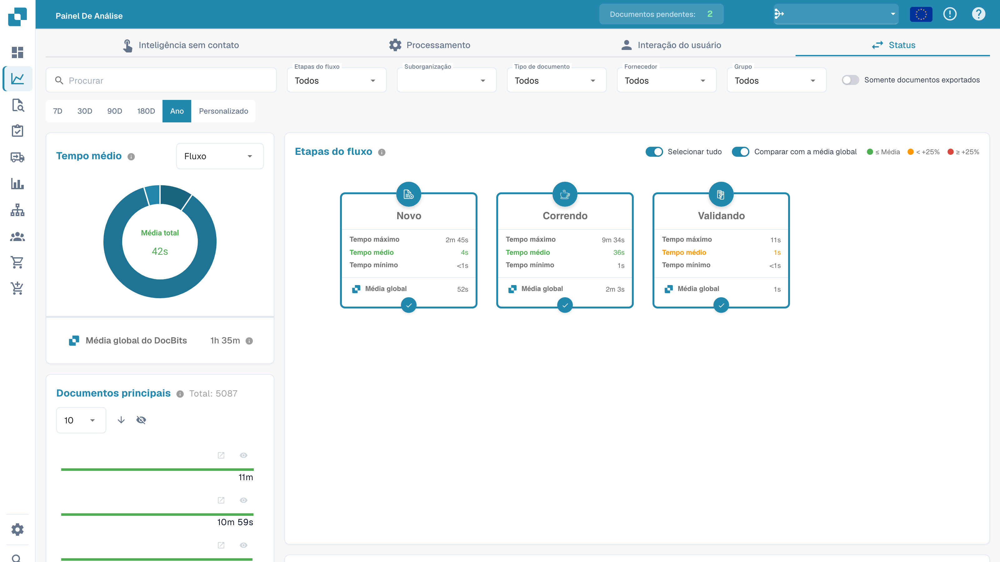<figcaption>
Vista dos estados na análise. Correndo indica processamento em execução.
</figcaption></figure>

### Fluxo de Processamento

Analisa o desempenho em todos os **módulos técnicos de processamento** (OCR, classificação, extração, validação) — útil para identificar gargalos do lado do sistema.

<figure>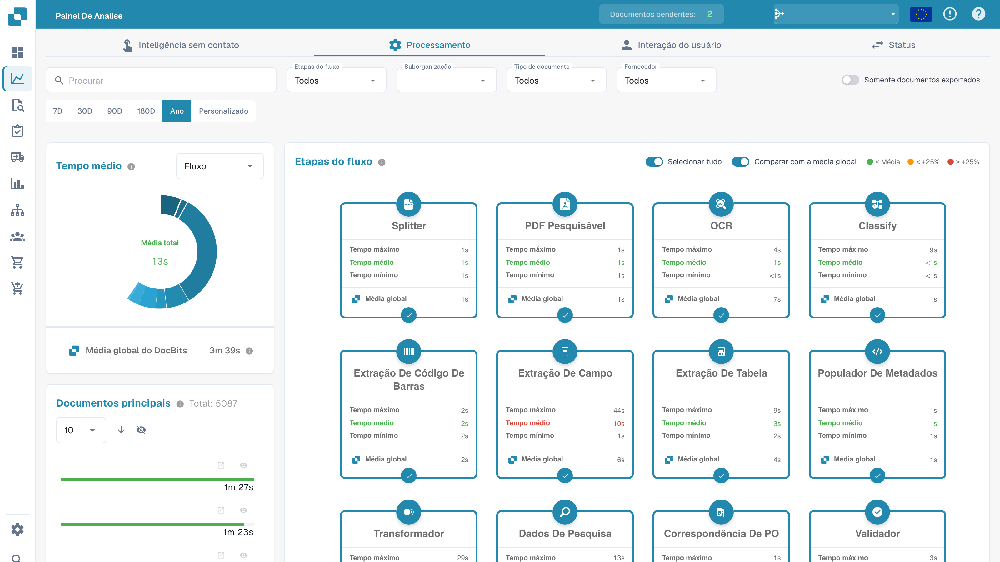<figcaption>
Vista do processo com as etapas agregadas.
</figcaption></figure>

### Fluxo de Interação do Usuário

Foca nos **pontos de contato humano** — tempo de espera na fila, validação manual, revisão e aprovação — útil para identificar gargalos de fluxo de trabalho e de pessoal.

<figure>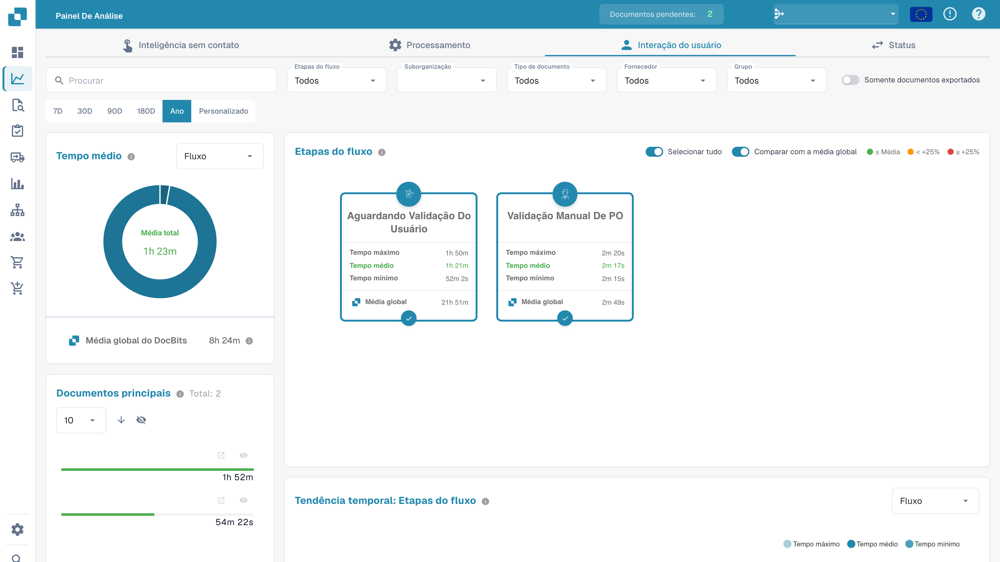<figcaption>
Vista agregada das interações dos utilizadores.
</figcaption></figure>

## Opções de Filtro

O painel suporta filtragem multidimensional poderosa. Todos os gráficos, cartões e tabelas são atualizados em tempo real com base nos filtros ativos.

### Pesquisar

Localize instantaneamente qualquer documento por **nome** ou **ID exclusivo**.

<figure>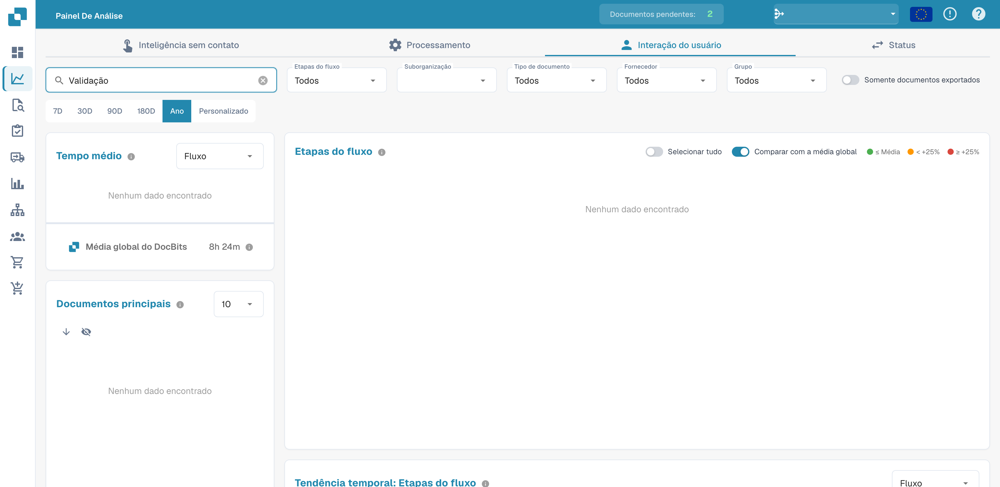<figcaption>
Análise filtrada pela etapa de validação.
</figcaption></figure>

### Etapas do Fluxo

Selecione etapas específicas para focar sua análise. Ativar/desativar etapas também recalcula as métricas de tempo nos demais componentes do painel.

<figure>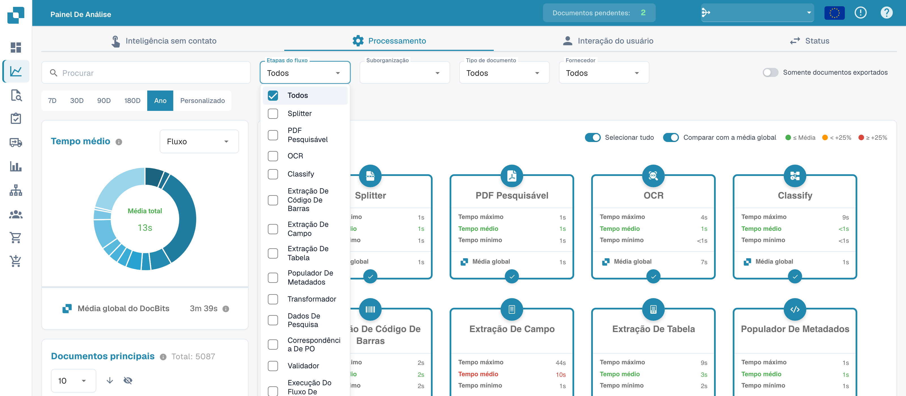<figcaption>
Seleção de etapas no filtro da análise.
</figcaption></figure>

### Suborganização, Tipo de Documento, Fornecedor, Grupo

Compare o desempenho entre:

* **Suborganizações** — diferentes unidades de negócio ou inquilinos
* **Tipos de Documento** — faturas, pedidos de compra, notas de entrega, etc.
* **Fornecedores** — para identificar quais fornecedores causam os maiores tempos de processamento
* **Grupos** — para comparar o desempenho entre grupos de usuários atribuídos (disponível para os tipos de fluxo **Status** e **Interação do Usuário**)

<figure>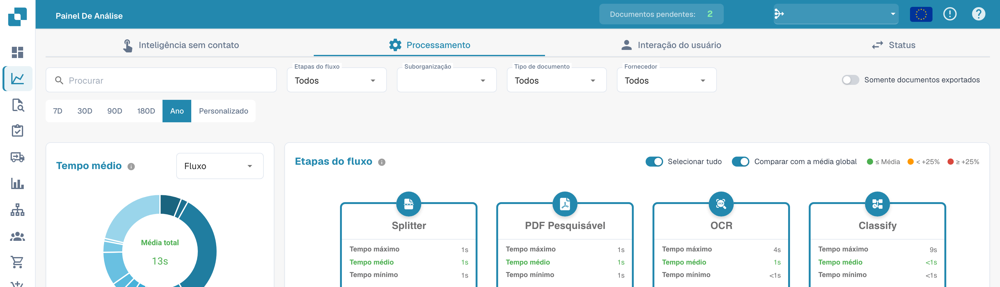<figcaption>
Filtros de análise por etapa, suborganização, tipo de documento e fornecedor.
</figcaption></figure>

<mark style="color:red;">**Observação**</mark>: O filtro **Grupo** aplica-se apenas a documentos que estão **atribuídos diretamente a um grupo**. Documentos atribuídos a um usuário individual — mesmo que esse usuário seja membro de um grupo — **não** são incluídos nos resultados do filtro de grupo.

### Somente documentos exportados

Ativado por padrão — apenas os documentos que concluíram a exportação são considerados nas métricas do painel.

<mark style="color:red;">**Observação**</mark>: Desativar essa opção pode resultar em valores médios imprecisos, pois os documentos que ainda não foram concluídos também são incluídos nos cálculos.

<figure>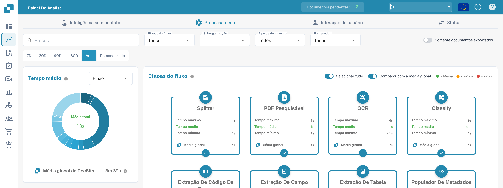<figcaption>
Opção para analisar apenas documentos exportados.
</figcaption></figure>

### Intervalo de Tempo

Analise qualquer período, de **7 dias** até **um ano completo**, ou defina um **intervalo personalizado** usando o seletor de datas.

<figure>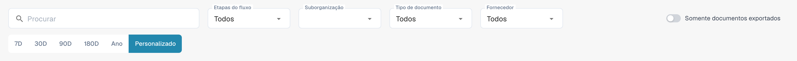<figcaption>
Opção de período personalizado nos filtros da análise.
</figcaption></figure>

## Cartões de Etapas do Fluxo

Cada cartão representa uma etapa do fluxo com base no **Tipo de Fluxo** selecionado. Os cartões se adaptam à sua seleção — mostrando estágios do ciclo de vida para *Status*, módulos de processamento para *Processamento* ou pontos de contato do usuário para *Interação do Usuário*.

Cada cartão exibe:

* Tempos **Mínimo, Médio, Máximo** para a etapa
* Uma comparação entre o **seu Tempo Médio** e a **Média Global DocBits** (quando o seletor de comparação está ativado)
* Um círculo de seleção para **incluir ou excluir** a etapa dos cálculos de tempo agregados usados pelo Gráfico de Tempo Médio, Gráfico de Tendência de Tempo e Tabela de Dados

Um seletor **Selecionar Todos** no cabeçalho permite incluir ou excluir todas as etapas de uma só vez.

<figure>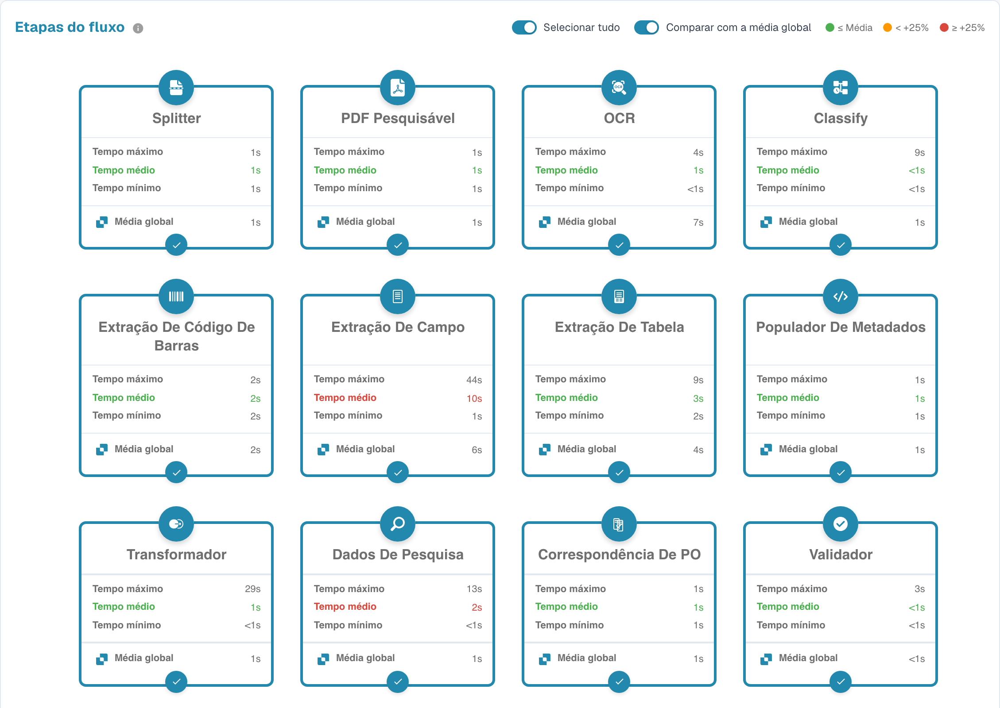<figcaption>
Cartões das etapas com tempos de processamento agregados.
</figcaption></figure>

### Comparar com a Média Global

O seletor **Comparar com a Média Global** controla se a Média Global DocBits é exibida nos cartões e no gráfico. Quando ativado, o tempo médio em cada cartão é codificado por cor:

* **Verde** — seu Tempo Médio está em ou abaixo da Média Global
* **Laranja** — seu Tempo Médio está até **+25%** acima da Média Global
* **Vermelho** — seu Tempo Médio está **+25%** ou mais acima da Média Global

<figure>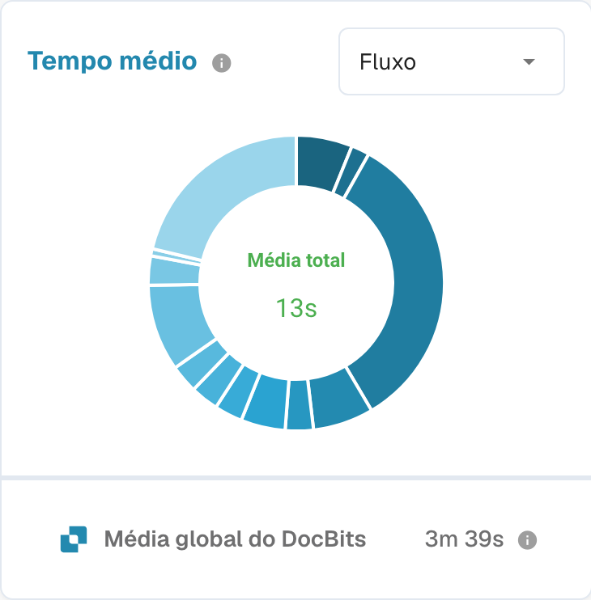<figcaption>
Duração média comparada com a média global.
</figcaption></figure>

## Gráfico de Tempo Médio

O Gráfico de Tempo Médio visualiza como o tempo de processamento é distribuído nas etapas de fluxo selecionadas. Use o seletor **Agrupar Por** para comparar entre diferentes dimensões:

* **Etapas do Fluxo** — veja quais etapas consomem mais tempo
* **Suborganização** — identifique variações entre unidades de negócio
* **Tipo de Documento** — compare os tempos de processamento entre tipos de documento
* **Fornecedor** — descubra quais fornecedores têm os maiores tempos de processamento
* **Grupo** — compare entre grupos de usuários atribuídos (somente tipos de fluxo Status e Interação do Usuário)

Quando **Comparar com a Média Global** está ativado, o gráfico também exibe a Média Global DocBits para benchmarking.

## Top Documentos

O cartão **Top Documentos** lista documentos individuais que correspondem ao conjunto de filtros ativos, classificados pelo tempo total gasto.

* Seletor de **ordem de classificação** — alterne entre **decrescente** (mais lentos primeiro) e **crescente** (mais rápidos primeiro).
* Lista suspensa de **tamanho da página** e paginação — navegue pelas páginas do conjunto de resultados.
* **Ocultar / mostrar** um documento por meio do ícone de olho ao lado dele — documentos ocultos são excluídos de todos os cálculos de tempo no painel.
* **Ocultar / mostrar todos** os documentos no filtro por meio do ícone de olho no cabeçalho.
* **Clique em um documento** (nome do arquivo ou barra de progresso) para copiar o ID do Documento para a área de transferência.

## Gráfico de Tendência de Tempo

Acompanhe as tendências de desempenho ao longo do tempo e identifique anomalias. O Gráfico de Tendência de Tempo mostra o **Tempo Médio** das etapas de fluxo atualmente selecionadas e pode ser agrupado por:

* **Etapas do Fluxo** — uma linha por etapa selecionada
* **Suborganização**
* **Tipo de Documento**
* **Fornecedor**
* **Grupo** (disponível para os tipos de fluxo **Status** e **Interação do Usuário**)

Isso facilita detectar um pico repentino para um fornecedor específico ou um aumento gradual para um tipo de documento específico, antes que se torne um problema crítico.

## Tabela de Dados

A Tabela de Dados fornece acesso completo a todos os dados de linha subjacentes para o conjunto de filtros ativos.

* **Arraste colunas para o painel Colunas Ocultas** (à esquerda da tabela) para removê-las da visualização. As colunas ocultas são usadas para agregação — os tempos **Mínimo / Máximo / Médio** são recalculados dinamicamente com base nas colunas visíveis. Arraste um chip de volta para a tabela (ou clique no ícone **+**) para restaurar a coluna.
* **Classifique** clicando nos cabeçalhos das colunas e **reordene** colunas arrastando-as e soltando-as.
* **Baixar CSV** por meio do botão no cabeçalho do cartão — apenas as colunas atualmente visíveis são exportadas.

<figure>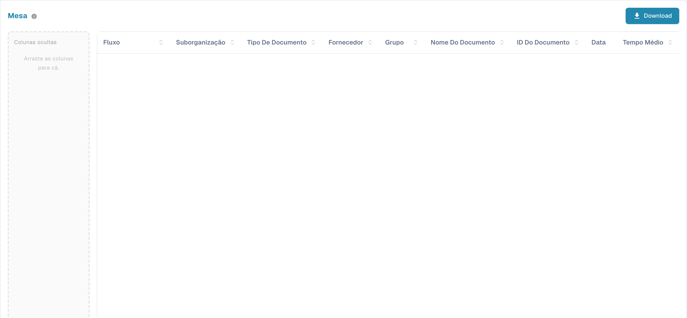<figcaption>
Tabela de análise com rótulos em português; valores dos documentos ocultos. A etiqueta Mesa refere-se à tabela de dados, não a mobiliário.
</figcaption></figure>

## Touchless Intelligence

A aba **Touchless Intelligence** mostra quantos documentos passam pelo DocBits sem que ninguém toque neles e por que os outros param. Veja [Touchless Intelligence](touchless-intelligence.md).
