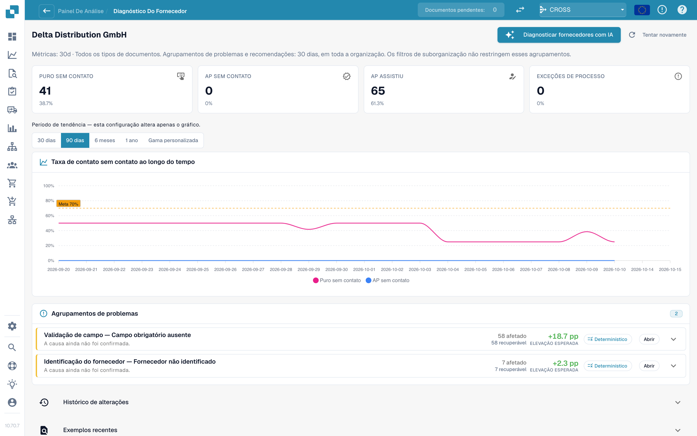
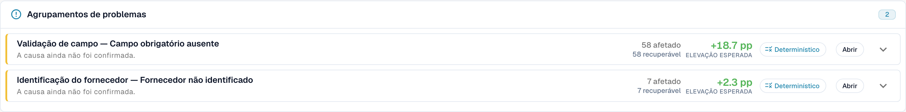

# Diagnóstico de fornecedores e clusters de problemas

Clique em um fornecedor na fila para abrir a sua página de diagnóstico.

<figure><figcaption>
A página Supplier Diagnosis: cartões de resultados, tendência com seletor de período e dois clusters de problemas ordenados por ganho esperado. Organização de exemplo com dados de demonstração; os nomes dos fornecedores são fictícios.
</figcaption></figure>

A página mostra:

* **Seis cartões de resultados** (Pure touchless, AP touchless, AP assisted, Process exception, In progress, Not eligible), cada um com link para os documentos.
* **A tendência** com o seu próprio seletor de período: 30 dias, 90 dias, 6 meses, 1 ano ou um intervalo personalizado (até dois anos). Isso altera apenas o gráfico.
* **Clusters de problemas** (veja abaixo).
* **Change history** (histórico de alterações): as alterações que você aplicou para este fornecedor e o que elas fizeram.
* **Recent examples** (exemplos recentes): documentos de exemplo, em duas abas: **Needed attention** e **Went touchless**.
* **Diagnose supplier with AI** (diagnosticar o fornecedor com IA): analisa todos os clusters do fornecedor (administradores).

Uma nota curta explica uma página vazia, por exemplo: _5 documents from this supplier are still being processed and have no analysis result yet._ ou _All 40 completed documents from this supplier ran touchless: there is nothing to diagnose._

### Clusters de problemas

Um **cluster** agrupa os documentos de um fornecedor que pararam pelo **mesmo primeiro motivo**. Em vez de 40 problemas individuais, você vê "3 problemas".

<figure><figcaption>
Um cartão de cluster aberto: o primeiro bloqueio, <strong>What to change</strong> e uma <strong>Change proposal</strong> com risco, escopo e perguntas em aberto. Aqui o cluster abrange 58 documentos e vale +18,7 pp. Organização de exemplo com dados de demonstração; os nomes dos fornecedores são fictícios.
</figcaption></figure>

**Exemplo de cluster (ilustrativo).**

* **Headline**: _Required field missing_ na etapa _Field Validation_
* **Affected**: 28 documentos. **Recoverable**: 28 documentos. **Expected lift**: +2,8 pp
* **Suspected cause**: o fornecedor imprime o número do PO abaixo da tabela, onde a extração não procura
* **What to change**: _Master data change_: adicionar o layout deste fornecedor. **Open** leva você à página de configurações certa
* **Owner**: Consultant. **Confidence**: Medium. **Source**: Hypothesis

O que um cartão de cluster mostra:

| Parte                                      | Significado                                                                                                                                                                                                                                  |
| ------------------------------------------ | -------------------------------------------------------------------------------------------------------------------------------------------------------------------------------------------------------------------------------------------- |
| **First blocker** e **stage**              | O motivo e a etapa do pipeline em que os documentos param. Há mais de 30 motivos, por exemplo _Supplier not identified_, _Purchase order not found_, _Unit price outside PO tolerance_, _Rejected by the ERP_, _E-invoice validation failed_ |
| **Affected / Recoverable / Expected lift** | Quantos documentos, quantos podem ser recuperados, quantos pontos percentuais isso renderia                                                                                                                                                  |
| **Suspected cause / Confirmed cause**      | O que o DocBits acha (ou o que uma pessoa confirmou) ser o motivo                                                                                                                                                                            |
| **Evidence** e **Missing evidence**        | Em que o achado se baseia e o que o DocBits **não** conseguiu estabelecer. Leia **Missing evidence** antes de confiar no resto                                                                                                               |
| **What to change**                         | Passos concretos com links **Open** para as configurações. Uma etiqueta informa o tipo: _Configuration change_, _Master data change_, _Supplier template change_, _Process change_, _Supplier action needed_, _Not fixable_                  |
| **Owner**                                  | DocBits, Customer, Consultant, Supplier ou Unassigned                                                                                                                                                                                        |
| **Sample documents**                       | Documentos reais do cluster para você examinar                                                                                                                                                                                               |

**Fixable in DocBits** e **Supplier action only** são exibidos em dois grupos. Em _Supplier action only_, nada no DocBits altera o resultado: o fornecedor precisa corrigir o documento e enviá-lo de novo.

### De onde vem uma recomendação

Toda causa mostra a sua **fonte**, para que você possa distinguir um achado derivado de um palpite:

| Fonte                              | Significado                                                                                                        |
| ---------------------------------- | ------------------------------------------------------------------------------------------------------------------ |
| **Deterministic** / **Rule-based** | Uma regra a derivou a partir da evidência registrada do pipeline. Nenhum modelo de linguagem foi usado             |
| **Hypothesis**                     | Um modelo de linguagem a propôs a partir da evidência do cluster. Trate-a como uma pista e verifique antes de agir |
| **Confirmed**                      | Uma pessoa revisou a evidência e confirmou a causa                                                                 |

Os textos de IA são escritos no idioma da sua organização. Se um cluster foi analisado em outro idioma, use **Analyse in this language**.

## Clusters de PO Matching

Se o primeiro bloqueio de um cluster for um motivo de PO Matching (por exemplo, _PO item mismatch_ ou _Purchase order not found_), o cartão do cluster mostra como o DocBits tenta fazer o match da fatura com o pedido de compra. Veja [Diagnóstico de PO Matching](touchless-po-matching-diagnosis.md).

## Páginas relacionadas

* [Touchless Intelligence](./)
* [Diagnóstico de PO Matching](touchless-po-matching-diagnosis.md)
* [Rastreamento do documento](touchless-document-trace.md)
* [Propostas de alteração e relatórios](touchless-change-proposals.md)
