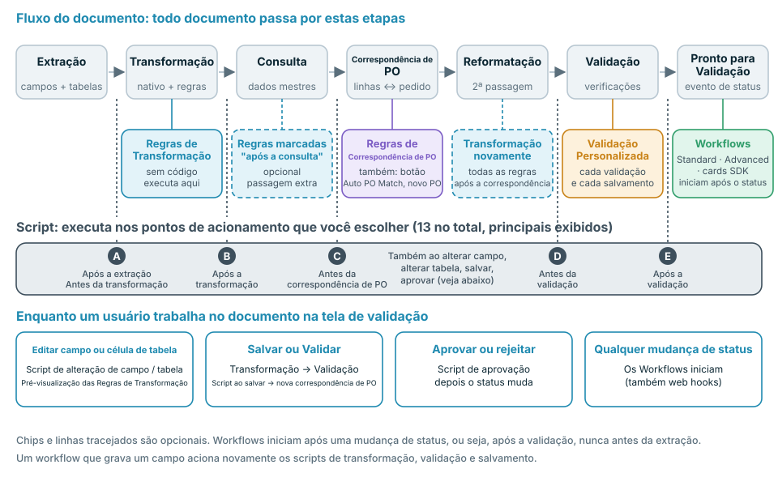
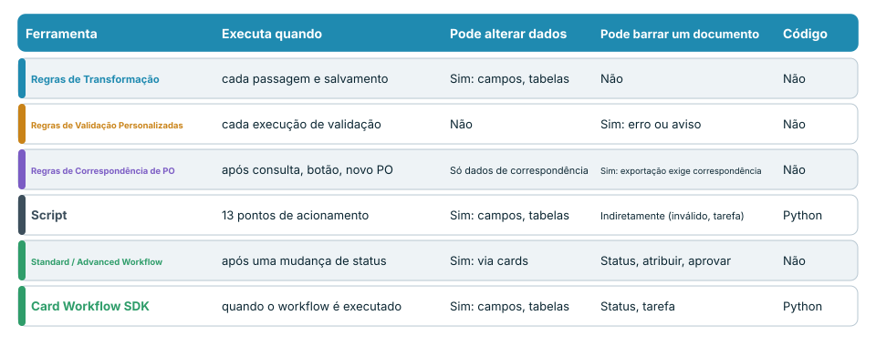
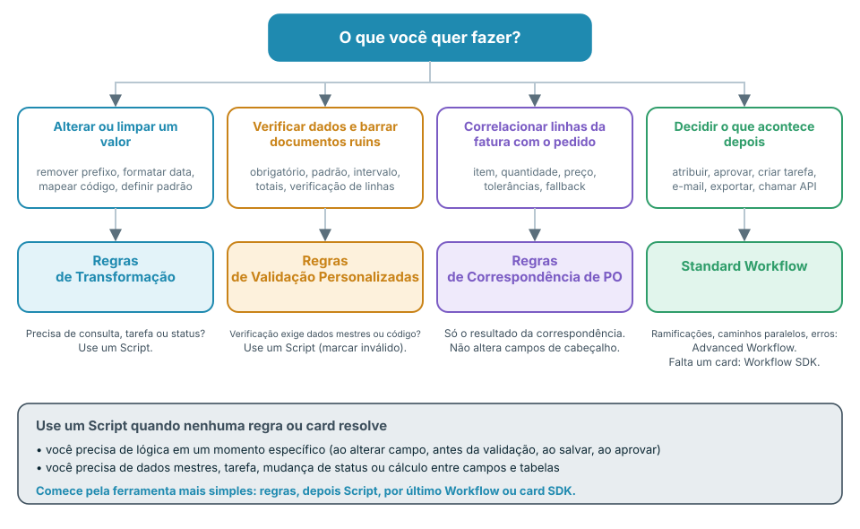

# Escolha a automação certa



O vídeo (quase seis minutos) percorre os mesmos temas em quatro partes: **0:00** onde cada ferramenta atua no fluxo do documento, **1:40** código, workflows e a comparação, **2:53** o que cada ferramenta pode e não pode fazer, **4:06** boas práticas e erros comuns.

O DocBits oferece várias formas de alterar, verificar e encaminhar documentos: **Regras de Transformação**, **Regras de Validação Personalizadas**, **Regras de Correspondência de Pedido de Compra**, **Scripts**, **Standard Workflows**, **Advanced Workflows** e **cards do Workflow SDK**. Elas se sobrepõem de propósito. Esta página mostra qual escolher, **quando cada uma é executada no fluxo do documento** e o que ela pode e não pode fazer.

## A resposta curta

| Quero … | Usar | Por quê |
| --- | --- | --- |
| Limpar ou reescrever um valor (aparar, prefixo, formato de data, mapeamento de unidade, valor padrão) | [Regras de Transformação](settings/global-settings/document-types/transformation-rules.md) | Sem código, pré-visualização ao vivo, executada em cada passagem e ao salvar |
| Garantir que os dados estejam completos e plausíveis e barrar os documentos que não estão | [Regras de Validação Personalizadas](settings/global-settings/document-types/custom-validation-rules.md) | Verificações declarativas, erro ou aviso, bloqueiam a exportação automática |
| Correlacionar linhas da fatura com linhas do pedido de compra | [Regras de Correspondência de Pedido de Compra](settings/global-settings/document-types/more-settings/purchase-order/purchase-order-matching-rules.md) | Conjuntos de regras com tolerâncias, fallbacks e um diagrama visual |
| Fazer algo que uma regra não consegue expressar: uma consulta, um cálculo entre campos e tabelas, uma tarefa, uma mudança de status em um momento exato | [Script](settings/global-settings/document-types/script/README.md) | Python em 13 pontos de acionamento do fluxo |
| Decidir **o que acontece depois** com um documento: atribuir, aprovar, criar uma tarefa, enviar um e-mail, exportar, chamar uma API | [Standard Workflow](workflow/standard-workflow-builder.md) | Cards When / And / Then em eventos de status |
| Fazer o mesmo com ramificações, várias condições e caminhos de erro | [Advanced Workflow](workflow/advanced-workflow-builder.md) | Grafo visual de nós |
| Precisar de uma ação que nenhum card nativo oferece | [Workflow SDK (Card SDK)](workflow/card-sdk.md) | Seu próprio card, revisado pelo DocBits |

**Regra prática: use a ferramenta menos poderosa que resolva o problema.** Primeiro regras, depois Script, por último Workflow ou card SDK. As regras são mais fáceis de ler, mais fáceis de testar e não podem danificar um documento; o código pode fazer mais e, por isso, exige mais cuidado.

## Onde cada ferramenta atua no fluxo do documento

Todo documento passa pelas mesmas etapas. Cada ferramenta tem o seu lugar nesse fluxo, e esse lugar determina o que ela enxerga e o que ainda pode alterar.

<figure><figcaption></figcaption></figure>

Em palavras:

1. A **extração** lê os campos de cabeçalho e as tabelas do documento. Um Script pode ser executado **após a extração**.
2. A **transformação** aplica a formatação nativa e as suas **Regras de Transformação**. Os Scripts podem ser executados antes e depois dela.
3. A **consulta de dados mestres** preenche campos como o fornecedor. As Regras de Transformação marcadas como **executar após a consulta** recebem aqui uma passagem extra.
4. A **correspondência de PO** só é executada quando a correspondência de pedidos de compra está ativa para o tipo de documento. As **Regras de Correspondência de Pedido de Compra** atuam aqui. Um Script pode ser executado **antes da correspondência de PO**.
5. **Reformatação**: todas as Regras de Transformação são executadas novamente, de modo que os valores gravados pela consulta ou pela correspondência também sejam formatados.
6. A **validação** executa as suas **Regras de Validação Personalizadas**. Os Scripts podem ser executados **antes** e **depois** da validação.
7. O documento recebe o status **Pronto para Validação**. Este é o primeiro momento em que um **Workflow** pode iniciar. Os Workflows reagem a mudanças de status, portanto sempre são executados **depois** da validação, nunca antes da extração.

Enquanto uma pessoa trabalha na tela de validação, outros acionamentos se aplicam: editar um campo ou uma célula de tabela executa os Scripts de alteração de campo e de tabela e atualiza a pré-visualização das Regras de Transformação. **Salvar** e **Validar** executam novamente as Regras de Transformação, a validação e os Scripts de salvamento, e correlacionam o pedido de compra de novo quando o número do PO mudou. **Aprovar** executa os Scripts de aprovação antes de o status mudar.


Um workflow que grava um campo se comporta como uma pessoa que salva o documento: as Regras de Transformação, a validação, as Regras de Validação Personalizadas e os Scripts de salvamento são executados novamente para essa gravação. Leve isso em conta quando um workflow e uma regra alterarem o mesmo campo.


## Compare as ferramentas

<figure><figcaption></figcaption></figure>

| | Regras de Transformação | Regras de Validação Personalizadas | Regras de Correspondência de PO | Script | Standard Workflow | Advanced Workflow | Card SDK |
| --- | --- | --- | --- | --- | --- | --- | --- |
| **Executa quando** | Em cada passagem de transformação e em cada salvamento | Em cada execução de validação | Após a consulta, **Auto PO Match**, novo número de PO | 13 pontos de acionamento | Após uma mudança de status | Após uma mudança de status | Quando o seu workflow é executado |
| **Pode ler** | Campos de cabeçalho, colunas de tabela | Campos, células de tabela, totais sobre linhas | Tabelas, números de PO, linhas do pedido de compra, tolerâncias | Todos os dados extraídos, consultas, usuários, grupos, pesquisa de texto completo | Dados do documento, usuários, grupos, variáveis | O mesmo, mais os resultados de nós anteriores | Campos, tabelas, consultas, usuários, grupos |
| **Pode gravar** | Valores de campos e colunas, linhas, suborganização | Nada: apenas marcações válido / inválido | Somente dados de correspondência | Campos, tabelas, tarefas, status | Campos, status, atribuição, tarefas, exportação, e-mail, chamada de API | Os mesmos cards, mais lógica e variáveis | Campos, tabelas, status, tarefas |
| **Pode barrar um documento** | Não | Sim, erros bloqueiam a exportação automática e **Validar** | Sim, sem correspondência completa a exportação automática aguarda quando a correspondência de PO está ativa | Indiretamente: marcar um campo como inválido, criar uma tarefa | Define o status, atribui, aprova, rejeita | O mesmo | Igual ao tipo do card |
| **Precisa de código** | Não | Não | Não | Sim, Python restrito | Não | Não | Sim, Python em um sandbox |
| **Uso típico** | Normalizar valores | Campos obrigatórios, formatos, totais | Correspondência de linhas | Lógica especial | Encaminhamento e aprovação | Encaminhamento com ramificações | Ações de parceiros |

## Decida em quatro perguntas

<figure><figcaption></figcaption></figure>

1. **Um valor precisa ser alterado?** Use **Regras de Transformação**. Se a alteração exigir dados mestres, uma tarefa ou um status, use um **Script**.
2. **Um valor precisa ser verificado?** Use **Regras de Validação Personalizadas**. Elas barram um documento, mas nunca o alteram. Se a verificação exigir dados mestres ou código, um **Script** pode marcar o campo como inválido.
3. **As linhas da fatura precisam ser correlacionadas com um pedido?** Use **Regras de Correspondência de Pedido de Compra**. Elas apenas produzem resultados de correspondência. Para corrigir um campo de cabeçalho antes da correspondência, use uma Regra de Transformação.
4. **O próximo passo depende do documento?** Use um **Workflow**. Escolha **Advanced** quando precisar de ramificações, várias condições ou caminhos de erro. Escolha um **card SDK** somente quando nenhum card nativo fizer o que você precisa.

## Ferramenta por ferramenta

### Regras de Transformação

* **Use quando** um valor está correto no conteúdo, mas errado na forma: prefixos, espaços, formatos de data, códigos de unidade, valores padrão, um número de PO no campo errado, ou tabelas que precisam ser reduzidas a uma linha de total.
* **Elas são executadas** na primeira passagem de transformação, em uma passagem opcional após a consulta de dados mestres, novamente após a correspondência de PO e em cada salvamento. A tela de validação mostra uma pré-visualização.
* **Elas podem** alterar campos de cabeçalho, colunas e linhas de tabela e a suborganização. Cada regra pode ser limitada a determinados fornecedores ou condições.
* **Elas não podem** barrar um documento, chamar outros sistemas, usar consultas de dados mestres nem criar tarefas. Uma regra que não pode ser aplicada deixa o valor como está.
* **Saiba mais:** [Regras de Transformação](settings/global-settings/document-types/transformation-rules.md)

### Regras de Validação Personalizadas

* **Use quando** um documento não deve prosseguir com dados errados: campos obrigatórios, padrões, intervalos numéricos, valores permitidos, comparação entre dois campos, totais que precisam fechar.
* **Elas são executadas** em cada validação: no pipeline, em cada salvamento e depois que um workflow gravou dados.
* **Elas podem** marcar um campo ou uma célula de tabela como **erro** (bloqueia a exportação automática e **Validar**, a menos que seja ignorado) ou como **aviso** (visível, não bloqueia).
* **Elas não podem** alterar dados, consultar dados mestres nem chamar serviços. Corrija os dados primeiro com uma Regra de Transformação e só então verifique-os.
* **Saiba mais:** [Regras de Validação Personalizadas](settings/global-settings/document-types/custom-validation-rules.md)

### Regras de Correspondência de Pedido de Compra

* **Use quando** as linhas da fatura precisam ser correlacionadas com as linhas do pedido de compra: correspondências simples, múltiplas e de total, tolerâncias de quantidade e preço, fallbacks quando a primeira regra não corresponde.
* **Elas são executadas** após a consulta de dados mestres, quando você clica em **Auto PO Match** e quando o número do PO muda ao salvar.
* **Elas podem** produzir o resultado da correspondência e os dados de que a aprovação precisa. A visualização em diagrama mostra qual regra se aplica em cada estágio.
* **Elas não podem** reescrever campos de cabeçalho, definir um status nem executar lógica personalizada. Sem correspondência completa, a exportação automática aguarda quando a correspondência de PO está ativa.
* **Saiba mais:** [Regras de Correspondência de Pedido de Compra](settings/global-settings/document-types/more-settings/purchase-order/purchase-order-matching-rules.md)

### Script

* **Use quando** nenhuma regra consegue expressar a lógica: um cálculo entre campos e tabelas, uma consulta, uma tarefa para um usuário, uma mudança de status em um momento exato ou uma reação a uma edição na tela de validação.
* **Ele é executado** nos pontos de acionamento que você escolher: após a extração, antes e depois da transformação, antes da correspondência de PO, antes e depois da validação, em alterações de campo e de tabela, ao salvar e ao aprovar.
* **Ele pode** ler o documento inteiro, usar consultas de dados mestres e pesquisa de texto completo, alterar campos, flags e tabelas, criar tarefas e mudar o status.
* **Ele não pode** importar módulos nem chamar serviços externos. É Python restrito. Um erro em um script é registrado no log e nunca interrompe o processamento do documento; portanto, um script **não** é uma forma confiável de barrar um documento: marque o campo como inválido ou crie uma tarefa.
* **Saiba mais:** [Script](settings/global-settings/document-types/script/README.md)

### Fluxo de trabalho padrão

* **Use quando** o próximo passo depende do documento: atribuir a um usuário ou grupo, aprovar ou rejeitar, criar uma tarefa, enviar um e-mail, exportar, definir um status, chamar uma API.
* **Ele é executado** quando um documento alcança um status que você escolheu, ou seja, após a validação. Ele também pode ser iniciado por um web hook, por um agendamento ou manualmente.
* **Ele pode** executar uma cadeia de cards: **When** (início), **And** (condições, todas devem ser atendidas), **Then** (ações em ordem).
* **Ele não pode** ramificar, aguardar várias condições nem reagir ao erro de um card em um caminho separado. Para isso, use um Advanced Workflow.
* **Saiba mais:** [Fluxo de trabalho padrão](workflow/standard-workflow-builder.md)

### Fluxo de trabalho avançado

* **Use quando** um documento precisa de caminhos diferentes: ramificações por condição, várias condições combinadas com ALL / ANY e um caminho para erros ou condições não atendidas.
* **Ele é executado** nos mesmos eventos de um Standard Workflow. Requer a assinatura DocFlow Advanced.
* **Ele pode** usar os mesmos cards de um Standard Workflow, além de cards de lógica e de variáveis, desenhados como um grafo.
* **Ele não pode** fazer o que acontece antes da validação: ele inicia depois de uma mudança de status. A lógica de pré-validação pertence a um Script ou a uma regra.
* **Saiba mais:** [Advanced Workflow](workflow/advanced-workflow-builder.md)

### Workflow SDK (Card SDK)

* **Use quando** precisar de um card que não existe, por exemplo uma condição ou ação específica de um aplicativo de parceiro.
* **Ele é executado** sempre que um workflow que contém o card é executado.
* **Ele pode** ler e gravar campos e tabelas, salvar o documento, mudar o status e criar tarefas.
* **Ele não pode** abrir conexões de rede. Uma execução é limitada a 60 segundos e 200 chamadas SDK. Um card só entra em produção depois que o DocBits o revisa e aprova.
* **Saiba mais:** [Card SDK](workflow/card-sdk.md)

## Boas práticas

* **Comece pela ferramenta mais simples.** Uma Regra de Transformação é melhor que um Script para formatação. Uma Regra de Validação Personalizada é melhor que um Script para uma verificação. Recorra a um Script ou a um card SDK somente quando uma regra ou um card nativo não conseguir fazer.
* **Corrija primeiro, verifique depois, encaminhe por último.** As Regras de Transformação e os Scripts preparam os dados, as Regras de Validação Personalizadas os avaliam, os Workflows decidem o que fazer com o documento. Esta é a ordem do fluxo.
* **Um responsável por campo.** Se uma Regra de Transformação e um Script gravam o mesmo campo, o resultado depende da ordem. Dê a cada campo um único responsável.
* **Não use um workflow para reparar dados.** Os Workflows iniciam depois da validação, então o reparo chega tarde e dispara uma nova validação. Repare os dados em uma regra ou em um Script antes da validação.
* **Valide com uma regra, não com um Script.** Um erro de Script nunca interrompe um documento. Uma Regra de Validação Personalizada interrompe.
* **Mantenha os scripts pequenos e nomeados pela finalidade.** Um script por tarefa, com o ponto de acionamento no nome, é fácil de desativar quando algo parece errado.
* **Teste primeiro em dev ou sandbox.** Use alguns documentos reais, confira o resultado na tela de validação e só então ative a regra ou o workflow para produção.
* **Consulte os logs.** O log do documento e o log do workflow mostram o que foi executado e o que mudou.

## Erros comuns

| Erro | Melhor |
| --- | --- |
| Um Script que apara e adiciona prefixos a valores | Uma Regra de Transformação |
| Um workflow que define um campo após a validação | Uma Regra de Transformação ou um Script antes da validação |
| Um Script de que se espera que barre um documento inválido | Uma Regra de Validação Personalizada |
| Uma Regra de Validação Personalizada de que se espera que corrija um valor | Uma Regra de Transformação e, depois, a regra de validação |
| Reescrever o número do PO em uma regra de correspondência de PO | Uma Regra de Transformação no campo *Pedido de Compra*, antes da correspondência |
| Um Advanced Workflow para um único *When → Then* | Um Standard Workflow |
| Um card SDK para algo que um card nativo faz | O card nativo |

## Páginas relacionadas

* [Regras de Transformação](settings/global-settings/document-types/transformation-rules.md)
* [Regras de Validação Personalizadas](settings/global-settings/document-types/custom-validation-rules.md)
* [Regras de Correspondência de Pedido de Compra](settings/global-settings/document-types/more-settings/purchase-order/purchase-order-matching-rules.md)
* [Script](settings/global-settings/document-types/script/README.md)
* [Workflow](workflow/README.md)
