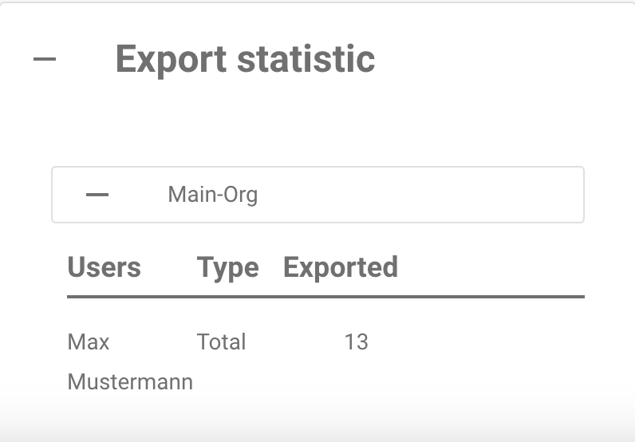

# Página de Relatórios



### 1. Como ativar a Página de Relatórios

Acesse **Settings** → **Document Processing** → **Module** → **Document Type** → **Show Report** e ative o botão para habilitar esta configuração.

<figure><figcaption></figcaption></figure>

### 2. **Como acessar a Página de Relatórios**

Siga estas etapas para acessar a **Página de Relatórios** no DocBits:

1. **Faça login no DocBits**
   * Abra o DocBits e faça login com suas credenciais.
2. **Clique no ícone Report**
   * Na barra lateral esquerda, encontre e clique no ícone **Report** (representado por um gráfico).

<figure><figcaption></figcaption></figure>

### **3. Usando o filtro Time Unit**

*   Na parte superior da página, você pode ajustar o filtro **Time Unit** para selecionar o intervalo de tempo do seu relatório:

    * **Últimos 30 dias**
    * **Últimos 7 dias**
    * **Custom Time Frame** (intervalo de datas personalizado)

    <figure><figcaption></figcaption></figure>

### **4. Exibição de Novos Documentos**

* Ao lado do filtro **Time Unit**, há uma exibição de informações chamada **New Documents**. Ela mostra o número de novos documentos importados durante o período selecionado.

<figure><figcaption></figcaption></figure>

### **5. Exibição do Tempo Médio do Sistema**

* Após o rótulo **New Documents**, você encontrará a exibição **Average System Time**. Ela mostra o tempo médio, em segundos, que o sistema levou para processar um novo documento durante o período selecionado.

<figure><figcaption></figcaption></figure>

### **6. Seção Changed Fields**

* Abaixo das informações relacionadas ao tempo, você encontrará a seção **Changed Fields**. Esta seção exibe um diagrama que mostra com que frequência cada campo do documento foi modificado manualmente pelos usuários durante o período selecionado.
* Cada campo é exibido com o número correspondente de alterações, mostrado como barras no diagrama.

<figure><figcaption></figcaption></figure>

* **Opções de download do diagrama**
  * No lado direito do diagrama **Changed Fields**, há um pequeno menu que permite baixar o diagrama em vários formatos. Você pode baixar o diagrama como:
    * **SVG**
    * **PNG**
    * **CSV**
  * Para baixar o diagrama, clique no menu e selecione o formato de arquivo de sua preferência.

### **7. Seções Adicionais do Relatório**

Abaixo da seção **Changed Fields**, você encontrará quatro botões adicionais que fornecem informações mais detalhadas ao serem clicados. Cada botão se expande para mostrar mais informações quando clicado.

1.  **Total de documentos por tipo**

    * Este botão exibe o número total de documentos de cada tipo de documento (por exemplo, fatura, pedido de compra etc.) durante o período selecionado.
    * Ao clicar no botão, ele se expande para mostrar uma lista de tipos de documento e a contagem correspondente de quantos documentos de cada tipo foram processados no período selecionado.

    <figure><figcaption></figcaption></figure>
2.  **Média diária por tipo de documento**

    * Este botão mostra a contagem média diária de documentos processados, categorizada por tipo de documento.
    * Ao clicar no botão, ele se expande para mostrar os tipos de documento e a respectiva contagem média diária.

    <figure><figcaption></figcaption></figure>
3.  **Status Statistic**

    * Este botão mostra a distribuição de status para cada tipo de documento (por exemplo, fatura, pedido de compra etc.). Ao ser clicado, ele se expande para exibir o status dos documentos dentro de cada tipo de documento, mostrando quantos documentos estão em cada categoria de status.

    <figure><figcaption></figcaption></figure>
4.  **Estatísticas de exportação**

    * Este botão permite visualizar as estatísticas de exportação dos seus documentos. Ao ser clicado, ele se expande para fornecer dados relacionados às exportações de documentos, como o número de exportações, taxas de sucesso/falha e outras informações relevantes.

    <figure><figcaption></figcaption></figure>
