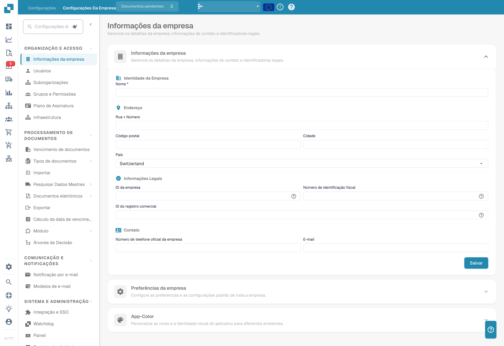

# Configurações

<figure><figcaption>
Definições da organização com dados identificativos ocultos. O país apresentado é um valor configurado; a secção App-Color mantém a designação inglesa na versão ilustrada.
</figcaption></figure>

A área de Configurações é o seu centro de controle para configurar o DocBits. Ela é organizada em cinco seções principais:

## 1. Organização e Acesso

Gerencie o perfil da sua empresa e controle quem pode acessar o quê.

* **Company Information**: Informe o nome da empresa, endereço, número de identificação fiscal e outros identificadores legais.
* **Users**: Adicione, edite ou desative contas de usuário e atribua funções (Admin, System Admin).
* **Sub-Organizations**: Crie e gerencie suborganizações para configurações com várias entidades.
* **Groups and Permissions**: Defina grupos de usuários e configure permissões detalhadas para cada grupo.

## 2. Processamento de Documentos

Configure como os documentos são importados, processados e exportados.

* **Documents Expiry**: Defina regras de exclusão automática de documentos (por exemplo, excluir após 48 horas, 1 semana etc.).
* **Document Types**: Defina e configure os tipos de documento que o DocBits processa (faturas, pedidos, guias de remessa etc.), incluindo campos, colunas de tabela, scripts e muito mais.
* **Import**: Configure como os documentos entram no DocBits — por e-mail (IMAP/Office 365), FTP ou upload de arquivos. Configure os tipos de arquivo e os limites de páginas.
* **Rule Management**: Defina regras de resolução de conflitos para a conciliação de fatura com PO, incluindo configurações de tolerância e fluxos de aprovação.
* **OCR Settings**: Configure os limites de qualidade do reconhecimento óptico de caracteres (OCR), o uso de E-Text, a versão do AI OCR e o comportamento da extração de tabelas.
* **Classification and Extraction**: Configure a separação de documentos, a formatação de valores, os métodos de extração de tabelas, as regras de classificação e os modelos de IA.
* **Lookup Master Data**: Configure como os dados extraídos são validados em relação aos dados mestres do seu sistema ERP (por exemplo, contas de fornecedores, pedidos de compra).
* **List of Values**: Crie e gerencie listas de valores predefinidas usadas em listas suspensas e na validação de dados.
* **Export**: Configure como e para onde os documentos processados são enviados — via Webhook, SFTP, SMB ou integrações Infor (IDM, ION, M3, LN).
* **Module**: Ative ou desative recursos opcionais, como PO Dashboard, Auto Accounting, Supplier Portal, Workflow Builder, extração de QR-Code e mais.
* **Decision Trees**: Crie uma lógica de decisão baseada em regras usando um designer visual. Suporta várias políticas (Unique, First, Priority, Collect etc.).
* **Agent Setup**: Crie e gerencie agentes de automação e canais de comunicação para fluxos de trabalho de processamento automático de documentos.

## 3. Comunicação e Notificações

Controle como o DocBits se comunica com os usuários e processa os e-mails recebidos.

* **Email Notification**: Configure alertas por e-mail para eventos de processamento de documentos e mudanças de status.
* **Email Templates**: Crie e gerencie modelos de e-mail reutilizáveis para notificações, organizados por tipo de documento.
* **Email Ingestion**: Configure como os e-mails recebidos são classificados automaticamente e convertidos em documentos. Inclui regras de classificação, extração de campos, processamento, gerenciamento de remetentes e treinamento — organizadas por tipo de documento (pedidos, faturas, cotações, guias de remessa, COA, PO Confirm).

## 4. Sistema e Administração

Monitore a integridade do sistema, gerencie integrações e mantenha a segurança.

* **Integration & SSO**: Configure chaves de API para integrações externas e configure o Single Sign-On (SSO) com provedores de identidade.
* **Watchdog**: Configure o serviço Watchdog para a importação automática de documentos a partir de diretórios locais.
* **Dashboard**: Personalize o comportamento do painel — filtros, configurações de exportação, permissões de ação e opções de exibição de status.
* **Activity Logging**: Visualize os logs de eventos do sistema em tempo real, filtrados por gravidade (Debug, Info, Warning, Error), período e serviço.
* **Analytics**: Acesse painéis de análise detalhados, incluindo Logs Analytics, monitoramento de segurança de autenticação (Auth Security) e API Metrics com Real User Monitoring (RUM).
* **Access Audit**: Ative e revise as trilhas de auditoria que registram todas as ações de criação, atualização e exclusão em toda a sua organização, para conformidade e segurança.
* **System Licenses**: Visualize e gerencie as informações de licença da API e o uso.
* **Cache Management**: Configure os intervalos de limpeza automática do cache (TTL) para os caches de Receive Delivery, Purchase Order e Task/Notification.
* **Fulltext Search Settings**: Configure os recursos de pesquisa de texto completo em seus documentos e dados (requer que o módulo Fulltext Search esteja ativado).

## 5. Configurações de Fornecedor

Configure o Supplier Portal e gerencie os fluxos de trabalho relacionados a fornecedores.

* **Supplier General Settings**: Configure os campos de convite do portal de fornecedores, os status do fluxo de trabalho (Not Invited, Open, Pending Registration, Approved, Rejected) e gerencie as configurações de aprovação.
* **Email Templates**: Crie e gerencie modelos de e-mail específicos para a comunicação com fornecedores.
* **Supplier Layout**: Personalize o layout e a aparência do Supplier Portal.
* **Export Configuration**: Configure como os dados de fornecedores são exportados para sistemas externos.
* **Supplier Group**: Crie e gerencie grupos de fornecedores para categorizar e organizar seus fornecedores.
* **User and Supplier Group Mapping**: Vincule usuários internos a grupos de fornecedores específicos para controlar a visibilidade e o acesso.
