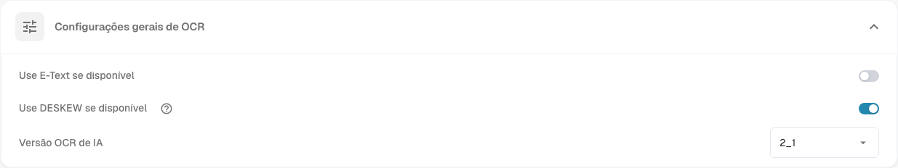

# Processamento de Documentos

As configurações de **Processamento de Documentos** determinam como o DocBits lê, enriquece e exporta documentos. Abra **Configurações** e selecione a área desejada em **Processamento de Documentos**.

* [Configurações OCR](ocr-settings.md): como o texto dos documentos é lido.
* [Pesquisa de dados mestre](master-data-lookup.md): como os valores extraídos são comparados com os dados mestres.
* [Cálculo da data de vencimento](due-date-calculation.md): como são calculadas as datas de vencimento.
* [Exportação](export.md): para onde e como são exportados os documentos processados.

Por exemplo, abra **Configurações de OCR** para verificar **Configurações gerais de OCR**. A opção **Use E-Text se disponível** utiliza o texto eletrónico incorporado. A opção **Use DESKEW se disponível** corrige a inclinação das páginas digitalizadas. A opção **Versão OCR de IA** seleciona a versão do mecanismo de reconhecimento. Consulte [Configurações de OCR](ocr-settings.md) para obter detalhes sobre os controlos.

<figure><figcaption>
As configurações gerais de OCR são uma área do processamento de documentos. Os valores selecionados dependem da sua organização.
</figcaption></figure>

Outras áreas desta secção são [Importar](import/README.md), [Classificação e extração](classification-and-extraction/README.md), [Gestão de regras](rule-manager/README.md), [Listas de valores](list-of-values.md) e [Módulos](module/README.md).

Se uma configuração não funcionar como esperado, verifique-a primeiro com um documento de teste. Uma alteração pode afetar todos os novos documentos da organização.
