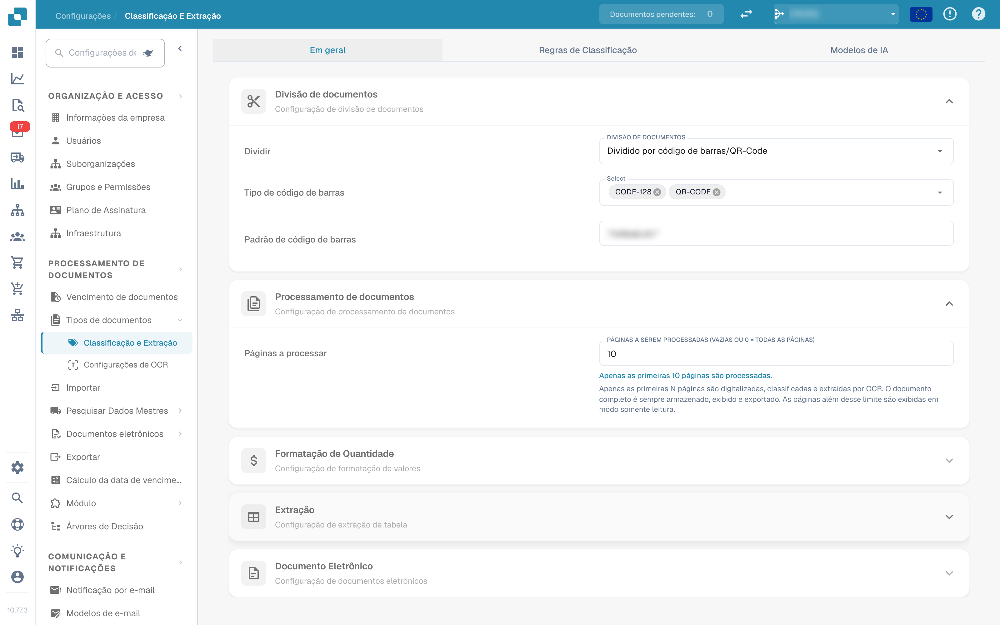
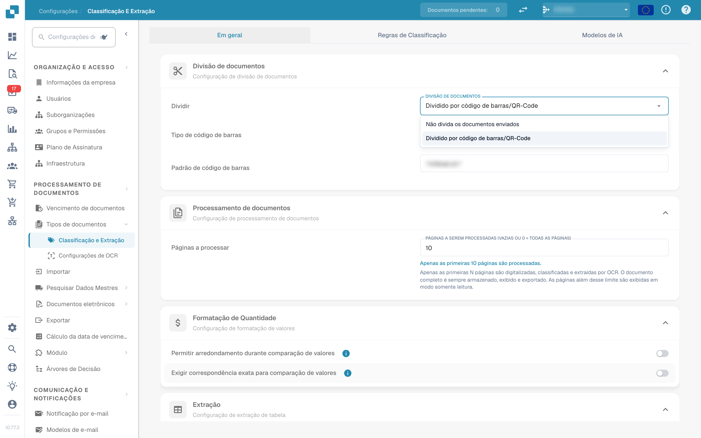
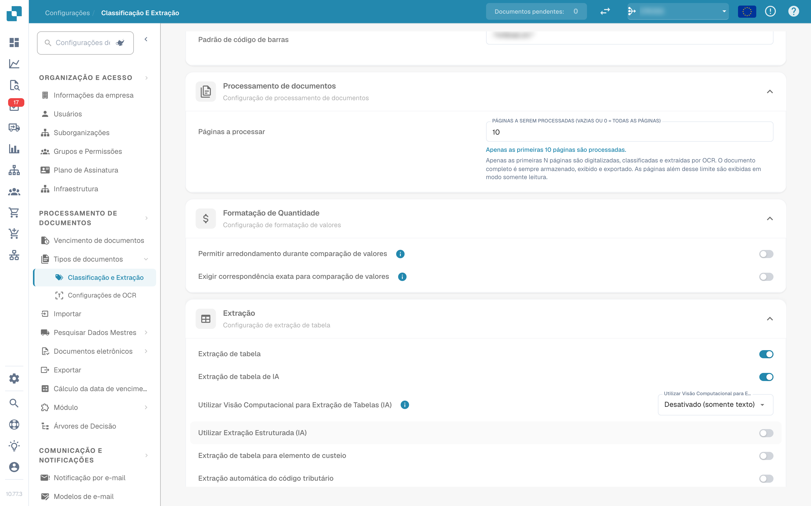
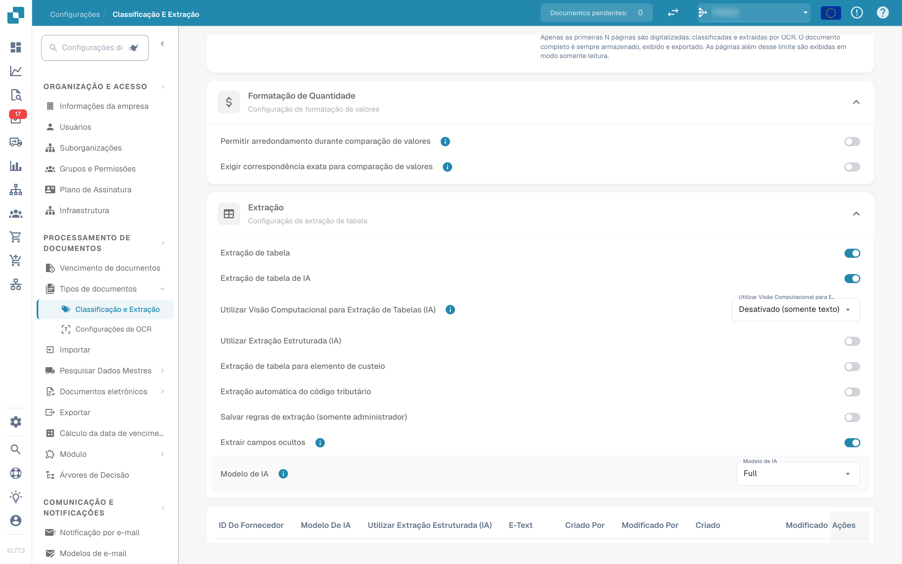
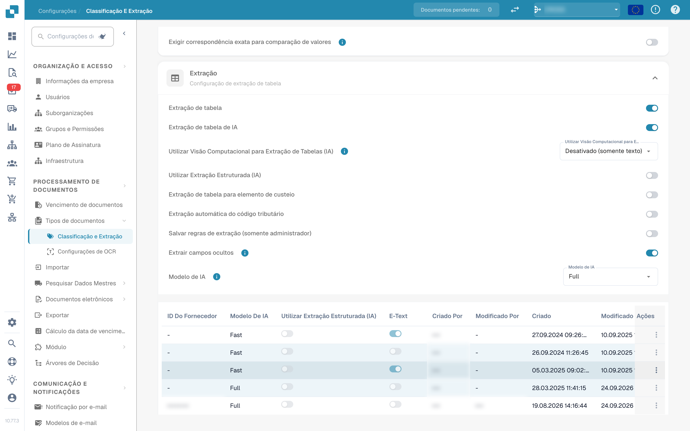
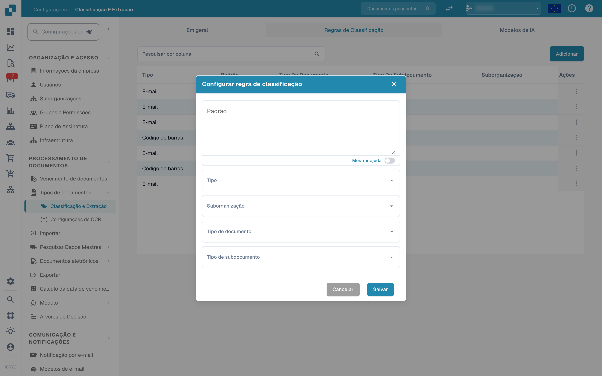
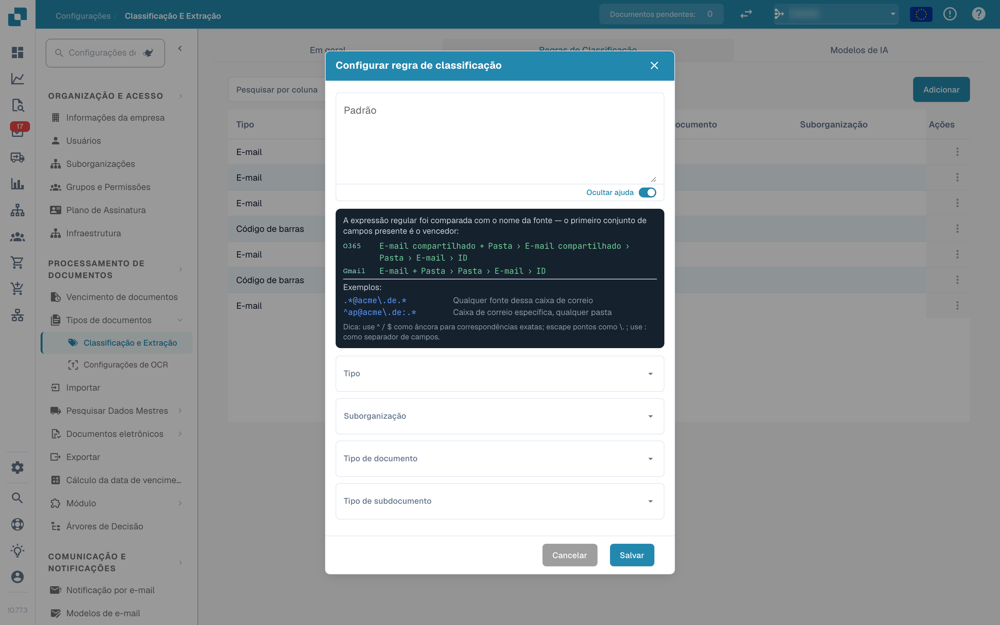
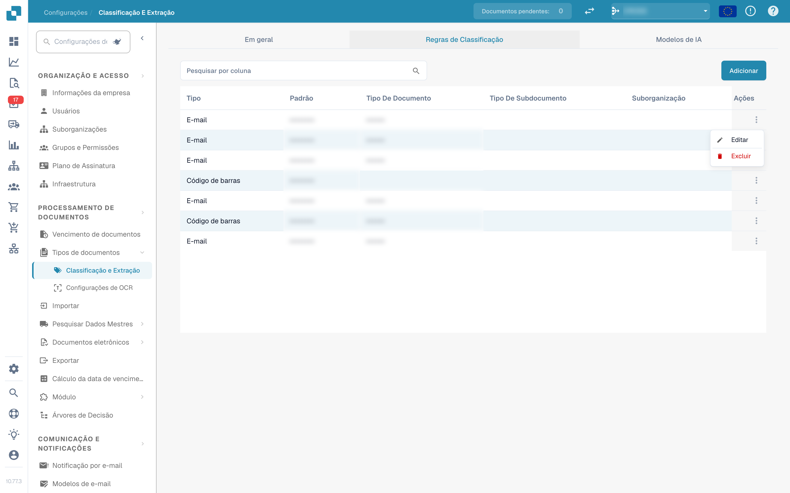
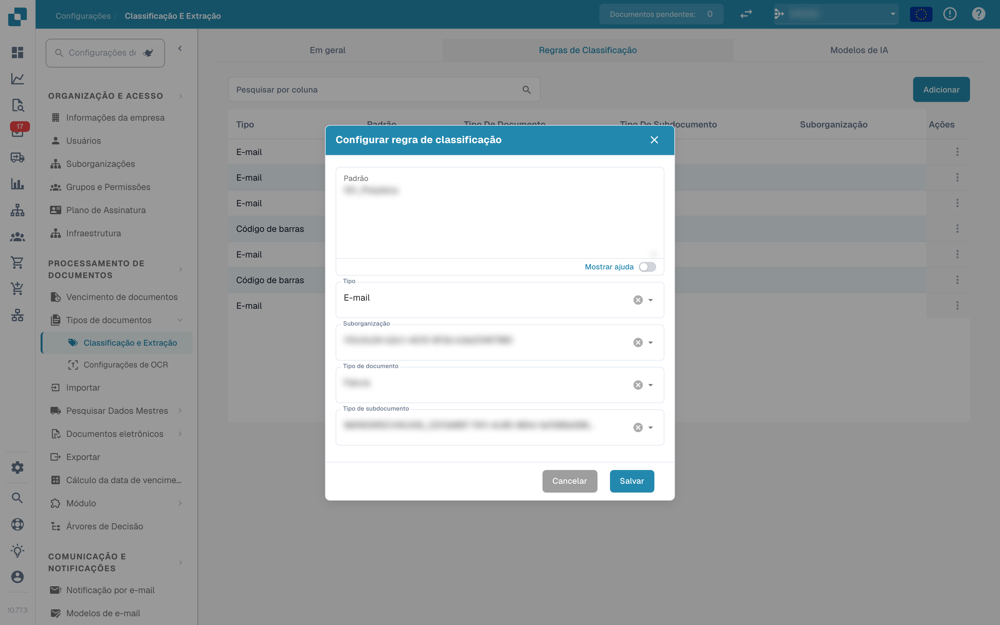
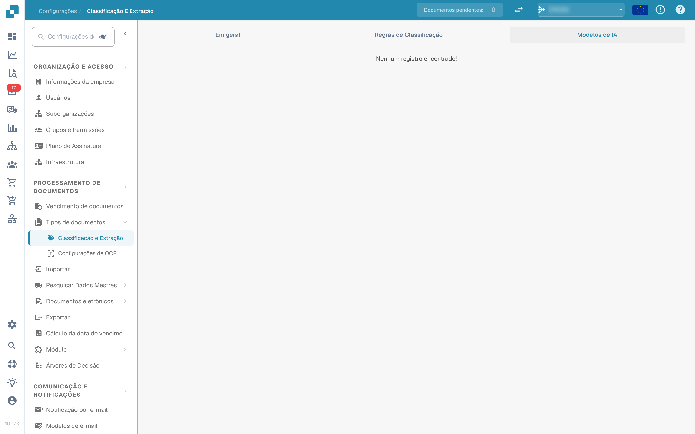

# Classificação e extração

<figure><figcaption>
Definições de classificação e extração
</figcaption></figure>

## Visão geral

Nas definições de **Classificação e extração** pode:

* controlar como os documentos carregados são **divididos** e quantas páginas são processadas
* configurar a **formatação de quantidades** para a comparação de valores
* configurar a **extração de tabelas**, incluindo o modelo de IA usado por fornecedor
* ativar ou desativar o processamento de ficheiros **ZUGFeRD** não suportados
* definir **regras de classificação** que atribuem automaticamente um tipo de documento
* rever os **modelos de IA** e as suas etiquetas treinadas

A página tem três separadores: **Em geral**, **Regras de Classificação** e **Modelos de IA**. O separador *Modelos de IA* só é apresentado quando o módulo de modelos e etiquetas está ativado para a sua organização.

| Separador | Conteúdo |
|---|---|
| Em geral | Divisão de documentos, Processamento de documentos, Formatação de Quantidade, Extração, Documento eletrónico |
| Regras de Classificação | Regras regex que classificam documentos pelo nome de origem |
| Modelos de IA | Modelos treinados à medida com as suas etiquetas, tipos de documento e prioridade |

## Acesso às definições de classificação e extração

Vá a **Definições → Tipos de Documento → Classificação e Extração**.

## Em geral

O separador **Em geral** agrupa as definições em secções expansíveis. Todas as alterações são guardadas imediatamente quando altera um valor; não existe um botão de guardar separado.

### Divisão de documentos

**Dividir** determina se um documento carregado é dividido em vários documentos quando aparece um código de barras numa das suas páginas. A lista pendente oferece:

* **Não divida os documentos enviados** – o valor predefinido; o documento é processado como um único ficheiro.
* **Dividido por código de barras/QR-Code** – o documento é dividido em cada código de barras detetado.

<figure><figcaption>
Opções de divisão na secção «Divisão de documentos»
</figcaption></figure>

Quando **Dividido por código de barras/QR-Code** está selecionado, aparecem dois campos adicionais:

* **Tipo de código de barras** – um ou mais tipos de código de barras a detetar, por exemplo *CODE-128* ou *QR-CODE*.
* **Padrão de código de barras** – uma expressão regular que o valor do código de barras tem de cumprir antes de a divisão ser acionada. Deixe vazio para dividir em qualquer código de barras dos tipos escolhidos. O padrão é validado antes de ser guardado; uma expressão inválida é comunicada de imediato.

Após uma divisão bem-sucedida, o documento principal é eliminado e as páginas continuam como documentos separados que partilham o mesmo lote.

### Processamento de documentos

**Páginas a serem processadas** limita quantas páginas por documento são reconhecidas por OCR, classificadas e extraídas.

<figure><figcaption>
Páginas a serem processadas na secção «Processamento de documentos»
</figcaption></figure>

* Vazio ou **0** significa que todas as páginas são processadas.
* Um número *N* limita o OCR, a classificação e a extração às primeiras *N* páginas. O documento completo continua a ser armazenado, apresentado e exportado; as páginas acima do limite são apresentadas apenas para leitura.

### Formatação de Quantidade

Dois interruptores controlam como os valores são comparados com os dados mestre e as encomendas de compra.

<figure><figcaption>
Secção «Formatação de Quantidade»
</figcaption></figure>

* **Permitir arredondamento durante comparação de valores** – quando ativado, é permitida uma tolerância de ±0,5. Quando desativado, aplica-se ±0,05.
* **Exigir correspondência exata para comparação de valores** – quando ativado, os valores têm de coincidir exatamente, sem tolerância. Quando desativado, aplica-se ±0,05.

Apenas um dos dois interruptores pode estar ativo ao mesmo tempo; ativar um desativa o outro.

### Extração


**Requisitos para uma extração de tabelas funcional**

* O tipo de documento tem **colunas de tabela** (Definições → Definições globais → Tipos de Documento → [Colunas de tabela](../../global-settings/document-types/table-columns/README.md)). Sem colunas não há nada para onde extrair.
* **Extração de tabela** ou **Extração de tabela de IA** está ativada abaixo, para toda a organização.
* O documento contém texto legível: o OCR foi executado, ou em PDF digitais é usado o E-Text ([Definições de OCR](../ocr-settings.md)).
* O treino e os modelos de IA são **por fornecedor**. Uma tabela treinada só é aplicada aos documentos do fornecedor com que foi treinada.


Pode extrair tabelas de documentos ativando **Extração de tabela** ou **Extração de tabela de IA**. Uma tabela treinada (baseada em IA ou manual) está sempre vinculada a um fornecedor específico.

<figure><figcaption>
Interruptores da extração de tabelas
</figcaption></figure>

**Extração de tabela:** Ativa a extração de tabelas baseada em regras. As tabelas são treinadas por fornecedor no ecrã de validação (*Go to table extraction view*).\
Saiba mais sobre o treino [aqui](../../../setup/document-training/training-line-fields-table-training/defining-tables-and-columns.md).

**Extração de tabela de IA:** Usa IA para extrair a tabela de qualquer fornecedor sem treino. Se os resultados para um fornecedor não forem suficientemente precisos, treine a tabela desse fornecedor; as regras guardadas têm então prioridade sobre a IA para esse fornecedor.

**Utilizar Visão Computacional para Extração de Tabelas (IA):** A IA lê a imagem da página em vez da camada de texto. Ajuda em documentos digitalizados e tabelas sem estrutura de texto clara; é mais lenta. A lista pendente junto ao interruptor determina com que intensidade a imagem da página é usada:

* **Desativado (apenas texto)** – É usada apenas a camada de texto. Este é o valor predefinido.
* **Apenas imagens** – É lida apenas a imagem da página.
* **Híbrido (texto e imagens)** – A camada de texto e a imagem da página são combinadas no mesmo pedido.
* **Automático (decidido por documento)** – A DocBits decide por documento se a camada de texto é suficiente.

**Utilizar Extração Estruturada (IA):** A IA devolve a tabela numa estrutura fixa que é mapeada diretamente para as colunas de tabela configuradas. Recomendado quando os cabeçalhos das colunas variam muito entre documentos. Clicar na definição abre uma pré-visualização dos campos e colunas que a IA irá pedir exatamente: os campos de cabeçalho e as colunas de linha são listados com a sua origem (campos padrão pedidos ou desativados), bem como o modo de saída esperado (por exemplo *strict* – sem colunas adicionais). Os campos configurados para o tipo de documento mas desativados não são pedidos à IA.

**Extração de tabela para elemento de custeio:** Quando ativado, a DocBits pode extrair elementos de custeio de tabelas ao nível da linha e classificá-los em conformidade.\
Encontra uma explicação detalhada [aqui](table-extraction-for-costing-element.md).

**Extração automática do código tributário:** Quando ativado, o sistema preenche automaticamente o campo **Código tributário** no ecrã de validação, desde que esteja configurado um campo de código tributário.\
Mais informações sobre esta definição [aqui](auto-extract-tax-code.md).

**Salvar regras de extração (somente administrador):** Apenas os administradores podem clicar em *Save Rules* durante o treino de tabelas. Ative esta opção quando os utilizadores guardam repetidamente regras que quebram a extração de um fornecedor.

**Extrair campos ocultos:** Os campos marcados como ocultos nas definições de campos também são extraídos. Útil quando um valor é necessário para uma regra ou uma exportação, mas não deve aparecer no ecrã de validação.

**Modelo de IA:** Seleciona o nível de IA usado para a extração de tabelas. Existem seis opções: **Full** (máxima precisão, a mais lenta, 2 tokens por documento), **Fast** (predefinido; 1 token por documento), **Nexus** e **Nexus Flash** (família de modelos alternativa, opcional), além de **Auto** e **Auto Nexus**, em que a DocBits decide por documento qual a potência de modelo necessária. A tabela sob o seletor mostra:

* que **fornecedores** usam que modelo de IA
* se usam extração estruturada (IA) e E-Text
* opções para eliminar uma entrada e devolver assim o fornecedor ao valor predefinido

Esta definição é explicada em detalhe [aqui](ai-model.md).

#### Porque é que a tabela parece diferente por fornecedor?

Tudo o que a DocBits aprende sobre uma tabela é guardado **por fornecedor**:

* **Regras guardadas** (treino de tabelas): posição da tabela e mapeamento das suas colunas no layout desse fornecedor.
* **Etiquetas de tabela de IA e regras de formatação**: indicações que o utilizador guardou para a tabela de IA desse fornecedor.
* **Modelo de IA específico do fornecedor**: o nível escolhido para esse fornecedor em *More settings* no ecrã de validação.

Assim, o fornecedor A com regras guardadas apresenta uma tabela determinística no separador *Extracted table* do ecrã de validação, enquanto o fornecedor B sem regras recebe a *AI Extracted table*. Para que o fornecedor B se comporte como A, treine uma vez a tabela de B. Para repor um fornecedor, elimine as suas regras no ecrã de validação ou reponha os seus dados de treino na tabela Modelo de IA.

#### Chaves de preferência

Cada interruptor desta secção é guardado como preferência da organização. Use a chave quando definir o valor através da API (`/preferences/set_preference`), de um script ou do DocBits MCP (`get_preference` / `set_preference`).

| Definição (etiqueta da UI) | Chave de preferência | Valores |
|---|---|---|
| Dividir | `SPLIT_DOCUMENT_ON_BARCODE` | `true` / `false` |
| Tipo de código de barras | `SPLIT_DOCUMENT_BARCODE_TYPE` | lista de nomes de tipos de código de barras |
| Padrão de código de barras | `SPLIT_DOCUMENT_BARCODE_PATTERN` | string regex |
| Páginas a serem processadas | `RESTRICT_TO_PAGES` | número; vazio ou `0` = todas as páginas |
| Permitir arredondamento durante comparação de valores | `AMOUNTS_ROUNDING` | `true` / `false` |
| Exigir correspondência exata para comparação de valores | `AMOUNTS_NO_ROUNDING` | `true` / `false` |
| Extração de tabela | `TABLE_EXTRACTION_SETTING` | `true` / `false` |
| Extração de tabela de IA | `USE_AI_TABLE_EXTRACTION` | `true` / `false` |
| Utilizar Visão Computacional para Extração de Tabelas (IA) | `TABLE_EXTRACTION_VISION_MODE` | `off` (predefinido), `vision`, `hybrid`, `auto` |
| Utilizar Visão Computacional para Extração de Tabelas (IA) – interruptor antigo | `TABLE_EXTRACTION_USE_VISION` | `true` / `false`; equivale a `vision` |
| Utilizar Extração Estruturada (IA) | `USE_STRUCTURED_EXTRACTION` | `true` / `false` |
| Extração de tabela para elemento de custeio | `CHARGES_TABLE_EXTRACTION` | `true` / `false` |
| Extração automática do código tributário | `AUTO_EXTRACT_TAX_CODE` | `true` / `false` |
| Salvar regras de extração (somente administrador) | `ONLY_ADMIN_CAN_SAVE_RULES` | `true` / `false` |
| Extrair campos ocultos | `EXTRACT_HIDDEN_FIELDS` | `true` / `false` |
| Modelo de IA | `AI_MODEL` | `gpt-6-sol` (Full), `gpt-6-luna` (Fast), `qwen3.8-max` (Nexus), `glm-5.3-flash` (Nexus Flash), `auto` (Auto), `auto-nexus` (Auto Nexus) |
| Versão da extração de tabelas (diálogo de confirmação) | `TBL_EXT_VERSION` | string de versão |
| Definições de OCR → Utilizar dados de IA para tabelas se disponíveis | `USE_AI_DATA_FOR_TABLE` | `true` / `false` |
| Definições de OCR → Utilizar E-Text se disponível | `USE_ETEXT_IF_AVAILABLE` | `true` / `false` |

Notas:

* As preferências booleanas são guardadas como as strings `true` / `false`; uma chave nunca definida conta como `false`. Se enviar `1` ou `0`, a DocBits guarda `true` / `false`.
* Um `AI_MODEL` não definido significa **Fast**.
* Um `TABLE_EXTRACTION_VISION_MODE` não definido é resolvido a partir do interruptor antigo `TABLE_EXTRACTION_USE_VISION`: `true` dá `vision`, qualquer outro valor dá `off`.
* Alterar uma chave produz efeito nos documentos processados depois. Reinicie um documento para o extrair novamente com a nova definição.
* As escolhas por fornecedor (E-Text, modelo de IA, regras guardadas) não são preferências da organização; são definidas no ecrã de validação, em *More settings*, para um documento desse fornecedor.

### Documento eletrónico

**Processo não suportado ZUGFeRD PDF:** Quando ativado, as versões **ZUGFeRD** não suportadas são processadas como PDF padrão e o XML incorporado é ignorado.

A lista de versões **ZUGFeRD** suportadas encontra-se [aqui](../../global-settings/document-types/edi/zugferd/README.md).

## Regras de Classificação

O separador **Regras de Classificação** lista as regras que atribuem automaticamente um tipo de documento durante o processamento. Cada regra compara um **padrão regex** com o nome de origem do documento e, em caso de correspondência, define o tipo de documento e, opcionalmente, um tipo de subdocumento.

Mude para o separador clicando em **Regras de Classificação** no topo da página.

<figure><figcaption>
Separador «Regras de Classificação» com a tabela de regras
</figcaption></figure>

A tabela tem uma linha por regra com estas colunas:

* **Tipo** – onde o padrão é aplicado. Existem dois tipos: **Código de barras** e **E-mail**.
* **Padrão** – a expressão regular guardada para a regra.
* **Tipo de Documento** – o tipo de documento atribuído quando o padrão corresponde.
* **Tipo de subdocumento** – o tipo de subdocumento atribuído quando o padrão corresponde.
* **Suborganização** – a suborganização à qual a regra está limitada. Vazio significa que a regra se aplica a todas as suborganizações.
* **Ações** – o menu de linha com *Editar* e *Excluir*.

O campo de pesquisa acima da tabela filtra todas as colunas, incluindo os textos apresentados das colunas de lista pendente.

### Adicionar uma regra de classificação

1.  Clique em **Adicionar** acima da tabela.

    <figure><figcaption>
Diálogo «Configurar a regra de classificação»
</figcaption></figure>
2. Preencha os campos:
   * **Padrão** (obrigatório) – a expressão regular que a regra procura.
   * **Tipo** (obrigatório) – **Código de barras** ou **E-mail**. Isto determina contra que nome de origem o padrão é comparado.
   * **Suborganização** *(opcional)* – limita a regra a uma suborganização.
   * **Tipo de Documento** – o tipo de documento atribuído quando o padrão corresponde.
   * **Tipo de subdocumento** *(opcional)* – um tipo mais específico; a lista depende do tipo de documento selecionado. Alterar o tipo de documento limpa o tipo de subdocumento.
3.  Clique em **Guardar**.

O diálogo valida o padrão antes de guardar. Um padrão já usado por outra regra é rejeitado com *O padrão já existe*; um padrão vazio é rejeitado com a mensagem de campo obrigatório.

#### Ajuda do padrão

O interruptor **Mostrar ajuda** sob o campo de padrão abre uma referência em linha com os formatos de nome de origem contra os quais o padrão é comparado:

* **O365** – `E-mail partilhado + Pasta › E-mail partilhado › Pasta › E-mail › ID`
* **Gmail** – `E-mail + Pasta › Pasta › E-mail › ID`

<figure><figcaption>
Painel de ajuda do padrão dentro do diálogo da regra
</figcaption></figure>

Exemplos no painel:

* `.*@acme\.de.*` – qualquer origem dessa caixa de correio
* `^ap@acme\.de:.*` – uma caixa de correio específica, qualquer pasta

Dica: use `^` / `$` como âncora para correspondências exatas, escape os pontos como `\.` e use `:` como separador de campos. Ganha o primeiro conjunto de campos presente no nome de origem.

Se usar o tipo **E-mail**, o padrão é comparado com os nomes de caixa de correio e pasta do e-mail importado, e não com o conteúdo do documento.

### Editar uma regra de classificação

1.  Clique nos três pontos da coluna **Ações** da regra que pretende alterar.

    <figure><figcaption>
Menu de linha com Editar e Excluir
</figcaption></figure>
2.  Selecione **Editar**. O diálogo abre com os valores atuais da regra.

    <figure><figcaption>
Editar uma regra de classificação existente
</figcaption></figure>
3. Altere o padrão, o tipo, a suborganização, o tipo de documento ou o tipo de subdocumento.
4.  Clique em **Guardar**.

Aplica-se a mesma validação da adição: o padrão não pode estar vazio nem duplicar o de outra regra.

### Excluir uma regra de classificação

1. Clique nos três pontos da coluna **Ações**.
2. Selecione **Excluir**.

A regra é removida imediatamente da lista. Eliminar uma regra não altera os documentos que já foram classificados com ela.

## Modelos de IA

O separador **Modelos de IA** mostra os modelos treinados à medida disponíveis para a classificação de documentos e as suas etiquetas. Só aparece quando o módulo de modelos e etiquetas está ativado para a sua organização.

<figure><figcaption>
Separador «Modelos de IA»
</figcaption></figure>

Se não existir nenhum modelo próprio para a organização, o separador mostra *Nenhum registro encontrado!*.

### Modelos

Cada modelo é uma entrada expansível com:

* o **nome do modelo** e o emblema **Padrão** no modelo usado quando nada mais se aplica.
* o número de **etiquetas** treinadas para esse modelo.
* por modelo, depois de expandido: **Tipo**, **Somente a primeira página** e **Versão**.

Abaixo dessa informação são listadas as etiquetas do modelo.

### Etiquetas

As etiquetas são o que o modelo aprende. Cada etiqueta associa um padrão que o modelo reconhece a um tipo de documento.

* **Nome** – o nome da etiqueta.
* **Próximo modelo** – um modelo que continua a processar a saída desta etiqueta.
* **TIPO DE DOCUMENTO** – o tipo de documento atribuído pela etiqueta.
* **Tipo de subdocumento** – um tipo mais específico para a etiqueta.
* **Prioridade** – a ordem pela qual as etiquetas são avaliadas; primeiro os números mais baixos.

O campo de pesquisa acima da tabela de etiquetas filtra as etiquetas do modelo selecionado.

### Editar uma etiqueta

Clique no ícone de lápis de uma linha de etiqueta para abrir o diálogo de edição. Oferece **Próximo modelo** e **Tipo de documento**; defina um dos dois, pois o diálogo exige um próximo modelo ou um tipo de documento. Clique em **Guardar** para aplicar a alteração.

## Páginas relacionadas

* [Modelo de IA](ai-model.md) – os seis níveis de extração e como um fornecedor obtém o seu próprio modelo
* [Extração automática do código tributário](auto-extract-tax-code.md)
* [Extração de tabela para elemento de custeio](table-extraction-for-costing-element.md)
* [Definições de OCR](../ocr-settings.md)
