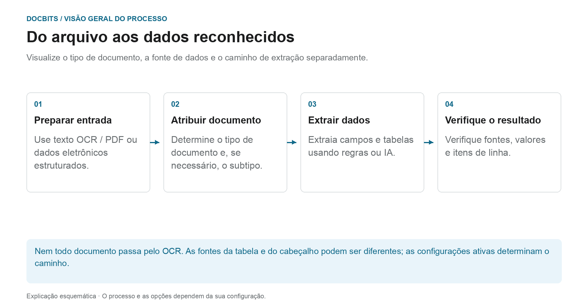
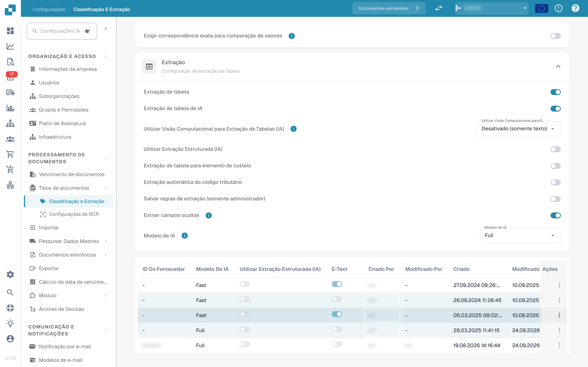
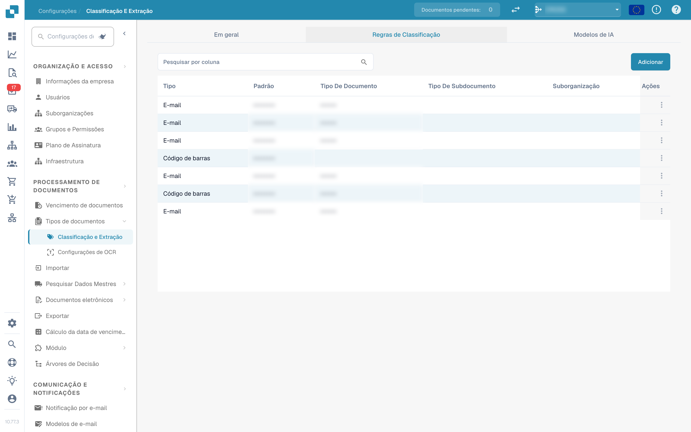
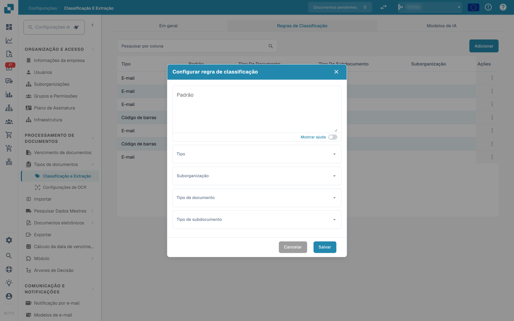
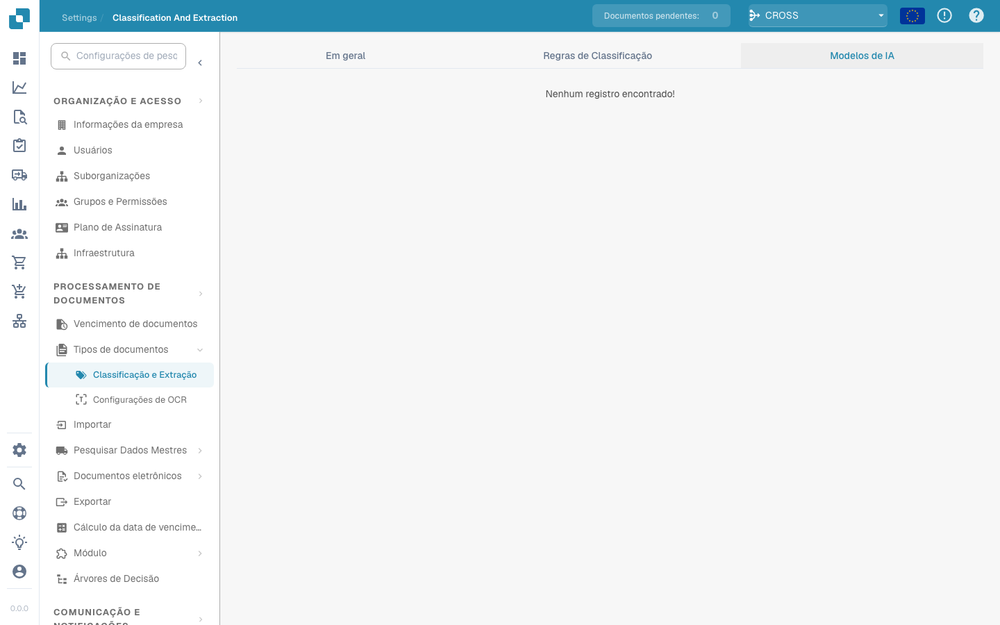

# Classificação e extração

## Qual configuração funciona em qual etapa do processo?

<figure><figcaption>
Visualize o tipo de documento, a fonte de dados e o caminho de extração separadamente. O diagrama é esquemático; as configurações ativas da sua organização determinam o comportamento real.
</figcaption></figure>

A classificação responde à pergunta **“Que tipo de documento é esse?”**. A extração responde **“Quais valores ela contém?”**. As configurações nesta página afetam diferentes pontos de processamento e não devem ser entendidas como uma única opção de IA.

1. **Preparar entrada:** Para PDFs, texto existente ou OCR pode ser usado; documentos eletrônicos suportados podem fornecer valores estruturados. Uma divisão ativada pode separar um documento recebido com base no código de barras configurado ou nos critérios QR.
2. **Determinar o tipo de documento:** Regras e modelos de classificação atribuem documentos a um tipo e, se necessário, a um subtipo. Esta atribuição deve ser diferenciada da posterior extração de campos e tabelas.
3. **Extrair valores:** As tabelas podem seguir caminhos diferentes dependendo da configuração e das regras salvas aplicáveis. Os campos de cabeçalho possuem seus próprios indicadores de origem. Portanto, o modelo de IA selecionado por si só não explica todos os valores de linha ou campo.
4. **Rastreie o resultado:** Na tela de validação, verifique qual aba da tabela contém as linhas e qual indicador de origem um campo de cabeçalho possui. Se faltar uma etapa de processamento, leia os registros do documento antes de alterar as configurações.

### Distinguir entre caminho de regra e caminho de IA

As regras de tabela salvas apropriadas podem determinar a extração da tabela para o modelo ou fornecedor relevante. Sem regras adequadas, o caminho AI pode ser usado quando a extração da tabela AI está ativada. Colunas individuais podem ter suas próprias opções de IA. Uma fonte de IA para um campo de cabeçalho não significa que toda a tabela venha da IA.

O guia de diagnóstico [Qual caminho de extração foi usado?](../../../../overview-and-basics/faq/document-processing/which-extraction-path-was-used.md) explica guias, identificadores de fonte e registos. A página [Modelo de IA](ai-model.md) explica o padrão da organização e as substituições relacionadas ao modelo.

## Visão geral

Nas configurações de **Classificação e extração**, pode:

* Ativar a **divisão de documentos** com base em códigos QR
* Configurar a **formatação de valores**
* Configurar a **extração de tabelas**
* Ativar ou desativar o processamento de ficheiros **ZUGFeRD** não suportados
* Definir regras especiais de classificação
* Monitorizar os **modelos de IA** treinados especificamente para a classificação

Esta página explica as configurações disponíveis.

## **Aceder às configurações de classificação e extração**

Para abrir as configurações de **Classificação e extração**, aceda a:\
**Configurações → Processamento de documentos → Classificação e extração**

## Acesso às definições de classificação e extração

## Divisão de documentos

Na secção **Divisão de documentos**, pode configurar a divisão de um documento carregado em vários documentos sempre que surgir um **código de barras** numa página.

Para ativar esta funcionalidade:

1. Abra a secção **Divisão de documentos**.
2.  Abra a lista suspensa.

    <figure><figcaption></figcaption></figure>
3.  Selecione **Dividir por código de barras/QR**.

* **Não divida os documentos enviados** – o valor predefinido; o documento é processado como um único ficheiro.
* **Dividido por código de barras/QR-Code** – o documento é dividido em cada código de barras detetado.

Depois, poderá:

* Selecionar um ou mais tipos de código de barras a detetar.
*   Indicar um padrão de expressão regular que o código de barras deve cumprir para provocar a divisão do documento.

* **Tipo de código de barras** – um ou mais tipos de código de barras a detetar, por exemplo *CODE-128* ou *QR-CODE*.
* **Padrão de código de barras** – uma expressão regular que o valor do código de barras tem de cumprir antes de a divisão ser acionada. Deixe vazio para dividir em qualquer código de barras dos tipos escolhidos. O padrão é validado antes de ser guardado; uma expressão inválida é comunicada de imediato.

## Formatação de valores

Na secção **Formatação de valores**, tem duas opções:

* **Permitir arredondamento na comparação de valores:**\
  Quando ativa, permite uma tolerância de ±0.5 na comparação de valores.\
  Quando desativada, aplica-se a tolerância padrão de ±0.05.
* **Exigir correspondência exata na comparação de valores:**\
  Quando ativa, os valores têm de corresponder exatamente, sem tolerância.\
  Quando desativada, permite uma tolerância de ±0.05.

<mark style="color:red;">**Nota**</mark>: apenas uma destas configurações pode estar ativa de cada vez.

## Extração de tabelas


Tabelas do DocBits: extração de tabelas com IA ou extração padrão — quando usar cada uma


Neste vídeo, comparamos a extração de tabelas por IA com a extração padrão, sem IA, no DocBits. Aprenderá as diferenças, quando utilizar cada método e como escolher a abordagem para os seus tipos de documento.

**O que irá aprender:**
*   O que faz a extração de tabelas por IA: reconhecimento de padrões e layouts flexíveis
*   O que faz a extração padrão de tabelas: comportamento estruturado e mais controlado
*   Vantagens e limitações: precisão, consistência, velocidade e manutenção
*   Quando utilizar IA: layouts variáveis, digitalizações com ruído e diferenças entre fornecedores
*   Quando utilizar extração padrão: modelos estáveis, controlo rigoroso e resultados previsíveis
*   Conselhos práticos para melhorar as tabelas extraídas e reduzir divergências


**Requisitos para uma extração de tabelas funcional**

* O tipo de documento tem **colunas de tabela** (Definições → Definições Globais → Tipos de Documento → [Colunas da Tabela](../../global-settings/document-types/table-columns/README.md)). Sem colunas, não há para onde extrair.
* A **Extração de tabelas** ou a **Extração de tabelas por IA** está ativada abaixo, para toda a organização.
* O documento tem texto legível: o OCR foi executado, ou o E-Text é usado para PDFs nativos digitais ([Definições OCR](../ocr-settings.md)).
* O treino e os modelos de IA são **por fornecedor**. Uma tabela treinada aplica-se apenas aos documentos do fornecedor com que foi treinada.


Pode extrair tabelas de documentos ativando **Extração de tabela** ou **Extração de tabela de IA**. Uma tabela treinada (baseada em IA ou manual) está sempre vinculada a um fornecedor específico.

<figure><figcaption>
Interruptores da extração de tabelas
</figcaption></figure>

**Extração de tabela:** Ativa a extração de tabelas baseada em regras. As tabelas são treinadas por fornecedor no ecrã de validação (*Go to table extraction view*).\
Saiba mais sobre o treino [aqui](../../../setup/document-training/training-line-fields-table-training/defining-tables-and-columns.md).

**Extração de tabela de IA:** Usa IA para extrair a tabela de qualquer fornecedor sem treino. Se os resultados para um fornecedor não forem suficientemente precisos, treine a tabela desse fornecedor; as regras guardadas têm então prioridade sobre a IA para esse fornecedor.

**Utilizar Visão Computacional para Extração de Tabelas (IA):** A IA lê a imagem da página em vez da camada de texto. Ajuda em documentos digitalizados e tabelas sem estrutura de texto clara; é mais lenta. A lista pendente junto ao interruptor determina com que intensidade a imagem da página é usada:

* **Desativado (apenas texto)** – É usada apenas a camada de texto. Este é o valor predefinido.
* **Apenas imagens** – É lida apenas a imagem da página.
* **Híbrido (texto e imagens)** – A camada de texto e a imagem da página são combinadas no mesmo pedido.
* **Automático (decidido por documento)** – A DocBits decide por documento se a camada de texto é suficiente.

**Utilizar Extração Estruturada (IA):** A IA devolve a tabela numa estrutura fixa que é mapeada diretamente para as colunas de tabela configuradas. Recomendado quando os cabeçalhos das colunas variam muito entre documentos. Clicar na definição abre uma pré-visualização dos campos e colunas que a IA irá pedir exatamente: os campos de cabeçalho e as colunas de linha são listados com a sua origem (campos padrão pedidos ou desativados), bem como o modo de saída esperado (por exemplo *strict* – sem colunas adicionais). Os campos configurados para o tipo de documento mas desativados não são pedidos à IA.

**Extração de tabela para elemento de custeio:** Quando ativado, a DocBits pode extrair elementos de custeio de tabelas ao nível da linha e classificá-los em conformidade.\
Encontra uma explicação detalhada [aqui](table-extraction-for-costing-element.md).

**Extração automática do código tributário:** Quando ativado, o sistema preenche automaticamente o campo **Código tributário** no ecrã de validação, desde que esteja configurado um campo de código tributário.\
Mais informações sobre esta definição [aqui](auto-extract-tax-code.md).

**Salvar regras de extração (somente administrador):** Apenas os administradores podem clicar em *Save Rules* durante o treino de tabelas. Ative esta opção quando os utilizadores guardam repetidamente regras que quebram a extração de um fornecedor.

**Modelo AI:** define o modelo de organização para extração de campos e tabelas. O menu oferece Full, Fast, Nexus, Nexus Flash, Auto e Auto Nexus. Verifique a disponibilidade, qualidade, tempo de execução e custo com documentos representativos. Uma camada nem sempre é a mais precisa ou rápida para todos os documentos. As substituições de modelo podem substituir a configuração da organização. A tabela abaixo do seletor mostra:

**Modelo de IA:** Seleciona o nível de IA usado para a extração de tabelas. Existem seis opções: **Full** (máxima precisão, a mais lenta, 2 tokens por documento), **Fast** (predefinido; 1 token por documento), **Nexus** e **Nexus Flash** (família de modelos alternativa, opcional), além de **Auto** e **Auto Nexus**, em que a DocBits decide por documento qual a potência de modelo necessária. A tabela sob o seletor mostra:

* que **fornecedores** usam que modelo de IA
* se usam extração estruturada (IA) e E-Text
* opções para eliminar uma entrada e devolver assim o fornecedor ao valor predefinido

Esta definição é explicada em detalhe [aqui](ai-model.md).

#### Porque é que a tabela parece diferente por fornecedor?

O processamento da tabela depende das regras e configurações salvas no fornecedor relevante ou no contexto do modelo:

* **Regras guardadas** (treino de tabelas): posição da tabela e mapeamento das suas colunas no layout desse fornecedor.
* **Tags e regras de formatação da tabela de IA**: indicações que o utilizador guardou para a tabela de IA desse fornecedor.
* **Modelo de IA específico do modelo:** A seleção feita na tela de validação é salva por organização e modelo de extração atual. Não altera automaticamente todos os modelos do mesmo fornecedor. Sem uma substituição, a configuração da organização aplicável será usada.

Assim, o fornecedor A com regras guardadas apresenta uma tabela determinística no separador *Extracted table* do ecrã de validação, enquanto o fornecedor B sem regras recebe a *AI Extracted table*. Para que o fornecedor B se comporte como A, treine uma vez a tabela de B. Para repor um fornecedor, elimine as suas regras no ecrã de validação ou reponha os seus dados de treino na tabela Modelo de IA.

#### Chaves de preferência

Cada interruptor desta secção é guardado como preferência da organização. Use a chave quando definir o valor através da API (`/preferences/set_preference`), de um script ou do DocBits MCP (`get_preference` / `set_preference`).

| Definição (etiqueta da UI) | Chave de preferência | Valores |
|---|---|---|
| Dividir | `SPLIT_DOCUMENT_ON_BARCODE` | `true` / `false` |
| Tipo de código de barras | `SPLIT_DOCUMENT_BARCODE_TYPE` | lista de nomes de tipos de código de barras |
| Padrão de código de barras | `SPLIT_DOCUMENT_BARCODE_PATTERN` | string regex |
| Páginas a serem processadas | `RESTRICT_TO_PAGES` | número; vazio ou `0` = todas as páginas |
| Permitir arredondamento durante comparação de valores | `AMOUNTS_ROUNDING` | `true` / `false` |
| Exigir correspondência exata para comparação de valores | `AMOUNTS_NO_ROUNDING` | `true` / `false` |
| Extração de tabela | `TABLE_EXTRACTION_SETTING` | `true` / `false` |
| Extração de tabela de IA | `USE_AI_TABLE_EXTRACTION` | `true` / `false` |
| Utilizar Visão Computacional para Extração de Tabelas (IA) | `TABLE_EXTRACTION_VISION_MODE` | `off` (predefinido), `vision`, `hybrid`, `auto` |
| Utilizar Visão Computacional para Extração de Tabelas (IA) – interruptor antigo | `TABLE_EXTRACTION_USE_VISION` | `true` / `false`; equivale a `vision` |
| Utilizar Extração Estruturada (IA) | `USE_STRUCTURED_EXTRACTION` | `true` / `false` |
| Extração de tabela para elemento de custeio | `CHARGES_TABLE_EXTRACTION` | `true` / `false` |
| Extração automática do código tributário | `AUTO_EXTRACT_TAX_CODE` | `true` / `false` |
| Salvar regras de extração (somente administrador) | `ONLY_ADMIN_CAN_SAVE_RULES` | `true` / `false` |
| Extrair campos ocultos | `EXTRACT_HIDDEN_FIELDS` | `true` / `false` |
| Modelo de IA | `AI_MODEL` | `gpt-6-sol` (Full), `gpt-6-luna` (Fast), `qwen3.8-max` (Nexus), `glm-5.3-flash` (Nexus Flash), `auto` (Auto), `auto-nexus` (Auto Nexus) |
| Versão da extração de tabelas (diálogo de confirmação) | `TBL_EXT_VERSION` | string de versão |
| Definições de OCR → Utilizar dados de IA para tabelas se disponíveis | `USE_AI_DATA_FOR_TABLE` | `true` / `false` |
| Definições de OCR → Utilizar E-Text se disponível | `USE_ETEXT_IF_AVAILABLE` | `true` / `false` |

Notas:

* As preferências booleanas são guardadas como as cadeias `true` / `false`; uma chave que nunca foi definida conta como `false`. Se enviar `1` ou `0`, o DocBits guarda `true` / `false`.
* `AI_MODEL` não definido significa **Fast**.
* Um `TABLE_EXTRACTION_VISION_MODE` não definido é resolvido a partir do botão antigo `TABLE_EXTRACTION_USE_VISION`: `true` dá `vision`, qualquer outro valor dá `off`.
* A alteração de uma chave produz efeito nos documentos processados posteriormente. Reinicie um documento para o extrair novamente com a nova definição.
* As substituições de modelo diferem das preferências da organização. O guia AI Model explica o escopo exato.

## Documento eletrónico

**Processar PDF ZUGFeRD não suportado:** quando esta opção está ativa, as versões **ZUGFeRD** não suportadas são processadas como PDF padrão e o XML incorporado é ignorado.

A lista de versões **ZUGFeRD** suportadas está disponível [aqui](../../global-settings/document-types/edi/zugferd/README.md).

## **Regras de classificação**

Na secção **Regras de classificação**, pode definir padrões de **expressões regulares** e critérios específicos para classificar automaticamente os documentos durante o processamento.

Para abrir esta secção, clique no separador **Regras de classificação** no topo da página.

<figure><figcaption>
Separador «Regras de Classificação» com a tabela de regras
</figcaption></figure>

### **Adicionar uma regra de classificação**

Para criar uma regra:

1.  Clique em **Adicionar** no canto superior direito.

    <figure><figcaption></figcaption></figure>
2. Preencha os campos seguintes:
   * **Padrão**: expressão regular que o sistema deve procurar para iniciar a classificação.
   * **Tipo**: local onde o padrão deve ser procurado, por exemplo no **código de barras**.
   * **Suborganização** _(opcional)_: suborganização à qual a regra se aplica.
   * **Tipo de documento**: tipo a atribuir ao documento quando o padrão corresponder.
   *   **Subtipo de documento** _(opcional)_: indique um subtipo para uma classificação mais detalhada.

       <figure><figcaption></figcaption></figure>
3.  Clique em **Guardar** para guardar a regra de classificação.

    <figure><figcaption>
Diálogo «Configurar a regra de classificação»
</figcaption></figure>
2. Preencha os campos:
   * **Padrão** (obrigatório) – a expressão regular que a regra procura.
   * **Tipo** (obrigatório) – **Código de barras** ou **E-mail**. Isto determina contra que nome de origem o padrão é comparado.
   * **Suborganização** *(opcional)* – limita a regra a uma suborganização.
   * **Tipo de Documento** – o tipo de documento atribuído quando o padrão corresponde.
   * **Tipo de subdocumento** *(opcional)* – um tipo mais específico; a lista depende do tipo de documento selecionado. Alterar o tipo de documento limpa o tipo de subdocumento.
3.  Clique em **Guardar**.

### **Editar uma regra de classificação**

Para editar uma regra existente:

1.  Clique nos três pontos da coluna **Ações**.

    <figure><figcaption></figcaption></figure>
2.  Selecione **Editar**.

    <figure><figcaption></figcaption></figure>
3. Efetue as alterações pretendidas.
4.  Clique em **Guardar** para aplicar as alterações.

Exemplos no painel:

### **Eliminar uma regra de classificação**

Para eliminar uma regra:

1.  Clique nos três pontos da coluna **Ações**.

    <figure><figcaption></figcaption></figure>
2.  Selecione **Eliminar**.

1.  Clique nos três pontos da coluna **Ações** da regra que pretende alterar.

## Modelos de IA

A secção **Modelos de IA** apresenta os modelos treinados e ajustados especificamente às suas necessidades.

### Aceder à secção de modelos de IA

Para abrir esta secção, clique no separador **Modelos de IA** no topo da página.

1. Clique nos três pontos da coluna **Ações**.
2. Selecione **Excluir**.

### Categorias de modelos

Os modelos estão organizados por categorias. Por baixo do nome de cada categoria, é apresentado o número de modelos que contém.\
Clique numa categoria para consultar os detalhes.

O separador **Modelos de IA** mostra os modelos treinados à medida disponíveis para a classificação de documentos e as suas etiquetas. Só aparece quando o módulo de modelos e etiquetas está ativado para a sua organização.

No topo da página da categoria selecionada, encontrará informação sobre cada modelo:

* **Tipo**: tipo de modelo.
* **Apenas primeira página**: indica se o modelo processa apenas a primeira página do documento.
* **Versão**: número da versão do modelo.

### Tabela de modelos

Os modelos da categoria são apresentados numa tabela com a seguinte informação:

* **Nome**: nome do modelo.
* **Próximo modelo**: modelo que irá processar o resultado do modelo atual.
* **Tipo de documento**: tipo principal atribuído pelo modelo durante a classificação.
* **Subtipos de documento**: subtipos nos quais o documento é classificado adicionalmente.
* **Prioridade**: nível que determina a posição do modelo na fila de classificação.

Abaixo dessa informação são listadas as etiquetas do modelo.

### Editar um modelo

Para editar um modelo:

1.  Clique no ícone de lápis da coluna **Ações**, junto ao modelo que pretende editar.

    <figure><figcaption></figcaption></figure>
2. Atualize os campos disponíveis:
   * **Próximo modelo**: selecione o modelo que deve processar o resultado do modelo atual.
   * **Tipo de documento**: escolha o tipo que o modelo deve atribuir ao documento de entrada.
3.  Clique em **Guardar** para aplicar as alterações.

### Editar uma etiqueta

Clique no ícone de lápis de uma linha de etiqueta para abrir o diálogo de edição. Oferece **Próximo modelo** e **Tipo de documento**; defina um dos dois, pois o diálogo exige um próximo modelo ou um tipo de documento. Clique em **Guardar** para aplicar a alteração.

## Páginas relacionadas

* [Modelo de IA](ai-model.md) – os seis níveis de extração e como um fornecedor obtém o seu próprio modelo
* [Extração automática do código tributário](auto-extract-tax-code.md)
* [Extração de tabela para elemento de custeio](table-extraction-for-costing-element.md)
* [Definições de OCR](../ocr-settings.md)
