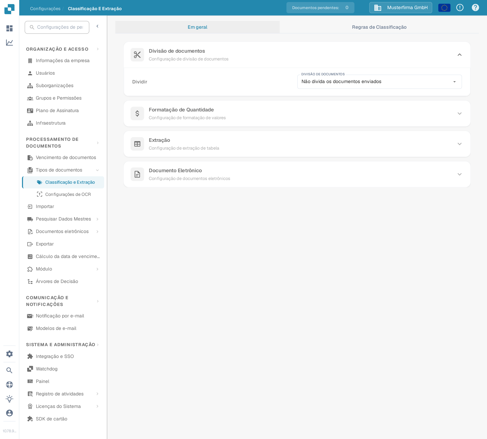
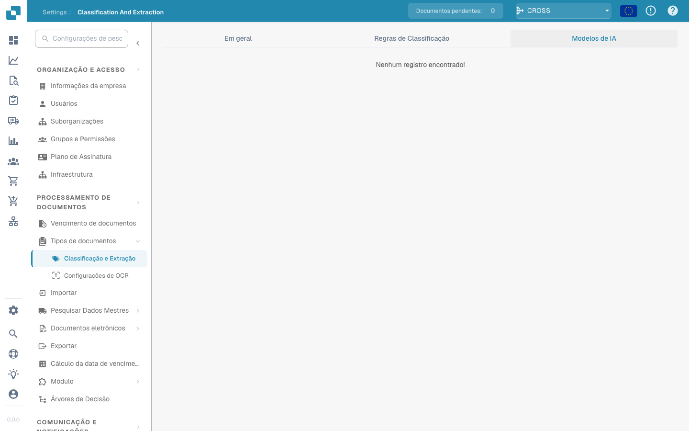

# Classificação e extração

## Visão geral

Nas configurações de **Classificação e extração**, pode:

* Ativar a **divisão de documentos** com base em códigos QR
* Configurar a **formatação de valores**
* Configurar a **extração de tabelas**
* Ativar ou desativar o processamento de ficheiros **ZUGFeRD** não suportados
* Definir regras especiais de classificação
* Monitorizar os **modelos de IA** treinados especificamente para a classificação

Esta página explica as configurações disponíveis.

## **Aceder às configurações de classificação e extração**

Para abrir as configurações de **Classificação e extração**, aceda a:\
**Configurações → Processamento de documentos → Classificação e extração**

<figure><figcaption>
Abra <strong>Configurações → Processamento de documentos → Classificação e Extração</strong>.
</figcaption></figure>

## Divisão de documentos

Na secção **Divisão de documentos**, pode configurar a divisão de um documento carregado em vários documentos sempre que surgir um **código de barras** numa página.

Para ativar esta funcionalidade:

1. Abra a secção **Divisão de documentos**.
2.  Abra a lista suspensa.

    <figure><figcaption></figcaption></figure>
3.  Selecione **Dividir por código de barras/QR**.

    <figure><figcaption></figcaption></figure>

Depois, poderá:

* Selecionar um ou mais tipos de código de barras a detetar.
*   Indicar um padrão de expressão regular que o código de barras deve cumprir para provocar a divisão do documento.

    <figure><figcaption></figcaption></figure>

## Formatação de valores

Na secção **Formatação de valores**, tem duas opções:

* **Permitir arredondamento na comparação de valores:**\
  Quando ativa, permite uma tolerância de ±0.5 na comparação de valores.\
  Quando desativada, aplica-se a tolerância padrão de ±0.05.
* **Exigir correspondência exata na comparação de valores:**\
  Quando ativa, os valores têm de corresponder exatamente, sem tolerância.\
  Quando desativada, permite uma tolerância de ±0.05.

<mark style="color:red;">**Nota**</mark>: apenas uma destas configurações pode estar ativa de cada vez.

## Extração de tabelas


Tabelas do DocBits: extração de tabelas com IA ou extração padrão — quando usar cada uma


Neste vídeo, comparamos a extração de tabelas por IA com a extração padrão, sem IA, no DocBits. Aprenderá as diferenças, quando utilizar cada método e como escolher a abordagem para os seus tipos de documento.

**O que irá aprender:**
*   O que faz a extração de tabelas por IA: reconhecimento de padrões e layouts flexíveis
*   O que faz a extração padrão de tabelas: comportamento estruturado e mais controlado
*   Vantagens e limitações: precisão, consistência, velocidade e manutenção
*   Quando utilizar IA: layouts variáveis, digitalizações com ruído e diferenças entre fornecedores
*   Quando utilizar extração padrão: modelos estáveis, controlo rigoroso e resultados previsíveis
*   Conselhos práticos para melhorar as tabelas extraídas e reduzir divergências


**Pré-requisitos para uma extração de tabelas funcional**

* O tipo de documento tem **colunas de tabela** (Definições → Definições Globais → Tipos de Documento → [Colunas da Tabela](../../global-settings/document-types/table-columns/README.md)). Sem colunas, não há para onde extrair.
* A **Extração de tabelas** ou a **Extração de tabelas por IA** está ativada abaixo, para toda a organização.
* O documento tem texto legível: o OCR foi executado, ou o E-Text é usado para PDFs nativos digitais ([Definições OCR](../ocr-settings.md)).
* O treino e os modelos de IA são **por fornecedor**. Uma tabela treinada aplica-se apenas aos documentos do fornecedor com que foi treinada.


Pode extrair tabelas de documentos ativando a **Extração de tabelas** ou a **Extração de tabelas por IA**. Uma tabela treinada (seja com IA ou manualmente) está sempre associada a um fornecedor específico.

**Extração de tabelas:** Ativa a extração de tabelas baseada em regras. As tabelas são treinadas por fornecedor no ecrã de validação (*Ir para a vista de extração de tabelas*).\
Saiba mais sobre o treino [aqui](../../../setup/document-training/training-line-fields-table-training/defining-tables-and-columns.md).

**Extração de tabelas por IA:** Usa IA para extrair a tabela de qualquer fornecedor sem treino. Se os resultados de um fornecedor não forem suficientemente precisos, treine a tabela desse fornecedor; as regras guardadas passam então a ter precedência sobre a IA para esse fornecedor.

**Usar Extração de tabelas Vision (IA):** A IA lê a imagem da página em vez da camada de texto. Ajuda com documentos digitalizados e tabelas sem uma estrutura de texto clara; é mais lenta. A lista pendente ao lado do botão escolhe com que intensidade a imagem da página é utilizada:

* **Desativado (somente texto)** – Só é utilizada a camada de texto. Esta é a predefinição.
* **Somente imagens** – Só é lida a imagem da página.
* **Híbrido (texto e imagens)** – A camada de texto e a imagem da página são combinadas no mesmo pedido.
* **Auto (decidido por documento)** – O DocBits decide por documento se a camada de texto é suficiente.

O modo é guardado na chave de preferência `TABLE_EXTRACTION_VISION_MODE`; o botão antigo `TABLE_EXTRACTION_USE_VISION` mantém-se e significa, na prática, *Somente imagens*.

**Usar Extração estruturada (IA):** A IA devolve a tabela numa estrutura fixa que é mapeada diretamente para as colunas de tabela configuradas. Recomendado quando os cabeçalhos das colunas nos documentos variam muito. Clicar na definição abre uma pré-visualização exata dos campos e colunas que serão pedidos à IA: os campos de cabeçalho e as colunas de linhas são listados com a sua origem (campos padrão pedidos ou desativados), juntamente com o modo de saída esperado (por exemplo, *strict* – sem colunas adicionais). Os campos configurados para o tipo de documento mas desativados não são pedidos à IA.

**Extração de tabelas para elemento de custo:** Quando ativada, o DocBits pode extrair elementos de custo das tabelas ao nível da linha e classificá-los em conformidade.\
Explicação detalhada disponível [aqui](table-extraction-for-costing-element.md).

**Extrair automaticamente o código de imposto:** Quando ativada, o sistema preenche automaticamente o campo **Código de imposto** no ecrã de validação, desde que exista um campo de código de imposto configurado.\
Mais informações sobre esta definição [aqui](auto-extract-tax-code.md).

**Guardar regras de extração (apenas administradores):** Só os administradores podem clicar em *Guardar regras* no treino de tabelas. Ative-a quando os utilizadores continuam a guardar regras que estragam a extração de um fornecedor.

**Modelo de IA:** Seleciona o nível de IA usado para a extração de tabelas. Estão disponíveis seis opções: **Full** (máxima precisão, a mais lenta, 2 tokens por documento), **Fast** (predefinição; 1 token por documento), **Nexus** e **Nexus Flash** (família de modelos alternativa, de ativação opcional), além de **Auto** e **Auto Nexus**, em que o DocBits decide por documento quão forte é o modelo necessário. A tabela por baixo do seletor mostra:

* Quais os **fornecedores** que usam cada modelo de IA
* Se usam a extração estruturada (IA) e o E-Text
* Opções para eliminar uma entrada e, assim, repor o fornecedor no valor predefinido

Esta definição é explicada em detalhe [aqui](ai-model.md).

### Porque é que a tabela é diferente de fornecedor para fornecedor?

Tudo o que o DocBits aprende sobre uma tabela é guardado **por fornecedor**:

* **Regras guardadas** (treino de tabelas): posição da tabela e mapeamento das suas colunas no layout desse fornecedor.
* **Tags e regras de formatação da tabela de IA**: indicações que o utilizador guardou para a tabela de IA desse fornecedor.
* **Modelo de IA específico do fornecedor**: o nível escolhido para esse fornecedor em *Mais definições* no ecrã de validação.

Assim, o fornecedor A, com regras guardadas, mostra uma tabela determinística no separador *Tabela extraída* do ecrã de validação, enquanto o fornecedor B, sem regras, recebe a *Tabela extraída por IA*. Para que o fornecedor B se comporte como o A, treine a tabela de B uma vez. Para repor um fornecedor, elimine as suas regras no ecrã de validação ou reponha os seus dados de treino na tabela do Modelo de IA.

### Chaves de preferências

Cada opção desta secção é guardada como uma preferência da organização. Use a chave quando definir o valor através da API (`/preferences/set_preference`), de um script ou do DocBits MCP (`get_preference` / `set_preference`).

| Definição (etiqueta na interface) | Chave de preferência | Valores |
|---|---|---|
| Extração de tabelas | `TABLE_EXTRACTION_SETTING` | `true` / `false` |
| Extração de tabelas por IA | `USE_AI_TABLE_EXTRACTION` | `true` / `false` |
| Usar Extração de tabelas Vision (IA) | `TABLE_EXTRACTION_VISION_MODE` | `off` (predefinição), `vision`, `hybrid`, `auto` |
| Usar Extração de tabelas Vision (IA) – botão antigo | `TABLE_EXTRACTION_USE_VISION` | `true` / `false`; significa, na prática, `vision` |
| Usar Extração estruturada (IA) | `USE_STRUCTURED_EXTRACTION` | `true` / `false` |
| Extração de tabelas para elemento de custo | `CHARGES_TABLE_EXTRACTION` | `true` / `false` |
| Extrair automaticamente o código de imposto | `AUTO_EXTRACT_TAX_CODE` | `true` / `false` |
| Guardar regras de extração (apenas administradores) | `ONLY_ADMIN_CAN_SAVE_RULES` | `true` / `false` |
| Modelo de IA | `AI_MODEL` | `gpt-6-sol` (Full), `gpt-6-luna` (Fast), `qwen3.8-max` (Nexus), `glm-5.3-flash` (Nexus Flash), `auto` (Auto), `auto-nexus` (Auto Nexus) |
| Versão da extração de tabelas (caixa de diálogo de confirmação) | `TBL_EXT_VERSION` | cadeia de versão |
| Definições OCR → Usar dados de IA para tabelas, se disponíveis | `USE_AI_DATA_FOR_TABLE` | `true` / `false` |
| Definições OCR → Usar E-Text, se disponível | `USE_ETEXT_IF_AVAILABLE` | `true` / `false` |

Notas:

* As preferências booleanas são guardadas como as cadeias `true` / `false`; uma chave que nunca foi definida conta como `false`. Se enviar `1` ou `0`, o DocBits guarda `true` / `false`.
* `AI_MODEL` não definido significa **Fast**.
* Um `TABLE_EXTRACTION_VISION_MODE` não definido é resolvido a partir do botão antigo `TABLE_EXTRACTION_USE_VISION`: `true` dá `vision`, qualquer outro valor dá `off`.
* A alteração de uma chave produz efeito nos documentos processados posteriormente. Reinicie um documento para o extrair novamente com a nova definição.
* As escolhas por fornecedor (E-Text, modelo de IA, regras guardadas) não são preferências da organização; são definidas no ecrã de validação em *Mais definições* num documento desse fornecedor.

## Documento eletrónico

**Processar PDF ZUGFeRD não suportado:** quando esta opção está ativa, as versões **ZUGFeRD** não suportadas são processadas como PDF padrão e o XML incorporado é ignorado.

A lista de versões **ZUGFeRD** suportadas está disponível [aqui](../../global-settings/document-types/edi/zugferd/README.md).

## **Regras de classificação**

Na secção **Regras de classificação**, pode definir padrões de **expressões regulares** e critérios específicos para classificar automaticamente os documentos durante o processamento.

Para abrir esta secção, clique no separador **Regras de classificação** no topo da página.

<figure><figcaption></figcaption></figure>

### **Adicionar uma regra de classificação**

Para criar uma regra:

1.  Clique em **Adicionar** no canto superior direito.

    <figure><figcaption></figcaption></figure>
2. Preencha os campos seguintes:
   * **Padrão**: expressão regular que o sistema deve procurar para iniciar a classificação.
   * **Tipo**: local onde o padrão deve ser procurado, por exemplo no **código de barras**.
   * **Suborganização** _(opcional)_: suborganização à qual a regra se aplica.
   * **Tipo de documento**: tipo a atribuir ao documento quando o padrão corresponder.
   *   **Subtipo de documento** _(opcional)_: indique um subtipo para uma classificação mais detalhada.

       <figure><figcaption></figcaption></figure>
3.  Clique em **Guardar** para guardar a regra de classificação.

    <figure><figcaption></figcaption></figure>

### **Editar uma regra de classificação**

Para editar uma regra existente:

1.  Clique nos três pontos da coluna **Ações**.

    <figure><figcaption></figcaption></figure>
2.  Selecione **Editar**.

    <figure><figcaption></figcaption></figure>
3. Efetue as alterações pretendidas.
4.  Clique em **Guardar** para aplicar as alterações.

    <figure><figcaption></figcaption></figure>

### **Eliminar uma regra de classificação**

Para eliminar uma regra:

1.  Clique nos três pontos da coluna **Ações**.

    <figure><figcaption></figcaption></figure>
2.  Selecione **Eliminar**.

    <figure><figcaption></figcaption></figure>

## Modelos de IA

A secção **Modelos de IA** apresenta os modelos treinados e ajustados especificamente às suas necessidades.

### Aceder à secção de modelos de IA

Para abrir esta secção, clique no separador **Modelos de IA** no topo da página.

<figure><figcaption></figcaption></figure>

### Categorias de modelos

Os modelos estão organizados por categorias. Por baixo do nome de cada categoria, é apresentado o número de modelos que contém.\
Clique numa categoria para consultar os detalhes.

<figure><figcaption></figcaption></figure>

No topo da página da categoria selecionada, encontrará informação sobre cada modelo:

* **Tipo**: tipo de modelo.
* **Apenas primeira página**: indica se o modelo processa apenas a primeira página do documento.
* **Versão**: número da versão do modelo.

### Tabela de modelos

Os modelos da categoria são apresentados numa tabela com a seguinte informação:

* **Nome**: nome do modelo.
* **Próximo modelo**: modelo que irá processar o resultado do modelo atual.
* **Tipo de documento**: tipo principal atribuído pelo modelo durante a classificação.
* **Subtipos de documento**: subtipos nos quais o documento é classificado adicionalmente.
* **Prioridade**: nível que determina a posição do modelo na fila de classificação.

<figure><figcaption></figcaption></figure>

### Editar um modelo

Para editar um modelo:

1.  Clique no ícone de lápis da coluna **Ações**, junto ao modelo que pretende editar.

    <figure><figcaption></figcaption></figure>
2. Atualize os campos disponíveis:
   * **Próximo modelo**: selecione o modelo que deve processar o resultado do modelo atual.
   * **Tipo de documento**: escolha o tipo que o modelo deve atribuir ao documento de entrada.
3.  Clique em **Guardar** para aplicar as alterações.

    <figure><figcaption></figcaption></figure>
