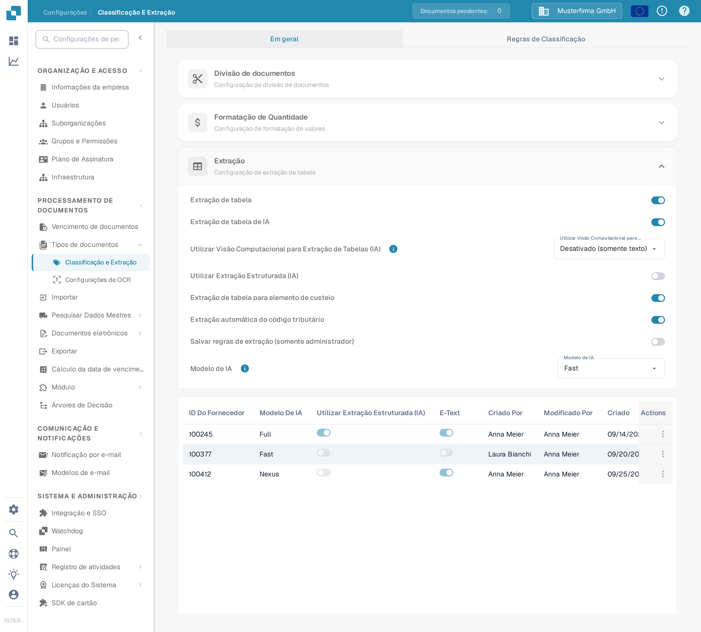
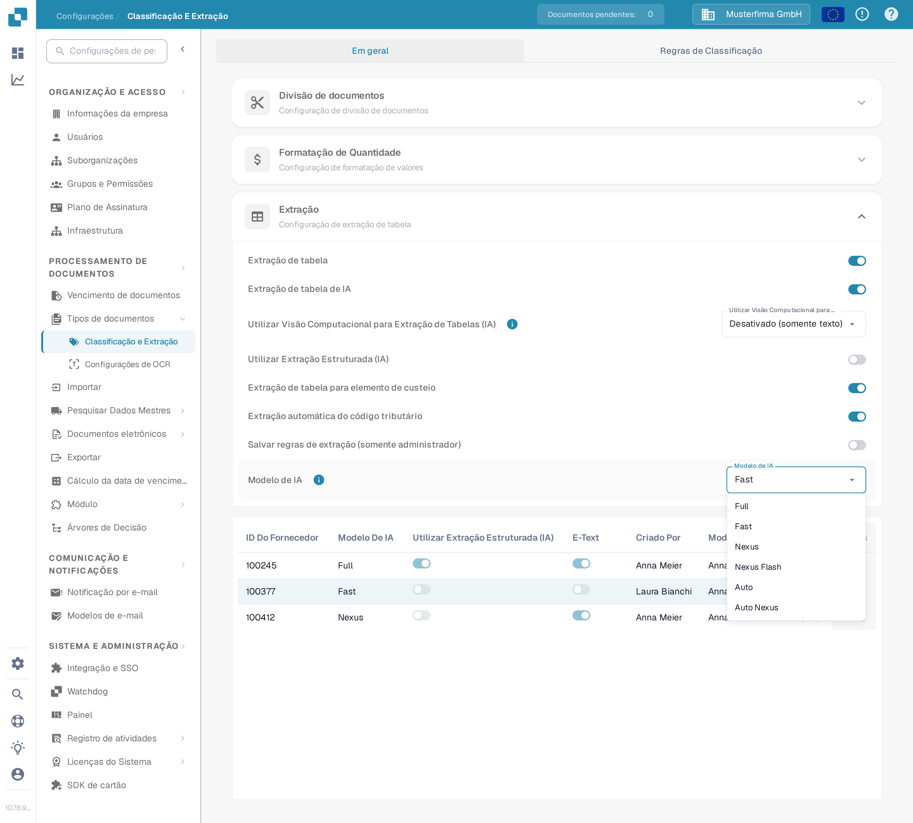
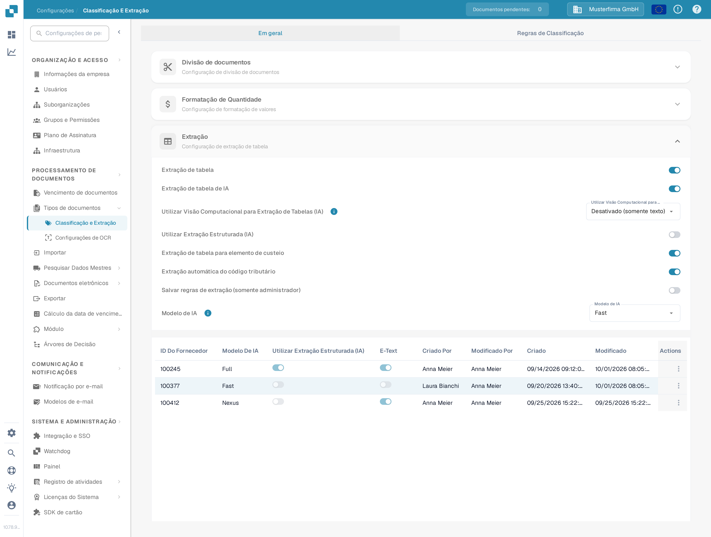
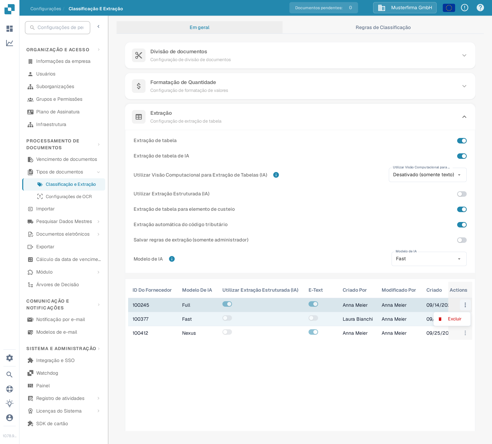
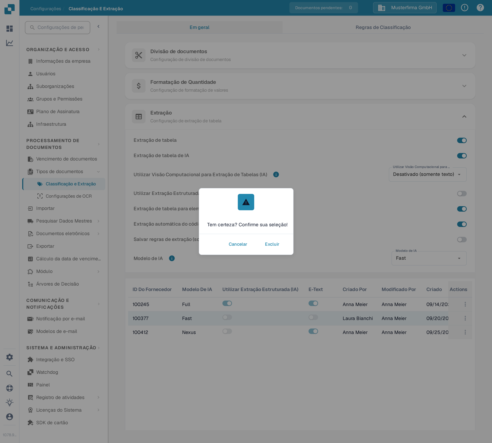

# Modelo de IA

## Visão Geral

A configuração do **Modelo de IA** permite que você defina qual modelo de IA é usado por padrão para a **extração de campo** e a **extração de tabela** durante o processamento de documentos.\ Nesta seção, você pode revisar o custo em tokens para cada modelo e ver qual modelo está atualmente atribuído a cada fornecedor.

## Como Acessar

1.  Navegue até **Configurações** → **Processamento de documentos** → **Classificação e Extração**

    <figure><figcaption>
Abra <strong>Configurações → Processamento de documentos → Classificação e Extração</strong>.
</figcaption></figure>
2.  Role para baixo até a seção **Extração de tabela**

    <figure><figcaption>
A seção <strong>Extração</strong> contém a configuração <strong>Modelo de IA</strong> e a tabela de atribuição de fornecedores.
</figcaption></figure>

## Opções de Modelo de IA

O DocBits oferece seis opções de modelo de IA para a extração de campos e tabelas. Elas diferem no equilíbrio entre **precisão de extração**, **velocidade de processamento** e **custo em tokens por documento** — assim você pode adequar a opção ao tipo de documentos que processa. Passe o mouse sobre o ícone de informação ao lado da configuração para ver o custo em tokens da opção atualmente selecionada. Se nenhum modelo estiver definido para um fornecedor, é usado **Fast**.

* **Full** – A opção mais completa, com a maior precisão de extração. Ideal para layouts complexos, digitalizações de baixa qualidade ou documentos em que a precisão é o mais importante. Por ser a opção mais potente, também é a mais lenta, com **2 tokens por documento**.
* **Fast** – Uma opção equilibrada que combina boa precisão com processamento mais rápido e custo menor. É o nível predefinido: fornecedores sem modelo de IA próprio usam **Fast**, com **1 token por documento**.
* **Nexus** – Uma opção de ativação opcional que corre numa família de modelos diferente (Qwen 3.8 Max). Útil quando pretende uma segunda opinião para fornecedores em que Fast e Full discordam, ou quando o modelo alternativo lê melhor um determinado layout, com **1 token por documento**.
* **Nexus Flash** – Um nível mais rápido da família Nexus (GLM-5.3 Flash). Processa os documentos mais depressa do que o Nexus, com o mesmo custo em tokens, com **1 token por documento**.
* **Auto** – Não é um modelo próprio: para cada documento, o DocBits decide se o Fast é suficiente ou se é necessário o Full, para que os documentos complexos recebam automaticamente o modelo mais forte, com **1 token por documento**.
* **Auto Nexus** – Como o Auto, mas restrito à família de modelos Nexus (Nexus Flash e Nexus). Os documentos mantêm-se totalmente fora da família de modelos padrão, com **1 token por documento**.

| Opção           | Ideal para                                                                            | Precisão      | Velocidade    | Custo em tokens |
| --------------- | ------------------------------------------------------------------------------------- | ------------- | ------------- | --------------- |
| **Full**        | Layouts complexos, digitalizações ruins, alta precisão                                | Máxima        | A mais lenta  | 2 / documento   |
| **Fast**        | Documentos do dia a dia (predefinição quando nada está definido)                      | Alta          | Rápida        | 1 / documento   |
| **Nexus**       | Fornecedores em que a família de modelos alternativa tem melhor desempenho (opcional) | Alta          | Rápida        | 1 / documento   |
| **Nexus Flash** | Qualidade do Nexus com processamento mais rápido                                      | Alta          | Mais rápida   | 1 / documento   |
| **Auto**        | Qualidade de documentos variada sem ajuste manual                                     | Por documento | Por documento | 1 / documento   |
| **Auto Nexus**  | Decisões Auto limitadas à família Nexus                                               | Por documento | Por documento | 1 / documento   |

<figure><figcaption>
A lista <strong>Modelo de IA</strong> com as seis opções disponíveis.
</figcaption></figure>

## Tabela de Atribuição de Modelo de IA

Você também pode configurar **modelos de IA** específicos por fornecedor diretamente na tela de **Validação**, permitindo ajustar a precisão da extração para fornecedores individuais.\ \ Para mais informações, consulte a documentação correspondente [aqui](../../../../end-user-and-partner-section/end-user-section/validation-screen/supplier-specific-ai-model-for-field-and-table-extraction.md).

A tabela de atribuição exibe as configurações do modelo de IA para cada fornecedor e inclui os seguintes detalhes:

* **ID Do Fornecedor** – O identificador único do fornecedor
* **Modelo De IA** – O nível de modelo de IA atualmente atribuído ao fornecedor
* **Utilizar Extração Estruturada (IA)** – Se a extração estruturada está ativada para esse fornecedor
* **E-Text** – Indica se o recurso E-Text está habilitado
* **Criado Por / Modificado Por / Criado / Modificado** – Quem criou a entrada e quando
* **Actions** – Contém a opção de excluir a entrada

<figure><figcaption>
A tabela de atribuição mostra o nome do nível por fornecedor, nunca o identificador do modelo em bruto.
</figcaption></figure>

### Excluir Entrada – Redefinir Configurações Específicas do Fornecedor

Para redefinir a configuração do modelo de IA de um fornecedor para o padrão:

1.  Clique nos três pontos na coluna **Actions** ao lado da entrada do fornecedor e selecione **Excluir**.

    <figure><figcaption>
Abra o menu de ações da linha e escolha <strong>Excluir</strong>.
</figcaption></figure>
2.  Um diálogo de confirmação aparecerá—confirme que você deseja excluir a entrada.

    <figure><figcaption>
Confirme a exclusão no diálogo.
</figcaption></figure>

Uma vez excluído, o fornecedor voltará a usar o **modelo de IA** padrão para a **extração de campo** e a **extração de tabela**.
