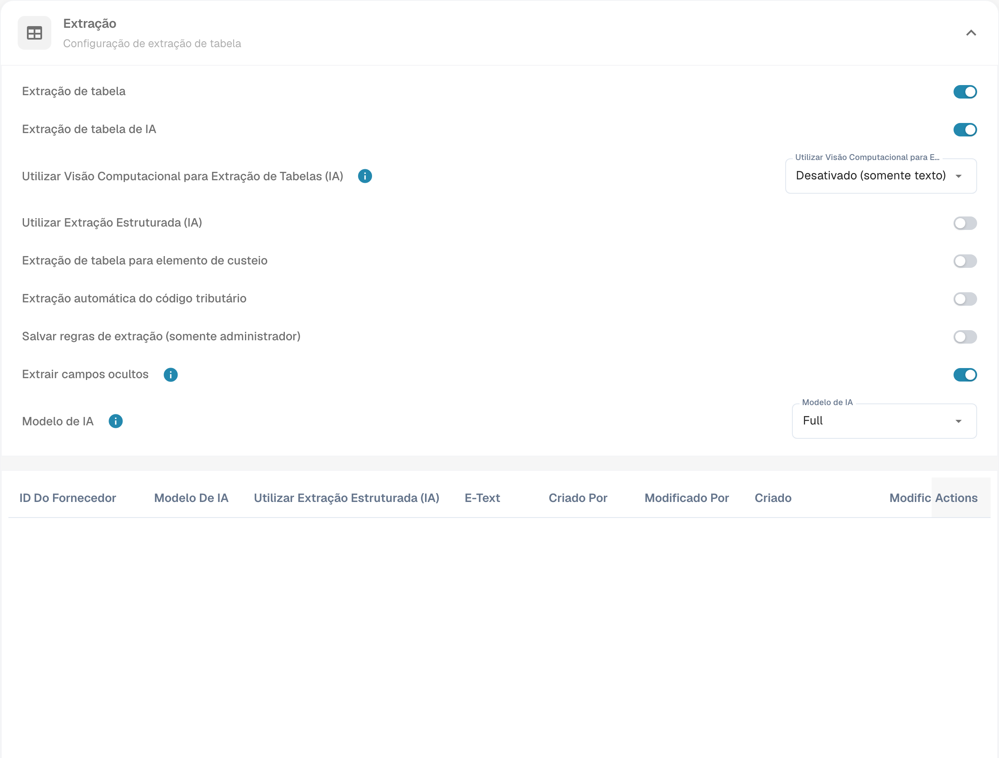

# Extrair automaticamente o código de imposto

Abra as definições de classificação e extração do tipo de documento e localize a extração automática do código de imposto. Verifique a configuração pretendida antes de ativar e guardar a função.

<figure><figcaption>
Definições da extração automática do código fiscal.
</figcaption></figure>

Se a função estiver ativa e existir um campo de código de imposto configurado, o DocBits pode preenchê-lo automaticamente durante a validação. Compare o código encontrado com o documento e a configuração ERP. Trata-se do código de imposto da integração, não de um identificador fiscal pessoal. A imagem mostra as definições e não comprova uma extração de imposto validada. A tabela preserva os códigos técnicos e as regras do exemplo de integração; verifique os valores da sua organização.

<table data-full-width="true"><thead><tr><th>Tipo de documento de fatura</th><th></th><th>Código de imposto</th><th>Ou no campo de texto</th><th>Número da ordem de compra</th><th>País do fornecedor</th><th>Regra</th></tr></thead><tbody><tr><td>Fatura de custos</td><td>Com montante de imposto</td><td>NAGDH</td><td>LD + % (arredondado para o maior valor absoluto)</td><td>Vazio</td><td>Os primeiros dois caracteres do número fiscal  ou o país do endereço do fornecedor: tccom120.cadr → tccom130.cadr, campo tcom130.ccty</td><td>Quando o país é o país da empresa</td></tr><tr><td>Fatura de custos</td><td>Sem montante de imposto</td><td>NAGD0</td><td>LD + % (arredondado para o maior valor absoluto)</td><td>Vazio</td><td>Os primeiros dois caracteres do número fiscal  ou o país do endereço do fornecedor: tccom120.cadr → tccom130.cadr, campo tcom130.ccty</td><td>Quando o país é o país da empresa</td></tr><tr><td>Fatura de custos</td><td>Sem montante de imposto</td><td>EUDH</td><td>ED 0 %</td><td>Vazio</td><td>Os primeiros dois caracteres do número fiscal  ou o país do endereço do fornecedor: tccom120.cadr → tccom130.cadr, campo tcom130.ccty</td><td>Quando o país difere do país da empresa e pertence à UE na tabela de países (tcmcs010)</td></tr><tr><td>Fatura de encomenda</td><td>Com montante de imposto</td><td>NAHGH</td><td>IG + % (arredondado para o maior valor absoluto)</td><td>Não vazio</td><td>Os primeiros dois caracteres do número fiscal  ou o país do endereço do fornecedor: tccom120.cadr → tccom130.cadr, campo tcom130.ccty</td><td>Quando o país é o país da empresa</td></tr><tr><td>Fatura de encomenda</td><td>Sem montante de imposto</td><td>NAHG0</td><td>IG + % (arredondado para o maior valor absoluto)</td><td>Não vazio</td><td>Os primeiros dois caracteres do número fiscal  ou o país do endereço do fornecedor: tccom120.cadr → tccom130.cadr, campo tcom130.ccty</td><td>Quando o país é o país da empresa</td></tr><tr><td>Fatura de encomenda</td><td>Com montante de imposto</td><td>EUGH</td><td>ED 0 %</td><td>Não vazio</td><td>Os primeiros dois caracteres do número fiscal  ou o país do endereço do fornecedor: tccom120.cadr → tccom130.cadr, campo tcom130.ccty</td><td>Quando o país difere do país da empresa e pertence à UE na tabela de países (tcmcs010)</td></tr><tr><td>Fatura de custos</td><td>Sem montante de imposto</td><td>IMGD</td><td>ID 0 %</td><td>Vazio</td><td>Os primeiros dois caracteres do número fiscal  ou o país do endereço do fornecedor: tccom120.cadr → tccom130.cadr, campo tcom130.ccty</td><td>Quando o país difere do país da empresa e não pertence à UE na tabela de países (tcmcs010)</td></tr><tr><td>Fatura de encomenda</td><td>Com montante de imposto</td><td>IMHG</td><td>IG 0 %</td><td>Não vazio</td><td>Os primeiros dois caracteres do número fiscal  ou o país do endereço do fornecedor: tccom120.cadr → tccom130.cadr, campo tcom130.ccty</td><td>Quando o país difere do país da empresa e não pertence à UE na tabela de países (tcmcs010)</td></tr></tbody></table>
