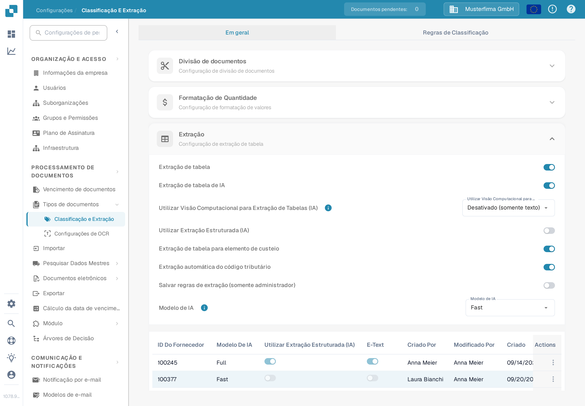

# Extração de tabela para elemento de custeio

Os elementos de custeio são encargos ou outros valores representados como linhas da tabela da fatura. Se esta função estiver ativada e o documento tiver linhas extraídas, o DocBits pode classificar essas linhas pelos elementos de custeio configurados para a organização. Um revisor pode corrigir a classificação de uma linha na tabela do documento.

## Ativar a configuração

1. Abra **Configurações → Processamento de documentos → Classificação e Extração**.
2. Permaneça em **Em geral** e expanda **Extração**.
3. Localize **Extração de tabela para elemento de custeio** abaixo dos campos solicitados para a extração de tabelas. Um administrador pode ativar este interruptor para a organização.

<figure><figcaption>
O interruptor está desativado na organização de teste sintética. Não foi alterado para este guia.
</figcaption></figure>


O interruptor por si só não cria elementos de custeio nem linhas de fatura. Configure primeiro os elementos e importe os dados necessários. O [guia de configuração de elementos de custeio](../../../../infor-integration-and-configuration/importing-customer-master-data/m3/table-extraction-for-costing-element.md) explica o exemplo M3. Consulte [Classificação e Extração](README.md) para ver os outros controles de extração.


## Revisar ou corrigir uma linha

Abra um documento cuja tabela da fatura contenha linhas extraídas e observe o ícone de elemento de custeio ao lado da linha correspondente. Selecione o ícone para abrir as classificações disponíveis. Escolha o elemento de custeio configurado correto, ou escolha **Uncategorize** se a linha for um artigo comum. Em seguida, reveja a linha resultante e os totais antes de guardar o documento.

Se o ícone ou uma classificação estiver em falta, confirme primeiro que o documento tem linhas extraídas, que a função está ativada e que existe um elemento de custeio configurado para a organização. O documento de teste sintético usado para esta verificação da documentação não tinha linhas de fatura extraídas, pelo que o menu de classificação não pôde ser mostrado nem testado. Os passos acima refletem o controlo de documentos atual; nenhuma classificação foi guardada durante esta verificação.
