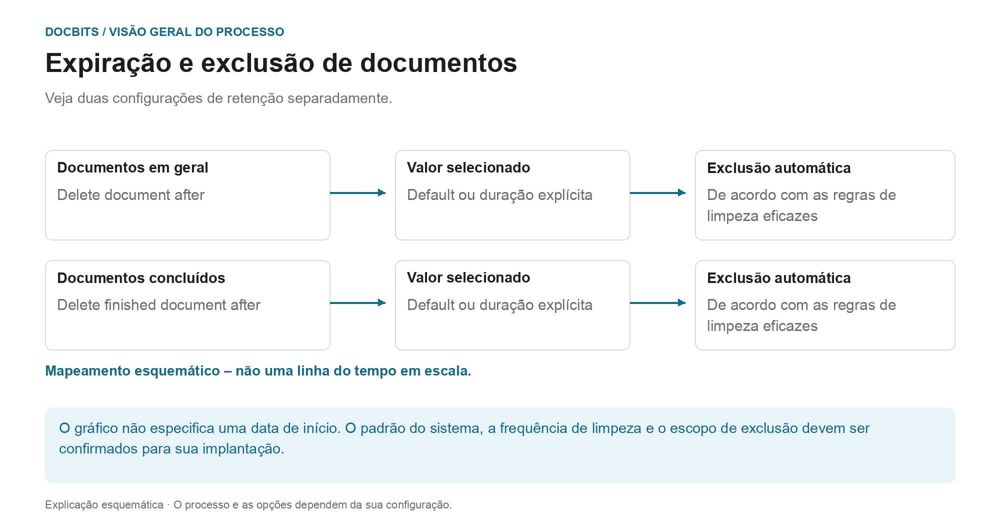
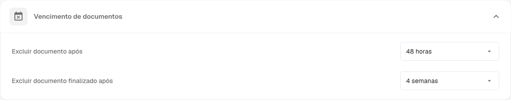
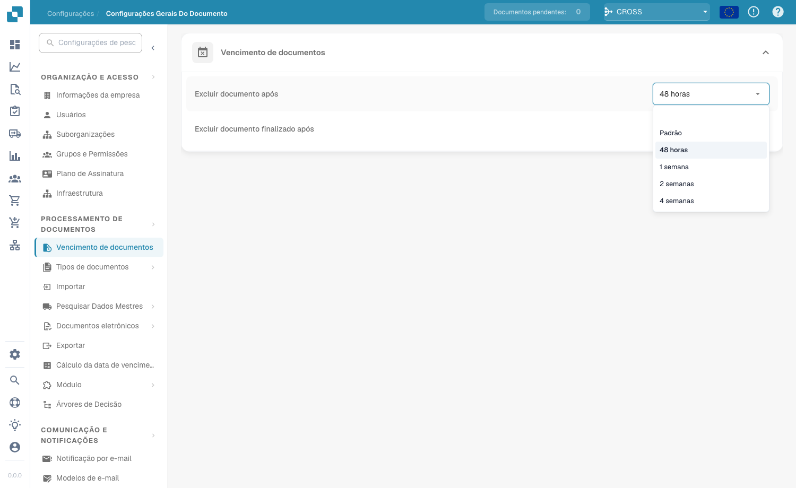

# Validade dos documentos

## Duas regras de retenção em vez de um período de exclusão geral

<figure><figcaption>
Veja duas configurações de retenção separadamente. O diagrama é esquemático; as configurações ativas da sua organização determinam o comportamento real.
</figcaption></figure>

A expiração do documento distingue a retenção geral de documentos da retenção completa de documentos. Verifique ambas as configurações juntamente com os requisitos do seu processo e o arquivo de destino pretendido.

| Configuração | O que você deve esclarecer |
| --- | --- |
| **Delete document after** | Qual valor de retenção de documentos é realmente eficaz em sua organização. |
| **Delete finished document after** | Qual valor se aplica a documentos concluídos, totalmente processados e exportados. |
| **Default** | Qual padrão de sistema está armazenado em sua implantação. O nome por si só não indica duração. |

O diagrama **não é uma linha do tempo desenhada em escala**. Não especifica o início técnico do período de retenção nem qual configuração tem precedência. Um valor suspenso por si só não estabelece um tempo de exclusão com precisão de segundos. Para um planejamento confiável, confirme também com que frequência a limpeza é executada.

### Exportação, retenção e backups separados

Uma exportação bem-sucedida não prova que a cópia DocBits já foi excluída. Por outro lado, excluir um documento em DocBits não remove um ERP armazenado de forma independente ou uma cópia de arquivo. Os backups podem ter regras de retenção separadas; excluir um documento do sistema ativo não prova que todas as cópias de backup foram removidas ao mesmo tempo.

Verifique os prazos antes de fazer alterações e chegue a acordo sobre o arquivo alvo e o tratamento dos backups. A visão geral do [Armazenamento, retenção e exclusão de dados](../../../security/data-storage-and-retention.md) explica as diferenças entre documentos, arquivos intermediários do OCR, logs e backups.

<figure><figcaption>
Configurações de Documents Expiry
</figcaption></figure>

Em Processamento de documentos → Expiração de documentos, configure a retenção de documentos. Verifique as configurações efetivas, o arquivo de destino e o escopo de exclusão da sua organização antes de alterá-los.

Duas configurações controlam a exclusão automática:

| Configuração | O que ela controla |
|---------|------------------|
| **Delete document after** | Por quanto tempo qualquer documento processado é mantido antes de ser excluído automaticamente. |
| **Delete finished document after** | Por quanto tempo um documento concluído (totalmente processado e exportado) é mantido antes de ser excluído automaticamente. |

Para cada configuração, você escolhe um período na lista suspensa:

<figure><figcaption>
Períodos de retenção disponíveis
</figcaption></figure>

| Opção | Significado |
|--------|---------|
| **Default** | Usa o período de retenção padrão do sistema (sem substituição personalizada). |
| **48 Hours** | Valor de retenção explícito de 48 horas; confirme o início do período e o cronograma de limpeza separadamente. |
| **1 Week** | Valor de retenção explícito de uma semana. |
| **2 Weeks** | Valor de retenção explícito de duas semanas. |
| **4 Weeks** | Valor de retenção explícito de quatro semanas. |

Essas configurações suportam a retenção planejada de documentos. Eles não substituem a confirmação dos períodos de retenção efetivos, arquivamento de destino e tratamento de backups para sua organização.
