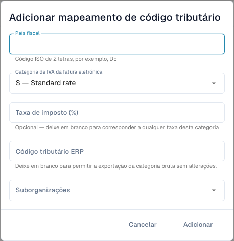

# Associar categorias de IVA de faturas eletrónicas a códigos ERP

<figure><figcaption>
Formulário de mapeamento fiscal antes de guardar uma entrada. Algumas descrições de categorias continuam em inglês na interface atual; os códigos técnicos mantêm-se.
</figcaption></figure>

Uma fatura eletrónica pode conter uma categoria de IVA como **S** em vez do código fiscal ERP. O mapeamento define a conversão. É independente de corrigir montantes fiscais ou regras de validação.

## Requisitos

Precisa de acesso administrativo, país fiscal, categoria e taxa da fatura e código ERP válido acordado com o administrador. Confirme organização e suborganização. A página deve estar disponível na versão utilizada.

## Adicionar e verificar

1. Abra **Definições → Documentos eletrónicos → Mapeamento de códigos fiscais** e analise as entradas.
2. Escolha adicionar um mapeamento.
3. Introduza o país fiscal com código ISO de duas letras, por exemplo `DE`.
4. Selecione a categoria: **S** taxa normal, **Z** taxa zero, **E** isento ou **O** fora do âmbito fiscal. Não troque categorias para contornar um erro.
5. Introduza a percentagem para uma taxa específica. Vazio aceita qualquer taxa dessa categoria, como indica o formulário.
6. Introduza código ERP e suborganizações relevantes. Um código ERP vazio permite expressamente exportar a categoria original sem conversão; use apenas se o destino a aceitar.
7. Adicione e confirme país, categoria, taxa, código, âmbito e estado ativo guardados.
8. Teste uma fatura representativa com destino controlado. Verifique código real no ERP e resposta, além de um mapeamento ausente/incorreto como caso de erro.

Uma fatura alemã `S` com taxa `19` precisa do código configurado para esse caso. Obtenha o código real no ERP; um exemplo não é uma predefinição de produção.

## Resolver erros

Compare país, categoria, taxa, âmbito e ativação. Verifique a resposta de integração antes de repetir uma exportação de resultado incerto. Eliminar o mapeamento altera operações futuras, sem anular exportações anteriores.

Consulte [Validação de faturas eletrónicas](validation-rules.md) e [Exportação](../export.md).
