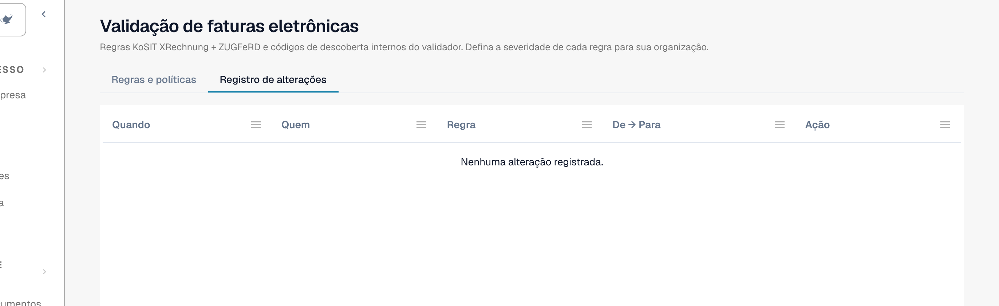

# Registo de alterações

O **Registo de alterações** regista todas as alterações das definições de validação. Faz parte de [Validação de faturas eletrônicas](validation-rules.md). Só os administradores da organização o podem ver.

Abra o separador **Registro de alterações**, ao lado de **Regras e políticas**.

<figure><figcaption>
O registo de alterações de uma organização ainda sem alterações
</figcaption></figure>

| Coluna | O que mostra |
| --- | --- |
| **Quando** | A hora da alteração. |
| **Quem** | O utilizador que fez a alteração. |
| **Regra** | A definição ou regra que mudou. |
| **De → Para** | O valor antigo e o novo. |
| **Ação** | O tipo de alteração. As linhas do assistente de configuração podem ser abertas para ver as alterações individuais. |

A lista mostra 50 entradas por página.

Cada alteração na tabela [Validação para cada tipo de documento](validation-per-document-type.md) cria uma entrada depois de a confirmar.
