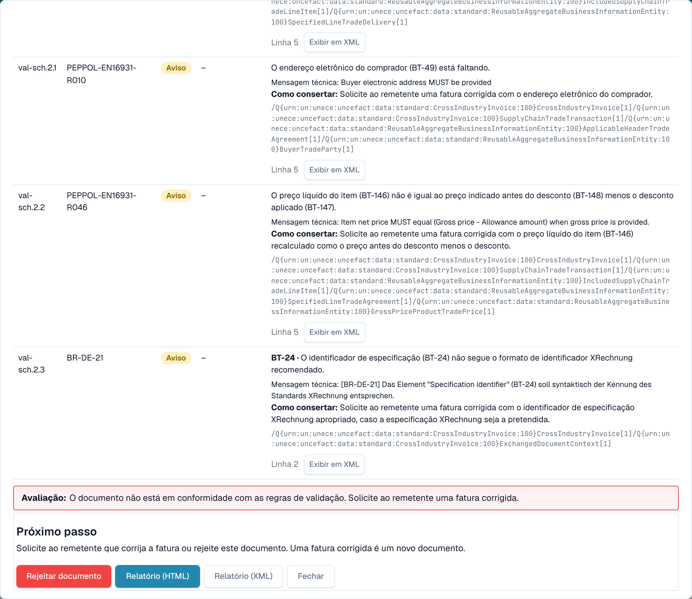
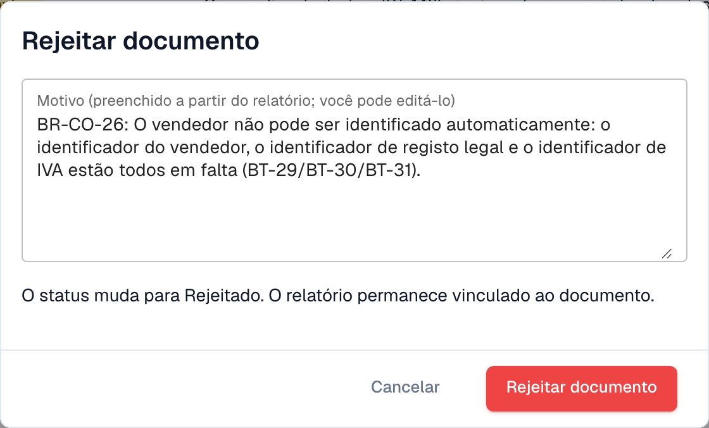

# Próximo passo e rejeitar um documento

Depois de ler o [relatório de validação](validation-report.md), o relatório diz-lhe o que fazer. Também pode rejeitar o documento.

## O que fazer a seguir

<figure><figcaption>
A avaliação, o próximo passo e os botões no fim do relatório
</figcaption></figure>

A **Avaliação** diz numa frase se a fatura está em conformidade. O bloco **Próximo passo** diz-lhe o que fazer:

| Resultado | Próximo passo |
| --- | --- |
| Pelo menos um **erro** | Peça ao remetente uma fatura corrigida, ou rejeite o documento. Uma fatura corrigida é um novo documento. |
| Apenas **avisos** | Pode continuar com o documento. |

Os botões no fim do relatório:

* **Rejeitar documento**: abre o diálogo de rejeição (ver abaixo).
* **Relatório (HTML)** e **Relatório (XML)**: transferem o relatório, por exemplo para o enviar ao fornecedor.
* **Fechar**: volta ao documento.

## Rejeitar um documento

<figure><figcaption>
O motivo é preenchido a partir dos erros do relatório. Pode editá-lo.
</figcaption></figure>

1. No relatório, selecione **Rejeitar documento**.
2. Verifique o **Motivo**. O DocBits preenche-o a partir dos erros do relatório. Pode editar o texto.
3. Selecione **Rejeitar documento** para confirmar. O estado muda para **Rejeitado**. O motivo é guardado como nota e o relatório permanece ligado ao documento.

Selecione **Cancelar** para deixar o documento como está.

> Só os utilizadores com permissão para editar documentos veem **Rejeitar documento**. O botão fica oculto quando o documento já está rejeitado ou concluído.
