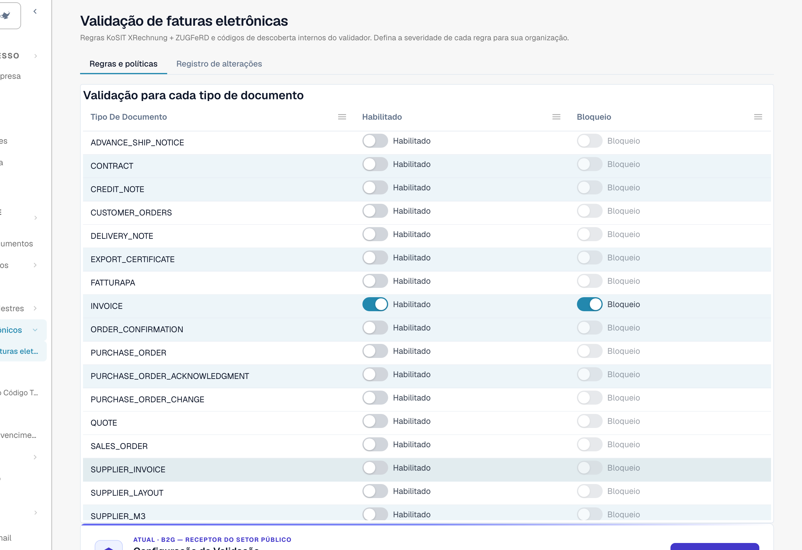
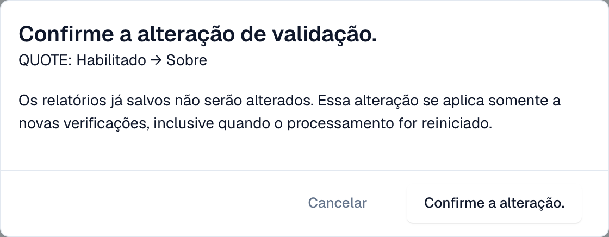

# Validação para cada tipo de documento

Os administradores decidem, para cada tipo de documento, se o DocBits valida as faturas eletrónicas recebidas e se uma verificação falhada bloqueia o documento. Cada alteração é confirmada e escrita no [registo de alterações](validation-change-log.md).

> Só os **administradores da organização** podem alterar estas definições. Os outros utilizadores veem a tabela só de leitura, ou não a veem.

## A tabela

Vá a **Definições → Documentos eletrónicos → Validação de faturas eletrônicas**. O separador **Regras e políticas** começa com a tabela **Validação para cada tipo de documento**.

<figure><figcaption>
Uma linha por tipo de documento com os interruptores Habilitado e Bloqueio. Organização de exemplo.
</figcaption></figure>

| Interruptor | O que faz |
| --- | --- |
| **Habilitado** | O DocBits valida cada fatura eletrónica recebida deste tipo de documento e guarda um [relatório de validação](validation-report.md). |
| **Bloqueio** | Um resultado que é um erro pára o documento. Fica com o estado **Erro**. Com o bloqueio desativado, o DocBits guarda o relatório e o documento continua. Só pode ativar **Bloqueio** quando **Habilitado** está ativo. |

Se um tipo de documento tiver substituições por subtipo, a tabela mostra uma nota sobre elas.

## Alterar uma definição

1. Selecione o interruptor que quer alterar.
2. O DocBits mostra **Confirme a alteração de validação.** com o tipo de documento e a alteração, por exemplo *QUOTE: Habilitado → Sobre*.

<figure><figcaption>
Cada alteração precisa de confirmação
</figcaption></figure>

3. Leia a nota: **Os relatórios já salvos não serão alterados.** A alteração aplica-se apenas a novas verificações, inclusive quando reinicia o processamento de um documento.
4. Selecione **Confirme a alteração.**, ou **Cancelar** para manter a definição anterior.

Se não tiver a permissão, o DocBits mostra uma mensagem a dizer que é necessário um administrador da organização, e nada muda.

## Páginas relacionadas

* [Validação de faturas eletrônicas](validation-rules.md)
* [Registo de alterações](validation-change-log.md)
* [Configuração da validação e versões aceites](validation-setup.md)
* [Relatório de validação](validation-report.md)
* [Ativar ou desativar a validação de faturas eletrónicas](README.md#ativar-ou-desativar-a-validacao-de-faturas-eletronicas)
