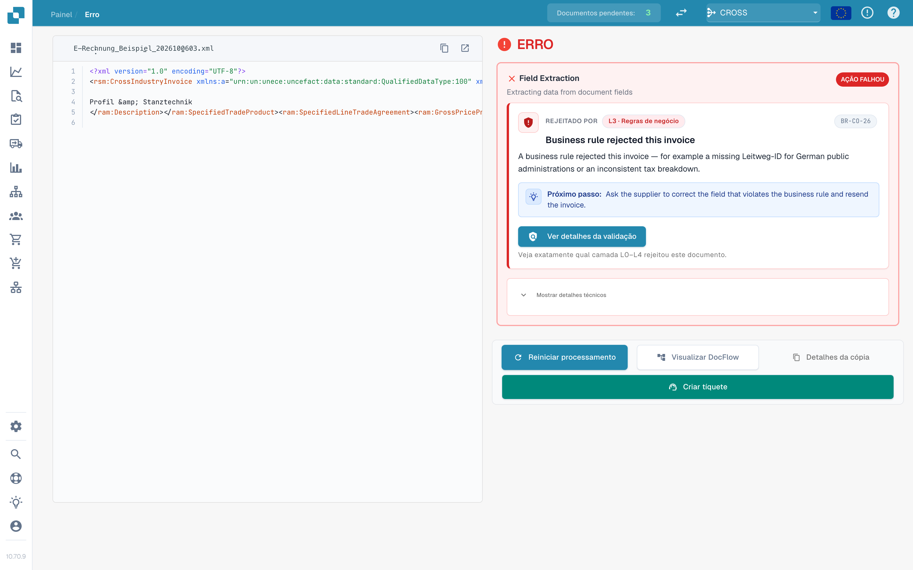
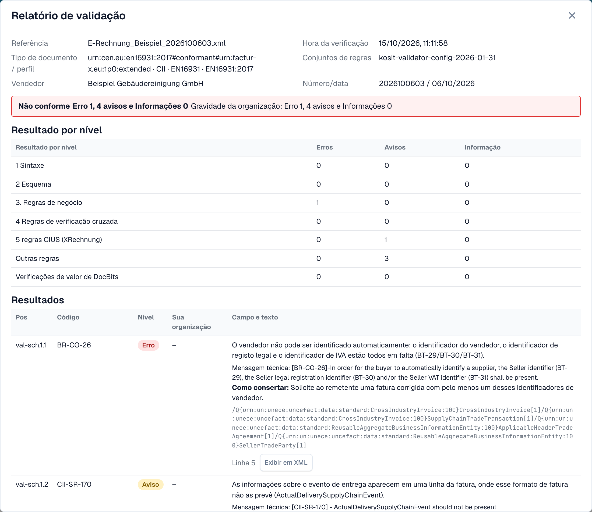
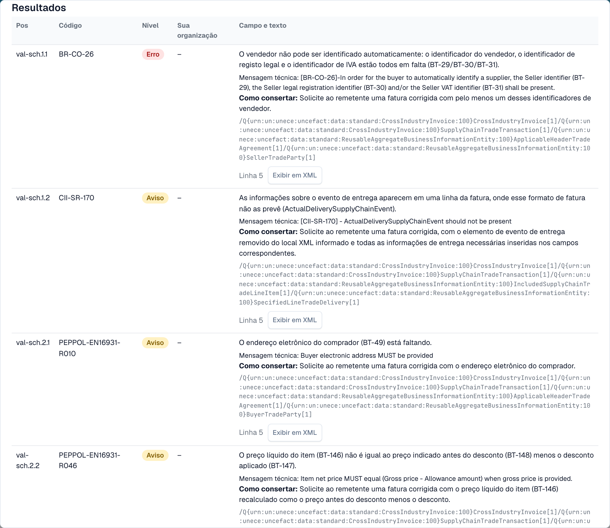

# Relatório de validação

Quando o DocBits rejeita uma fatura eletrónica, pode ler exatamente porquê. O **relatório de validação** lista cada resultado em linguagem simples, diz-lhe o que corrigir e mostra o próximo passo. Abre-o a partir do documento, não das definições. O ecrã onde o encontra está descrito em [O ecrã de erro de uma fatura eletrónica rejeitada](validation-error-screen.md).

Esta página é para quem processa faturas. Os administradores definem as regras na página [Validação de faturas eletrônicas](validation-rules.md) e escolhem, por tipo de documento, se uma verificação falhada bloqueia a fatura, ver [Validação para cada tipo de documento](validation-per-document-type.md).

## Quando um documento fica com erro

Se a validação estiver **ativada** e em **bloqueio** para o tipo de documento, uma fatura com um resultado bloqueante fica com o estado **Erro**. Abra o documento no painel. A vista de erro mostra o XML à esquerda e o motivo à direita.

<figure><figcaption>
A vista de erro: o XML da fatura e o primeiro resultado bloqueante com um próximo passo. Fatura de exemplo com nomes fictícios.
</figcaption></figure>

O cartão à direita indica a camada que rejeitou a fatura (por exemplo **L3 · Regras de negócio**), o código da regra (por exemplo `BR-CO-26`), uma explicação curta e um **Próximo passo**. Selecione **Ver detalhes da validação** para abrir o relatório completo.

## Ler o relatório

<figure><figcaption>
O topo do relatório: dados do ficheiro, o veredicto e o resultado de cada nível
</figcaption></figure>

O relatório começa com os factos sobre o ficheiro:

| Campo | O que mostra |
| --- | --- |
| **Referência** | O nome do ficheiro da fatura. |
| **Hora da verificação** | Quando o DocBits executou a verificação. Um relatório guardado não muda depois. |
| **Tipo de documento / perfil** | O formato da fatura, por exemplo CII e EN 16931. |
| **Conjuntos de regras** | A versão dos conjuntos de regras que o DocBits usou. |
| **Vendedor** | O vendedor, lido do XML. |
| **Número/data** | O número e a data da fatura, lidos do XML. |

Abaixo dos dados do ficheiro vê o **veredicto**, por exemplo **Não conforme**, com o número de erros, avisos e mensagens de informação. Se a sua organização alterou a gravidade de uma regra, uma segunda linha **Gravidade da organização** mostra as contagens segundo as definições da sua organização.

### Resultado por nível

A tabela **Resultado por nível** mostra quantos erros, avisos e mensagens de informação cada verificação encontrou. As verificações assentam umas nas outras:

| Nível | O que verifica |
| --- | --- |
| **1 Sintaxe** | O XML está bem formado. |
| **2 Esquema** | A estrutura segue o esquema XML oficial. |
| **3 Regras de negócio** | Os campos obrigatórios estão presentes e corretos (regras `BR-…`). |
| **4 Regras de verificação cruzada** | Os campos são coerentes entre si, por exemplo os totais. |
| **5 regras CIUS (XRechnung)** | As regras alemãs adicionais do XRechnung. |
| **Outras regras** | Outras regras, por exemplo as regras PEPPOL. |
| **Verificações de valor de DocBits** | Verificações que o DocBits acrescenta, por exemplo IBAN e IVA. |

> Nas faturas com perfil EN 16931 ou EXTENDED, as regras específicas do XRechnung aparecem como **avisos**, não como erros.

## Os resultados

<figure><figcaption>
Cada resultado tem um código, um nível, um texto legível e uma indicação de como corrigir
</figcaption></figure>

Cada resultado é uma linha:

* **Pos** e **Código**: a posição no relatório e o código da regra, por exemplo `BR-CO-26`.
* **Nível**: **Erro**, **Aviso** ou **Informação**.
* **Sua organização**: o nível segundo as definições da sua organização. Um traço significa que a sua organização não alterou o nível.
* **Campo e texto**: o problema em linguagem simples, o campo a que diz respeito (por exemplo *BT-29*), a mensagem técnica do validador e **Como consertar**.
* **Linha** e **Exibir em XML**: selecione **Exibir em XML** para fechar o relatório e saltar para a linha no visualizador de XML.

O DocBits tem textos em linguagem simples para as regras mais comuns. Para uma regra sem esse texto, o relatório mostra a mensagem técnica do validador.

## A seguir

* [Próximo passo e rejeitar um documento](validation-next-step-and-reject.md): o que fazer depois de ler o relatório.

## Páginas relacionadas

* [Validação de faturas eletrônicas](validation-rules.md): versões aceites, perfis e a gravidade de cada regra.
* [Validação para cada tipo de documento](validation-per-document-type.md): ative a validação e defina o bloqueio.
* [Encaminhamento de notificações](notification-routing.md): quem trata cada resultado.
