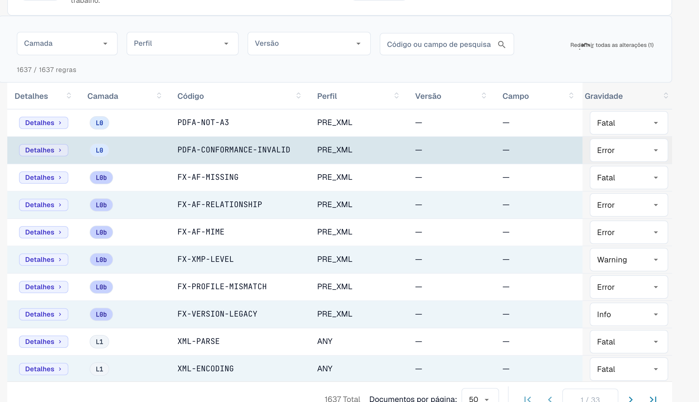

# Gravidade das regras

Cada regra de validação tem uma gravidade. Pode alterar a gravidade de cada regra para a sua organização. Esta página faz parte de [Validação de faturas eletrônicas](validation-rules.md). Só os administradores da organização podem alterar as gravidades.

## Substituir a gravidade das regras

<figure><figcaption>
A tabela completa de regras com substituição de gravidade por regra
</figcaption></figure>

A tabela de regras lista todas as regras de validação (mais de 1.600 no total). Filtre por **Camada (Layer)**, **Perfil** ou **Versão**, ou pesquise por código ou campo. Para cada regra pode substituir a **Gravidade** no menu pendente para a ajustar à política da sua organização — por exemplo, baixar uma regra de `ERROR` para `WARNING` para que deixe de rejeitar o documento.

O significado de **FATAL**, **ERROR**, **WARNING** e **INFO** está explicado em [Configuração da validação e versões aceites](validation-setup.md#perfis-aceites-e-modelo-de-gravidade). Uma gravidade alterada também aparece no [relatório de validação](validation-report.md), na coluna **Sua organização**.
