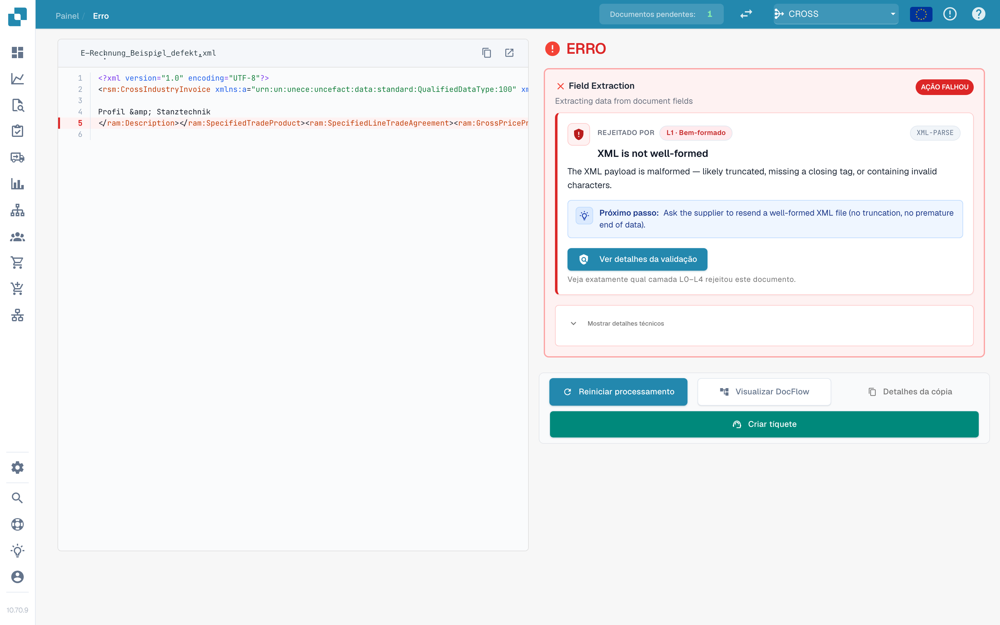
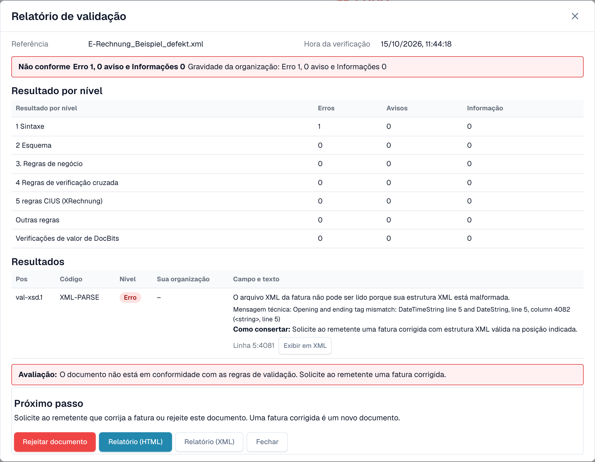

# O ecrã de erro de uma fatura eletrónica rejeitada

Quando carrega uma fatura eletrónica incorreta, o DocBits não a perde. O documento fica com o estado **Erro** e o ecrã de erro diz-lhe o que está errado, onde, e o que fazer a seguir. Esta página mostra dois exemplos: um ficheiro XML que não está bem formado e uma fatura que viola uma regra de negócio.

> Uma fatura só fica com o estado **Erro** quando a validação está **ativada** e em **bloqueio** para o seu tipo de documento. Ver [Validação para cada tipo de documento](validation-per-document-type.md).

## Exemplo 1: o ficheiro XML está danificado

Um fornecedor envia um ficheiro XML em que uma etiqueta de fecho não corresponde à etiqueta de abertura. O ficheiro não pode ser lido, por isso o DocBits pára na primeira verificação, **L1 · Bem-formado**.

<figure><figcaption>
O ecrã de erro de um ficheiro XML danificado. A linha errada está marcada no XML. Ficheiro de exemplo com dados fictícios.
</figcaption></figure>

O ecrã tem dois lados:

* **Esquerda: o ficheiro XML.** O DocBits mostra o ficheiro com números de linha. A linha com o problema está marcada a vermelho. Use os botões acima do ficheiro para copiar o XML ou abri-lo num novo separador.
* **Direita: a explicação.** O cartão **Rejeitado por** indica a verificação que parou o ficheiro (aqui **L1 · Bem-formado**) e o código da regra (aqui `XML-PARSE`). Abaixo vê um título em linguagem simples (_XML is not well-formed_), uma explicação curta e o bloco **Próximo passo**.

Selecione **Ver detalhes da validação** para abrir o [relatório de validação](validation-report.md) completo.

<figure><figcaption>
O relatório do ficheiro danificado: um erro no nível 1 Sintaxe, com a mensagem técnica e a posição
</figcaption></figure>

O relatório indica a posição exata (aqui linha 5, coluna 4081) e dá a mensagem técnica do analisador de XML. Selecione **Exibir em XML** para saltar para essa linha. A dica **Como consertar** diz-lhe para pedir ao remetente um ficheiro corrigido.

## Exemplo 2: a fatura viola uma regra de negócio

O XML está correto, mas falta um campo obrigatório. Por exemplo, o vendedor não pode ser identificado porque não existe identificador do vendedor, identificador de registo nem identificador de IVA (regra `BR-CO-26`).

<figure><figcaption>
O ecrã de erro de um erro de regra de negócio: a camada <strong>L3 · Regras de negócio</strong>, o código da regra e um próximo passo
</figcaption></figure>

Aqui o cartão indica a camada **L3 · Regras de negócio** e o código `BR-CO-26`. O relatório lista todos os resultados da fatura, ver [Relatório de validação](validation-report.md).

## Os botões por baixo do cartão

| Botão                       | O que faz                                                                                                                          |
| --------------------------- | ---------------------------------------------------------------------------------------------------------------------------------- |
| **Reiniciar processamento** | Executa de novo o processamento do documento, por exemplo depois de alterar uma definição. A verificação usa as definições atuais. |
| **Visualizar DocFlow**      | Mostra o fluxo de trabalho do documento.                                                                                           |
| **Detalhes da cópia**       | Copia os detalhes do erro, por exemplo para uma mensagem ao seu administrador.                                                     |
| **Criar tíquete**           | Abre um tíquete de suporte com os detalhes do erro.                                                                                |

Selecione **Mostrar detalhes técnicos** no cartão para ver a informação técnica em bruto.

## O que fazer a seguir

* **Erros:** peça ao remetente uma fatura corrigida ou [rejeite o documento](validation-next-step-and-reject.md). Uma fatura corrigida é um novo documento.
* **Apenas avisos:** o documento não fica bloqueado. Pode continuar.

## Páginas relacionadas

* [Relatório de validação](validation-report.md): todos os resultados, nível a nível.
* [Próximo passo e rejeitar um documento](validation-next-step-and-reject.md)
* [Validação para cada tipo de documento](validation-per-document-type.md): ative a validação e defina o bloqueio.
