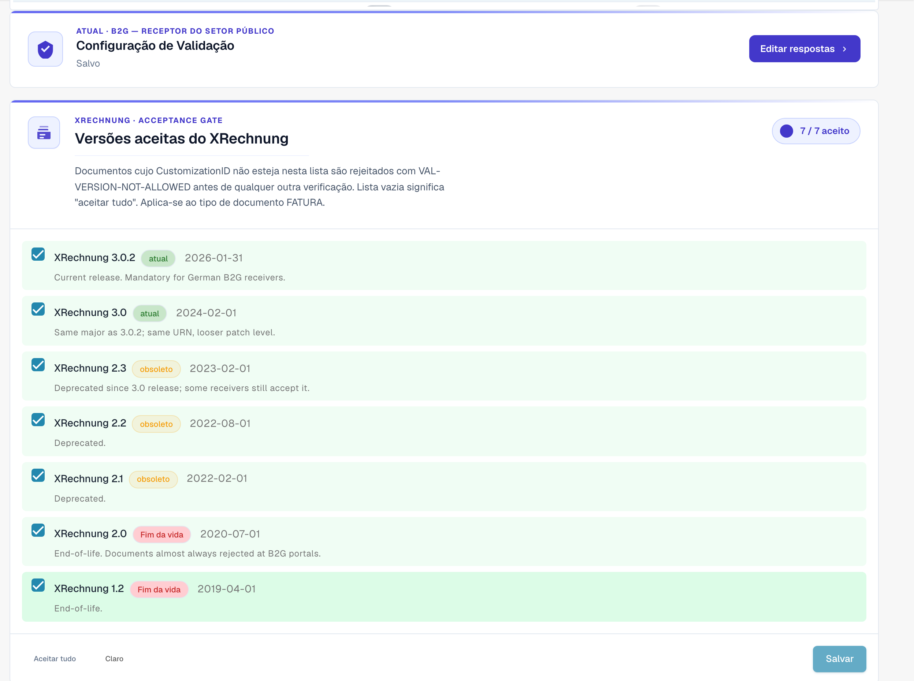
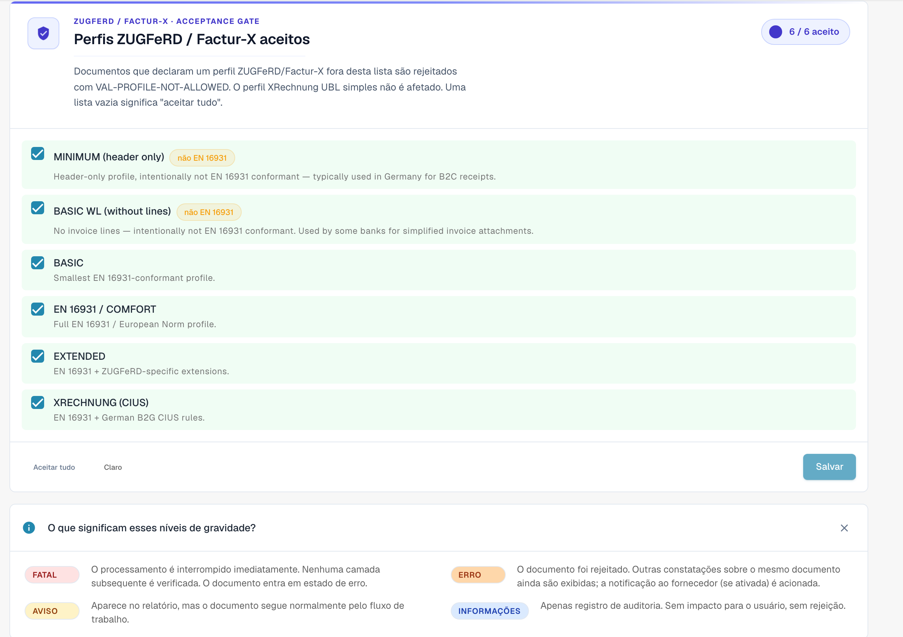

# Configuração da validação e versões aceites

Esta página explica o assistente de configuração, as versões XRechnung aceites e os perfis aceites da página [Validação de faturas eletrônicas](./). Só os administradores da organização podem alterar estas definições.

## Configuração da validação

<figure><figcaption>
Configuração de validação e versões XRechnung aceites
</figcaption></figure>

O cartão **Configuração da validação** mostra o seu perfil de validação atual (por exemplo, _B2G — Public Sector Receiver_). Clique em **Editar respostas** para voltar a executar o assistente de configuração e alterar o padrão face ao qual valida.

## Versões XRechnung aceites

A barreira **Versões XRechnung aceites** lista todas as versões de XRechnung. Marque as versões que aceita — os documentos cujo CustomizationID fica fora desta lista são rejeitados com `VAL-VERSION-NOT-ALLOWED` antes de qualquer outra verificação. Uma lista vazia significa "aceitar tudo". Cada versão é marcada como **current**, **deprecated** ou **EOL** juntamente com a respetiva data de lançamento.

## Perfis aceites e modelo de gravidade

<figure><figcaption>
Perfis aceites e o significado de cada gravidade
</figcaption></figure>

Escolha que **perfis** aceita (BASIC WL, BASIC, EN 16931 / COMFORT, EXTENDED, XRECHNUNG (CIUS)) através de **Aceitar tudo** / **Limpar** e, em seguida, **Guardar**.

Cada regra de validação tem uma **gravidade** que decide o que acontece quando é acionada:

| Gravidade   | Efeito                                                                                                                                                    |
| ----------- | --------------------------------------------------------------------------------------------------------------------------------------------------------- |
| **FATAL**   | Para o processamento de imediato. Nenhuma camada seguinte é verificada; o documento passa a Erro.                                                         |
| **ERROR**   | O documento é rejeitado. Os restantes resultados do mesmo documento continuam a ser apresentados; a notificação ao fornecedor (se ativada) é despoletada. |
| **WARNING** | Surge no relatório de validação, mas o documento prossegue normalmente no fluxo.                                                                          |
| **INFO**    | Apenas registo de auditoria. Sem efeito visível para o utilizador nem rejeição.                                                                           |

### O que o assistente altera

O cartão **Configuração da validação**, mais abaixo na página, abre um assistente com **Editar respostas**. O assistente substitui todo o conjunto de substituições de regras da sua organização. O DocBits avisa-o antes de guardar. Verifique com atenção o passo de revisão e aplicação.

A seguir: [Gravidade das regras](validation-rule-severities.md) e [Validação para cada tipo de documento](validation-per-document-type.md).
