# Exportação

## Visão Geral

A página de Exportação exibe todas as configurações de exportação configuradas, incluindo se estão ativas ou inativas. A partir daqui, os usuários podem:

* Visualizar e gerenciar configurações de exportação existentes
* Criar novas conexões de exportação (ex.: para **Infor**, **Infor & IDM**, **Webhook** ou **SFTP**)
* Editar ou excluir configurações de exportação existentes

## Onde encontrar

Você pode encontrá-lo em: **Configurações** → **Processamento de Documentos** → **Exportação**

<figure>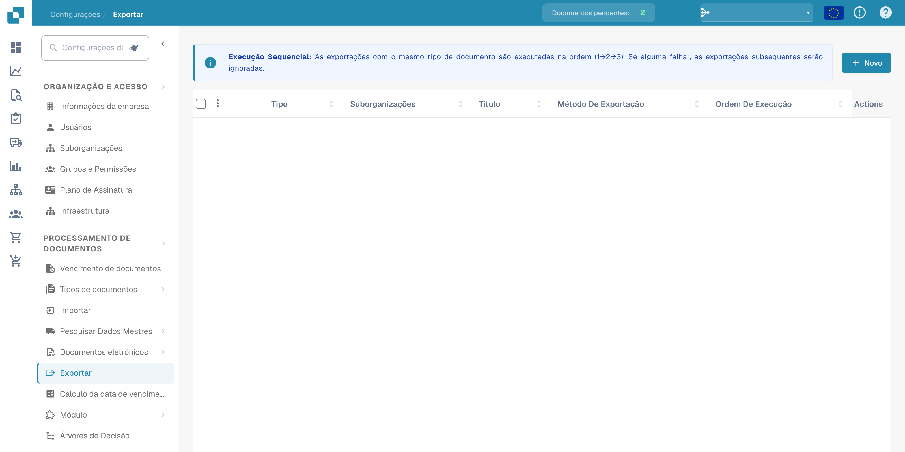<figcaption>
Acesso às configurações de exportação a partir das definições.
</figcaption></figure>

## **Usando a página de Exportação**

Quando você abre a página de Exportação, verá uma lista de todas as configurações de exportação existentes.

Cada linha na lista mostra:

* **Indicador de status**
  * **Verde** significa que a exportação está ativa
  * **Vermelho** significa que a exportação está desativada
* **Nome** – o nome da configuração de exportação
* **Tipo de documento** – o tipo de documento para o qual a exportação está configurada
* **Sub-organização** – se a exportação está limitada a uma sub-organização específica
* **Método de exportação** – para onde o documento será enviado (ex.: Infor, IDM, SFTP)
* **Ações** – botões para **editar, excluir** ou **ativar/desativar** a configuração

#### **Regras importantes para configuração de exportação**

Para cada **tipo de documento** **dentro de uma determinada organização ou sub-organização**, aplicam-se as seguintes regras:

* Você pode ter **apenas uma exportação Infor ativa**
* Você pode ter **apenas uma exportação não-Infor ativa** (ex.: Webhook, SFTP)

No entanto, é possível ter:

* **Uma exportação Infor ativa** _e_ **uma exportação não-Infor ativa** ao mesmo tempo para o mesmo tipo de documento
* **Diferentes configurações de exportação para diferentes sub-organizações** — por exemplo, uma exportação Infor para Sub-Org A e outra exportação Infor para Sub-Org B

## **Criando uma nova exportação**

Para criar uma nova exportação:

1. Clique no botão **"Novo"**.

<figure>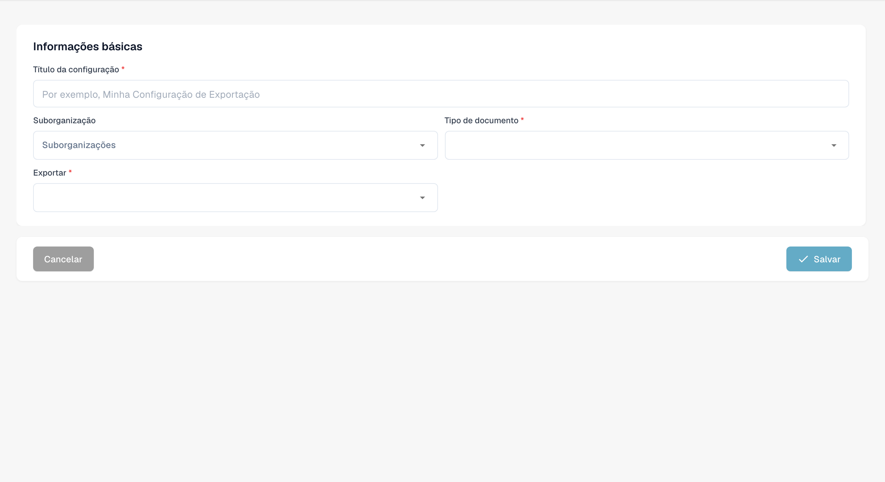<figcaption>
Rascunho de configuração de exportação sem guardar.
</figcaption></figure>

2. Selecione o **Tipo de Exportação** que deseja configurar (ex.: Infor, IDM, SFTP).
3. Preencha os campos obrigatórios com base no tipo de exportação.
4. Salve a configuração.

## Opções de exportação

#### Webhook

Webhook

<figure>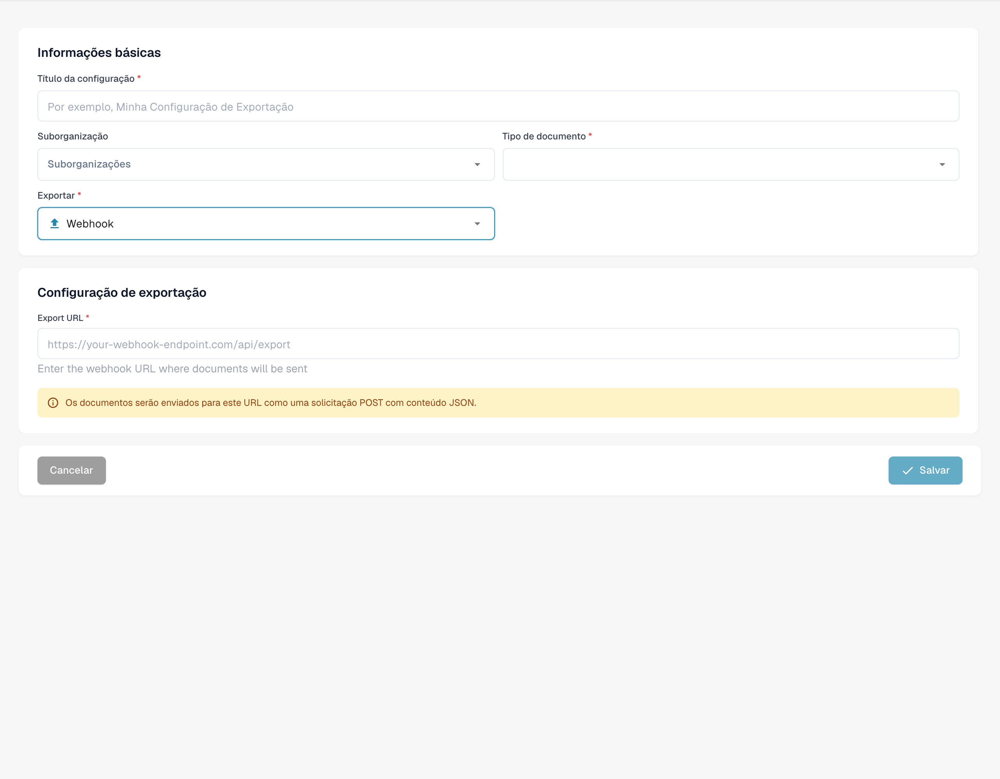<figcaption>
Rascunho de configuração de exportação por Webhook. Algumas instruções do produto permanecem em inglês.
</figcaption></figure>

**Descrição dos campos**

* **Título** O nome da configuração de exportação. Isso aparecerá na lista de exportações.
* **Suborganização** _(opcional)_ Um menu suspenso com todas as sub-organizações disponíveis.
  * Se deixado vazio: aplica-se à organização principal.
  * Se selecionado: a exportação será aplicada apenas à sub-organização escolhida.
* **Tipo de documento** Menu suspenso listando todos os tipos de documentos disponíveis. Isso determina a qual tipo de documento esta configuração de exportação se aplica.
* **Export URL** A URL de destino onde o documento deve ser exportado.

#### SFTP

SFTP

<figure>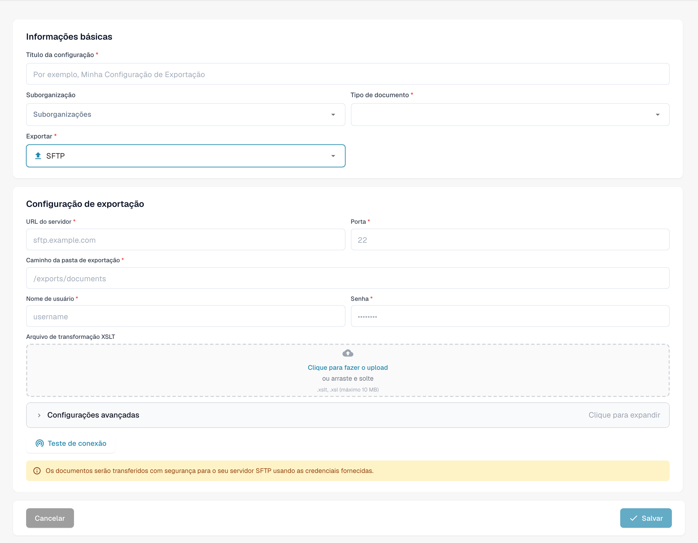<figcaption>
Rascunho de configuração de exportação por SFTP.
</figcaption></figure>

**Descrição dos campos**

* **Título** O nome da configuração de exportação. Isso aparecerá na lista de exportações.
* **Suborganização** _(opcional)_ Um menu suspenso com todas as sub-organizações disponíveis.
  * Se deixado vazio: aplica-se à organização principal.
  * Se selecionado: a exportação será aplicada apenas à sub-organização escolhida.
* **Tipo de documento** Menu suspenso listando todos os tipos de documentos disponíveis. Isso determina a qual tipo de documento esta configuração de exportação se aplica.
* **Nome de usuário** O nome de usuário usado para autenticar no servidor SFTP.
* **Senha** A senha correspondente para a conta SFTP. Certifique-se de que a conta tenha acesso de gravação à pasta especificada.
* **URL do servidor** O nome do host ou endereço IP do servidor SFTP de destino.
* **Porta** A porta usada para conectar ao servidor SFTP.
* **Pasta** O caminho no servidor SFTP onde os documentos devem ser carregados (ex.: `/incoming/invoices/`). Deve existir e ser gravável.
*   **Ficheiro XSLT (opcional)**

    O **arquivo XSLT** permite a transformação do formato de exportação padrão do DocBits.

    * **Quando usar:** Apenas se o sistema receptor requer uma estrutura diferente ou formatação específica que difere do padrão do DocBits.
    * **Deixe vazio** se o formato de exportação padrão atende aos requisitos.

**Configurações avançadas:**

* **Modo de exportação do nome do arquivo** Especifica se o arquivo exportado mantém seu nome de arquivo original ou é renomeado usando o ID do documento DocBits.
* **Incluir histórico do documento** Quando habilitado, o arquivo exportado incluirá o histórico do documento baseado nos logs disponíveis no painel.

<figure>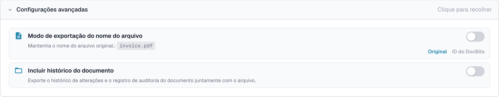<figcaption>
Opções avançadas de exportação SFTP sem guardar.
</figcaption></figure>

#### Exportação Infor para SFTP

Exportação Infor para SFTP

<figure>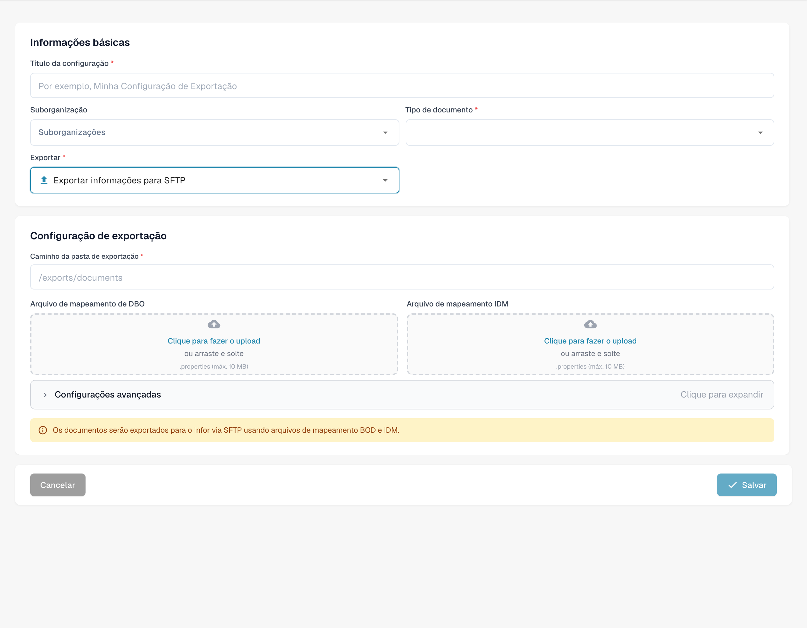<figcaption>
Rascunho de exportação por Infor SFTP. A marca Infor aparece incorretamente como Informações; os nomes técnicos mantêm-se.
</figcaption></figure>

**Descrição dos campos**

* **Título** O nome da configuração de exportação. Isso aparecerá na lista de exportações.
* **Suborganização** _(opcional)_ Um menu suspenso com todas as sub-organizações disponíveis.
  * Se deixado vazio: aplica-se à organização principal.
  * Se selecionado: a exportação será aplicada apenas à sub-organização escolhida.
* **Tipo de documento** Menu suspenso listando todos os tipos de documentos disponíveis. Isso determina a qual tipo de documento esta configuração de exportação se aplica.
* **Arquivo de mapeamento IDM** Selecione um arquivo de mapeamento do gerenciador de arquivos. [Precisa de ajuda para criar um? Veja o Guia de Mapeamento IDM](../../../infor-integration-and-configuration/exporting-to-infor/creating-an-idm-mapping-file.md)
* **Arquivo de mapeamento de DBO** Selecione um arquivo de mapeamento do gerenciador de arquivos. [Precisa de ajuda para criar um? Veja o Guia de Mapeamento BOD](../../../infor-integration-and-configuration/exporting-to-infor/creating-a-bod-mapping-file.md)
* **Pasta** O caminho no servidor SFTP onde os documentos devem ser carregados (ex.: `/incoming/invoices/`). Deve existir e ser gravável.

#### **SMB**

SMB

<figure>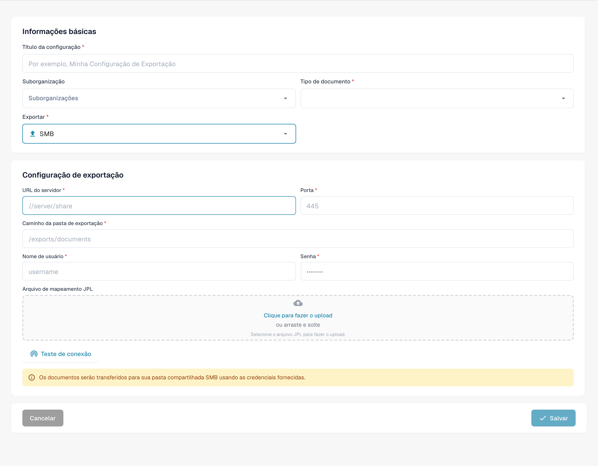<figcaption>
Rascunho de exportação por SMB; o protocolo mantém-se inalterado.
</figcaption></figure>

**Descrição dos campos**

* **Título** O nome da configuração de exportação. Isso aparecerá na lista de exportações.
* **Suborganização** _(opcional)_ Um menu suspenso com todas as sub-organizações disponíveis.
  * Se deixado vazio: aplica-se à organização principal.
  * Se selecionado: a exportação será aplicada apenas à sub-organização escolhida.
* **Tipo de documento** Menu suspenso listando todos os tipos de documentos disponíveis. Isso determina a qual tipo de documento esta configuração de exportação se aplica.
* **Nome de usuário** O nome de usuário usado para conectar ao compartilhamento SMB.
* **Senha** A senha correspondente para autenticação SMB.
* **URL do servidor** O endereço do servidor SMB.
* **Porta** Número da porta usado para acessar o compartilhamento SMB.
* **Pasta** O caminho da pasta dentro do compartilhamento SMB onde os documentos devem ser salvos (ex.: `/incoming/invoices/`). Deve existir e ser gravável.
*   **Ficheiro de mapeamento JPL (opcional)**

    O **arquivo JPL** é usado para definir uma transformação dos dados exportados antes de serem gravados no compartilhamento SMB.

    * **Quando usar:** Apenas quando os dados do documento exportado precisam ser ajustados para corresponder à formatação externa ou expectativas do sistema.
    * **Deixe vazio** se nenhuma transformação for necessária.

#### **Infor IDM**

Infor IDM

<figure>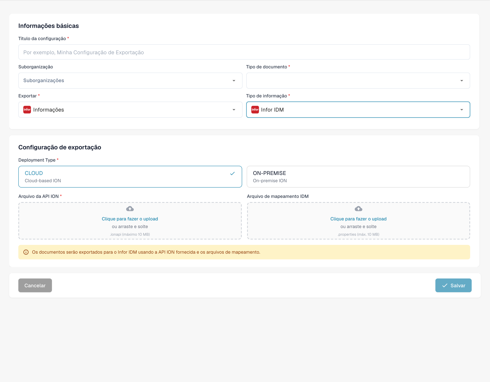<figcaption>
Rascunho de exportação para Infor IDM. A marca Infor aparece incorretamente como Informações; os nomes técnicos mantêm-se.
</figcaption></figure>

**Descrição dos campos**

* **Título** O nome da configuração de exportação. Isso aparecerá na lista de exportações.
* **Suborganização** _(opcional)_ Um menu suspenso com todas as sub-organizações disponíveis.
  * Se deixado vazio: aplica-se à organização principal.
  * Se selecionado: a exportação será aplicada apenas à sub-organização escolhida.
* **Tipo de documento** Menu suspenso listando todos os tipos de documentos disponíveis. Isso determina a qual tipo de documento esta configuração de exportação se aplica.
* **Ficheiro de mapeamento ION** Selecione um arquivo de mapeamento do gerenciador de arquivos.
* **Arquivo de mapeamento IDM** Selecione um arquivo de mapeamento do gerenciador de arquivos. [Precisa de ajuda para criar um? Veja o Guia de Mapeamento IDM](../../../infor-integration-and-configuration/exporting-to-infor/creating-an-idm-mapping-file.md)
* **Cloud / On-Prem Toggle** Um interruptor para indicar o tipo de implantação do Infor:
  * **Implementação na nuvem**: Selecione isso se você for um cliente Infor CloudSuite.
  * **On-Prem**: Selecione isso se o Infor for auto-hospedado.

#### **Infor ION**

Infor ION

<figure>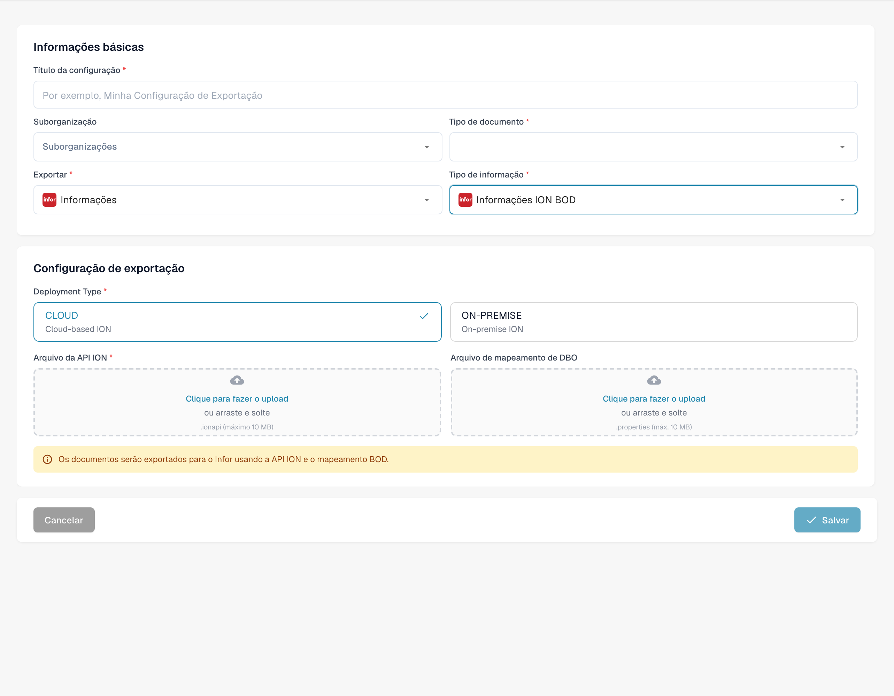<figcaption>
Rascunho de exportação para Infor ION. A marca Infor aparece incorretamente como Informações; os nomes técnicos mantêm-se.
</figcaption></figure>

**Descrição dos campos**

* **Título** O nome da configuração de exportação. Isso aparecerá na lista de exportações.
* **Suborganização** _(opcional)_ Um menu suspenso com todas as sub-organizações disponíveis.
  * Se deixado vazio: aplica-se à organização principal.
  * Se selecionado: a exportação será aplicada apenas à sub-organização escolhida.
* **Tipo de documento** Menu suspenso listando todos os tipos de documentos disponíveis. Isso determina a qual tipo de documento esta configuração de exportação se aplica.
* **Ficheiro de mapeamento ION** Selecione um arquivo de mapeamento do gerenciador de arquivos.
* **Arquivo de mapeamento de DBO** Selecione um arquivo de mapeamento do gerenciador de arquivos. [Precisa de ajuda para criar um? Veja o Guia de Mapeamento BOD](../../../infor-integration-and-configuration/exporting-to-infor/creating-a-bod-mapping-file.md)
* **Cloud / On-Prem Toggle** Um interruptor para indicar o tipo de implantação do Infor:
  * **Implementação na nuvem**: Selecione isso se você for um cliente Infor CloudSuite.
  * **On-Prem**: Selecione isso se o Infor for auto-hospedado.

#### Infor IDM + ION BOD

Infor IDM + ION BOD

<figure>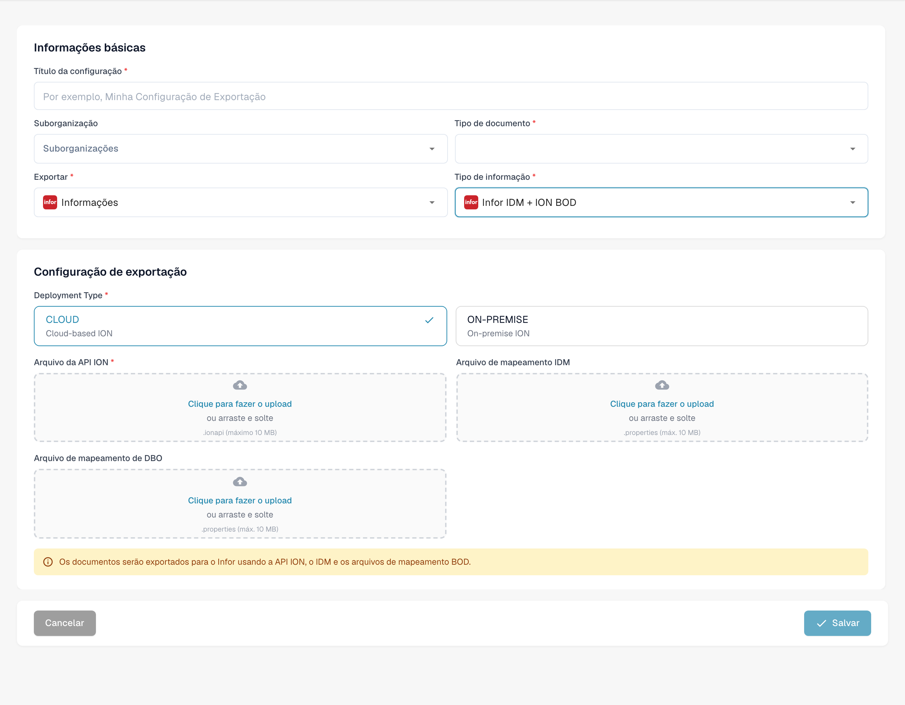<figcaption>
Rascunho de exportação para Infor IDM ION BOD. A marca Infor aparece incorretamente como Informações; os nomes técnicos mantêm-se.
</figcaption></figure>

**Descrição dos campos**

* **Título** O nome da configuração de exportação. Isso aparecerá na lista de exportações.
* **Suborganização** _(opcional)_ Um menu suspenso com todas as sub-organizações disponíveis.
  * Se deixado vazio: aplica-se à organização principal.
  * Se selecionado: a exportação será aplicada apenas à sub-organização escolhida.
* **Tipo de documento** Menu suspenso listando todos os tipos de documentos disponíveis. Isso determina a qual tipo de documento esta configuração de exportação se aplica.
* **Ficheiro de mapeamento ION** Selecione um arquivo de mapeamento do gerenciador de arquivos.
* **Arquivo de mapeamento IDM** Selecione um arquivo de mapeamento do gerenciador de arquivos. [Precisa de ajuda para criar um? Veja o Guia de Mapeamento IDM](../../../infor-integration-and-configuration/exporting-to-infor/creating-an-idm-mapping-file.md)
* **Arquivo de mapeamento de DBO** Selecione um arquivo de mapeamento do gerenciador de arquivos. [Precisa de ajuda para criar um? Veja o Guia de Mapeamento BOD](../../../infor-integration-and-configuration/exporting-to-infor/creating-a-bod-mapping-file.md)
* **Cloud / On-Prem Toggle** Um interruptor para indicar o tipo de implantação do Infor:
  * **Implementação na nuvem**: Selecione isso se você for um cliente Infor CloudSuite.
  * **On-Prem**: Selecione isso se o Infor for auto-hospedado.

### Para clientes Infor CloudSuite

#### Infor IDM + LN

Infor IDM + LN

<figure>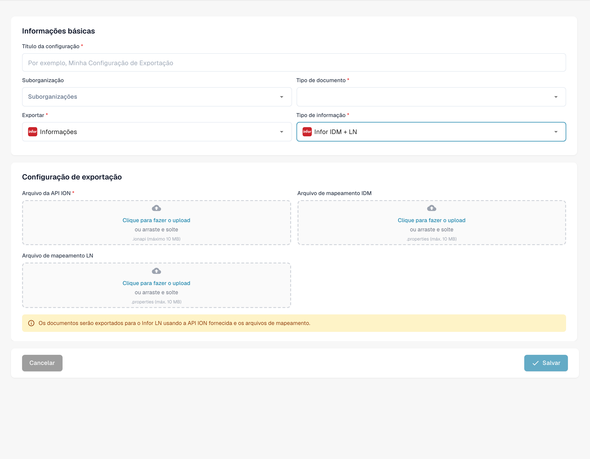<figcaption>
Rascunho de exportação para Infor IDM LN. A marca Infor aparece incorretamente como Informações; os nomes técnicos mantêm-se.
</figcaption></figure>

**Descrição dos campos**

* **Título** O nome da configuração de exportação. Isso aparecerá na lista de exportações.
* **Suborganização** _(opcional)_ Um menu suspenso com todas as sub-organizações disponíveis.
  * Se deixado vazio: aplica-se à organização principal.
  * Se selecionado: a exportação será aplicada apenas à sub-organização escolhida.
* **Tipo de documento** Menu suspenso listando todos os tipos de documentos disponíveis. Isso determina a qual tipo de documento esta configuração de exportação se aplica.
* **Ficheiro de mapeamento ION** Selecione um arquivo de mapeamento do gerenciador de arquivos.
* **Arquivo de mapeamento IDM** Selecione um arquivo de mapeamento do gerenciador de arquivos. [Precisa de ajuda para criar um? Veja o Guia de Mapeamento IDM](../../../infor-integration-and-configuration/exporting-to-infor/creating-an-idm-mapping-file.md)
* **Arquivo de mapeamento LN** Selecione um arquivo de mapeamento do gerenciador de arquivos. [Precisa de ajuda para criar um? Veja o Exemplo de Mapeamento LN](../../../infor-integration-and-configuration/exporting-to-infor/ln/example-export-ln/)

#### Infor IDM + M3

Infor IDM + M3

<figure>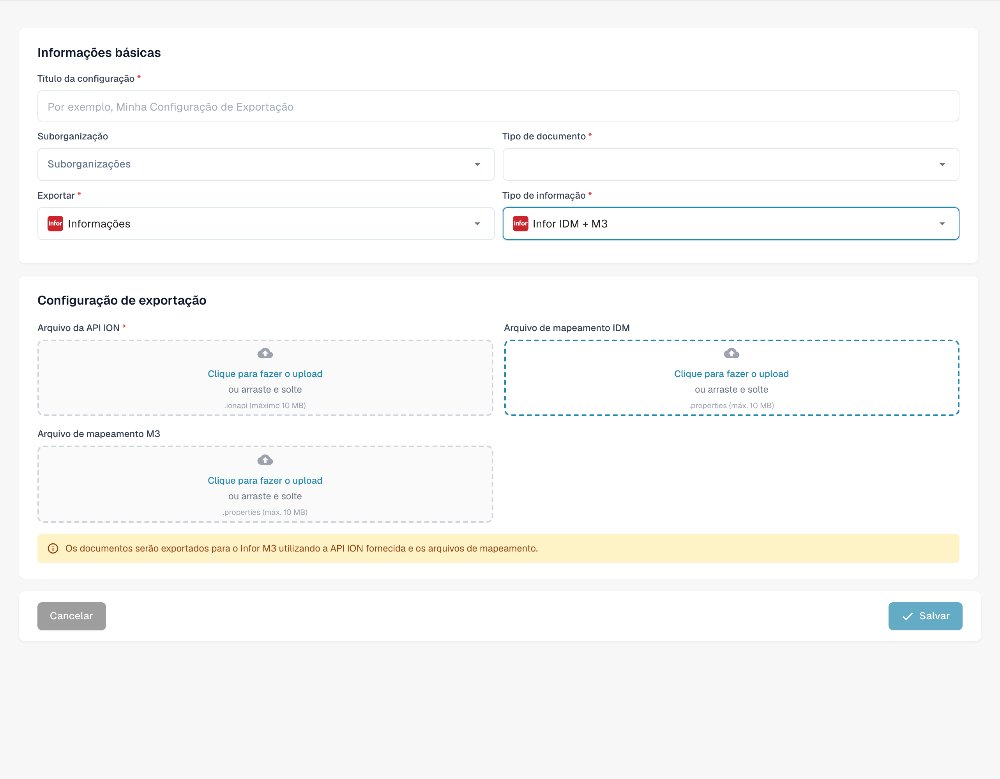<figcaption>
Rascunho de exportação para Infor IDM M3. A marca Infor aparece incorretamente como Informações; os nomes técnicos mantêm-se.
</figcaption></figure>

**Descrição dos campos**

* **Título** O nome da configuração de exportação. Isso aparecerá na lista de exportações.
* **Suborganização** _(opcional)_ Um menu suspenso com todas as sub-organizações disponíveis.
  * Se deixado vazio: aplica-se à organização principal.
  * Se selecionado: a exportação será aplicada apenas à sub-organização escolhida.
* **Tipo de documento** Menu suspenso listando todos os tipos de documentos disponíveis. Isso determina a qual tipo de documento esta configuração de exportação se aplica.
* **Ficheiro de mapeamento ION** Selecione um arquivo de mapeamento do gerenciador de arquivos.
* **Arquivo de mapeamento IDM** Selecione um arquivo de mapeamento do gerenciador de arquivos. [Precisa de ajuda para criar um? Veja o Guia de Mapeamento IDM](../../../infor-integration-and-configuration/exporting-to-infor/creating-an-idm-mapping-file.md)
* **Arquivo de mapeamento M3** Selecione um arquivo de mapeamento do gerenciador de arquivos. [Precisa de ajuda para criar um? Veja o Exemplo de Mapeamento M3](../../../infor-integration-and-configuration/exporting-to-infor/m3/example-export-m3.md)

#### Infor IDM + M3 (toml)

Infor IDM + M3 (toml)

<figure>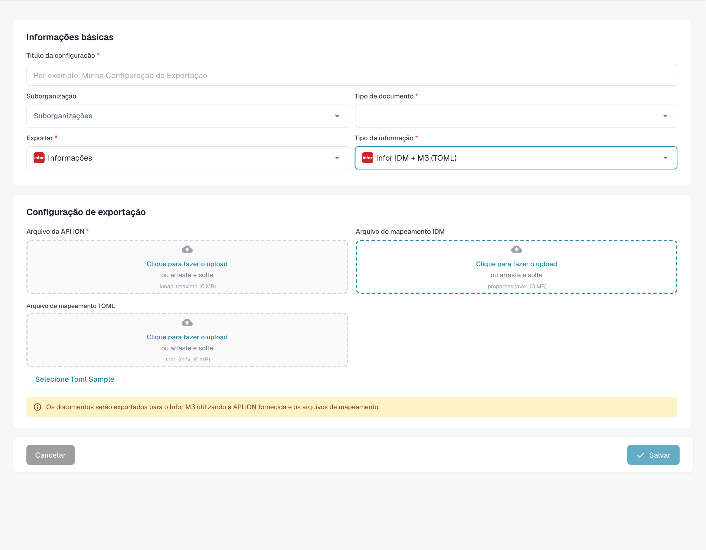<figcaption>
Rascunho de exportação para Infor IDM M3 com TOML. A marca Infor aparece incorretamente como Informações; os nomes técnicos mantêm-se.
</figcaption></figure>

**Descrição dos campos**

* **Título** O nome da configuração de exportação. Isso aparecerá na lista de exportações.
* **Suborganização** _(opcional)_ Um menu suspenso com todas as sub-organizações disponíveis.
  * Se deixado vazio: aplica-se à organização principal.
  * Se selecionado: a exportação será aplicada apenas à sub-organização escolhida.
* **Tipo de documento** Menu suspenso listando todos os tipos de documentos disponíveis. Isso determina a qual tipo de documento esta configuração de exportação se aplica.
* **Ficheiro de mapeamento ION** Selecione um arquivo de mapeamento do gerenciador de arquivos.
* **Arquivo de mapeamento IDM** Selecione um arquivo de mapeamento do gerenciador de arquivos. [Precisa de ajuda para criar um? Veja o Guia de Mapeamento IDM](../../../infor-integration-and-configuration/exporting-to-infor/creating-an-idm-mapping-file.md)
* **Ficheiro de mapeamento M3 TOML** Selecione um arquivo de mapeamento do gerenciador de arquivos ou use a opção selecionar Toml para usar um toml criado com o gerenciador de regras. [Precisa de ajuda para criar um? Veja o Guia do Gerenciador de Regras](rule-manager/)

## Tutorial em vídeo: Configurar e testar a exportação para o ERP


Configurar e testar a exportação para o ERP


[Ver com legendas e capítulos](https://docbits-videos.fra1.cdn.digitaloceanspaces.com/settings-assistant/erp-export-admin/v1/pt.html)

Alguns rótulos nativos podem permanecer noutro idioma. Os identificadores técnicos dos campos são preservados.

Utilizo uma configuração e um tipo de documento próprios para este teste. As faturas contêm dados fictícios. O nosso recetor de teste verifica a transmissão, sem efetuar lançamentos num ERP de produção. Não altero as outras integrações.

Na configuração de exportação, verifico o tipo de documento, a organização e o tipo de exportação. Este exemplo utiliza Generic API na nuvem. As credenciais JSON e o mapeamento de campos TOML são ficheiros separados. Em projetos reais, o sistema de destino, as permissões e a suborganização devem corresponder ao processo pretendido.

<figure>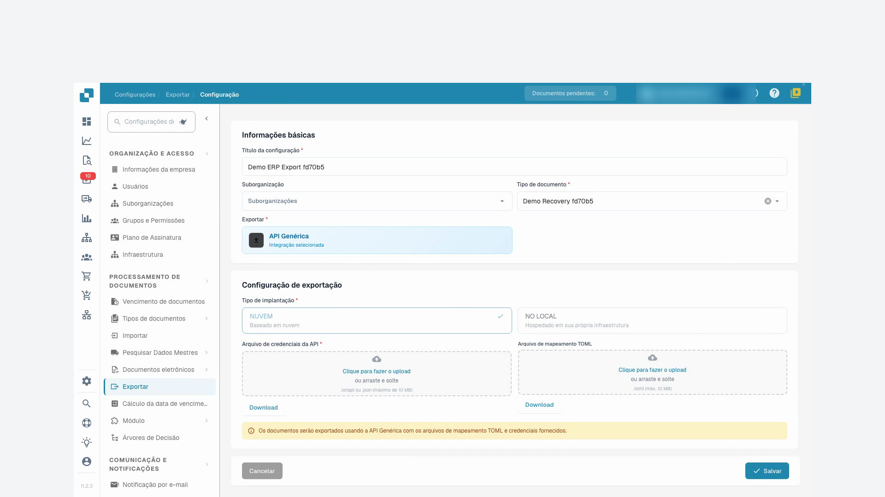<figcaption>
Configuração de exportação limitada ao tipo de documento de formação
</figcaption></figure>

No mapeamento corrigido, o campo invoice_id do DocBits fornece o número da fatura enviado ao recetor de teste. São também mapeados o fornecedor, o montante total e a moeda. Este teste verifica os dados de cabeçalho. As linhas da fatura e os lançamentos no ERP exigem verificações de negócio separadas em cada projeto.

Carrego o ficheiro TOML corrigido e guardo a configuração. Depois, abro-a novamente e verifico se a alteração foi guardada. As credenciais de teste mantêm-se; as credenciais de produção não devem aparecer na gravação.

Regresso à fatura de teste cuja exportação falhou e reinicio a exportação exatamente uma vez. Aguardo que o processamento termine. A simples aceitação do pedido não comprova que a transmissão foi bem-sucedida.

O DocBits mostra agora a fatura como concluída. Além disso, verifico o comprovativo de receção do recetor de teste. O número da fatura, o fornecedor, o montante e a moeda coincidem com a fatura de teste. A autenticação e a transmissão foram bem-sucedidas. O recetor de teste não confirma qualquer lançamento no ERP.

<figure>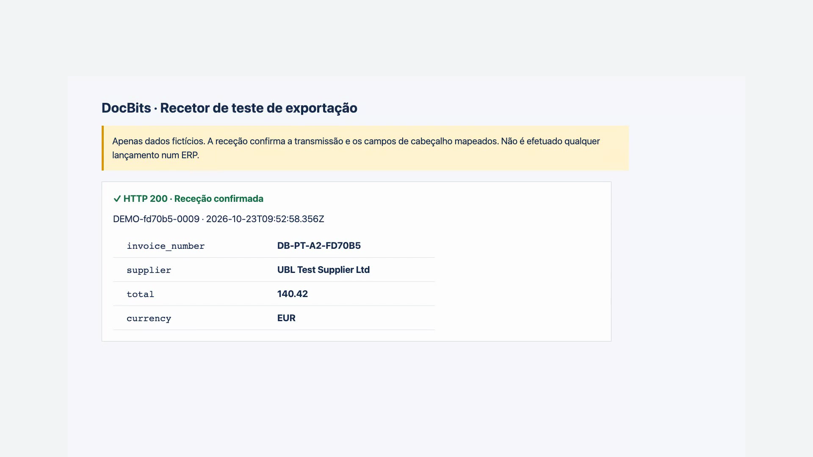<figcaption>
Receção real pelo destinatário de teste; sem lançamento no ERP
</figcaption></figure>
