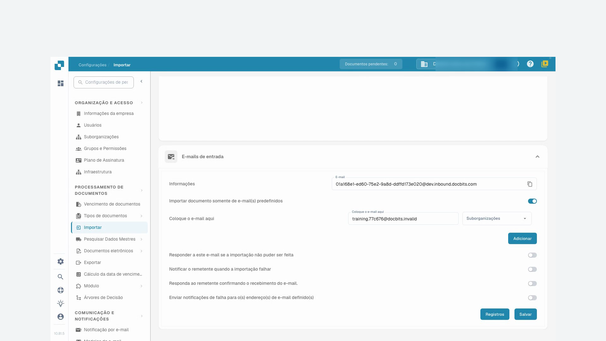
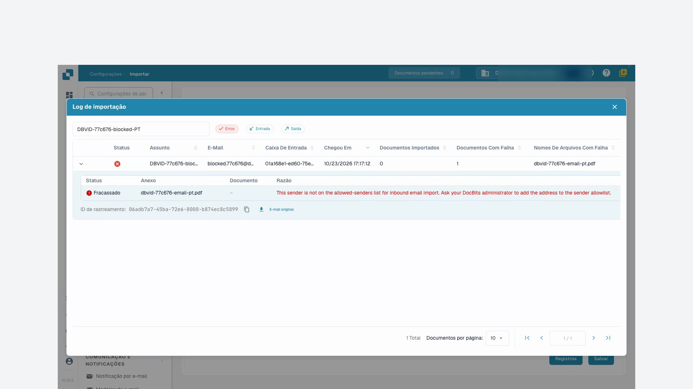

# Importar

Nas definições de importação pode determinar o tratamento dos documentos e configurar a receção automática por FTP ou e-mail. Abra **Definições → Processamento de documentos → Importar**.

## Opções dos documentos

Verifique o limite de páginas, o prazo de pagamento predefinido em dias e o formato de data. As páginas que excedem o limite configurado podem ser descartadas. O valor predefinido documentado para esta função é 60 páginas; confirme a configuração da sua organização antes da importação.

## Importação FTP

É necessário um servidor FTP compatível, dados de ligação aprovados e uma pasta de importação dedicada acessível à conta do servidor.

<figure><figcaption>
Resumo das ligações de importação FTP.
</figcaption></figure>

### Configurar uma ligação

Crie uma ligação. O assistente começa pela configuração do servidor e continua com opções e configuração de importação.

<figure><figcaption>
Configuração do servidor no assistente de importação FTP.
</figcaption></figure>

| Definição | Significado |
| --- | --- |
| Protocolo e porta | Escolha FTP, FTPS ou SFTP e a porta confirmada pelo administrador do servidor. |
| Servidor e credenciais | Endereço do servidor e conta autorizada a ler a pasta de importação. |
| Padrões dos nomes de ficheiros | Limitam a importação aos nomes correspondentes. |
| Suborganização | Determina a atribuição dos documentos importados. |
| Chave API | Se for apresentada pela configuração, deve corresponder à organização correta. Não publique o seu valor. |
| Pasta principal e pasta de importação | Indicam a localização dos ficheiros no servidor. |
| Arquivo após importação | Move os ficheiros importados com sucesso para a pasta de arquivo indicada. A conta necessita das permissões adequadas. |
| Incluir subpastas | Alarga a pesquisa de ficheiros às pastas subordinadas. |

Verifique todas as etapas antes de guardar. Após guardar, confirme separadamente se a ligação está ativa. As ações disponíveis incluem testar a ligação, consultar registos, ativar, desativar, editar e eliminar. Leia o resultado do teste e os registos antes de iniciar a importação regular. As imagens mostram a lista e o início do assistente sem guardar, não uma ligação ao servidor verificada.

## Importação de e-mail {#email-import}

Uma ligação de e-mail recolhe documentos de uma caixa de correio própria por IMAP ou OAuth Microsoft365. O reencaminhamento para um endereço fornecido pelo DocBits é um método separado: consulte [E-mails recebidos](../module/inbound-emails.md).

### Anexos suportados

Os tipos de documentos importados incluem `.pdf`, `.tiff` / `.tif`, `.eml`, `.dat`, `.xml`, `.edi` e `.purchaseorder`.

O DocBits também reconhece documentos pelo conteúdo real, além do tipo declarado pelo servidor de e-mail. Isto é relevante quando um anexo reencaminhado recebe o tipo genérico `application/octet-stream` em vez de `application/pdf` ou `application/xml`.

* As mensagens `.eml` reencaminhadas e os anexos Outlook `winmail.dat` (TNEF) são descompactados para importar os documentos contidos.
* XML com um tipo genérico é reconhecido pela declaração `<?xml`, aceitando um BOM inicial UTF-8 ou UTF-16 (LE/BE). Atualmente, apenas estas codificações BOM são detetadas automaticamente pelo conteúdo. Um nome terminado em `.xml` permite importar independentemente da codificação.
* Imagens incorporadas na mensagem, como logótipos de assinatura e gráficos PNG, JPG, GIF ou BMP, são ignoradas e não contam como importações falhadas.
* Se estiver ativa a resposta em caso de falha de importação do endereço de entrada, a notificação é enviada para o endereço de resposta configurado.

### Ligação IMAP

Crie uma ligação na secção de importação de e-mail e escolha IMAP. Verifique a encriptação SSL ou TLS, o servidor, a porta, o nome de configuração ou utilizador, o endereço de e-mail e a palavra-passe. Selecione a suborganização e o endereço para notificações de erro. Se for apresentada uma chave API, confirme o contexto da organização.

Depois de criar a ligação, pode selecionar a pasta de correio e a transferência das mensagens processadas para outra pasta. Se estas opções ainda não estiverem disponíveis, abra a ligação guardada para edição. Conforme a configuração, também pode juntar documentos anexados, enviar uma confirmação ao remetente e bloquear a importação de nomes de ficheiro repetidos. Verifique o assunto e a mensagem de confirmação antes de a ativar.

Guardar e ativar são ações separadas. O menu da ligação pode disponibilizar teste de ligação, registos de ligação e importação, edição, ativação, desativação e eliminação.

### OAuth Office365

Crie uma ligação de e-mail e escolha OAuth Office365. Inicie a autenticação Microsoft. Se aparecer um código de dispositivo, copie o código do DocBits para a página Microsoft indicada e inicie sessão na conta correta. Regresse ao DocBits e conclua a autenticação.

Verifique a suborganização, pasta, caixa de correio partilhada opcional, pasta de destino das mensagens processadas e endereço para notificações de erro. Confirme também o encaminhamento dos documentos para DocBits ou AI Workforce, se essa opção estiver disponível. Guarde a configuração e escolha conscientemente o momento da ativação ou do início da importação. A variante OAuth Office365 – Tenant exige os dados de registo da aplicação da organização; confirme-os com o administrador e consulte [E-mails recebidos](../module/inbound-emails.md).

### Registos de importação

Os registos de ligação ajudam a investigar problemas de comunicação; os registos de importação mostram os resultados das importações anteriores. O registo agregado da secção de e-mail abrange as ligações configuradas. Pode filtrar por assunto ou remetente, ordenar pelos cabeçalhos e alterar a ordem das colunas. Investigue a mensagem antes de repetir a importação.

## Tutorial em vídeo: Caixa de entrada e procura de erros

A personagem e a voz são sintéticas. A gravação mostra a interface de teste real do DocBits com faturas de formação sintéticas.


Caixa de entrada e procura de erros


[Ver com legendas e capítulos](https://docbits-videos.fra1.cdn.digitaloceanspaces.com/settings-assistant/email-import-admin/v2/pt.html)

Alguns rótulos nativos podem permanecer noutro idioma. Os identificadores técnicos dos campos são preservados.

Em definições e importação, utilizo o endereço de entrada do DocBits neste exemplo. Uma caixa de correio ligada diretamente é um método de importação distinto. Para a formação, trabalho numa organização de demonstração própria com faturas sintéticas. As notificações permanecem desativadas.

Primeiro verifico o endereço de receção apresentado e o âmbito. O endereço pertence exatamente a esta organização e ao seu ambiente. Para outra empresa ou um ambiente de produção, utilizo sempre o endereço que é efetivamente apresentado lá.

Aqui restrinjo a entrada ao nosso remetente de teste aprovado. Só seleciono a atribuição a uma suborganização se fizer parte do processo previsto. Guardo a definição e abro-a novamente. O remetente permitido foi mantido; os e-mails de resposta automática continuam desativados nesta formação.

<figure><figcaption>
Remetente autorizado guardado com as notificações desativadas
</figcaption></figure>

Para esta formação, foi submetida uma mensagem de teste diretamente ao processamento de e-mails recebidos do DocBits. Este teste não confirma a entrega de e-mail externo. No registo, verifico o assunto, o remetente e o anexo importado. Depois verifico o documento efetivamente criado.

Abro o documento correspondente e comparo o anexo PDF com a fatura no DocBits. O nome do ficheiro, o número da fatura, o fornecedor e o valor devem corresponder. Uma importação bem-sucedida não diz nada sobre uma aprovação ou um registo no ERP.

Um segundo teste controlado provém de um remetente não autorizado. No registo, procuro especificamente por esta entrada e ativo o filtro de erros. Os detalhes indicam o remetente rejeitado. Verifico a causa utilizando o assunto e o identificador de rastreio, em vez de acionar a importação várias vezes.

Num caso real, primeiro esclareço se este remetente está sequer autorizado. Uma alteração aprovada na lista de remetentes é guardada e verificada novamente. Depois, verifico uma nova entrada de teste única até ao documento criado. Para erros técnicos, entrego o identificador de rastreio e a mensagem de erro concreta.

<figure><figcaption>
Importação falhada com anexo, motivo e identificador de rastreio
</figcaption></figure>
