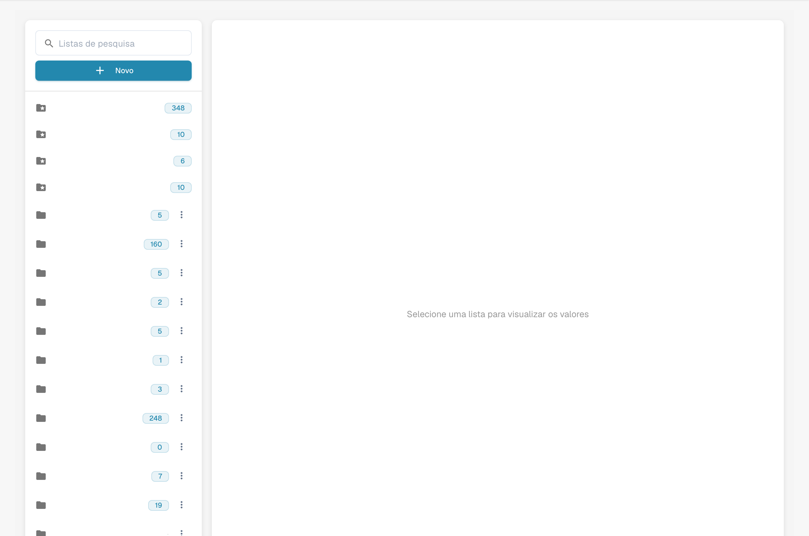

# Listas de valores

As listas de valores contêm opções predefinidas para os campos dos documentos. Um campo pode utilizar uma lista para apresentar opções durante a validação. Os rótulos podem ser traduzidos; o valor técnico é igual em todos os idiomas.

## Abrir as listas

Abra os dados mestre e as listas de valores nas definições. Selecione uma lista para consultar os valores. Os nomes configurados estão ocultos.

<figure><figcaption>
Listas de valores com nomes configurados ocultos.
</figcaption></figure>

## Criar uma lista

1. Escolha a opção de criar uma lista.
2. Introduza um nome e limite a lista a uma suborganização, se necessário.
3. Verifique os dados antes de guardar.

As listas predefinidas são fornecidas pelo sistema e não podem ser eliminadas. Antes de eliminar uma lista própria, verifique os campos que a utilizam: a ação pode ter efeito imediato.

## Adicionar e alterar valores

Abra a lista pretendida e adicione uma linha. Verifique cada propriedade:

| Propriedade | Significado |
| --- | --- |
| Valor | Valor técnico guardado pelo DocBits, igual para todos os idiomas. |
| Rótulo | Texto do idioma selecionado. Sem rótulo para o idioma ativo, aparece o valor técnico. |
| Idioma | Idioma do rótulo. |
| Suborganizações | Âmbito de disponibilidade; sem restrição, o valor aplica-se a todas as suborganizações. |
| Sinónimos | Variantes do valor, como EURO e € para EUR. Confirme cada sinónimo no campo previsto. |

Verifique todas as propriedades antes de guardar. As ações de edição e eliminação dependem das permissões e do valor selecionado. Os valores do sistema não podem ser eliminados.

## Importar CSV

Abra as ações da lista e escolha a importação CSV. Selecione o ficheiro e o separador correto, como `;` ou `,`. Verifique a estrutura e o conteúdo antes de importar.

## Adicionar traduções

Adicione um idioma ao valor e introduza o rótulo pretendido. Repita para os outros idiomas necessários, verifique tudo e guarde. Pode adicionar rótulos traduzidos aos valores do sistema que não podem ser eliminados.

Um rótulo traduzido não altera o valor técnico. Após as alterações pretendidas, verifique o campo na validação e no idioma escolhido. A imagem mostra a consulta das listas e não comprova alterações guardadas nem uma importação executada.
