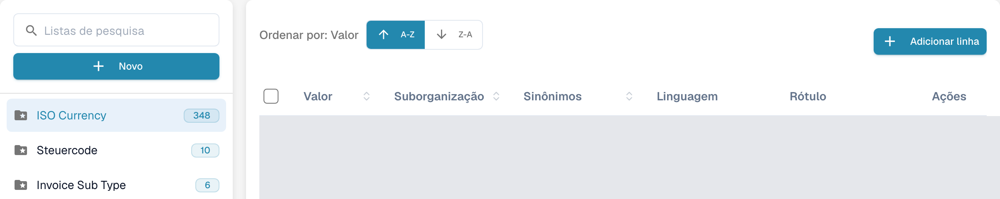
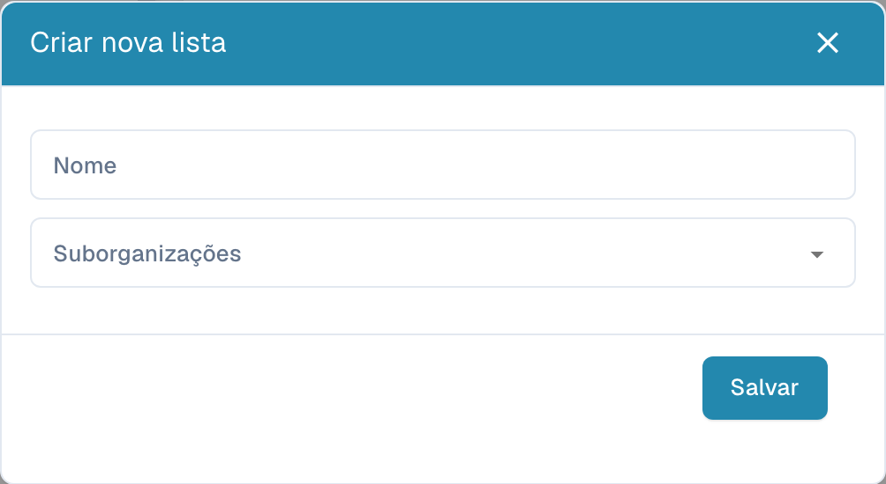
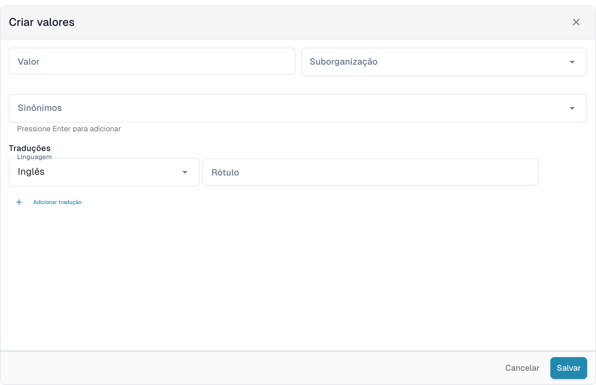

# Listas de valores

## Vídeo tutorial: Dados mestres e listas de valores


Fontes de dados mestres, listas de valores e configurações de dados mestre no DocBits


O vídeo mostra as fontes de dados mestres, as listas de valores e as configurações de dados mestre de um tipo de documento.

As listas de valores contêm opções predefinidas para os campos dos documentos. Um campo pode utilizar uma lista para apresentar opções durante a validação. Os rótulos podem ser traduzidos; o valor técnico é igual em todos os idiomas.

## Abrir as listas

Nas definições, abra os dados mestre e selecione as listas de valores. O campo **Listas de pesquisa**, à esquerda, permite encontrar uma lista. Selecione o nome para abrir os valores à direita. Uma pasta com uma estrela identifica uma lista do sistema; o número junto ao nome indica a quantidade de valores carregados.

<figure><figcaption>
Listas de valores com nomes configurados ocultos.
</figcaption></figure>

<figure><figcaption>
A lista do sistema selecionada abre a tabela de valores. A-Z e Z-A ordenam os valores; Adicionar linha abre o formulário. Valores e nomes próprios estão ocultos; os nomes de listas do sistema, como ISO Currency, são dados existentes.
</figcaption></figure>

## Criar uma lista

1. Selecione **Novo** acima dos nomes das listas.
2. Introduza o **Nome** e, se necessário, selecione **Suborganizações** para limitar o âmbito da lista.
3. **Salvar** cria a lista. O **X** fecha a janela sem criar uma lista.

<figure><figcaption>
Novo abre a janela vazia Criar nova lista com Nome, Suborganizações, X e Salvar. Esta vista não apresenta uma lista guardada.
</figcaption></figure>

Para eliminar uma lista criada pela sua organização, utilize a opção de eliminação no menu de três pontos junto ao nome e confirme apenas a lista pretendida. As listas do sistema não apresentam esse menu de eliminação e não podem ser eliminadas.

## Adicionar e alterar valores

1. Selecione a lista à esquerda e depois **Adicionar linha** acima da tabela.
2. Introduza o **Valor** técnico e, se necessário, a **Suborganização**.
3. Adicione os **Sinônimos** pretendidos. Confirme cada um com **Enter** para o adicionar ao campo.
4. Em **Traduções**, selecione **Linguagem** e preencha um **Rótulo** não vazio. Um novo valor exige pelo menos uma tradução completa.
5. **Salvar** cria o valor. **Cancelar** ou o **X** fecha o formulário sem guardar.

<figure><figcaption>
Adicionar linha abre Criar valores abaixo da tabela: Valor, Suborganização, Sinônimos, Linguagem, Rótulo e Adicionar tradução. Salvar cria o valor; Cancelar descarta o rascunho não guardado.
</figcaption></figure>

Para editar um valor, selecione a linha ou a opção de edição em **Ações**. Os campos protegidos permanecem apenas de leitura; o valor técnico também pode estar bloqueado quando já existem traduções. **Cancelar** descarta alterações não guardadas.

A opção de duplicação no menu da linha cria outro valor. Para copiar vários valores, selecione as respetivas caixas e utilize o botão de cópia acima da tabela. A eliminação está disponível para valores da sua organização e remove o valor selecionado; os valores do sistema não apresentam esta ação. Uma lista do sistema pode conter valores protegidos e valores da sua organização.

## Importar CSV

Esta interface não oferece a antiga importação CSV a partir do menu **Ações**. Os passos antigos de carregamento de CSV não se aplicam a este ecrã; utilize **Adicionar linha** para introduzir valores aqui.

## Adicionar traduções

No formulário do valor, selecione **Linguagem** e introduza o **Rótulo**. Utilize **Adicionar tradução** para acrescentar outro idioma e o respetivo rótulo. Preencha ou remova as linhas de tradução adicionais vazias antes de guardar. Quando uma linha de tradução pode ser removida, o respetivo caixote do lixo retira-a primeiro do formulário; guarde para aplicar a alteração.

O texto apresentado pode variar conforme o idioma, mas o valor técnico permanece igual. Sem um rótulo para o idioma ativo, aparece o valor técnico. Os valores do sistema e as traduções herdadas podem ter campos protegidos; altere apenas dados da sua organização cujos campos sejam editáveis.
