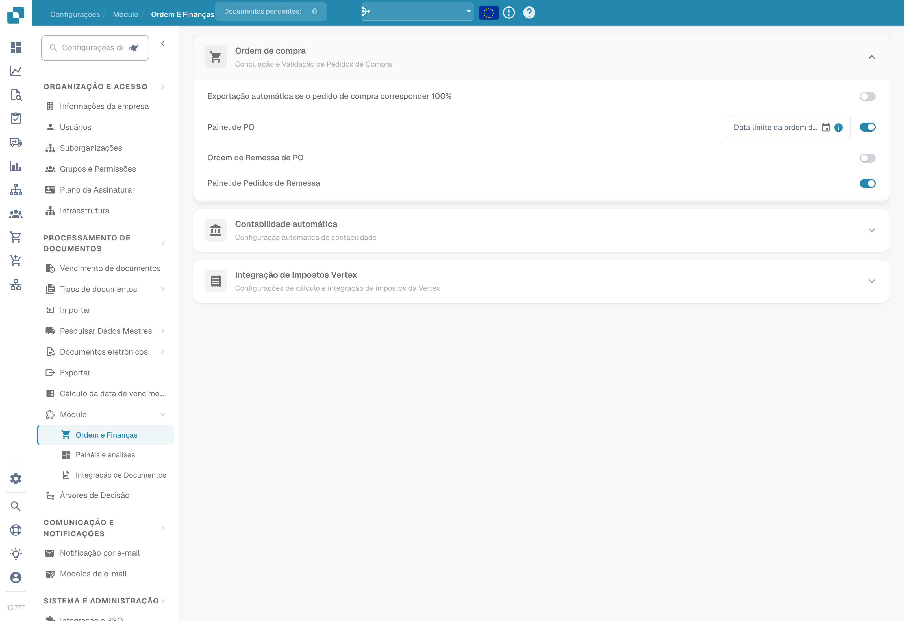
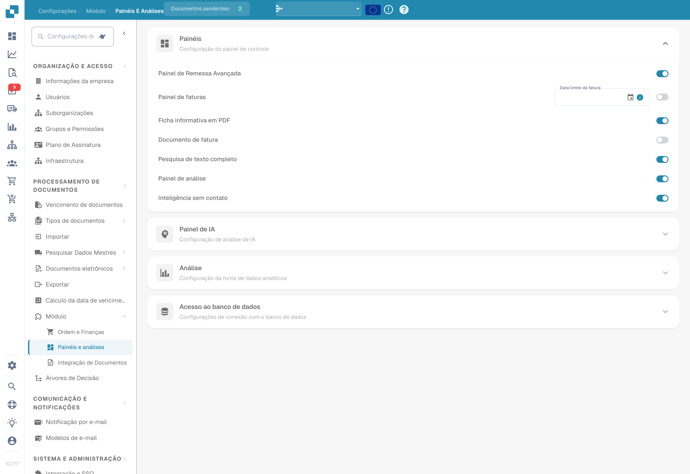

# Módulos

<figure><figcaption>
Módulos de ordens e finanças no estado de configuração existente.
</figcaption></figure>

<figure><figcaption>
Módulos de integração de documentos: scripts, digitalização, códigos de barras e dados mestre personalizados. A etiqueta Select do seletor de códigos de barras mantém-se em inglês na versão ilustrada.
</figcaption></figure>

<figure><figcaption>
Módulos de painéis e análises no estado de configuração existente.
</figcaption></figure>

A página Module permite ativar ou desativar recursos opcionais no DocBits. Cada seção agrupa módulos relacionados que podem ser ativados ou desativados.

## Pedido de compra

Configurações de PO Matching e validação.

| Configuração | Descrição |
|---------|-------------|
| **Auto Export if PO matched 100%** | Exporta o documento automaticamente quando o PO Matching atinge 100%. |
| **PO Dashboard** | Ativa o painel de pedidos de compra. Inclui o campo **PO Date Limit** para restringir os dados de pedidos de compra por data. |
| **PO Shipment Order** | Ativa o processamento de ordens de remessa vinculadas a pedidos de compra. |
| **Shipment Order Dashboard** | Ativa um painel dedicado para ordens de remessa. |

## Contabilidade automática

| Configuração | Descrição |
|---------|-------------|
| **Auto Accounting** | Ativa a contabilização automática de documentos. Selecione o tipo de ERP (por exemplo, LN, M3). |

## Painéis

| Configuração | Descrição |
|---------|-------------|
| **Advance Shipment Dashboard** | Painel para monitorar atividades de remessa antecipada. |
| **Invoice Dashboard** | Painel para monitoramento e análise de faturas. |
| **Full Text Search** | Ativa a pesquisa de texto completo em todos os documentos. |
| **Analytics Dashboard** | Ativa o painel de visão geral de análises. |

## Database Access

| Configuração | Descrição |
|---------|-------------|
| **DB Access** | Ativa o acesso direto ao banco de dados para a organização. |

## AI Dashboard

| Configuração | Descrição |
|---------|-------------|
| **AI Document Warehouse** | Análises do depósito de documentos com tecnologia de IA. |
| **Dashboard v2** | Painel atualizado com recursos aprimorados. |
| **Clickhouse Direct Access** | Ativa o acesso direto ao banco de dados Clickhouse. |
| **Supplier Statistics** | Ativa estatísticas e relatórios por fornecedor. |

## Expedição e fornecedores

| Configuração | Descrição |
|---------|-------------|
| **Supplier Portal** | Ativa o portal do fornecedor para colaboração com fornecedores. |

## Document Type

| Configuração | Descrição |
|---------|-------------|
| **Workflow Builder** | Crie e personalize workflows de processamento de documentos. |
| **Annotation Mode** | Permite que os usuários anotem documentos na tela de validação. |
| **Show Report** | Ativa a geração de relatórios para documentos. |
| **Inbound Emails** | Ativa o tratamento de e-mails de entrada por tipo de documento. |
| **Models & Labels** | Gerencie modelos de IA e rótulos para o reconhecimento de documentos. |
| **Document Script** | Ativa scripts personalizados para o processamento de documentos. |
| **Document Scan** | Ativa a funcionalidade de digitalização de documentos. |
| **Bar-Code/QR Code Extraction** | Extrai dados de código de barras/QR code dos documentos. Selecione os tipos de código compatíveis. |
| **Custom Master Data** | Ativa campos personalizados de dados mestres. |
| **Tasks & Notifications** | Ativa os recursos de gerenciamento de tarefas e de notificações. Inclui a opção **Dashboard Tasks Count**. |
| **DocBits Operator** | Ativa o recurso de automação de navegador DocBits Operator. |
| **DocNet** | Ativa a rede de documentos DocNet. |
| **IDM ACL Updater** | Atualiza as listas de controle de acesso do Infor Document Management. Envie um arquivo ION-Mapping e configure os mapeamentos de Infor-Doctype para ACL. |
| **Barcode Assignment** | Ativa a atribuição de códigos de barras a documentos. |
| **Set Negative Sign For Credit Notes** | Aplica automaticamente sinais negativos aos valores de notas de crédito. |

## Fluxo de ligação BOD

| Configuração | Descrição |
|---------|-------------|
| **BOD Connection Stream** | Ativa a integração de BOD (Business Object Document). Mostra o **Stream Name** usado na conexão. |

## Analytics

| Configuração | Descrição |
|---------|-------------|
| **Use PostgreSQL for Quality Analytics** | Alterna entre Prometheus (em tempo real, reinicia a cada deploy) e PostgreSQL (persistente por 90 dias, análise de tendências, campos com pior desempenho). |

## Integração fiscal Vertex

| Configuração | Descrição |
|---------|-------------|
| **Vertex Tax Integration** | Ativa o cálculo de impostos do Vertex. Configure **Base URL**, **Client ID** e **Client Secret**. Use **Test Connection** para verificar. |
