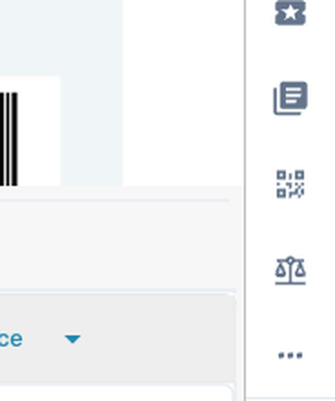
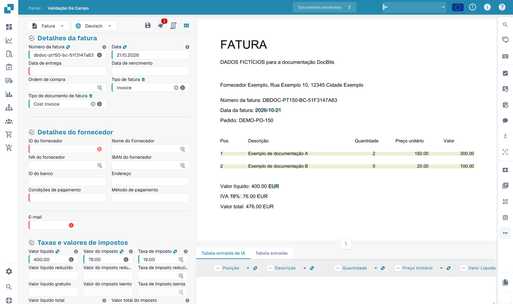
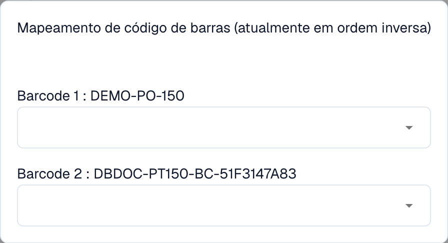
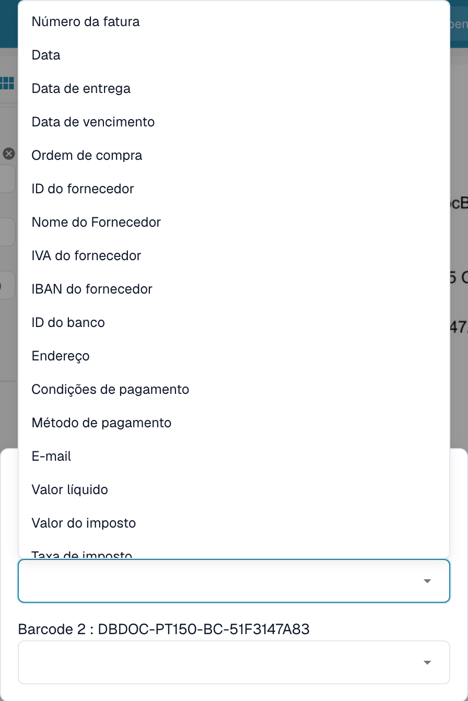
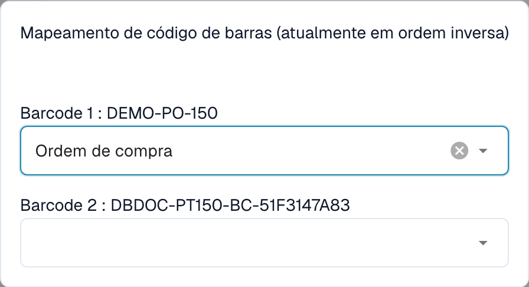
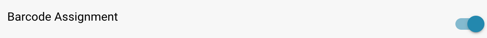

# Atribuição por código de barras

### Visão geral

A configuração **Atribuição por código de barras** (Barcode Assignment) adiciona uma ferramenta de código de barras à **tela de validação de documentos**. Ela lê os códigos de barras e códigos QR encontrados em um documento e permite que você **atribua os valores deles aos campos do documento** — por exemplo, preencher um número de pedido, de referência ou de nota de entrega a partir de um código de barras em vez de digitá-lo.

Esta configuração está **desativada por padrão**.

### O que você obtém ao ativá-la

Assim que a configuração está ativada, um novo **botão de código de barras** (um ícone de código QR) aparece na barra de ferramentas do lado direito da **tela de validação** (`/field_validation_v1/…`). Este botão é o ponto de entrada de todo o recurso — sem a configuração, o ícone permanece oculto.

<figure><figcaption>
Com a configuração ativada, o ícone de código de barras aparece na barra de ferramentas de validação.
</figcaption></figure>

Aqui está o ícone em contexto na tela de validação, ao lado do documento em revisão:

<figure><figcaption>
Validação de uma fatura fictícia com código de barras e código QR.
</figcaption></figure>

### Como os códigos de barras são lidos

O DocBits detecta os códigos de barras durante o processamento do documento e oferece os valores decodificados deles para atribuição. Um mesmo documento pode conter vários tipos de código de barras — por exemplo, um **código QR**, um **Code 128** e um **EAN-13** — cada um codificando um valor diferente, como um número de pedido, um número de fatura ou um GLN do fornecedor.

<figure><figcaption>
Exemplo de fatura de demonstração do DocBits contendo três tipos de código de barras (código QR → número de pedido, Code 128 → número de fatura, EAN-13 → GLN do fornecedor), cada um codificando um valor que você pode atribuir a um campo.
</figcaption></figure>


Quais tipos de código de barras são detectados é controlado pela configuração **Bar-Code / QR Code Extraction** (`Barcode Extraction Types`). Se a caixa de diálogo exibir *“no barcodes extracted found”*, verifique se a extração de códigos de barras está ativada e se os tipos esperados (por exemplo, `QRCODE`, `CODE128`, `EAN13`) estão selecionados. Consulte [Bar-Code / QR Code Extraction](bar-code-qr-code-extraction/README.md).


### Usando a caixa de diálogo de Atribuição por código de barras

1. Abra um documento na **tela de validação**.
2. Clique no **ícone de código de barras** na barra de ferramentas à direita.
3. A caixa de diálogo **Atribuição por código de barras** lista cada código de barras que o DocBits detectou no documento, exibido como `Barcode <n> : <valor>`.

<figure><figcaption>
Associar códigos de barras lidos aos campos do documento.
</figcaption></figure>

4. Para cada código de barras, abra a lista suspensa e escolha o campo para o qual o valor deve ir.

<figure><figcaption>
Campos disponíveis na janela de associação dos códigos de barras.
</figcaption></figure>

5. Assim que você seleciona um campo, ele é preenchido com o valor do código de barras.

<figure><figcaption>
Associação ao campo da ordem de compra sem guardar.
</figcaption></figure>

### Como ativar

1. Vá para **Configurações**.
2. Selecione **Processamento de Documentos**.
3. Selecione **Módulo**.
4. Abra a seção **Tipo de Documento**.
5. Encontre **Atribuição por código de barras** e ligue o botão.

<figure><figcaption>
O botão de Atribuição por código de barras em Configurações → Processamento de Documentos → Módulo.
</figcaption></figure>

### Benefícios

* **Entrada mais rápida e sem erros**: Pegue os valores diretamente de um código de barras em vez de lê-los e digitá-los manualmente.
* **Menos erros de digitação**: Um valor escaneado é exatamente o que está codificado no código de barras.
* **Mantém o controle**: Você decide qual código de barras vai em qual campo durante a validação.

### Quando usar este recurso

* **Documentos com códigos de barras**: Quando os seus documentos têm códigos de barras/QR cujos valores pertencem a campos específicos (por exemplo, números de pedido ou de referência).
* **Fluxos de validação manual**: Quando uma pessoa revisa documentos e quer preencher campos rapidamente a partir dos códigos de barras.
* **Deixe desativado** se os seus documentos não tiverem códigos de barras utilizáveis, ou se você só precisar da **extração** automática de códigos de barras/QR — consulte [Bar-Code / QR Code Extraction](bar-code-qr-code-extraction/README.md).


**Isto serve para ler um valor de código de barras/QR e atribuí-lo a um campo durante a validação.** A extração automática de dados estruturados de códigos de pagamento (como Swiss QR Bill ou GiroCode) — e a divisão de um arquivo de várias páginas nas páginas separadoras com código de barras — são tratadas por uma configuração **diferente**: [Bar-Code / QR Code Extraction](bar-code-qr-code-extraction/README.md).

