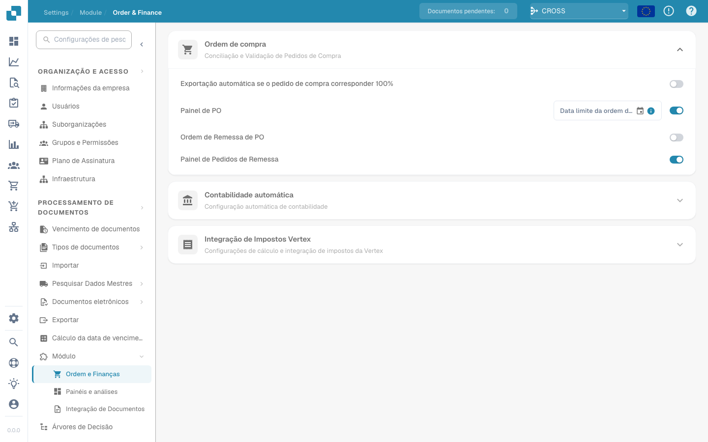

# Atualização das ACL do IDM

## Visão geral

O módulo ACL-Updater atualiza e gere as listas de controlo de acesso (ACL) no DocBits, mantendo as permissões de acesso e tratamento dos documentos.

## Instruções de ativação

Para ativar o módulo ACL-Updater:

1. Abra **Configurações**.
2. Selecione **Processamento de documentos**.
3. Selecione **Módulo**.
4. Abra **Tipo de documento**.
5. Ative **IDM ACL-Updater** no respetivo interruptor.

Depois de ativar o módulo, pode selecionar um **ficheiro de mapeamento ION**.

<figure><figcaption></figcaption></figure>

### Adicionar informação de ACL

Clique em **Adicionar** e indique os dados seguintes:

* **Tipo de documento IDM**
* **Estado atual da ACL do IDM**
* **Novo estado da ACL do IDM**

<figure><figcaption></figcaption></figure>

