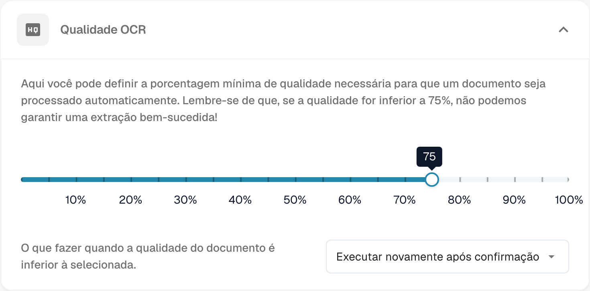
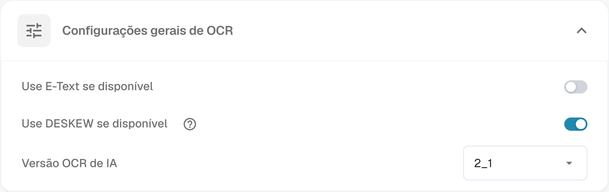
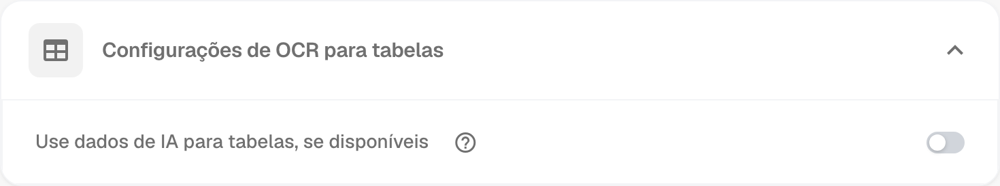
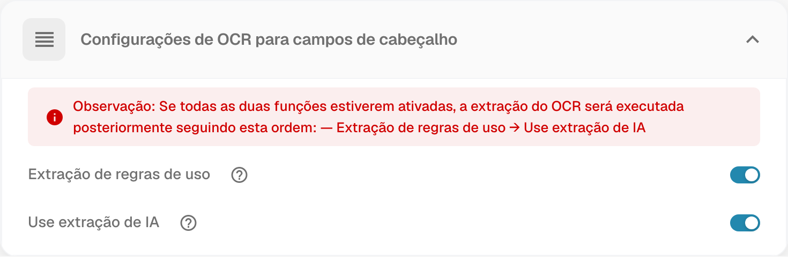

# Configurações OCR


OCR e texto eletrónico no DocBits: vista OCR, modo de depuração, qualidade, correção de inclinação e extração de cabeçalho


Neste vídeo, aprenderá como o OCR e o texto eletrónico funcionam no DocBits e como os configurar para melhorar a precisão da extração.

O DocBits suporta duas formas de ler texto:
*   **OCR (reconhecimento ótico de caracteres):** lê o texto impresso dos documentos digitalizados e converte-o em dados que pode validar.
*   **Texto eletrónico:** utiliza uma camada de texto interna existente, quando disponível, para extrair os dados diretamente, sem OCR.

**O que irá aprender:**
*   Como abrir a vista OCR no ecrã de validação
*   Como mudar para o modo de depuração para inspecionar os detalhes da extração OCR
*   Como comparar os resultados extraídos com o documento original
*   Como ativar o texto eletrónico para um fornecedor específico (Use E-text if available)
*   Como o DocBits usa primeiro o texto eletrónico e recorre ao OCR quando não existe uma camada de texto
*   As principais configurações OCR: qualidade mínima e comportamento quando a qualidade é demasiado baixa
*   Ativar o texto eletrónico global para todos os fornecedores, quando disponível
*   Ativar o DESKEW para endireitar automaticamente digitalizações inclinadas
*   Escolher a versão OCR mais adequada aos seus documentos
*   Forçar o OCR para extrair tabelas, mesmo quando existe texto eletrónico
*   **Opções de extração de cabeçalho:**
    *   Extração por regras predefinidas
    *   Extração por IA (deteção automática)
    *   Ordem de execução quando ambas estão ativas: regras → IA
    *   Recomendação: manter ambas ativas para obter a melhor precisão

## Visão geral

Nas configurações de **OCR (reconhecimento ótico de caracteres)**, pode definir como o OCR é aplicado no processamento de documentos: qualidade mínima exigida, utilização de texto eletrónico incorporado, versão OCR e outras opções. Esta página explica as configurações disponíveis.

## Como aceder às configurações OCR

Para aceder às configurações OCR:

*   Abra: **Configurações** → **Processamento de documentos** → **Configurações OCR**

## Qualidade OCR

Nesta secção, pode ajustar o controlo deslizante para definir a qualidade mínima dos documentos para o processamento OCR. Mova-o para a esquerda para reduzir o limite ou para a direita para o aumentar.

Se um documento não atingir a qualidade definida, o DocBits oferece três opções:

* **Executar mesmo assim**\
  O documento é processado independentemente da sua qualidade.
* **Executar novamente após confirmação**\
  O **DocBits** faz uma pausa e pede que confirme se pretende continuar o processamento.
* **Apresentar erro**\
  O processamento é interrompido e é apresentada uma mensagem de erro a indicar que o documento não atingiu a qualidade mínima exigida.

<figure><figcaption>
Qualidade OCR: limite mínimo de qualidade e opção de processamento quando o documento não atinge esse limite.
</figcaption></figure>

## Configurações gerais de OCR

* **Utilizar texto eletrónico, se disponível**\
  Quando esta opção está ativa, o **DocBits** utiliza o texto eletrónico incorporado, por exemplo num PDF, em vez de executar OCR. A extração direta do texto melhora a velocidade e a precisão.
* **Utilizar DESKEW, se disponível**\
  Esta opção corrige automaticamente a orientação dos documentos digitalizados. Endireitar imagens inclinadas ajuda a melhorar a precisão do OCR.
*   **Versão OCR de IA**\
    Permite selecionar uma versão específica do motor OCR baseado em IA.\
    Isto pode ser útil se:

    * Não estiver a obter os resultados pretendidos com a versão selecionada.
    * Estiver a investigar problemas de desempenho ou precisão do OCR.

<figure><figcaption>
Configurações gerais de OCR: utilização de E-Text, correção de inclinação com DESKEW e seleção da versão OCR de IA.
</figcaption></figure>

## Configurações OCR para tabelas

* **Utilizar dados de IA para tabelas, se disponíveis**\
  Quando esta opção está ativa, o DocBits utiliza os dados OCR nas tabelas em vez do texto eletrónico incorporado, mesmo que **Utilizar texto eletrónico, se disponível** esteja ativa.

<figure><figcaption>
Configurações de OCR para tabelas: opção de utilização de dados de IA quando disponíveis.
</figcaption></figure>

## Configurações OCR para campos de cabeçalho

* **Utilizar extração por regras**\
  O DocBits aplica as regras de extração predefinidas para identificar os campos de cabeçalho.
* **Utilizar extração por IA**\
  O DocBits utiliza IA para detetar e extrair automaticamente os campos de cabeçalho.

**Ordem de execução:**\
Se ambas as opções estiverem ativas, o **DocBits** executa a extração nesta ordem:\
**Extração por regras → Extração por IA**\
\
<mark style="color:red;">**Nota**</mark>: para obter os melhores resultados e um comportamento consistente, ative ambas as opções. Isto permite ao **DocBits** combinar a extração por regras e por IA nos campos de cabeçalho.

<figure><figcaption>
Configurações de OCR para campos de cabeçalho: extração por regras e por IA, com a ordem de execução indicada.
</figcaption></figure>
